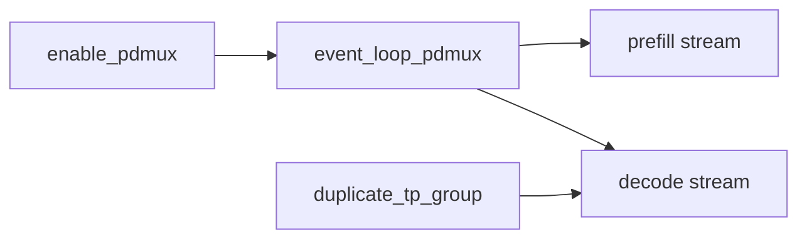
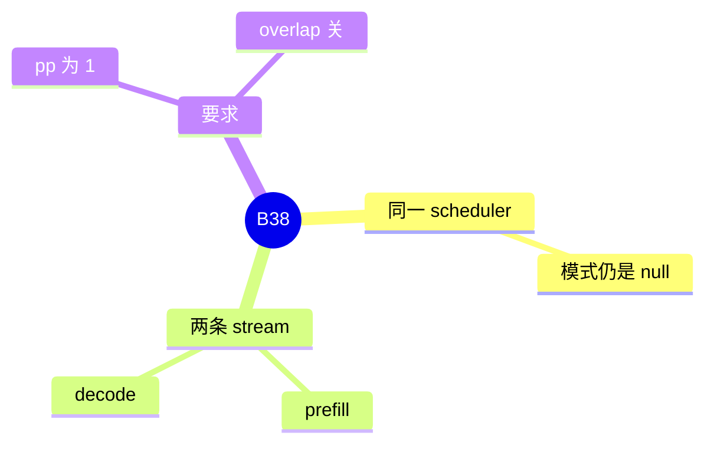

# PD mux

对应 B38。树是 `297e54fd105e974cdf401e5b4d20253a22c16f90`。**源码路径推断，未实测**。

## 场景与硬件

同一进程里既做 prefill 又做 decode，用两条 stream 把它们隔开，而不是拆成两个 `disaggregation_mode`。开关 `enable_pdmux`。条件：模式仍是 `null`，`pp_size=1`，overlap schedule 关掉。`initialize_model_parallel(..., duplicate_tp_group=enable_pdmux)` 为第二条 stream 复制 TP 组。

UNO 的处理函数禁止 PD mux。没有单独的 GPU 代数门。

## 在框架中的位置

## 原理

分离 PD 用两进程传 KV。Mux 把两种批放在一个进程的两个流上，KV 不用出卡。复制 TP 组是为了两条流的集合通信不要共用一个 NCCL group 的状态。Overlap schedule 已经在用「上一批结果和当前前向」的时间缝，和 mux 的双流调度叠在一起会被关掉。

## 过程

1. 旗标打开，检查 PP 和 overlap。
2. 分布式初始化复制 TP 组。
3. `event_loop_pdmux` 在两条流上分别组 prefill 和 decode。

## 调用栈

| 函数 | 做什么 | 角色 |
| --- | --- | --- |
| `enable_pdmux` 的校验 | PP=1，overlap 关，模式 null | 解析 |
| `initialize_model_parallel` | `duplicate_tp_group` | 通信组 |
| `event_loop_pdmux` | 双流循环 | 调度，F151、F186 |

## 待核

两条流如何共享同一棵 radix，以 `event_loop_pdmux` 里对 `tree_cache` 的加锁为准。本页没有逐步跟锁。

返回 [本目录 README](README.md)。
