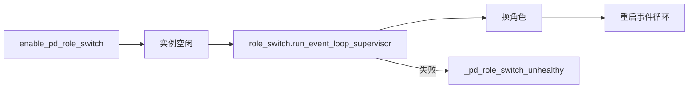
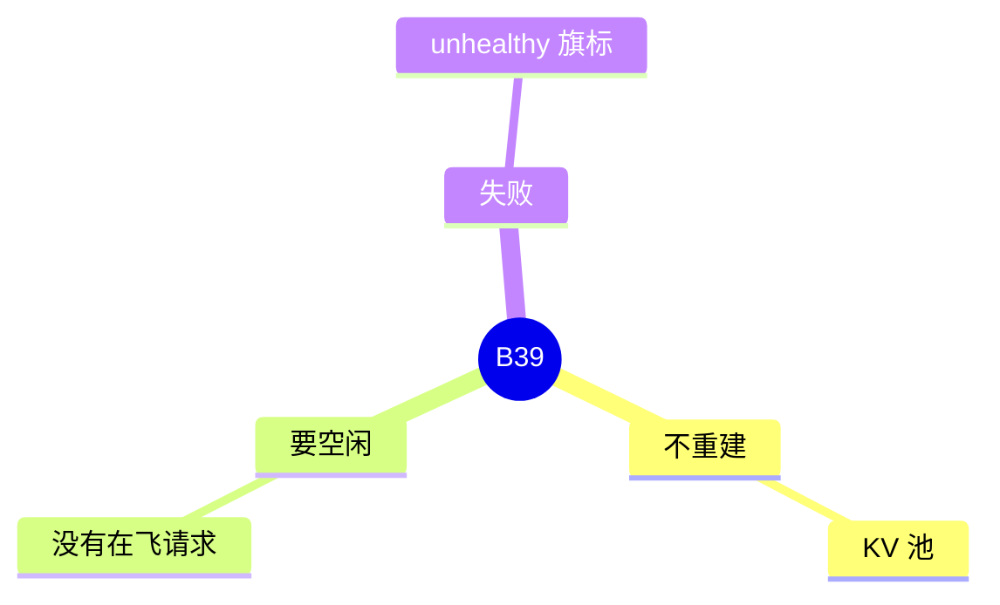

# PD 角色切换

对应 B39。树是 `297e54fd105e974cdf401e5b4d20253a22c16f90`。**源码路径推断，未实测**。

## 场景与硬件

一个已经跑起来的 PD 进程，在空闲时从 prefill 换成 decode，或反过来，而不重建 KV 池。开关 `enable_pd_role_switch`。失败会把 `_pd_role_switch_unhealthy` 置上，之后健康检查应看见不健康。

和 host-receive、HiSparse 一类组合在 PD hook 里冲突。没有 GPU 代数门。实例必须先空闲，才能拆角色结构（F150、F185）。

## 在框架中的位置

## 原理

角色决定事件循环和队列，不决定池的大小。切换时拆掉旧角色的 bootstrap / prealloc 结构，换循环，池和已加载的权重留下。Supervisor 包住这次重启。中途失败不能留在半个角色上，所以置 unhealthy，而不是悄悄继续旧循环。

## 过程

1. 旗标在启动时通过与其它 PD 选项的检查。
2. 运行中收到切换请求。实例空闲才进入 supervisor。
3. 成功则新循环开始。失败则标记不健康。

## 调用栈

| 函数 | 做什么 | 角色 |
| --- | --- | --- |
| `enable_pd_role_switch` 的解析 | 与传输、HiSparse 等冲突检查 | 启动 |
| `run_event_loop_supervisor` | 空闲时换角色并重启循环 | 运行 |
| `_pd_role_switch_unhealthy` | 失败标记 | 健康 |

## 待核

切换请求从哪个 HTTP 路径进来，本页没有在 `http_server.py` 里点名。流程篇 F185 写的是调度侧。控制面路径标待核。

返回 [本目录 README](README.md)。
