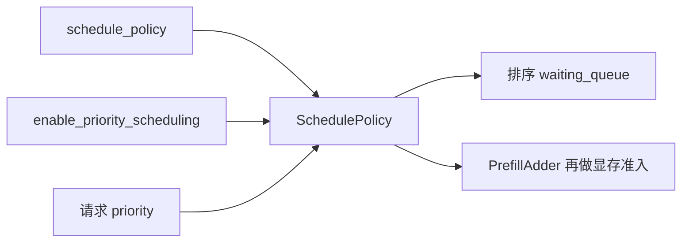
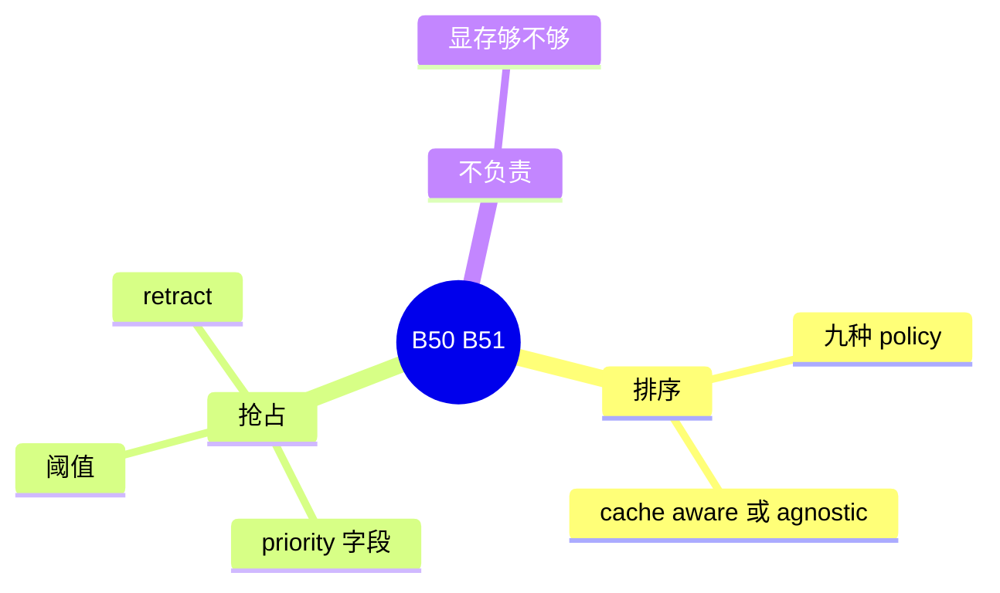

# 优先级与调度策略

对应 B50、B51。树是 `297e54fd105e974cdf401e5b4d20253a22c16f90`。**源码路径推断，未实测**。

队列和 `SchedulePolicy` 只排序、不组 batch，见 [02-队列与策略](../../02-流程/03-调度与推理/02-队列与策略.md)（F158）。本页写策略名字和优先级抢占。

## 场景与硬件

等待队列里有很多请求时，按哪种顺序上车。`--schedule-policy` 的取值：`lpm`，`random`，`fcfs`，`dfs-weight`，`lof`，`priority`，`routing-key`，`hrrn`，`shortest-prefill-first`。

另有 `--enable-priority-scheduling` 和 `priority_scheduling_preemption_threshold`。请求字段 `priority`。`validation_hook` 把优先级调度和 `fcfs` / `lof` 耦在一起。高优先级可以抢占已经在跑的低优先级请求，被抢占的走 retract，KV 备份或放弃，见调度篇的显存不够路径。

没有 GPU 门。排序在 CPU 上。

策略实现分 `CacheAwarePolicy` 和 `CacheAgnosticPolicy`。LPM 一类会看前缀命中，agnostic 的不看。Cache-agnostic 且支持快速匹配时，`calc_priority` 里仍可能调 `match_kv_cache`，只为了负载快照，不一定用命中长度来排序。

## 在框架中的位置

## 原理

`SchedulePolicy` 只决定等待队列的顺序。谁真的能进本轮 batch，还要过 `PrefillAdder` 的 token 预算和空闲页。优先级抢占是在这个顺序之外，把 running 里低优先级的请求赶回队列，腾出页给高优先级。阈值决定差多少才抢。

## 过程

1. 解析期定策略名。优先级开关若与策略不耦合则被 hook 拒绝。
2. 每轮 `calc_priority` 给等待请求打分。
3. 需要前缀长度的策略先 `match_kv_cache`。
4. 若开启抢占且分差超过阈值，retract 低优先级 running 请求。
5. `PrefillAdder` 按新顺序准入。

## 调用栈

| 函数 | 做什么 | 角色 |
| --- | --- | --- |
| `--schedule-policy` | 九个枚举值 | 配置 |
| `SchedulePolicy.calc_priority` | 打分，可能附带匹配 | 排序 |
| `enable_priority_scheduling` | 打开抢占 | B50 |
| retract 路径 | 备份或放弃 KV，回等待队列 | 抢占的执行 |

## 待核

每种策略的精确键（例如 lpm 是最长前缀还是最长匹配页）以 `schedule_policy.py` 的分支为准。本页列出了枚举，没有逐个写比较键。`priority` 作为策略名和 `enable_priority_scheduling` 同时存在，两者的分工标待核。

返回 [本目录 README](README.md)。
