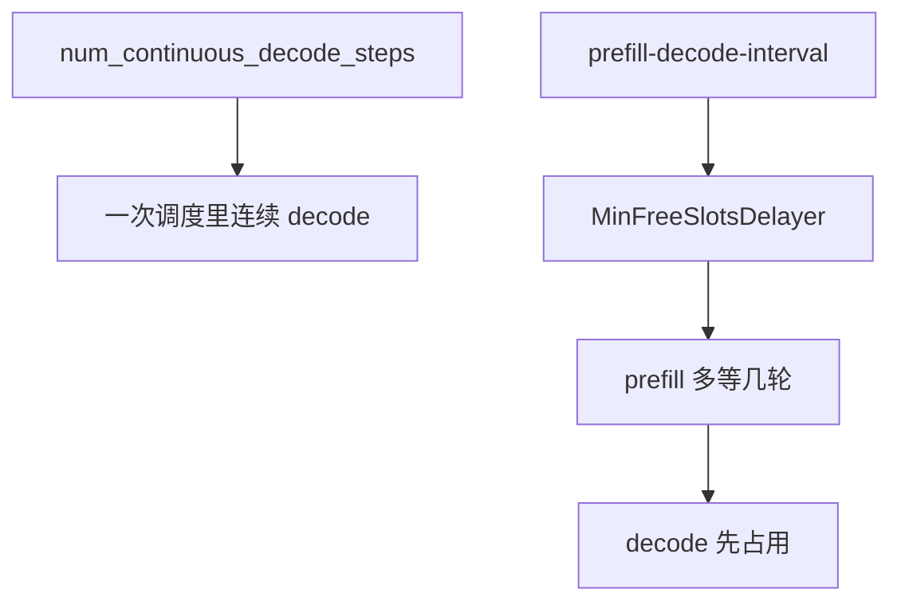
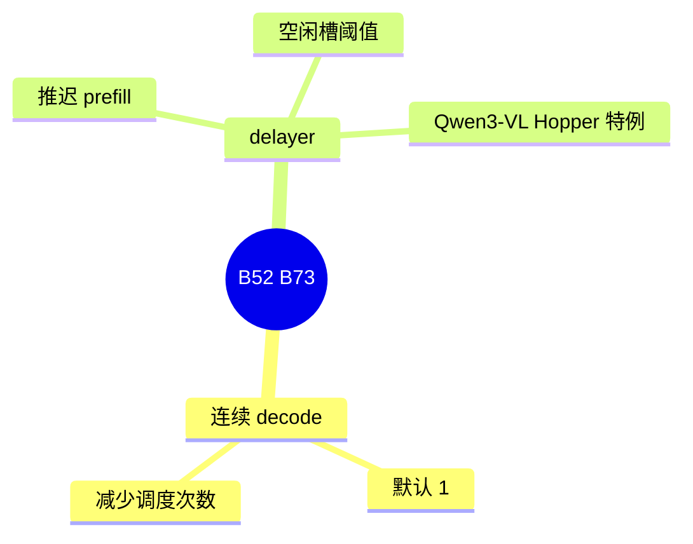

# 连续 decode 与 prefill delayer

对应 B52、B73。树是 `297e54fd105e974cdf401e5b4d20253a22c16f90`。**源码路径推断，未实测**。

## 场景与硬件

Decode 一步往往比调度本身短。`num_continuous_decode_steps` 让一次调度连续跑多步 decode，默认 1。help 说的是用步数换调度开销，代价是新 prefill 要多等这几步。

Prefill delayer 则是反过来：故意推迟 prefill，让 decode 先把空槽填上。`--prefill-decode-interval`，默认关。help 写 Qwen3-VL 在 Hopper 上有特例。实现有 `MinFreeSlotsDelayer` 和 `handle_prefill_delayer_env_compat`。

没有通用的 GPU 白名单。Hopper 特例是 help 里对 Qwen3-VL 的说明，不是所有模型的门。

## 在框架中的位置

## 原理

连续 decode 在已经组好的 running batch 上多跑几步，不回到「先看看有没有新 prefill」的决策。投机的步数若也大于 1，两套「多步」叠在同一轮里。清单把这个交互标成待核，本页保持待核。

Delayer 看空闲槽。槽太少时不放新的 prefill 进来，避免 prefill 把 decode 的页抢走。`handle_prefill_delayer_env_compat` 在流水线早期把旧环境变量收成现在的字段。

## 过程

1. 两个字段在解析期定稿。
2. 调度循环若连续步数大于 1，在同一 running batch 上重复 decode 准备和前向。
3. Delayer 在取新 prefill 之前看空闲槽和 interval，不满足就跳过这一轮的 prefill。

## 调用栈

| 函数 | 做什么 | 角色 |
| --- | --- | --- |
| `num_continuous_decode_steps` | 一次调度的 decode 步数 | B52 |
| `handle_prefill_delayer_env_compat` | 旧环境变量 | B73 |
| `MinFreeSlotsDelayer` | 按空闲槽推迟 prefill | B73 |
| `prefill_decode_interval` | 间隔 | 配置 |

## 待核

连续步数与 overlap、投机步数的组合没有在循环里跟完。Hopper 特例是改默认值还是改内核，以 help 旁边的 override 为准。

返回 [本目录 README](README.md)。
