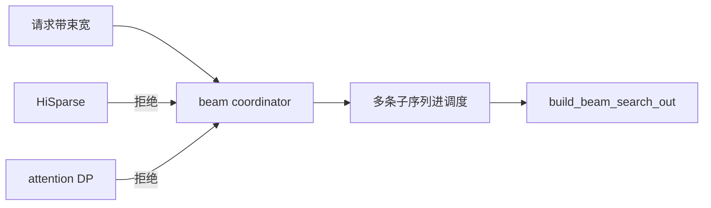
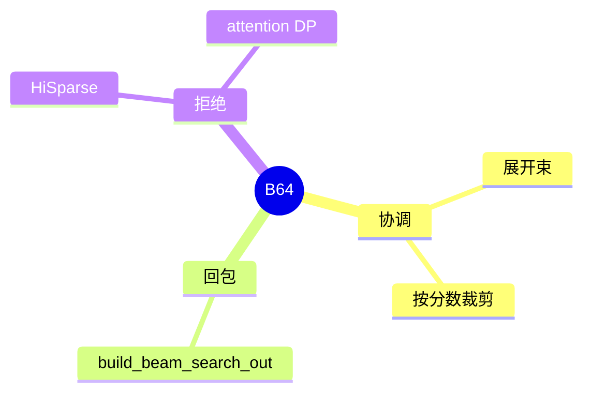

# Beam search

对应 B64。树是 `297e54fd105e974cdf401e5b4d20253a22c16f90`。**源码路径推断，未实测**。

## 场景与硬件

一条请求保留多条候选，每步按分数留宽束。请求字段在附录 06，本页不抄字段表。实现在 `beam_search/coordinator.py`，回包用 `build_beam_search_out`。

协调器在启动或请求进入时拒绝两种组合：

| 条件 | 文案 |
| --- | --- |
| `enable_hisparse` | Beam search is not supported with hisparse. |
| attention DP | Beam search is not supported with dp attention. |

没有 GPU 代数门。束宽带来的 KV 倍数由每条束自己的请求槽承担。

## 在框架中的位置

## 原理

普通 decode 一条请求一个槽。Beam 在每步把一条请求展开成多条，再剪回束宽。KV 不能简单共享到分叉之后，所以协调器要在分叉点复制或 COW。HiSparse 的 host 换页按单链 top-k 设计，多束对不上，因此直接拒绝。Attention DP 把请求分到不同 scheduler，一条束的兄弟可能不在同一 rank，协调器也拒绝。

## 过程

1. 请求进入，协调器检查 HiSparse 和 attention DP。
2. 每步展开、打分、裁剪。
3. 结束时 `build_beam_search_out` 把多条候选收成回包。

## 调用栈

| 函数 | 做什么 | 角色 |
| --- | --- | --- |
| `validate_beam_request` | HiSparse 与 DP 的拒绝 | 门 |
| coordinator 的步进 | 展开和裁剪 | 调度旁路 |
| `build_beam_search_out` | 多候选回包 | 输出 |

## 待核

分叉时 KV 是完整复制还是 COW，以 coordinator 里对 `tree_cache` 的调用为准。本页只确认拒绝条件和回包函数名。

返回 [本目录 README](README.md)。
