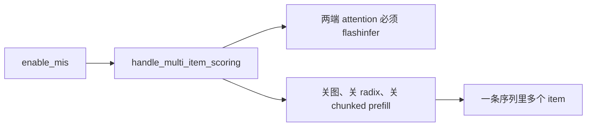
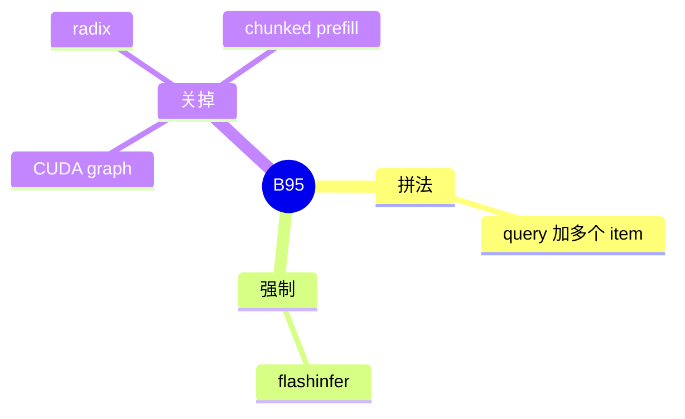

# Multi-item scoring

对应 B95。树是 `297e54fd105e974cdf401e5b4d20253a22c16f90`。**源码路径推断，未实测**。

## 场景与硬件

一个 query 要对多个 item 打分。把它们拼成一条序列，一次前向得到每个 item 的分数，而不是每个 item 一次请求。开关 `--enable-mis`。

`attention_hook.handle_multi_item_scoring`：要求 prefill 和 decode 的 attention 后端都是 `flashinfer`。然后关掉 decode 与 prefill 的 CUDA graph、radix、chunked prefill。关图的方式是改 `cuda_graph_config` 的 decode backend。

没有额外的 GPU 代数断言。FlashInfer 本身的设备要求仍在。

## 在框架中的位置

## 原理

Item 之间没有普通的因果前缀可复用，radix 的前缀匹配会把不该共享的段当成命中。Chunked prefill 会把 item 边界切坏。CUDA graph 捕获的是定长 decode，和这种变长拼接不一致。Hook 因此把三条都关掉，并锁死 flashinfer，因为拼接后的 mask 只在该后端上实现。

## 过程

1. 旗标打开。
2. Hook 检查两个 attention 后端，改图配置，关 radix 和 chunk。
3. 请求按拼接序列进入一次 extend。
4. 分数从拼接后的位置读出。回包字段不在本页展开。

## 调用栈

| 函数 | 做什么 | 角色 |
| --- | --- | --- |
| `handle_multi_item_scoring` | 后端断言，关图、radix、chunk | 解析 |
| flashinfer 前向 | 按拼接 mask 计算 | 唯一允许的后端 |

## 待核

query 与 item 的分隔 token 从哪个请求字段来，附录 06 若有则归请求字段，本页不抄。Mask 的构造函数名标待核。

返回 [本目录 README](README.md)。
