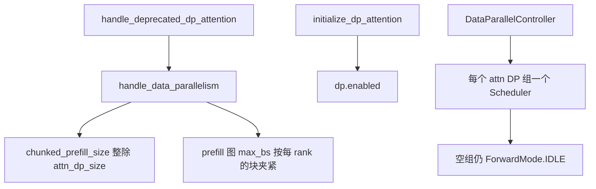
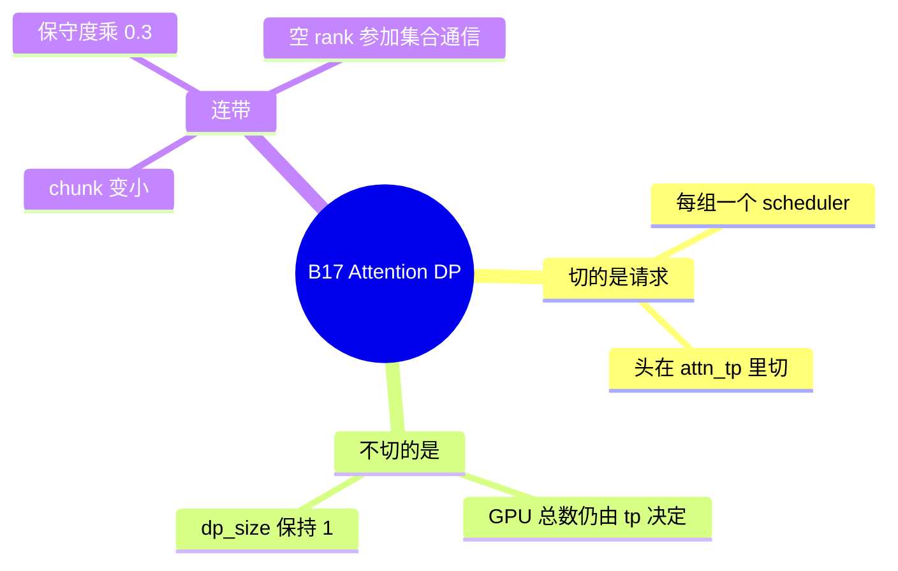

# Attention DP

对应 B17，并行轴 D04、D18。树是 `297e54fd105e974cdf401e5b4d20253a22c16f90`。**源码路径推断，未实测**。

组怎么初始化在 [05-分布式初始化](../../02-流程/01-启动/05-分布式初始化.md)（F97、F108、F192）。空 rank 仍要前向是 F193。本页写这个特性把请求、头和块大小各改成什么样。

## 场景与硬件

一张机上有多张卡，希望每张卡跑不同的请求，attention 不要再把头切到这些卡上。Attention DP 在同一个 TP 世界里切出 `attn_dp_size` 个调度器。每个调度器看到自己的请求批。头的切分宽度是 `attn_tp_size = tp_size // attn_dp_size // attn_cp_size`，不是「DP 维上再切头」。

开关 `--attn-dp-size`。旧的 `--enable-dp-attention` 由 `handle_deprecated_dp_attention` 收成：`attn_dp_size` 取原来的 `dp_size`，`dp_size` 改为 1，`enable_dp_attention=False`。

和模型副本 DP 互斥。`handle_data_parallelism`：

- `attn_dp_size < 1` → `--attn-dp-size must be positive`
- `attn_dp_size > 1` 且 `dp_size > 1` → `--dp-size {dp} with --attn-dp-size {attn}: data-parallel replicas combined with attention data parallelism are not supported.`

没有 SM 白名单。多机时副本 DP 被禁止，提示改用 attention DP，见 [02-模型副本DP](02-模型副本DP.md)。所以跨节点的数据并行走的是本页，不是 `dp_size`。

## 在框架中的位置

`derive_attn_tp_size`（`runtime_context.py`）就是上面的整除。`derive_attention_ranks` 的布局是 `(dp, cp, tp)`，tp 变化最快。`attn_dp_enabled_of` 读 `initialize_dp_attention_flags` 写下的 `flags.dp.enabled`。

## 原理

Attention 的 KV 若按头切开，每张卡只有一部分头，一次 decode 必须所有卡到齐。Attention DP 让每张卡持有完整的头（在它自己的 `attn_tp` 子组里），请求分到不同 scheduler。MLP 或 MoE 仍可能要在更大的组里 all-reduce 或 all-to-all，所以某个 scheduler 这一步没有请求时，不能跳过 `forward`。它造 `ForwardMode.IDLE`，见 F193。

`DataParallelController`（`managers/data_parallel_controller.py`）只做 ZMQ 分发、负载和可选的控制广播。它不建 `Req`、不跑模型。`attn_dp_enabled` 时 `launch_dp_attention_schedulers`，否则 `launch_dp_schedulers`（那是副本 DP）。每个 rank 上的 `Scheduler` 才组 batch 和前向。

Chunked prefill 的块是「这一步新 token 的预算」。Attention DP 把预算除以 `attn_dp_size`，因为每个 scheduler 只承担一份。这就是 F202，函数是 `_handle_data_parallelism` 里的整除，并打 warning。Prefill CUDA graph 的 `max_bs` 再夹到这个每 rank 的块，避免图捕获的批大于实际会来的块。

`schedule_conservativeness *= 0.3`。注释意图是多调度器时不要每边都把预填充塞满。本页不改写这个系数的调参含义，只记录它发生在这个函数里。

`tp_size % attn_dp_size == 0` 是 assert。再叠 prefill CP 时，`handle_context_parallelism` 要求 `tp_size % (attn_dp_size * attn_cp_size) == 0`。

## 过程

1. 废弃旗标先折算。
2. `handle_data_parallelism` 做互斥、整除、保守度和图的夹紧。
3. `initialize_dp_attention` 写 `attn_dp_rank` / `attn_dp_size`。`initialize_dp_attention_flags` 设 `dp.enabled`。
4. `initialize_model_parallel` 建 `_ATTN_TP` 等组。文档示例里 attn_cp=2、attn_tp=4 的布局就是这个函数。
5. Controller 拉起多个 scheduler。
6. 每步：有请求的 rank 正常 EXTEND 或 DECODE。没请求但组内有 token 的 rank 走 IDLE。投机时 `spec_scale_global_num_tokens` 按 `num_tokens_per_req` 放大计数，各 rank 的 token 数才能对上。

## 调用栈

| 函数 | 做什么 | 角色 |
| --- | --- | --- |
| `handle_deprecated_dp_attention` | 旧旗标收成 `attn_dp_size`，`dp_size=1` | 兼容 |
| `handle_data_parallelism` | 互斥、chunk 整除、图的 max_bs、保守度 | 特性本体 |
| `derive_attn_tp_size` | `tp // attn_dp // attn_cp` | 头的宽度 |
| `initialize_dp_attention` | 写下 rank 和 size | 运行时 |
| `initialize_dp_attention_flags` | `dp.enabled` | 查询 |
| `DataParallelController.launch_dp_attention_schedulers` | 每组一个 scheduler 进程 | 进程 |
| `Scheduler` 的 IDLE 分支 | 空组仍 `model.forward` | F193 |

## 与相邻特性

| ID | 关系 |
| --- | --- |
| B18 | `dp_size>1` 与本页互斥。多节点只能走本页 |
| B28 | 块大小被整除 |
| B09 | DSPARK + 本页时 a2a 只允许 none、megamoe、mori |
| B05 / B06 | STANDALONE 和 NGRAM 直接拒绝 attention DP |
| B07 | DFLASH 在非 NPU 上还要 `--enable-dp-lm-head` |
| B46 | DWDP 会把 `attn_dp_size` 设成自己的宽度 |
| B64 | `is_dp_attention_enabled()` 时 beam 报 Beam search is not supported with dp attention |
| B42 + 投机 | `SGLANG_ENABLE_PP_SPEC` 与 attention DP 互斥，见 `check_pipeline_parallel_compat` |

Rust server（`SGLANG_RUST_SERVER`）还会声明 `enable_dp_attention_local_control_broadcast`。控制器在 Rust 模式下的行为以该分支为准，标待核细节。

## 待核

保守度乘 0.3 的注释是否还解释了这个常数的来源，本页没有再抄。空组 IDLE 与 MoE all-to-all 的缓冲大小，在 DeepEP normal 模式下是否每次都按全局 token 数分配，未实测。

返回 [本目录 README](README.md)。
