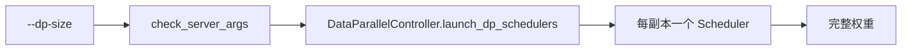
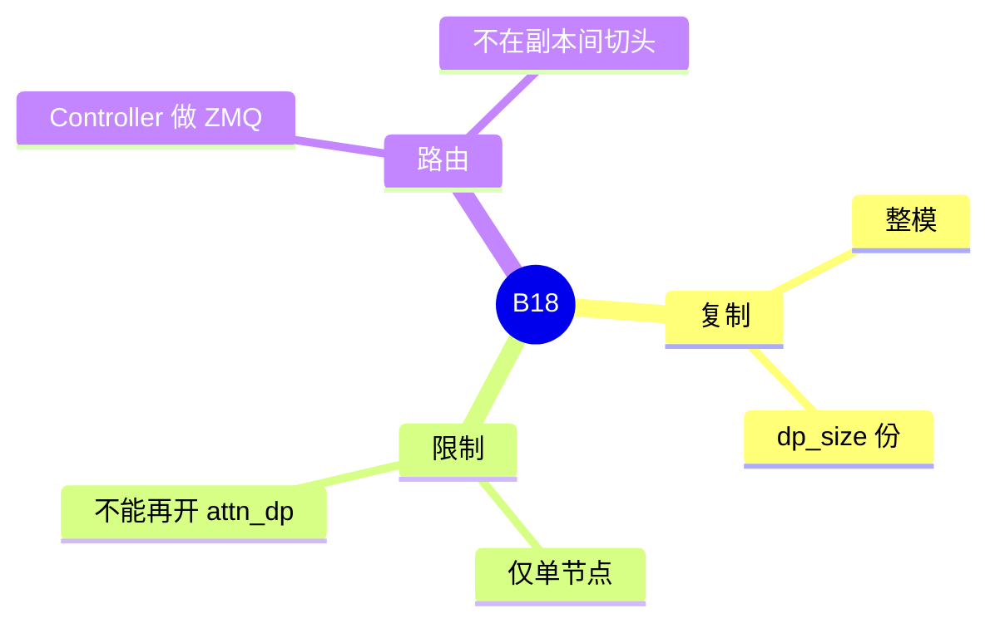

# 模型副本 DP

对应 B18，轴 D03。树是 `297e54fd105e974cdf401e5b4d20253a22c16f90`。**源码路径推断，未实测**。

## 场景与硬件

整份模型复制 `dp_size` 份，每份独立服务一批请求。副本之间不切头、不做专家 all-to-all。开关 `--dp-size`。单机、想用多份权重换吞吐时用它。

`validation_hook.check_server_args`：`dp_size>1` 且 `nnodes != 1` 则断言失败，文案是 multi-node data-parallel replicas are not supported; use attention DP (`--attn-dp-size`) across nodes。多机数据并行走 [01-Attention-DP](01-Attention-DP.md)。

与 `attn_dp_size>1` 互斥，错误字符串在 attention DP 页。

## 在框架中的位置

## 原理

每个副本有自己的 KV 和请求队列。Controller 按负载或 `routed_dp_rank` 把请求送到某一个副本。副本内部若 `tp_size>1`，仍是普通张量并行。`num_dp_ranks = dp_size * attn_dp_size`。本特性把 `attn_dp_size` 留在 1，所以 rank 数等于副本数。

## 过程

1. `Engine._launch_subprocesses` 走到 `check_server_args`。
2. 单节点且与 attention DP 不冲突则通过。
3. Controller `launch_dp_schedulers`，不是 `launch_dp_attention_schedulers`。
4. 请求被路由到一个副本的 tokenizer / scheduler 路径。F144 写控制器不自己造 `Req`。

## 调用栈

| 函数 | 做什么 | 角色 |
| --- | --- | --- |
| `check_server_args` | 多节点禁止 `dp_size>1` | 启动门 |
| `handle_data_parallelism` | 与 attention DP 互斥 | 第二道门 |
| `launch_dp_schedulers` | 拉起副本 | 进程 |
| Controller 路由 | 选副本 | 请求入口 |

## 待核

副本之间是否共享 host 内存里的 HiCache，本页没有看到 `dp_size` 专用的 HiCache 分支。默认按每进程各持一棵树理解。

返回 [本目录 README](README.md)。
