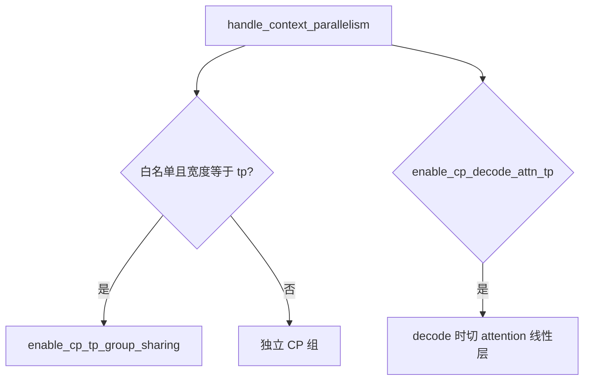
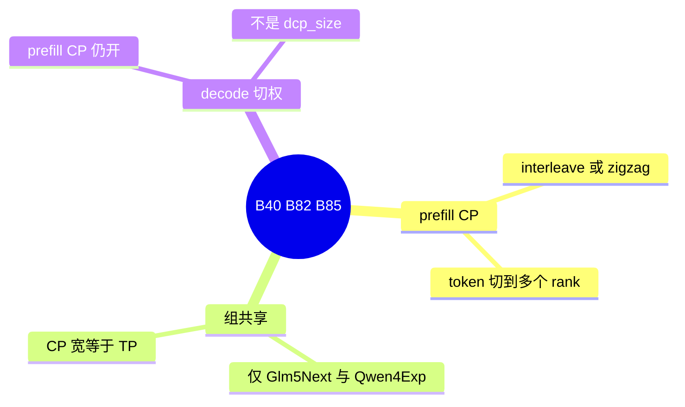

# Prefill CP、CP-TP 共享与 decode 切权

对应 B40、B82、B85。树是 `297e54fd105e974cdf401e5b4d20253a22c16f90`。**源码路径推断，未实测**。

Decode CP（`dcp_size`）是另一页。DSA 按层切缓存是 [17-DSA-cache切层](../02-注意力与稀疏/17-DSA-cache切层.md)。

## 场景与硬件

一条 prefill 太长，单卡放不下整段激活或做不完。Prefill CP 把这条序列的 token 切到多个 rank，`--enable-prefill-cp`，宽度 `attn_cp_size`，策略 `cp_strategy` 取 `interleave` 或 `zigzag`。代码里没有 `pcp_size` 这个字段名。

`handle_context_parallelism` 与更早的 `validate_prefill_cp_platform`：

| 条件 | 结果 |
| --- | --- |
| 平台是 MUSA | prefill CP 被标成废弃并拒绝（F43） |
| HIP | 只允许 `DeepseekV4ForCausalLM` |
| `enable_aiter_allreduce_fusion` 且 `attn_cp_size>1` | 断言：Aiter allreduce fusion is not supported with context parallelism |
| 同时 PP | 同一 hook 里的 assert |
| `tp_size` 不能被 `attn_dp_size * attn_cp_size` 整除 | assert |
| `dcp_size>1` | 与 prefill CP 互斥，`ValueError`，见下一页 |

F205：少数模型在 CP 定稿时把 CP 组收成 TP 组。`resolve_cp_tp_group_sharing` 的白名单只有 `Glm5NextForConditionalGeneration`（策略必须 `interleave`）和 `Qwen4ExpForConditionalGeneration`（`zigzag`）。要求 `attn_cp_size == tp_size`，写下 `enable_cp_tp_group_sharing=True`（`no_cli`）。投机只放行 GLM-5.3-Flash 的 DFLASH 或 native MTP（topk 1）。Qwen4-Exp 会关掉 prefill CUDA graph，并拒绝 waterfill、DSA cache 切层。

B85：`cp_size>1` 时，decode 可以把复制的 attention 线性层切到本地 CP 分片。旗标 `--enable-cp-decode-attn-tp`。这不是 `dcp_size`。Prefill CP 仍然开着。支持的架构在 `layers/cp/cp_decode_attn_tp.py` 的 `CP_DECODE_ATTN_TP_SUPPORTED_ARCHS`，`model_hook` 对照这张表。运行时 `CpDecodeAttnTpContext.maybe_use_decode_attn_tp`。

## 在框架中的位置

## 原理

Interleave 与 zigzag 决定 token 下标如何落到 rank，影响因果 mask 和通信次数。组共享是：CP 的成员和 TP 的成员是同一批 rank，就不要建第二套进程组。结果字段 `enable_cp_tp_group_sharing` 没有 CLI。Qwen4-Exp 关 prefill 图，是因为 zigzag 加组共享之后，捕获时的序列布局对不上。

Decode 切权解决的是另一件事。Prefill 已经按 CP 把序列切开，decode 若仍把 attention 的 QKV 投影按完整 TP 算，会在 CP 分片上做多余的复制。`--enable-cp-decode-attn-tp` 在 decode 步把这些线性层切到本 rank 的分片。KV 缓存的切分方式仍由 CP 策略决定，不因此变成 B41 的 decode CP。

## 过程

1. `validate_prefill_cp_platform` 挡 MUSA。
2. `handle_context_parallelism` 定 `attn_cp_size` 和策略，拒绝 Aiter 融合和 PP。
3. `resolve_cp_tp_group_sharing` 对两个架构决定是否共享组。
4. 若打开 B85，`model_hook` 对照架构表。
5. Prefill 按策略切 token。Decode 在上下文对象里决定是否切线性层。

## 调用栈

| 函数 | 做什么 | 角色 |
| --- | --- | --- |
| `validate_prefill_cp_platform` | MUSA 拒绝 | 平台 |
| `handle_context_parallelism` | 宽度、策略、Aiter、PP、整除 | B40 |
| `resolve_cp_tp_group_sharing` | 两个架构上的组共享 | B82 / F205 |
| `handle_model_specific_adjustments` | 对照 `CP_DECODE_ATTN_TP_SUPPORTED_ARCHS` | B85 |
| `CpDecodeAttnTpContext.maybe_use_decode_attn_tp` | decode 步切线性层 | 运行时 |

## 待核

zigzag 与 interleave 的下标公式在 `layers/cp/`。本页没有把公式再推导一遍。MiMo V2 只接受 zigzag 且多模态要 `--language-only`，那条在 `parallel_hook.py`，属于模型限制，细节归模型篇。

返回 [本目录 README](README.md)。
