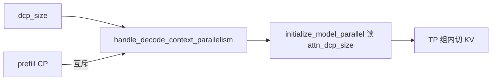
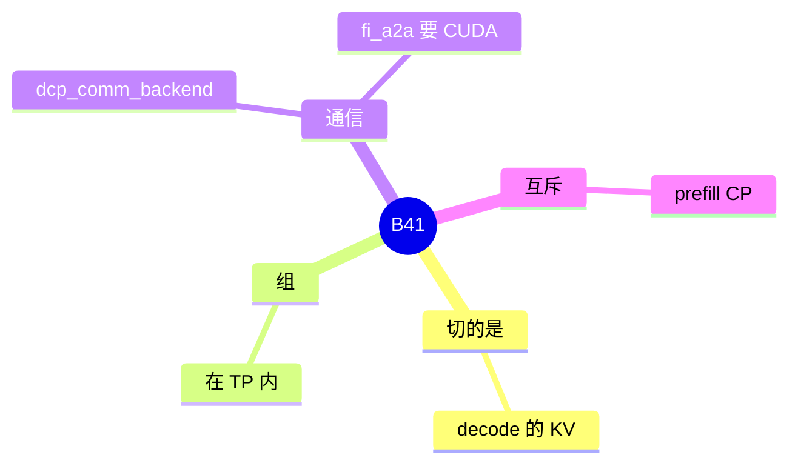

# Decode CP

对应 B41，轴 D07。树是 `297e54fd105e974cdf401e5b4d20253a22c16f90`。**源码路径推断，未实测**。

## 场景与硬件

Decode 时 KV 很长，希望在 TP 组内把 KV 切开，每张卡只拿一段。开关 `--dcp-size` / `--decode-context-parallel-size`，字段 `attn_dcp_size`。通信后端 `dcp_comm_backend`。`fi_a2a` 要求 `get_platform().is_cuda`，文案指向 Blackwell 的 MNNVL。

`dcp_size>1` 与 `--enable-prefill-cp` 互斥，`parallel_hook.py` 直接 `ValueError`。平台限制在 `initialize_model_parallel` 开头的 `RuntimeError`。本页不凭记忆写那句 RuntimeError 的全文，展开时对着该函数开头。

这不是 B85。B85 是 prefill CP 仍开着时，decode 去切 attention 权重。本页是单独的 decode KV 并行，并且要求 prefill CP 关闭。

## 在框架中的位置

## 原理

Prefill 已经在某张卡上算完整段 KV 之后，decode 若仍让每张卡持有全量 KV，长上下文会先把容量打满。DCP 在 decode 阶段把 KV 分片，attention 通过 `dcp_comm_backend` 取回需要的段。因为 prefill 的切分方式和这个分片不同，两者不能同时开。DSPARK 的 V4.1 PD 附加条件还要求 DCP=1，见 DSPARK 页。

## 过程

1. `handle_decode_context_parallelism` 读 `dcp_size` 和通信后端。
2. 与 prefill CP 冲突则抛错。`fi_a2a` 在非 CUDA 上抛错。
3. `initialize_model_parallel` 按 `attn_dcp_size` 建组。开头的平台 `RuntimeError` 在这里。
4. Decode 前向按分片读 KV。

## 调用栈

| 函数 | 做什么 | 角色 |
| --- | --- | --- |
| `handle_decode_context_parallelism` | 大小、通信后端、与 prefill CP 互斥 | 解析 |
| `initialize_model_parallel` | 读 `attn_dcp_size`，平台 RuntimeError | 进程组 |
| decode attention | 按分片访问 KV | 计算 |

## 待核

`dcp_comm_backend` 的全部取值，以及 `initialize_model_parallel` 那句 RuntimeError 的平台名单，以这两个函数的源码为准。轴的图在分布式篇 D07，本页不重写组的个数公式。

返回 [本目录 README](README.md)。
