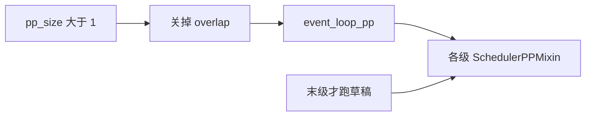
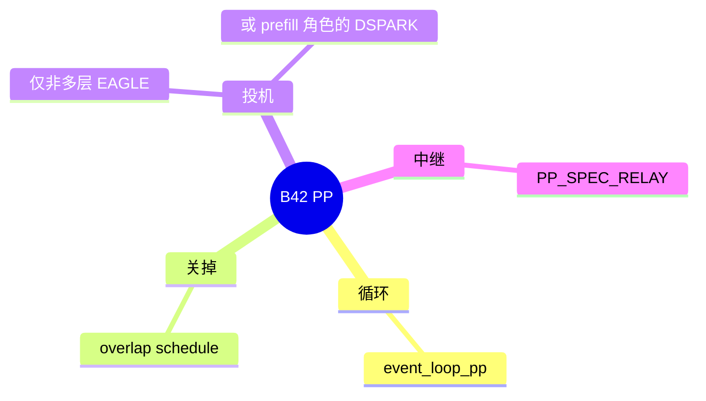

# 流水并行

对应 B42，轴 D02。树是 `297e54fd105e974cdf401e5b4d20253a22c16f90`。**源码路径推断，未实测**。

## 场景与硬件

层数多到一层的权重和激活在时间上串行太长，或单卡放不下全部层。`--pp-size` 把层切到多张卡。调度用 `SchedulerPPMixin` 和 `event_loop_pp`。微批次沿级传递。

`pp_size>1` 时 overlap schedule 被关掉。`overrides._pipeline_parallel_overlap_disable` 写 `disable_overlap_schedule=True`。`check_pipeline_parallel_compat` 断言 Pipeline parallelism is not compatible with overlap schedule。这是 F196。

投机：非 DSPARK 时只允许非多层的 EAGLE。DSPARK 要求 `disaggregation_mode=prefill`，且 `SGLANG_ENABLE_PP_SPEC` 不支持这条。`SGLANG_ENABLE_PP_SPEC` 还要求模式是 null、不能 adaptive、不能 attention DP。V4.1 的 `validate_deepseek_v41_features` 拒绝 `pp_size>1`。DeepEP 的弹性扩容也要求 `pp_size==1`。

## 在框架中的位置

## 原理

每一级只持有一部分层。激活从第 0 级传到最后一级，logits 在最后一级产生。草稿 worker 只在最后一级构建（EAGLE 的 `_hosts_draft`）。非末级若要验证，用 `PP_SPEC_RELAY` 里的树重建验证输入，自己不跑草稿 forward。Overlap 把「上一批的结果处理」和「当前批的前向」叠在同一级上，和级间传递的假设冲突，所以解析期就关掉，而不是在循环里分支。

## 过程

1. 解析期关掉 overlap，并按算法检查投机和 PD。
2. 各级初始化自己的层区间。
3. `event_loop_pp` 在级间收发微批。
4. 末级采样，投机时末级再跑草稿。

## 调用栈

| 函数 | 做什么 | 角色 |
| --- | --- | --- |
| `_pipeline_parallel_overlap_disable` | `pp_size>1` 则关 overlap | F196 |
| `check_pipeline_parallel_compat` | overlap、EAGLE、DSPARK、PP spec | 断言 |
| `event_loop_pp` | 级间循环 | 调度 |
| `SchedulerPPMixin` | 级的状态 | 调度器 |
| `maybe_init_draft_worker` | 非末级跳过草稿 | F113 |

## 待核

微批大小和 `DynamicChunkSizer` 的步进没有在本页展开。V4.1 拒绝 PP 的原文在模型拒绝表，本页只记录 `pp_size>1` 会被那张表拒绝。

返回 [本目录 README](README.md)。
