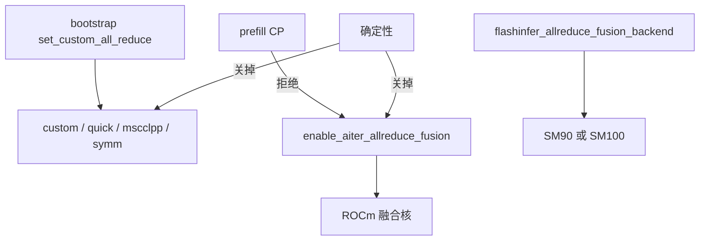
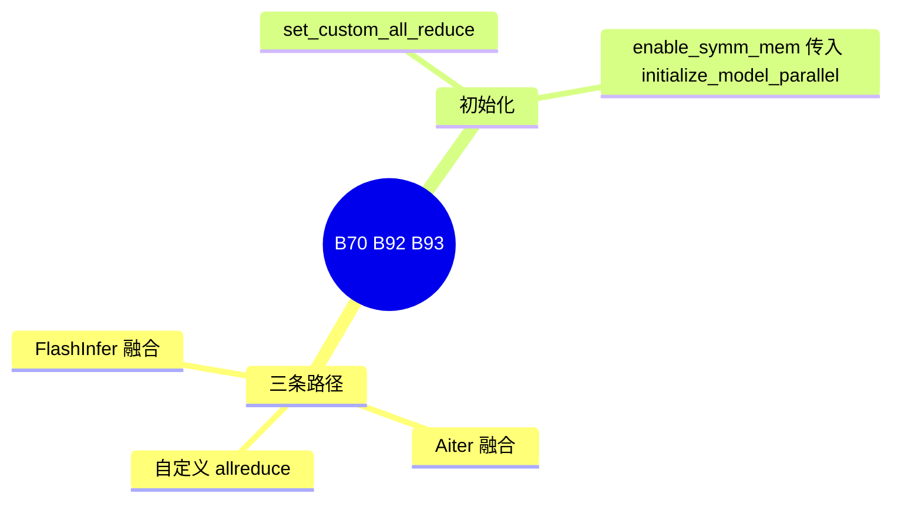

# 自定义集合通信与 allreduce 融合

对应 B70、B92、B93。树是 `297e54fd105e974cdf401e5b4d20253a22c16f90`。**源码路径推断，未实测**。

Mooncake 进程组是 D 篇的题目。本页写 all-reduce 的实现选择，以及两条把 all-reduce 和后续计算叠在一起的融合。

## 场景与硬件

张量并行每层都要 all-reduce。默认走 NCCL 或 RCCL。还可以换成自定义核，或把 all-reduce 与 residual、RMSNorm 融进一个核。

| ID | 开关 | 源码里的设备条件 |
| --- | --- | --- |
| B70 | `--enable-symm-mem` 等 | `handle_symm_mem_device_support`：不是 CUDA 或 HIP 就关掉 symm mem。实现文件在 `distributed/device_communicators/`：`custom_all_reduce`，`quick_all_reduce`，`pymscclpp`，`torch_symm_mem` |
| B92 | `--enable-aiter-allreduce-fusion`，以及 prefill / decode 的 disable 旗标 | ROCm 上把 allreduce 和后续计算叠在一起。`model_hook` 对 `GlmMoeDsaForCausalLM` 的 decode 有自动打开的注释。Prefill CP 打开时 `handle_context_parallelism` 直接拒绝 |
| B93 | `flashinfer_allreduce_fusion_backend`：`auto` / `trtllm` / `mnnvl` / `cutedsl` | help：要 SM90 或 SM100。未指定时，受支持的 MiMo 用 `cutedsl`，其它受支持模型用 `auto`。自动打开还要求 `tp_size>1` 且 `moe_a2a_backend==none` |

确定性推理会关掉 custom all-reduce、torch symm mem 和 Aiter 融合，见 [18-确定性推理](../02-注意力与稀疏/18-确定性推理.md)。

## 在框架中的位置

## 原理

自定义 all-reduce 替换的是集合通信库的实现，计算核仍是原来的 residual 和 norm。融合路径把通信和这两步算子合成一次 launch，减少读写。Aiter 是 ROCm 的融合。FlashInfer 是 NVIDIA SM90 / SM100 的融合，后端再在 trtllm、mnnvl、cutedsl 之间选。三者不要写成同一个旗标。

`distributed/bootstrap.py` 里 `set_custom_all_reduce(not disable_custom_all_reduce)`，`initialize_model_parallel` 接收 `enable_symm_mem`。

## 过程

1. 平台 hook 可能关掉 symm mem。
2. 模型 hook 可能为 GLM MoE DSA 打开 Aiter 融合。
3. Prefill CP 若开着，Aiter 融合在 CP hook 被断言打回。
4. FlashInfer 融合在 override 里按 SM 和 a2a 自动打开，或使用用户指定的后端名。
5. 层前向在 TP all-reduce 的位置调用被选中的实现。

## 调用栈

| 函数 | 做什么 | 角色 |
| --- | --- | --- |
| `set_custom_all_reduce` | 按 `disable_custom_all_reduce` 安装实现 | B70 |
| `handle_symm_mem_device_support` | 非 CUDA/HIP 关掉 | B70 |
| `handle_context_parallelism` | CP 与 Aiter 融合互斥 | B92 |
| `model_hook` 对 `GlmMoeDsaForCausalLM` | decode 上可能自动打开 Aiter | B92 |
| `_flashinfer_allreduce_fusion_auto_enable` | SM90/SM100、tp>1、a2a none | B93 |

## 待核

`--enable-symm-mem` 以外的自定义 all-reduce 旗标全名，清单写过待核。本页确认了 `disable_custom_all_reduce` 和 `enable_symm_mem` 这两个符号。quick all-reduce 与 pymscclpp 的开关名以 `device_communicators` 的调用点为准。

返回 [本目录 README](README.md)。
