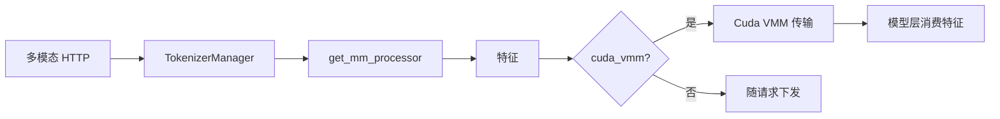
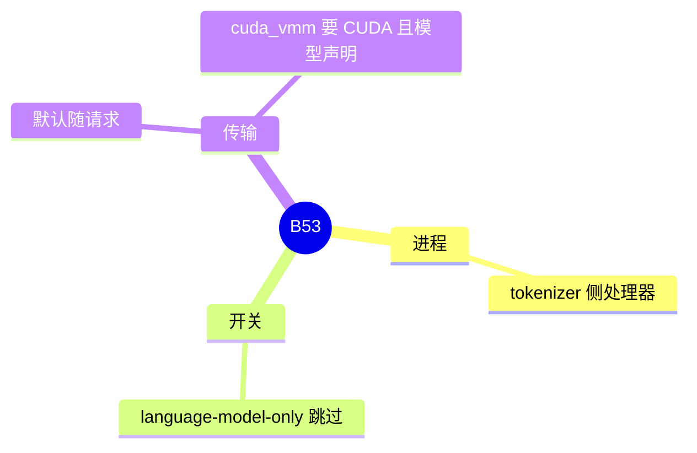

# 多模态

对应 B53。树是 `297e54fd105e974cdf401e5b4d20253a22c16f90`。**源码路径推断，未实测**。

请求侧的校验在 F176、F143、F144。本页写处理器放在哪，以及特征怎么进模型。

## 场景与硬件

请求带图像、视频或音频，语言模型要先跑编码器，再把特征送进解码器。处理器在 tokenizer 进程：`managers/multimodal_processor.py` 的 `import_processors` / `get_mm_processor`，`TokenizerManager` 把它放在 `self.mm_processor`。`--language-model-only` 跳过这条，只跑文本。

`mm_feature_transport=cuda_vmm` 要求 CUDA，且模型类声明 `supports_cuda_vmm_feature_transport`（F144）。编码器 SWA replay 的图像请求仅 CUDA，视频、音频、`input_embeds` 和位置覆盖在分词校验里被拒绝（F143）。

扩散模型不走这条 LLM 处理器，见 [02-扩散](02-扩散.md)。只跑编码器的进程是 [04-编码器分离](04-编码器分离.md)。

## 在框架中的位置

## 原理

编码器输出的是张量，不是 token id。它们在 `Req` 上作为多模态特征，调度器按槽位把它们送进对应的层。VMM 传输让特征留在 GPU 显存里跨进程可见，避免先拷到 CPU 再拷回。模型不声明支持时不能选这条，否则地址空间对不上。

清单里的 `CudaVmmFeatureTransport` 是否仍是唯一入口：F144 写的是传输模式字段。类名是否还叫这个，标待核，以 `mm_feature_transport` 的实现类为准。

## 过程

1. 路由识别多模态请求，且没有 `--language-model-only`。
2. `mm_processor` 在 tokenizer 进程跑处理器。
3. 特征按传输模式交给 scheduler。
4. 模型前向在视觉或音频层消费特征，文本层仍走普通 KV。

## 调用栈

| 函数 | 做什么 | 角色 |
| --- | --- | --- |
| `get_mm_processor` | 按模型选处理器 | 入口 |
| `TokenizerManager` | 持有 `mm_processor` | 进程 |
| 传输模式 `cuda_vmm` | GPU 上跨进程交特征 | 仅 CUDA 且模型声明 |
| 模型层 | 把特征加进隐藏状态 | 计算 |

## 待核

各架构的处理器文件在 `srt/multimodal/processors/`。本页不列模型名单，名单归 [05-模型](../../05-模型/README.md)。`CudaVmmFeatureTransport` 类名待核。

返回 [本目录 README](README.md)。
