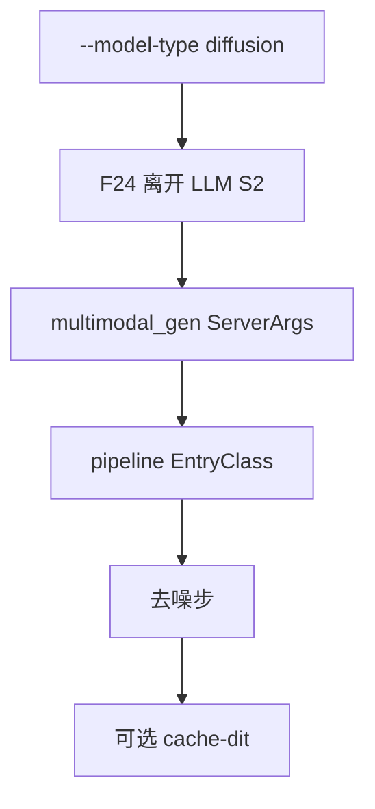
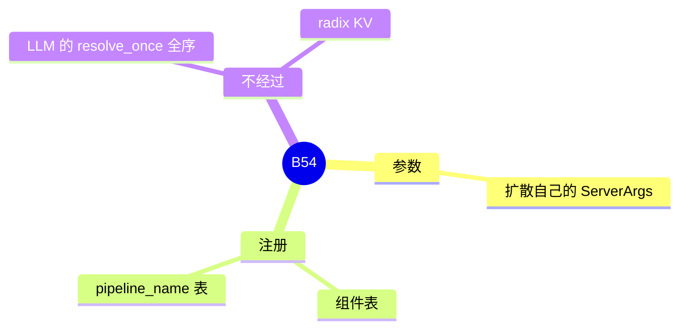

# 扩散

对应 B54。Cache-dit 在 [06-cache-dit](06-cache-dit.md)（B96）。树是 `297e54fd105e974cdf401e5b4d20253a22c16f90`。**源码路径推断，未实测**。

## 场景与硬件

文生图、视频这一类去噪循环，不走 LLM 的 `ServerArgs` 解析流水线 S2。`sglang serve` 的 `--model-type diffusion`，或 auto 判定为扩散时，启动分叉到扩散运行时（F24）。

生产用的参数类是 `multimodal_gen/runtime/server_args/server_args.py` 里的 `ServerArgs`。测试文件里的 `DiffusionServerArgs` 只在 `multimodal_gen/test/server/testcase_configs.py`，不是服务入口。

模型组件注册表在 `multimodal_gen/runtime/models/registry.py`。Pipeline 注册表是另一张，键是 `pipeline_name`，不是 HF `architectures`（清单 M14）。硬件随 pipeline：CUDA 是常见路径，本页没有看到一张覆盖所有 pipeline 的 SM 白名单。

## 在框架中的位置

## 原理

扩散的一步是对隐变量去噪，不是对 token 做 decode。KV radix、chunked prefill、投机都不在这条循环里。Cache-dit 缓存的是去噪步，见 B96。

## 过程

1. 启动判定模型类型，分叉。
2. 扩散 `ServerArgs` 解析自己的字段。
3. 按 `pipeline_name` 建 pipeline，组件从组件表加载。
4. 去噪循环写出图像或视频。

## 调用栈

| 函数 | 做什么 | 角色 |
| --- | --- | --- |
| 启动对 `--model-type` 的分叉 | 离开 LLM S2 | F24 |
| 扩散 `ServerArgs` | 本运行时的配置 | 参数 |
| pipeline `EntryClass` | 按 `pipeline_name` 注册 | M14 |
| 去噪 stage | 多步更新隐变量 | 计算 |

## 待核

auto 判定的规则以启动分叉代码为准。各 pipeline 的最低 GPU 本页未列。

返回 [本目录 README](README.md)。
