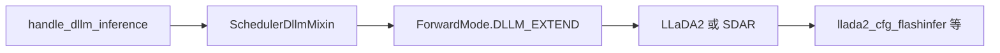
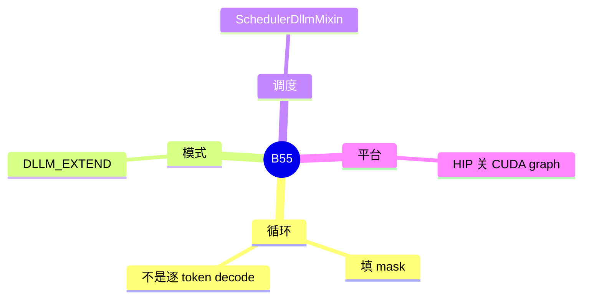

# dLLM

对应 B55。树是 `297e54fd105e974cdf401e5b4d20253a22c16f90`。**源码路径推断，未实测**。

## 场景与硬件

扩散式语言模型：一次前向填一块被 mask 的 token，而不是每步只出一个 token。循环在 LLM 进程里，但 forward 模式是 `ForwardMode.DLLM_EXTEND`。例子：`models/llada2.py` 的 `LLaDA2MoeModelLM`，以及 `sdar.py` / `sdar_moe.py`。Attention choices 里有 `llada2_cfg_flashinfer`。

`dllm_hook.handle_dllm_inference` 读 `dllm_algorithm`、`dllm_fdfo` 等（`exec_.dllm`）。算法对象可以 `configure_server_args`。HIP 上这个 hook 关掉 CUDA graph。具体旗标的 help 以字段为准，清单把旗标标成待核，本页确认了 hook 和命名空间，不把每个 CLI 连字符再发明一遍。

KV 分片拒绝 DLLM。它不是 PD 的一种角色。

## 在框架中的位置

## 原理

普通 EXTEND 把新 token 接在前缀后面。DLLM 的一步可能改写序列中间的 mask 位置，长度和 KV 的追加方式不同，所以用单独的 `ForwardMode`，避免 chunked prefill 和 radix 按「只在尾部追加」来处理。Mixin 把这个循环放进 scheduler，而不是再写一个 HTTP 服务。

## 过程

1. 模型被识别为 dLLM，hook 跑算法的 `configure_server_args`。
2. HIP 关图。
3. 调度用 mixin 组 `DLLM_EXTEND` 批。
4. 模型按算法填 mask，直到停止条件。

## 调用栈

| 函数 | 做什么 | 角色 |
| --- | --- | --- |
| `handle_dllm_inference` | 算法配置、HIP 关图 | 解析 |
| `SchedulerDllmMixin` | 循环 | 调度 |
| `ForwardMode.DLLM_EXTEND` | 与普通 extend 区分 | 前向 |
| `LLaDA2MoeModelLM` / SDAR | 模型 | 计算 |

## 待核

各 `dllm_algorithm` 的名字和停止条件以算法类为准。和 radix 是否完全互斥，本页只确认 KV 分片拒绝 DLLM，没有看到一条「dLLM 必须 disable radix」的全局断言。

返回 [本目录 README](README.md)。
