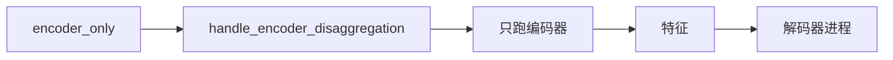
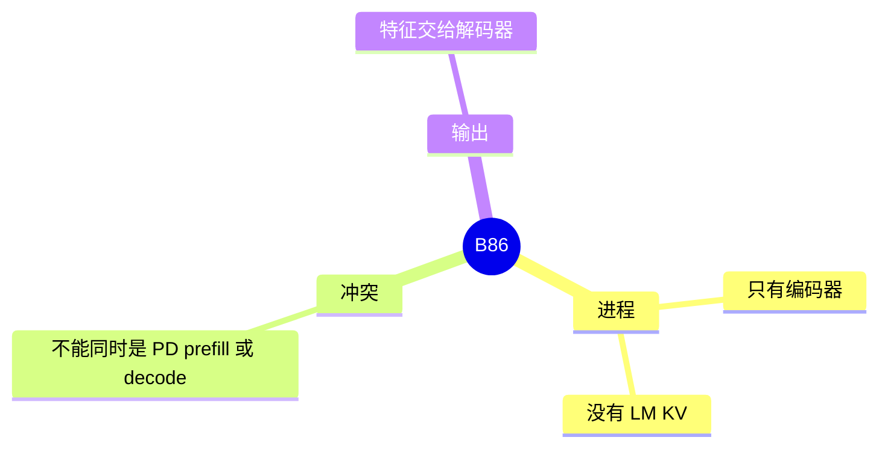

# 编码器分离

对应 B86。树是 `297e54fd105e974cdf401e5b4d20253a22c16f90`。**源码路径推断，未实测**。

## 场景与硬件

视觉或音频编码器单独占一个进程，解码器进程不在这张卡上跑编码器。字段 `encoder_only`（`fields/disagg.py`）。启动分叉是 F21，调度侧是 F187。可选再走 encoder gRPC。

`handle_encoder_disaggregation` 检查：encoder-only 与 PD 的 prefill/decode 角色冲突，并检查模型架构是否支持。这不是 PD 的 prefill。Prefill 进程仍会跑语言模型的提示词。编码器进程不持有语言模型的 KV。

## 在框架中的位置

## 原理

多模态特征的计算和 token 解码抢同一张卡时，把编码器拆出去。解码器拿到的仍是 B53 的特征，只是生产者在另一个进程。传输可以是 gRPC。特征的形状由模型类决定，hook 用架构检查避免把纯文本模型当成编码器。

## 过程

1. `encoder_only` 打开。
2. Hook 拒绝与 PD 角色并存，并核对架构。
3. 进程只加载编码器。
4. 请求的图像或音频在这里变成特征，再送到解码器。

## 调用栈

| 函数 | 做什么 | 角色 |
| --- | --- | --- |
| `handle_encoder_disaggregation` | 角色冲突和架构 | 解析 |
| 编码器前向 | 产出特征 | 计算 |
| 解码器侧的多模态入口 | 消费特征 | B53 |

## 待核

gRPC 的服务定义以 F21 的启动代码为准。本页没有抄 protobuf。

返回 [本目录 README](README.md)。
