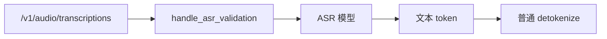
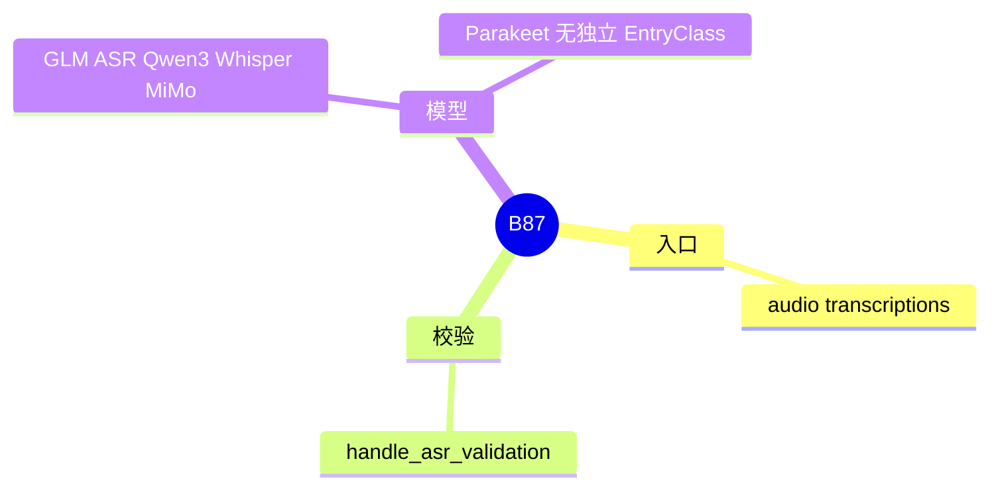

# ASR

对应 B87。树是 `297e54fd105e974cdf401e5b4d20253a22c16f90`。**源码路径推断，未实测**。

## 场景与硬件

音频转写。HTTP `/v1/audio/transcriptions`（A.10 已列路径）。`serving_hook.handle_asr_validation` 在流水线里做校验。模型例子：`GlmAsrForConditionalGeneration`（`glmasr.py`），`qwen3_asr.py`，`whisper.py`，`mimo_v2_asr.py`。`parakeet.py` 没有 `EntryClass`，由 `nano_nemotron_vl.py` 引用 `ProjectedParakeet`。

旗标细节清单标了待核。本页确认校验函数存在，不发明 CLI 名字。转写请求字段不在本页抄。

## 在框架中的位置

## 原理

音频先变成编码器特征，再由语言模型或专用头吐出文本 token。后面的 detokenize 与普通生成共用。校验函数负责拒绝和 ASR 模型不匹配的服务配置，避免把转写请求送进没有音频塔的文本模型。

## 过程

1. 路由进入转写。
2. `handle_asr_validation` 在启动时已经挡住不合法的组合。
3. 模型前向产出 token id。
4. 回包走普通文本路径。

## 调用栈

| 函数 | 做什么 | 角色 |
| --- | --- | --- |
| `handle_asr_validation` | 启动校验 | 门 |
| ASR 模型 `forward` | 音频到 token | 计算 |
| detokenize | token 到文本 | 与 F14 相同 |

## 待核

`handle_asr_validation` 具体拒绝哪些并行和量化组合，以函数正文为准。本页没有逐条抄 assert。

返回 [本目录 README](README.md)。
