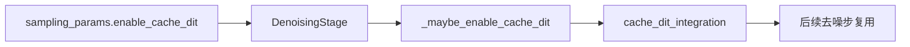
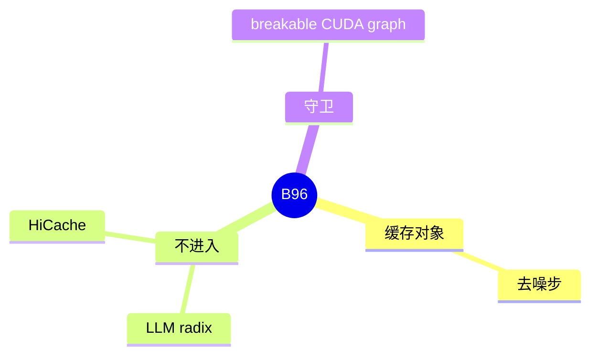

# 扩散 cache-dit

对应 B96。树是 `297e54fd105e974cdf401e5b4d20253a22c16f90`。**源码路径推断，未实测**。本环境没有跑扩散。

## 场景与硬件

去噪的相邻步如果隐变量变得慢，可以复用上一步的一部分计算。这是扩散循环内部的缓存，不进入 LLM 的 radix。

请求字段 `enable_cache_dit`，另有 `cache_dit_params`（测试里出现）。服务端 `DiffusionServerArgs.enable_cache_dit` 只在测试构造里出现。生产读的是扩散 `ServerArgs` 和 `batch.sampling_params`。

`DenoisingStage._maybe_enable_cache_dit` 还有 `server_args.enable_breakable_cuda_graph` 的守卫。实现模块是 `runtime/cache/cache_dit_integration.py`。

## 在框架中的位置

## 原理

LLM radix 按 token 前缀存 KV。扩散没有这条前缀。Cache-dit 在去噪迭代之间记可复用的激活或噪声预测。Breakable 图的守卫说明：图的分段方式和这种跨步复用要一起考虑，不能无条件打开。

## 过程

1. 请求或服务参数打开。
2. 去噪 stage 调用 `_maybe_enable_cache_dit`。
3. 守卫通过则 integration 模块在后续步复用。
4. 关闭时每步完整计算。

## 调用栈

| 函数 | 做什么 | 角色 |
| --- | --- | --- |
| `DenoisingStage._maybe_enable_cache_dit` | 读 sampling params 和图守卫 | 入口 |
| `cache_dit_integration` | 跨步缓存 | 实现 |

## 待核

哪些 pipeline 实现了这个 stage 方法。清单写各 pipeline 是否都实现：待核。测试里的 `DiffusionServerArgs.enable_cache_dit` 不是生产字段的证明。

返回 [本目录 README](README.md)。
