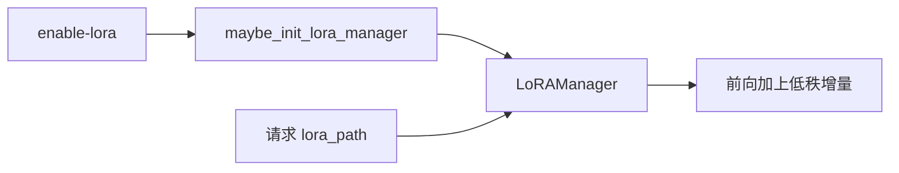
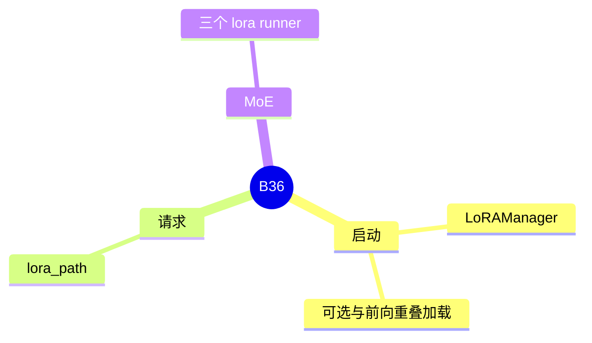

# LoRA

对应 B36。树是 `297e54fd105e974cdf401e5b4d20253a22c16f90`。**源码路径推断，未实测**。

## 场景与硬件

同一基座上挂多份低秩适配器，请求用 `lora_path` 选择。`--enable-lora` 在启动时装载。`enable_lora_overlap_loading` 允许加载和前向重叠。MoE 上的核是 runner 名 `lora_cutedsl`、`lora_triton`、`lora_marlin`，见 [04-GEMM-runner](../04-MoE与DeepEP/04-GEMM-runner.md)。

UNO 禁止公开的多 LoRA，它用单独的 `--uno-lora-path`。没有通用 GPU 代数门。某个 LoRA 核是否要求 SM，以该 runner 为准。

## 在框架中的位置

## 原理

适配器不替换基座权重的存储，而在线性层输出上加低秩分支。`LoRAManager` 管适配器的槽和请求到槽的映射。重叠加载让新适配器的拷贝不堵住当前批。MoE 的三个 runner 是专家 GEMM 里做同一件事的核，生命周期仍归 manager。

## 过程

1. `ModelRunner.maybe_init_lora_manager` 在旗标打开时 `init_lora_manager`。
2. 可选 `init_lora_cuda_graph_moe_buffers`，给图捕获留缓冲。
3. 请求带 `lora_path` 时，本步前向选中对应适配器。

## 调用栈

| 函数 | 做什么 | 角色 |
| --- | --- | --- |
| `maybe_init_lora_manager` | 决定是否构建 | 启动 |
| `LoRAManager` | 槽和路径 | 状态 |
| `lora_*` runner | MoE 上的增量 GEMM | 计算 |

## 待核

同时加载的适配器上限以 `LoRAManager` 的构造参数为准。请求字段的拼写在附录 06，本页不抄。

返回 [本目录 README](README.md)。
