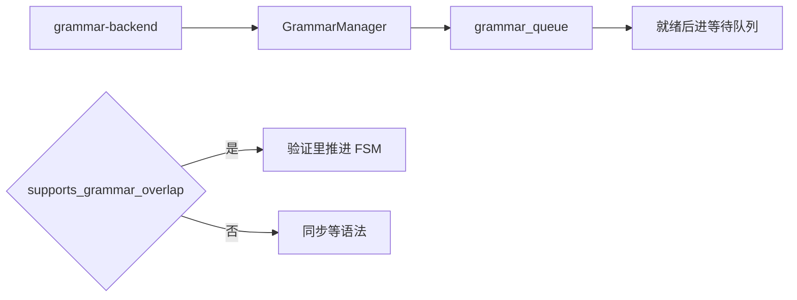
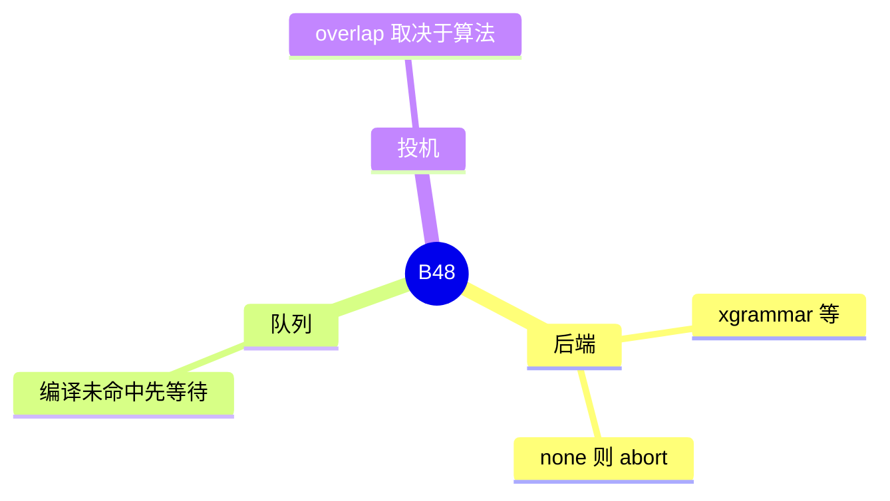

# 语法后端

对应 B48。树是 `297e54fd105e974cdf401e5b4d20253a22c16f90`。**源码路径推断，未实测**。

回包路径上的位置是 F166，见 [01-采样后端与语法](../../02-流程/04-流式与非流式响应/01-采样后端与语法.md)。本页写后端选择和与投机的重叠。

## 场景与硬件

结构化输出：JSON schema、正则或语法，把不合法的 token 掩掉。`--grammar-backend`，默认 `xgrammar`。`none` 或编译失败时请求以 abort 回包，不进正常增量解码（F166）。

编译未命中缓存时请求先入 `grammar_queue`，就绪后再进等待队列（F158）。这是 CPU 上的编译，没有 GPU 代数门。

`supports_grammar_overlap` 为真的算法（EAGLE 族、STANDALONE、DFLASH 族）可以在验证内部推进 FSM，语法 CPU 藏在 GPU 草稿下面。NGRAM 不支持，保持同步。

## 在框架中的位置

## 原理

语法状态是 per-request 的 FSM。每步采样前用 FSM 产生 mask。编译语法可能很慢，所以和调度队列分开。投机的 overlap 要求草稿在 GPU 上花时间，这段时间足够把下一步的 FSM 算完。NGRAM 的草稿在 CPU，和 FSM 抢同一侧，所以不重叠。

## 过程

1. `serving_hook.handle_grammar_backend` 定后端。
2. `constrained/create_grammar_backend` 建实现。
3. 请求的语法没缓存则进 `grammar_queue`。
4. 采样时应用 mask。投机且允许 overlap 时，barrier 在 verify 内部。

## 调用栈

| 函数 | 做什么 | 角色 |
| --- | --- | --- |
| `handle_grammar_backend` | 选择实现 | 解析 |
| `GrammarManager` | 缓存和 per-request 状态 | 运行 |
| `supports_grammar_overlap` | 算法是否允许异步 FSM | 与 B01 的交界 |

## 待核

`GRAMMAR_BACKEND_CHOICES` 的完整名单以 `choices.py` 为准。本页只点默认 `xgrammar` 和 `none` 的失败行为（后者在流程篇已写）。

返回 [本目录 README](README.md)。
