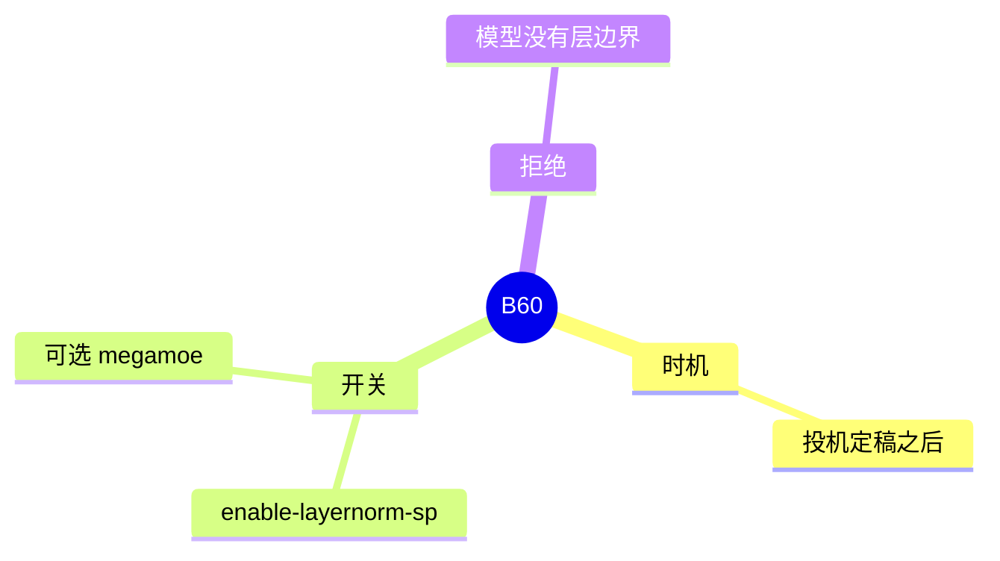

# LayerNorm 序列并行

对应 B60。树是 `297e54fd105e974cdf401e5b4d20253a22c16f90`。**源码路径推断，未实测**。

## 场景与硬件

张量并行时，LayerNorm 若在每张卡上对局部隐藏维做，统计量是错的。序列并行把 token 维切开，norm 的隐藏维在卡上是完整的。开关 `--enable-layernorm-sp`。另有 `--enable-megamoe-for-layernorm-sp`，它要求前者已经打开。

`pipeline.py` 把 `handle_layernorm_sp` 放在投机 hook 之后，注释：After the speculative hook so speculative_algorithm is final。校验要看最终的算法名。

`handle_layernorm_sp` 把架构、`tp_size`、`ep_size`、量化、a2a、runner、attention DP、投机算法、`pp_size` 交给 `validate_layernorm_sp`。不用层边界的模型会在这里拒绝，而不是在层里悄悄忽略。

Muse 的 MegaMoE 还有 mixed chunk、PP、chunk 大小和 breakable 图的额外断言。那段只对 `MuseSparkForConditionalGeneration`。

## 在框架中的位置

## 原理

序列并行的 all-gather / reduce-scatter 和 TP 的 all-reduce 交换了切分维。Norm 看到完整隐藏维、局部序列。投机算法会影响有没有草稿层也要走同一套切分，所以必须等算法名不再变化。

## 过程

1. 投机 hook 结束。
2. `handle_layernorm_sp`。旗标关着且又开了 megamoe 则报错。
3. `validate_layernorm_sp` 看架构和并行。
4. `layers/layernorm_sp.py` 的 `initialize_layernorm_sp` 安装通信。

## 调用栈

| 函数 | 做什么 | 角色 |
| --- | --- | --- |
| `handle_layernorm_sp` | 读最终算法和并行，调用校验 | 解析 |
| `validate_layernorm_sp` | 架构是否支持 | 门 |
| `initialize_layernorm_sp` | 序列并行的 norm 通信 | 运行 |

## 待核

`validate_layernorm_sp` 允许的架构列表本页没有抄全。Muse 的 token 预算用环境变量 `SGLANG_OPT_DEEPGEMM_MEGA_MOE_NUM_MAX_TOKENS_PER_RANK`，数值门以该函数为准。

返回 [本目录 README](README.md)。
