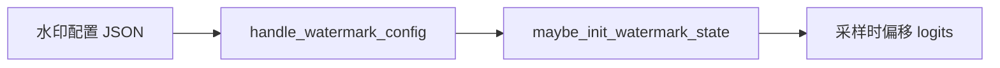
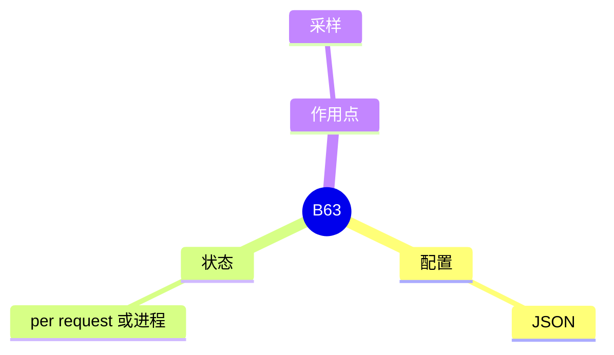

# Watermark

对应 B63。树是 `297e54fd105e974cdf401e5b4d20253a22c16f90`。**源码路径推断，未实测**。

## 场景与硬件

在采样分布里嵌入可检测的水印。`serving_hook.handle_watermark_config` 从 JSON 加载 `sampling/watermarking/config.load_watermark_config`，再 `declare_resolution` 写下字段。`maybe_init_watermark_state` 在运行时建状态。

没有 GPU 门写在 hook 名上。水印改的是采样，和 attention 后端独立。旗标的连字符以 `fields` 里 watermark 那一组为准，清单把拼写标成待核。

## 在框架中的位置

## 原理

水印不改模型权重。它在采样前按密钥和已生成 token 调整 logits 或候选。检测器以后用同一密钥看输出。状态必须跟着请求走，否则下一块的偏移对不上上一块。

## 过程

1. Hook 读 JSON，失败则解析期报错。
2. 模型或调度初始化时 `maybe_init_watermark_state`。
3. 每步采样读取状态并更新。

## 调用栈

| 函数 | 做什么 | 角色 |
| --- | --- | --- |
| `handle_watermark_config` | 加载 JSON 并声明 | 解析 |
| `load_watermark_config` | 解析配置 | 输入 |
| `maybe_init_watermark_state` | 建运行时状态 | 采样前 |

## 待核

JSON 的字段和检测器是否在本树里，本页只跟到加载和初始化。没有打开 `watermarking` 包的每一种算法。

返回 [本目录 README](README.md)。
