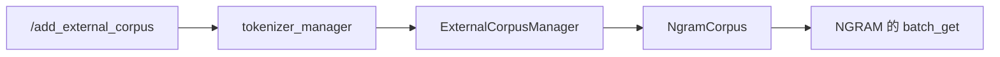
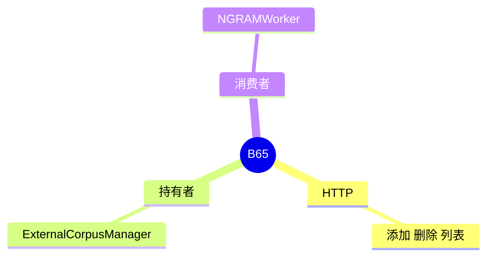

# 外部语料

对应 B65。树是 `297e54fd105e974cdf401e5b4d20253a22c16f90`。**源码路径推断，未实测**。

NGRAM 怎么用这份语料，见 [05-NGRAM](../03-投机与MTP/05-NGRAM.md)。

## 场景与硬件

不重启进程，往 n-gram 语料里加热或删掉一段文本，供后续草稿查找。HTTP：

| 方法 | 路径 |
| --- | --- |
| POST | `/add_external_corpus` |
| POST | `/remove_external_corpus` |
| 列表 | `/list_external_corpora` |

没有单独的「特性开关」名。NGRAM 的启动路径还可以用 `speculative_ngram_external_corpus_path`。运行时添加走 `ExternalCorpusManager`，在 `maybe_init_draft_worker` 里为 NGRAM 创建。

语料在 host 上。没有 GPU 门。

## 在框架中的位置

## 原理

语料是 host 侧的 SAM 或 BFS 结构，不是 KV。热更新只影响之后的草稿查找，不改已经在 GPU 上的目标 KV。`_handle_ngram` 对外部语料有预算检查，避免无界增长。

## 过程

1. 进程以 NGRAM 启动，manager 存在。
2. POST 添加或删除经 tokenizer manager 转到 scheduler 侧的 manager。
3. 下一轮 `_prepare_for_speculative_decoding` 的 `batch_get` 能看见新语料。

## 调用栈

| 函数 | 做什么 | 角色 |
| --- | --- | --- |
| `http_server` 的三个路由 | 接 HTTP | 入口 |
| `tokenizer_manager.add/remove_external_corpus` | 转发 | 控制面 |
| `ExternalCorpusManager` | 改 host 语料 | 状态 |
| `NgramCorpus.batch_get` | 草稿查找 | 消费 |

## 待核

`/list_external_corpora` 的响应字段未抄。非 NGRAM 算法收到这些 POST 时是 4xx 还是空操作，标待核。

返回 [本目录 README](README.md)。
