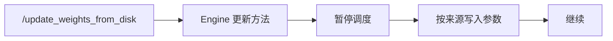
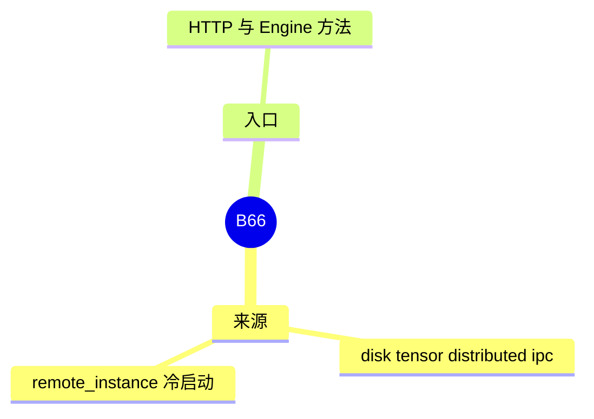

# 权重热更新

对应 B66。树是 `297e54fd105e974cdf401e5b4d20253a22c16f90`。**源码路径推断，未实测**。

## 场景与硬件

服务不退出，换一批权重。来源可以是磁盘、张量、分布式进程、IPC，或远端实例。`--load-format remote_instance` 是冷启动时就从远端拉。热更新是运行中的 HTTP 或 Engine 方法。

`http_server.py` 有 `POST /update_weights_from_disk` 等。`Engine` / `EngineBase` 还有 `update_weights_from_tensor`、`from_distributed`、`from_disk`、`from_ipc`。`RemoteInstanceModelLoader` 对应远端实例。

更新期间的集合通信要求各 rank 一起换。单卡没有这个同步。CUDA IPC 路径要求 CUDA。磁盘路径没有 GPU 代数门。

## 在框架中的位置

## 原理

参数地址若被 CUDA graph 捕获，原地换数据可以不重捕获，换形状或换地址则要重捕获或拒绝。本页不把「一定不重捕获」写成事实。实现要在调度暂停之后写参数，避免前向读到一半新一半旧的权重。

## 过程

1. 控制面调用 HTTP 或 Engine 方法。
2. 各 rank 对齐。
3. Loader 或 IPC 把新值写入参数。
4. 调度恢复。

## 调用栈

| 函数 | 做什么 | 角色 |
| --- | --- | --- |
| `/update_weights_from_disk` | HTTP 入口 | 控制面 |
| `update_weights_from_tensor` 等 | 进程内入口 | Engine |
| `RemoteInstanceModelLoader` | 冷启动的远端格式 | B35 |
| `LoadFormat.IPC_CACHE` | 内部 IPC 缓存格式，无公开 CLI | 与热更新的 IPC 相邻 |

## 待核

暂停调度的函数名，以及图是否在更新后重捕获，以 Engine 方法的实现为准。本页确认了入口名字。

返回 [本目录 README](README.md)。
