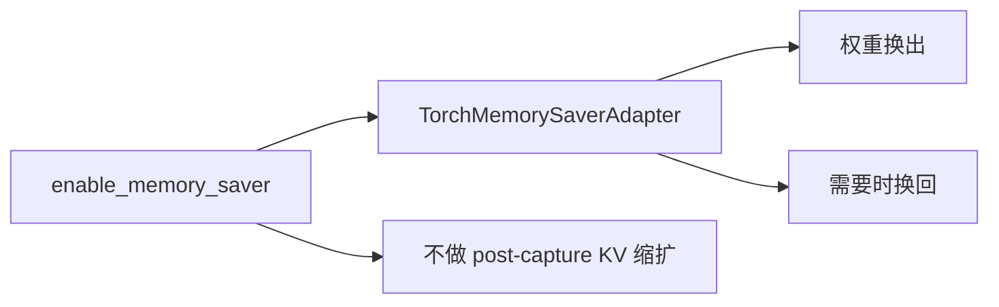
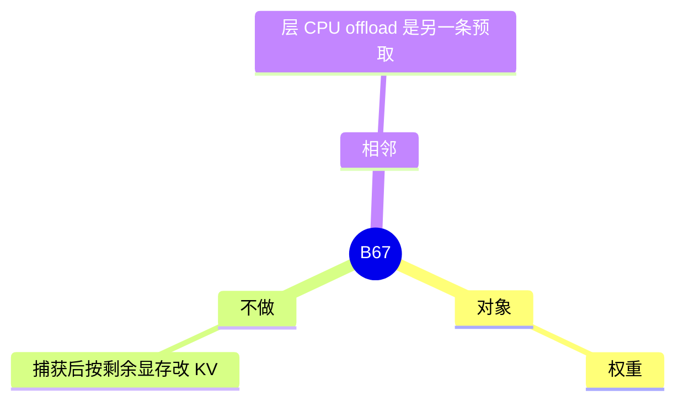

# Memory saver

对应 B67。树是 `297e54fd105e974cdf401e5b4d20253a22c16f90`。**源码路径推断，未实测**。

## 场景与硬件

权重先占着显存，捕获 CUDA graph 或把显存让给别的进程时，希望把权重暂存到 CPU，用时再换回。开关 `--enable-memory-saver`。`ModelRunner.init_memory_saver_adapter` 调 `TorchMemorySaverAdapter.create(enable=get_exec().features.enable_memory_saver)`。

`post_capture_kv_sizing_planned` 在 memory saver 打开时返回 False。捕获之后按剩余显存改 KV 池的那条路径（F195）因此不跑。这和层 CPU offload（B89）不是同一个开关。本页没有找到它和 `cpu_offload_gb` 的直接互斥。

实现依赖 PyTorch 的 memory saver，设备是 CUDA 路径。非 CUDA 是否创建 no-op，以 `TorchMemorySaverAdapter.create` 为准。

## 在框架中的位置

## 原理

Adapter 在暂停时把权重页换出，恢复时换回同一虚拟地址，这样已捕获的图仍指向原地址。因为地址和剩余显存的关系变了，捕获后的 KV 尺寸计划被关掉，避免按「权重还在卡上」的剩余显存去扩 KV。

## 过程

1. 旗标打开，runner 创建 adapter。
2. 需要休眠时 adapter 把权重换出。
3. 前向前换回。
4. KV 池按启动时的计划分配，不在捕获后再改。

## 调用栈

| 函数 | 做什么 | 角色 |
| --- | --- | --- |
| `init_memory_saver_adapter` | 创建 adapter | 启动 |
| `TorchMemorySaverAdapter.create` | 按旗标启用 | 实现 |
| `post_capture_kv_sizing_planned` | 打开时返回 False | 与 F195 的边界 |

## 待核

换出的 API 名字（pause / resume）以 adapter 类为准。和 CPU offload 同时打开时的显存账户，没有直接断言。

返回 [本目录 README](README.md)。
