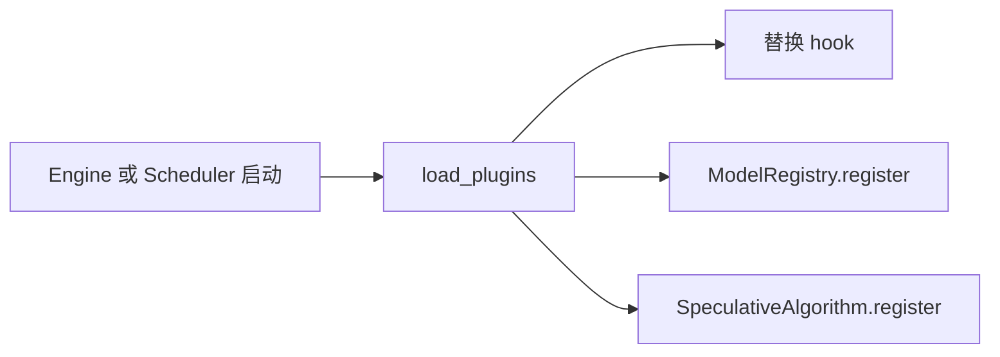
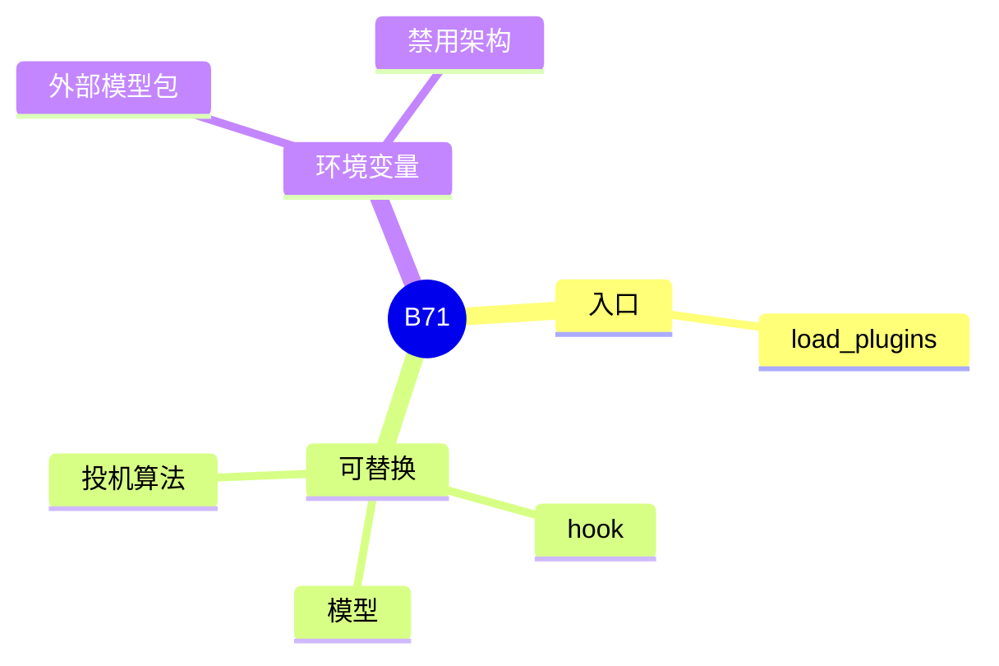

# 插件

对应 B71。树是 `297e54fd105e974cdf401e5b4d20253a22c16f90`。**源码路径推断，未实测**。

## 场景与硬件

不改服务源码，替换 hook、模型类或投机算法。`srt/plugins.py` 的 `load_plugins` 在 `Engine`、`Scheduler`、`DataParallelController` 启动时调用。

环境变量：

| 变量 | 作用 |
| --- | --- |
| `SGLANG_EXTERNAL_MODEL_PACKAGE` | 置位时推迟内置模型导入，只装外部包（M04） |
| `SGLANG_DISABLED_MODEL_ARCHS` | 按模块名跳过内置架构（M05） |

投机插件用 `SpeculativeAlgorithm.register`。名字不能撞上枚举成员和 `NEXTN`。`CustomSpecAlgo` 必须实现与枚举相同的 `is_*` / `supports_*`，`_assert_custom_spec_algo_conforms` 在注册时检查。模型插件用 `ModelRegistry.register`。

没有 GPU 门。插件自己的核可以再提设备要求。

## 在框架中的位置

## 原理

注册发生在解析和建模型之前，这样后续 hook 和 `from_string` 能看见插件。投机插件默认 `supports_overlap=False` 已废弃：overlap 开着会 `ValueError`，关掉则警告并同步跑 V2 schema。

## 过程

1. 进程入口调用 `load_plugins`。
2. 插件注册模型、算法或 hook。
3. 外部包环境变量若置位，内置 `sglang.srt.models` 的扫描让路。
4. 之后的启动按注册表走。

## 调用栈

| 函数 | 做什么 | 角色 |
| --- | --- | --- |
| `load_plugins` | 导入插件模块 | 启动最早的扩展点 |
| `ModelRegistry.register` | 加架构 | M03 的表 |
| `SpeculativeAlgorithm.register` | 加算法 | B01 |
| `_assert_custom_spec_algo_conforms` | 鸭子类型对齐 | 失败则注册期报错 |

## 待核

插件发现是入口点还是环境变量里的模块路径，以 `plugins.py` 的查找循环为准。本页确认了三个调用点和两个模型环境变量。

返回 [本目录 README](README.md)。
