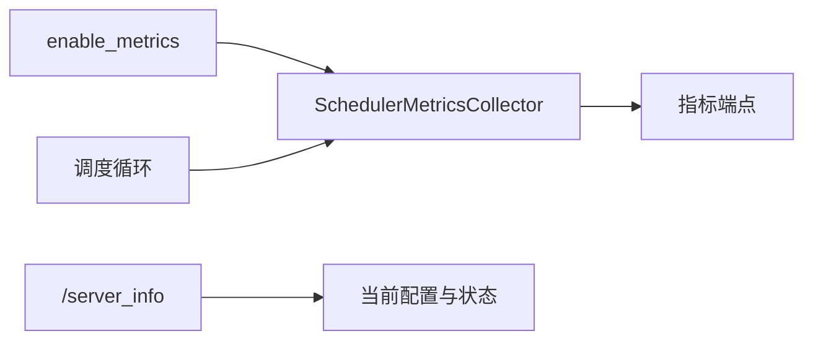
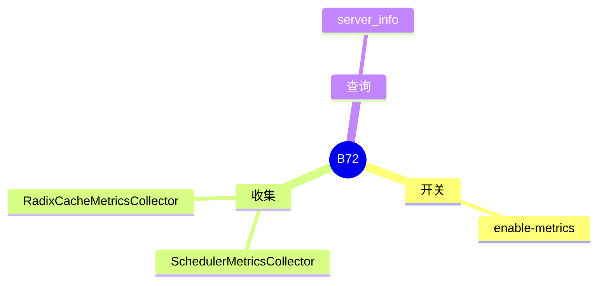

# 观测

对应 B72。树是 `297e54fd105e974cdf401e5b4d20253a22c16f90`。**源码路径推断，未实测**。

## 场景与硬件

采集调度队列、token 吞吐和缓存命中，或用 HTTP 看进程内部状态。`--enable-metrics`。收集器是 `observability/metrics_collector.py` 的 `SchedulerMetricsCollector`。另有 `RadixCacheMetricsCollector`。HTTP `/server_info` 返回服务器信息，不依赖指标是否打开的细节以路由为准。

指标在 CPU 上聚合。没有 GPU 门。多 rank 时每个 scheduler 自己的收集器上报，控制器再汇总与否以 `metrics_reporter` 为准。

## 在框架中的位置

## 原理

收集器挂在调度循环的边上，读队列长度和本步 token 数，不改变组 batch 的结果。Radix 收集器读命中长度，这些长度在 F161 已经写在请求上。打开指标不应改变 KV 或采样。若某条路径为了指标多做一次 all-gather，那是实现细节，本页没有把这种同步写成默认行为。

## 过程

1. 旗标打开时构造收集器。
2. 每步调度结束记录。
3. HTTP 刮取指标，或请求 `/server_info`。

## 调用栈

| 函数 | 做什么 | 角色 |
| --- | --- | --- |
| `SchedulerMetricsCollector` | 调度侧计数 | 指标 |
| `RadixCacheMetricsCollector` | 前缀命中 | 缓存 |
| `/server_info` | 配置快照 | 调试 |

## 待核

指标端点的路径和是否另要 `--enable-metrics` 才挂上，以 `http_server.py` 的路由为准。本页确认了收集器类和 `/server_info`。

返回 [本目录 README](README.md)。
