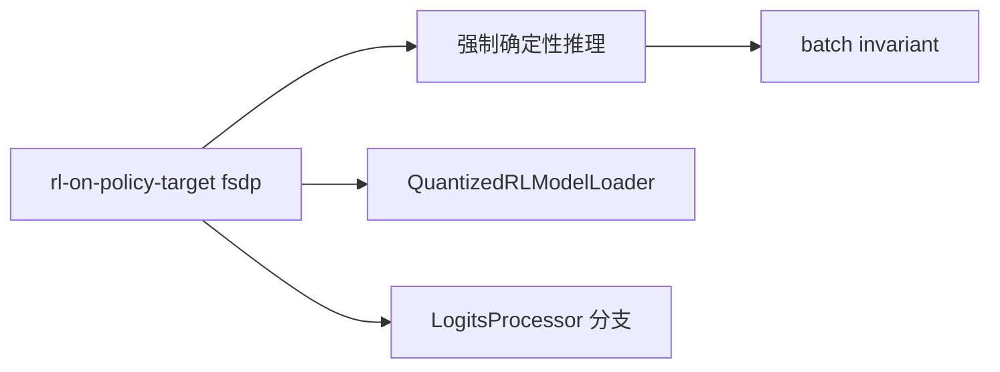
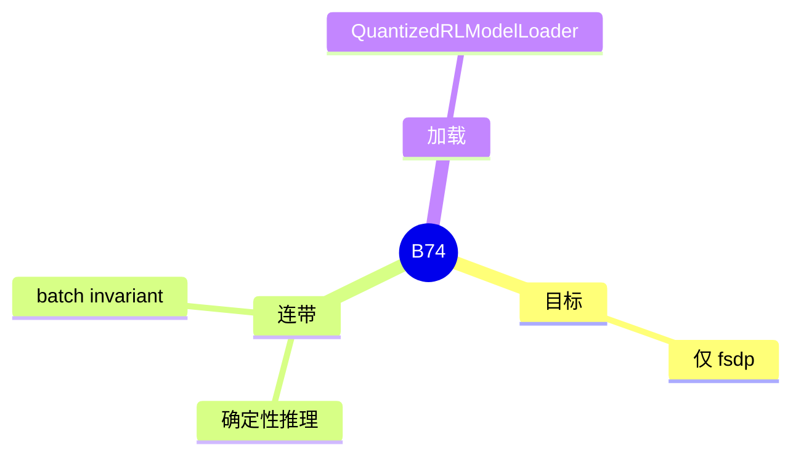

# RL on-policy

对应 B74。树是 `297e54fd105e974cdf401e5b4d20253a22c16f90`。**源码路径推断，未实测**。

## 场景与硬件

在线 RL 希望服务端的 logits 和训练侧 FSDP 对齐。`--rl-on-policy-target` 的 choices 只有 `fsdp`（`RL_ON_POLICY_TARGET_CHOICES`）。置位时 `attention_hook` 打开确定性推理，从而走到 B61 和 B62。

加载器类 `QuantizedRLModelLoader` 继承 `DefaultModelLoader`（`model_loader/loader.py`）。它负责量化权重在这条目标下怎么读。`LogitsProcessor`、layernorm 和视觉路径里有 `rl_on_policy_target == "fsdp"` 的分支。

没有单独的 GPU 名单。确定性推理会改 NCCL 和 attention 后端，那些门在 B61。

## 在框架中的位置

## 原理

训练和推理的数值差会把 on-policy 的梯度打偏。服务端收紧到确定的 matmul、attention 和采样，并用专门 loader 对齐量化权重的舍入。这不是一个新的调度循环。

## 过程

1. 字段设为 `fsdp`。
2. Attention hook 打开确定性旗标。
3. Loader 若被选中，按 RL 路径读权重。
4. 采样和 norm 走 fsdp 分支。

## 调用栈

| 函数 | 做什么 | 角色 |
| --- | --- | --- |
| `RL_ON_POLICY_TARGET_CHOICES` | 只含 `fsdp` | 校验 |
| attention hook 的确定性分支 | 打开 B61 | 数值 |
| `QuantizedRLModelLoader` | 权重量化加载 | 启动 |
| `LogitsProcessor` 的 fsdp 分支 | 对齐 logits | 采样 |

## 待核

`QuantizedRLModelLoader` 在什么 `load_format` 或量化组合下被 `get_model_loader` 选中，以 loader 工厂的分支为准。本页确认类存在，没有逐步跟选择条件。

返回 [本目录 README](README.md)。
