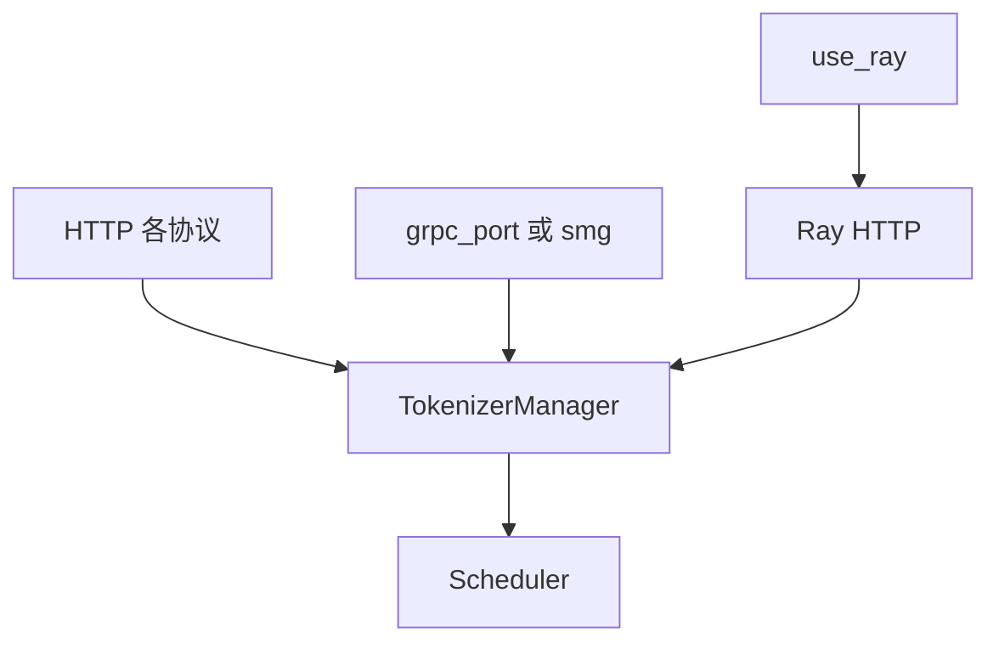
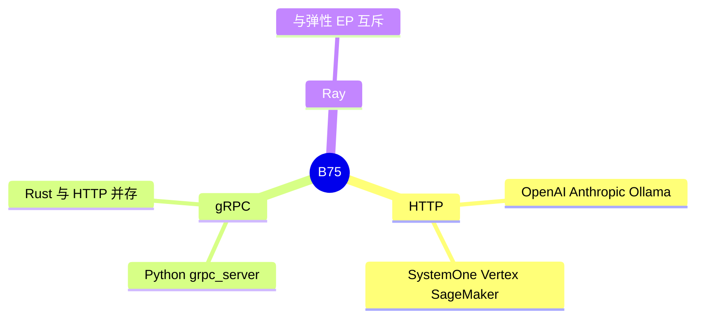

# 服务协议面

对应 B75。树是 `297e54fd105e974cdf401e5b4d20253a22c16f90`。**源码路径推断，未实测**。

请求如何进入 `GenerateReqInput`，见 [01-协议入口](../../02-流程/02-请求接入/01-协议入口.md)。本页只写有哪些面，以及和特性的冲突。

## 场景与硬件

同一套调度可以挂不同的对外协议：OpenAI、Anthropic、Ollama、SystemOne、Vertex、SageMaker、gRPC、Ray。路由在 A.10。原生 gRPC 在 `entrypoints/grpc_server.py`。Ray 的 HTTP 在 `srt/ray/http_server.py`。

旗标：`--smg-grpc-mode`，`--use-ray`，`--grpc-port`。`run_server` 的注释写原生 Rust gRPC 与 HTTP 可以并存。`grpc_mode` 是被折进 `smg_grpc_mode` 的旧名。

Elastic EP 的扩容拒绝 `--use-ray`。Rust server（`SGLANG_RUST_SERVER`）下进程内 `Engine.generate` 被拒绝（F11）。协议进程本身不要求特定 GPU，GPU 在 scheduler 上。

## 在框架中的位置

## 原理

协议层把外部 JSON 收成内部请求。调度、KV 和模型不读协议名字。因此特性页里的限制（例如 PD、语法）对所有协议相同，除非某个路由根本不传某个字段。字段表在附录 06。

## 过程

1. `serving_hook` 处理 `grpc_port`、`smg_grpc_mode` 和 `use_ray`。
2. HTTP 路由或 gRPC 服务启动。
3. 请求进入 tokenizer，之后与协议无关。

## 调用栈

| 函数 | 做什么 | 角色 |
| --- | --- | --- |
| `serving_hook` 的 gRPC / Ray 分支 | 旗标和废弃名 | 解析 |
| `grpc_server` | Python gRPC | 入口 |
| Ray `http_server` | Ray 部署的 HTTP | 入口 |
| `handle_elastic_ep` | 拒绝 `use_ray` | 互斥 |

## 待核

哪些路由在 Rust 模式下仍由 Python 注册，以 F22 和 `run_server` 为准。本页不重写协议字段。

返回 [本目录 README](README.md)。
