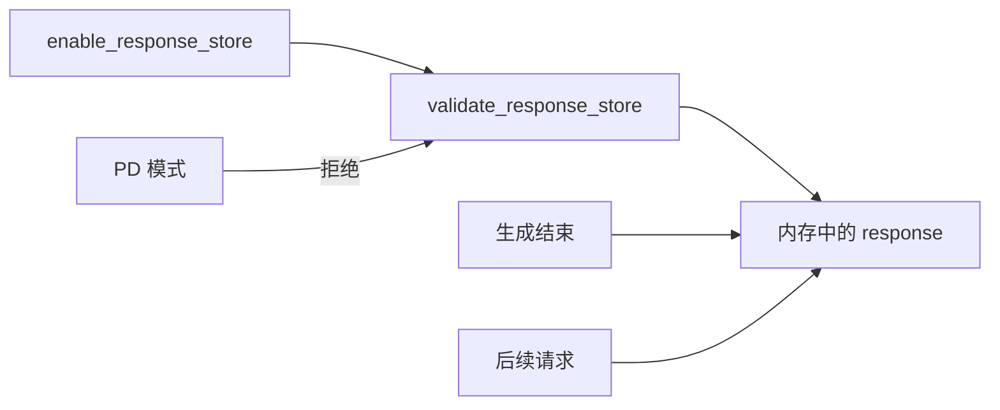
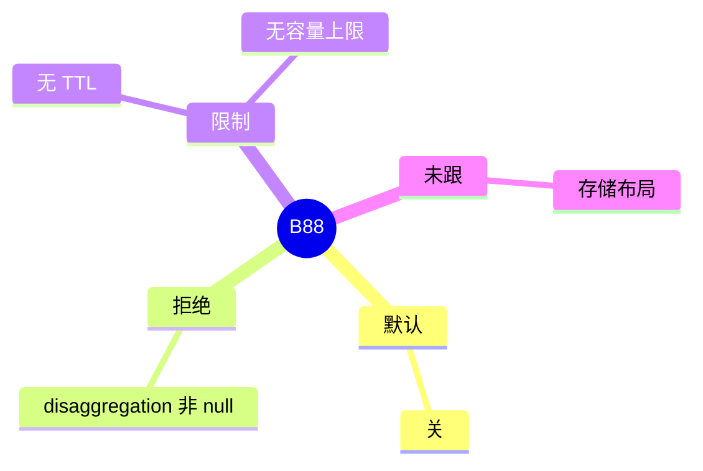

# Responses 存储

对应 B88。树是 `297e54fd105e974cdf401e5b4d20253a22c16f90`。**源码路径推断，未实测**。

## 场景与硬件

把一次 response 留在内存里，供之后检索、把多轮串起来，或后台请求再读。开关 `--enable-response-store`，字段 `enable_response_store`。help：默认关；PD 分离不支持；无 TTL、无容量上限。

`validate_response_store`：`enable_response_store` 且 `disaggregation_mode != null` 则 `ValueError`，文案是 response storage must remain disabled in PD mode。校验在 S2 早期。

存储在进程内存。没有 GPU 门。没有 TTL 意味着条目一直留到进程退出或被实现里的删除路径清掉。容量无上限意味着要靠调用方控制。

## 在框架中的位置

## 原理

PD 的 prefill 和 decode 是两个进程，一份内存里的 response 对不上两边的请求身份。校验因此直接禁止，而不是做跨进程复制。和 radix session（B49）不同：session 保的是 KV 引用，这里保的是响应对象。

## 过程

1. 旗标打开。
2. `validate_response_store` 看 PD 模式。
3. 生成结束把 response 放进存储。
4. 后续检索或串联读取它。

## 调用栈

| 函数 | 做什么 | 角色 |
| --- | --- | --- |
| `validate_response_store` | PD 拒绝 | 解析 |
| `enable_response_store` | 开关 | 配置 |

## 待核

存储的键、结构体和删除 API 未跟。help 已经说明没有 TTL 和容量上限。布局标待核。

返回 [本目录 README](README.md)。
