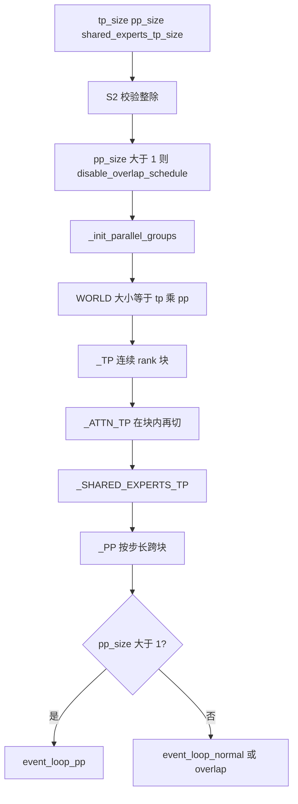
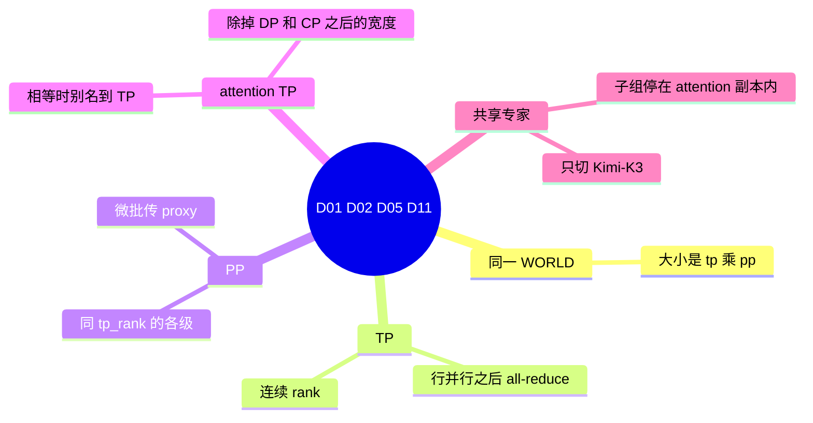
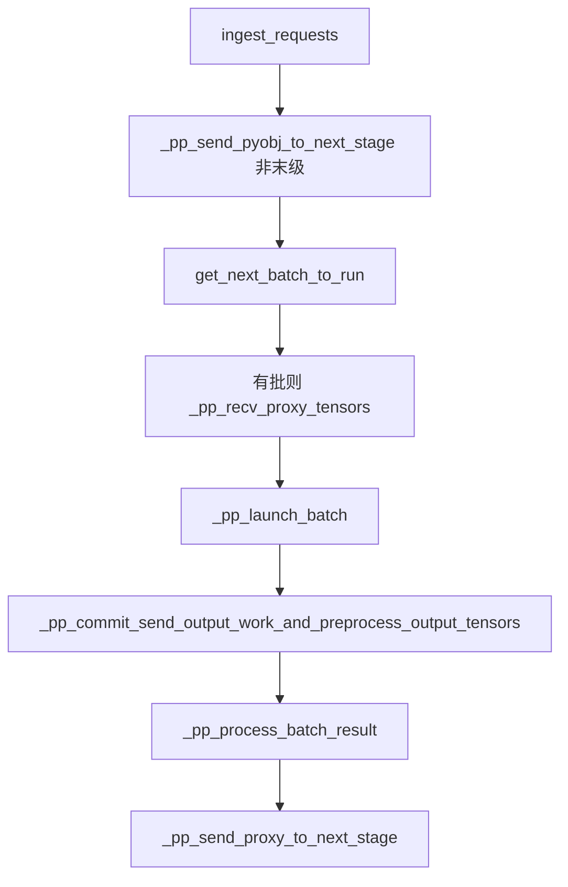

# 张量与流水

对应 D01、D02、D05、D11。树是 `297e54fd105e974cdf401e5b4d20253a22c16f90`。**源码路径推断，未实测**。

开关和互斥的短文在特性页：[05-PP](../03-特性/07-并行切分/05-PP.md)（B42）、[05-Shared-experts-TP](../03-特性/04-MoE与DeepEP/05-Shared-experts-TP.md)（B43）。F196（为何 PP 关 overlap）在 [05-分布式初始化](../02-流程/01-启动/05-分布式初始化.md) 的上游 hook，函数是 `_pipeline_parallel_overlap_disable`。本页写组怎么排、层怎么切、隐藏状态在哪一次集合通信上汇合。

## 场景与硬件

| 场景 | 硬件或平台前提 | 轴 |
| --- | --- | --- |
| 单卡放得下整模 | `tp_size = pp_size = 1`。仍会建 WORLD，大小是 1。NCCL 预热要求 TP、PP 或 MoE EP 大于 1，单卡不进 `_prewarm_nccl` | D01 的退化 |
| 单机多卡，权重按列/行切开 | `tp_size>1`。同机、组宽属于 `{2,4,6,8}`、并且 `can_use_custom_all_reduce_with_nvlink` 认到全互连时，D17 的自定义 all-reduce 才可能启用。跨机 TP 走进程组后端（D16），不走这条自定义核 | D01 |
| 头数不能被 `tp_size` 整除 | 线性层按输出维或输入维整除。对不上时加载或建层会失败。本页不另造「自动补头」 | D01 |
| 层数多，一张卡放不下全部层 | `pp_size>1`。`(tp_size * pp_size) % nnodes == 0`（scale joiner 除外）。级间传激活，带宽压力小于每层 all-reduce，但调度不能再 overlap | D02 |
| attention DP 或 prefill CP 把 TP 组再切开 | attention 的线性层落在更窄的 `attn_tp_size` 上。`attn_tp_size == tp_size` 时 `_ATTN_TP` 就是 `_TP`，不建第二套组 | D05 |
| Kimi-K3 的共享专家比 attention 更窄 | `--shared-experts-tp-size` 为正，且整除 attention TP。a2a 必须是 deepep、megamoe、mooncake、ascend_fuseep、mori 之一。不是 Kimi-K3 直接 `ValueError` | D11 |

MPS 的标准路径要求 `tp_size=pp_size=dp_size=1`（`validation_hook.py`）。这是平台门，不是这四条轴的定义。

## 在启动里的位置

WORLD 的 rank（`_init_parallel_groups`，scale joiner 另加 `ep_join_rank_offset`）：

`rank = tp_size * pp_rank + tp_rank`

所以一个 PP 级上的 TP rank 是连续的。文档字符串里的 8 卡例子：TP=2、PP=4。

| 组 | 成员 |
| --- | --- |
| 4 个 TP 组 | `[g0,g1]` `[g2,g3]` `[g4,g5]` `[g6,g7]` |
| 2 个 PP 组 | `[g0,g2,g4,g6]` `[g1,g3,g5,g7]` |

g0 与 g1 是第 0 级的两张 TP 卡，每层都要 all-reduce。g0、g2、g4、g6 是同一条 TP 分片在四个级上的卡，它们之间传的是级间激活，组名 `pp`，建组时 `use_custom_allreduce=False`。

## D01 张量并行

`initialize_model_parallel` 读 `get_parallel().tp_size`。TP 组个数是 `world_size // tp_size`。第 `i` 组的 rank 是 `[i*tp_size, (i+1)*tp_size)`。`group_name="tp"`。建组时传入 `SGLANG_USE_MESSAGE_QUEUE_BROADCASTER`。函数在建 TP 组之前注释说消息队列广播只用于张量并行组；同一次调用里 DCP、attention CP、attention TP 和 PD mux 组也把这个环境变量传了进去。它是否只在 TP 上生效，标待核。

权重怎么切，由线性层自己选组。`ColumnParallelLinear` 的文档：矩阵 `A` 按输出维切成 `[A_1, …, A_p]`，默认每卡拿到 `Y_i = X A_i`。`gather_output` 为真时再按最后一维 all-gather。`RowParallelLinear` 把输入按最后一维切开，本地 GEMM 之后，在 `reduce_results` 且组宽大于 1 时做 all-reduce。`parallel_group == "attn_tp"` 时 reduce 走 `attn_tp_group`，否则走 `tensor_model_parallel_all_reduce`，它就是 `get_tp_group().all_reduce`。

`GroupCoordinator.all_reduce` 在组宽为 1 时直接返回输入。组宽大于 1 时按设备选实现：HPU、XPU、FlashInfer 融合、MSCCL++、自定义 all-reduce、对称内存上的 PyNCCL，最后才是 inplace / outplace 的进程组 all-reduce。选哪条是 D17，本页只标明调用点在行并行线性层的输出上。

LayerNorm 序列并行（B65）把这一次 all-reduce 换成 reduce-scatter 加后面的 all-gather，让 LayerNorm 吃序列分片。它不新建进程组，仍用 TP 组。细节在 [03-LayerNorm-SP](../03-特性/09-其它/03-LayerNorm-SP.md)。`enable_attn_tp_input_scattered` 则是 attention 输入可以保持分片，减少 qkv latent 的计算；Nemotron-H、LongCat-Flash、Kimi-K3、Inkling 在 `handle_context_parallelism` 里会被关掉，因为它们的 forward 不进那个 scope。

### 调用栈

| 函数 | 做什么 | 角色 |
| --- | --- | --- |
| `_init_parallel_groups` | 用 `tp_size * pp_size` 当 WORLD，rank 用上面的公式 | 进程坐标 |
| `init_model_parallel_group`（`group_name="tp"`） | 连续 rank 建成 `_TP` | D01 的组 |
| `ColumnParallelLinear.forward` | 输出维已切好的 GEMM；可选 all-gather | 列切 |
| `RowParallelLinear.forward` | 输入切开，GEMM，再 all-reduce | 行切后的汇合 |
| `tensor_model_parallel_all_reduce` | 转到 `get_tp_group().all_reduce` | 通信入口 |
| `GroupCoordinator.all_reduce` | 按设备和旗标选一种 all-reduce | D17 的落点 |
| `_prewarm_nccl` | `tp_size>1` 时对 TP 组做一次标量 all-reduce | 去掉首请求冷启动 |

## D02 流水并行

`pp_size>1` 时 `_pipeline_parallel_overlap_disable` 把 `disable_overlap_schedule` 写成真。`check_pipeline_parallel_compat` 再断言 overlap 必须已经关掉，并限制投机：非 DSPARK 只允许非多层 EAGLE；DSPARK 只允许 prefill 角色。`min_free_slots_delay` 与 PP 互斥，因为可分配槽被 `pp_max_micro_batch_size` 卡住，阈值可能永远达不到。这些断言的原文在特性页，这里用作「什么时候不该开 PP」。

层区间的公共函数是 `distributed/utils.py` 的 `get_pp_indices`。默认把层尽量均分，余数分给最后几个级。环境变量 `SGLANG_PP_LAYER_PARTITION` 可以用逗号列出每一级的层数，长度必须等于 `pp_size`，和必须等于总层数。`pp_size==1` 时这个环境变量被忽略，避免单层草稿读到目标模型的切分。`models/starcoder2.py` 用 `pp_rank * num_hidden_layers // pp_size` 自己算起点。谁走公共函数、谁自己整除，没有逐文件核对，标待核。

PP 组的排法与 TP 正交。组个数是 `world_size // pp_size`。第 `i` 组的 rank 是 `range(i, world_size, 组个数)`，也就是同一个 `tp_rank` 穿过各级。另外每个 rank 再进一个单人组 `_SELF_PP`（`group_name="self_pp"`），给一层草稿用：草稿不跨级，但 `new_group` 是集合操作，每个 rank 都要参加创建。`patch_pipeline_parallel_group` 在草稿 forward 时把 `_PP` 临时换成这个单人组。

调度入口在 `dispatch_event_loop`：模式是 null 且 `pp_size>1` 时进 `event_loop_pp`；prefill / decode 分离时进 `event_loop_pp_disagg_prefill` 或 `event_loop_pp_disagg_decode`。`SchedulerPPMixin.event_loop_pp` 的注释规定：每一级按同一顺序跑；发送异步、接收同步；`pp_async_batch_depth` 让最后一级把输出先攒着，用来盖住 CPU 处理。未设置 `pp_max_micro_batch_size` 时，scheduler 把它收成 `max(max_running_requests // pp_size, 1)`。

一次微批在一级上的数据面（函数名来自 `event_loop_pp` 本体）：

| 函数 | 做什么 | 角色 |
| --- | --- | --- |
| `get_pp_indices` | 按级算 `[start_layer, end_layer)` | 这一级拥有哪些层 |
| `init_model_parallel_group`（`group_name="pp"`） | 跨级的同 TP 分片 | 级间组，不用自定义 all-reduce |
| `event_loop_pp` | 按微批下标循环，各级同一顺序 | 调度 |
| `_pp_send_pyobj_to_next_stage` | 把本级刚收到的请求对象异步送到下一级 | 控制面，Python 对象 |
| `_pp_recv_proxy_tensors` | 收下一级需要的隐藏状态代理 | 数据面 |
| `_pp_launch_batch` | 在本级的层上跑前向 | 计算 |
| `_pp_send_proxy_to_next_stage` | 把本级输出送给下一级 | 数据面 |
| `patch_pipeline_parallel_group` | 草稿 forward 时改用单人 PP 组 | 草稿不跨级 |

末级才产生 logits 并采样。草稿 worker 是否建在末级，是 F113，归启动篇，不在这里重写。

## D05 Attention TP

`derive_attn_tp_size`：`attn_tp_size = tp_size // attn_dp_size // attn_cp_size`。两个除数都是 1 时，宽度等于 TP，`initialize_model_parallel` 把 `_ATTN_TP = _TP`，不调用第二次 `init_model_parallel_group`。

宽度更窄时，在每个 TP 块里按 `(cp, dp)` 的组合切出连续的 `attn_tp_size` 个 rank，`group_name="attention_tp"`。这段建组把 `use_pynccl` 设成 `SYNC_TOKEN_IDS_ACROSS_TP or enable_symm_mem`，自定义 all-reduce 交给组自己探测（`use_custom_allreduce=None`），对称内存 all-reduce 关掉。

`get_dp_tp_group`：attention DP 开着时返回 `attn_tp_group`，否则返回整个 `tp_group`。文档字符串：这是跑某一个 DP rank 那份 batch 的 TP rank。Attention CP 的同伴只在第二种情况下还留在这个组里。线性层若按 attention TP 切权重、却对整个 TP 组 all-reduce，`reject_attn_tp_shard_with_tp_reduce` 会拒绝，因为 all-reduce 会混进别的请求或复制过的输入。

`initialize_dp_attention` 用 `compute_dp_attention_world_info` 把 `attn_tp_rank` 和 `attn_dp_rank` 写进并行袋子。这两个 rank 是进程私有的，不在 `override_permanently` 的宽度表里，所以要在建组之后再算。细节和「不增加 GPU」的解释是 F108、F192，归启动篇。

## D11 共享专家 TP

`handle_shared_experts_tp` 在 a2a 改写 `ep_size` 之后跑。`shared_experts_tp_size is None` 则直接返回。否则：

- 宽度小于 1，或不能整除 `derive_attn_tp_size(...)`，`ValueError`。
- 模型路径是实例连接器，或架构不是 `KimiK3ForConditionalGeneration`，`ValueError`。
- a2a 不在 deepep、megamoe、mooncake、ascend_fuseep、mori 里，`ValueError`。

建组：宽度等于 attention TP 时，`_SHARED_EXPERTS_TP = _ATTN_TP`。更窄时，按 `shared_size` 把 WORLD 切成连续块，`group_name="shared_experts_tp"`，不用自定义 all-reduce，也不用对称内存 all-reduce。注释写明这些块留在各自的 PP 级里。因为 TP 块本身连续，而 `shared_size` 整除 attention TP、attention TP 又整除 `tp_size`，连续小块不会跨出 TP 块，也就不会跨级。文档字符串的那句「subgroups never cross attention replicas」指的是这件事。

只有 `shared_experts_tp_size > 1` 才建组。宽度 1 表示权重复制，字段帮助文本写了这一点，函数在 `> 1` 才进 `init_model_parallel_group`。

| 函数 | 做什么 | 角色 |
| --- | --- | --- |
| `handle_shared_experts_tp` | 只放行 Kimi-K3 和列出的 a2a，并检查整除 | S2 |
| `derive_attn_tp_size` | 给出必须被整除的那个宽度 | 约束 |
| `init_model_parallel_group`（`group_name="shared_experts_tp"`） | 连续子块，或别名到 attention TP | 运行时组 |

共享专家怎么进 all-to-all，是 B43 和 Waterfill（B94）。本页停在组的成员。

## 组合

- PP 与 overlap 互斥，这是解析期改写，不是循环里的分支。
- `moe_dp_size>1` 时 `handle_context_parallelism` 断言 `pp_size==1`，报错文案写的是 context parallelism。纯 prefill CP、且 `moe_dp_size==1`，不会走进这条 assert。特性页把「同时 PP」写成 CP hook 一律拒绝；以这条分支为准。
- Elastic EP 的运行时扩容要求 `pp_size==1`，因为注释假定 TP 组下标就是全局 rank。见 [04-专家并行](04-专家并行.md) 的 D12。
- Attention DP 把行并行的 reduce 从整个 TP 组挪到 `attn_tp_group`（`use_dp_attention_reduce`）。空的 attention DP rank 仍要参加这次 reduce，那是 F193。

返回 [分布式目录](README.md)。
