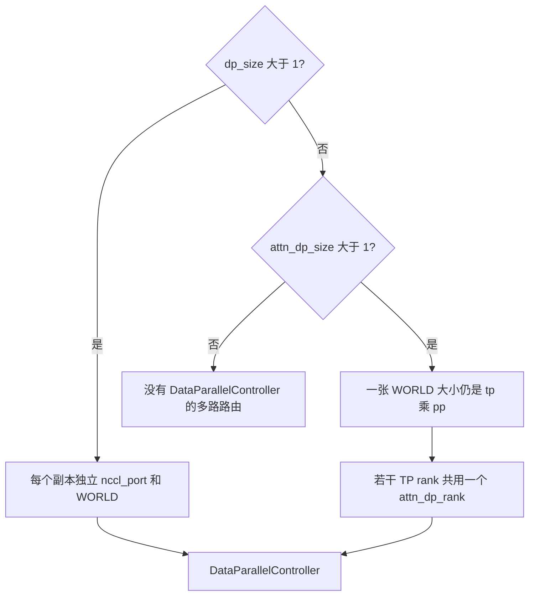
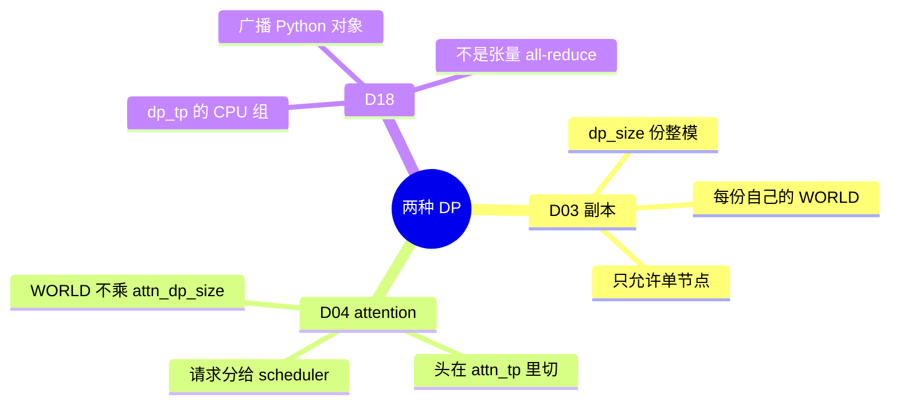

# 数据并行

对应 D03、D04、D18。树是 `297e54fd105e974cdf401e5b4d20253a22c16f90`。**源码路径推断，未实测**。

特性开关在 [02-模型副本DP](../03-特性/07-并行切分/02-模型副本DP.md)（B18）和 [01-Attention-DP](../03-特性/07-并行切分/01-Attention-DP.md)（B17）。「为何 attention DP 不增加 GPU 却增加 scheduler」是 F192，「空组为何仍要 IDLE」是 F193，chunk 被改小是 F202。本页写两套 DP 的进程拓扑差在哪里，以及控制面走哪一个组。

## 场景与硬件

| 场景 | 硬件或平台前提 | 轴 |
| --- | --- | --- |
| 单机，多张卡各放一份完整模型，用副本换吞吐 | `dp_size>1`，`attn_dp_size` 保持 1。`check_server_args`：`dp_size>1` 且 `nnodes != 1` 则失败，文案要求改用 `--attn-dp-size`。GPU 数是 `dp_size * tp_size * pp_size`，每个副本一张 WORLD | D03 |
| 头少，不想再切 attention 头；请求可以分给不同 scheduler，FFN 仍张量并行 | `attn_dp_size>1` 且 `dp_size==1`。可以跨节点。GPU 数仍是 `tp_size * pp_size`，不乘 `attn_dp_size` | D04 |
| 两套一起开 | `handle_data_parallelism` 直接 `ValueError`。`num_dp_ranks_of` 的文档也写：attention DP 不在副本里面跑，两个数里有一个是 1 | 互斥 |
| 多模态对象要在一组 TP rank 上广播 | 用 `dp_tp_group` 的 CPU gloo 组，避免把 Python 对象送进 CUDA 流 | D18 |
| 旧旗标 `--dp-size N --enable-dp-attention` | `handle_deprecated_dp_attention` 把 N 挪到 `attn_dp_size`，`dp_size` 改回 1 | 兼容，结果是 D04 |

没有单独的 SM 白名单。跨机时集合通信走 D16 的进程组，副本 DP 根本不被允许跨机。

## 两套 DP 差在进程，不差在名字

`num_dp_ranks = dp_size * attn_dp_size`。大于 1 时父进程拉起 `DataParallelController`。`attn_dp_enabled` 为真走 `launch_dp_attention_schedulers`，否则走 `launch_dp_schedulers`。

## D03 模型副本

`launch_dp_schedulers` 对每个 `dp_rank`：

1. `PortArgs.init_new` 拿一份新的 IPC 名，并占住一个 `nccl_port`。
2. 起线程跑 `launch_tensor_parallel_group`，`base_gpu_id` 按 `tp_size * pp_size * gpu_id_step` 往后跳。
3. `node_rank==0` 时为这个副本建一条 ZMQ PUSH。

每个副本的 scheduler 进程用自己的 `nccl_port` 做 rendezvous，所以 `initialize_model_parallel` 的 `world_size == tp_size * pp_size` 里没有 `dp_size`。副本之间不共享 TP 组，也不做专家 all-to-all。副本内部 `tp_size>1` 时仍是普通 D01。

线程绑定的 `world_size` 用 `dp_size * tp_size * pp_size`。`bootstrap` 里这段的注释：attention DP 划分的是已有的 TP 组，不再起一批进程，所以只有副本去乘进程数。

负载方法在 `handle_load_balance_method`：`auto` 在非 PD 和 PD decode 上收成 `round_robin`，在 PD prefill 上收成 `follow_bootstrap_room`。`total_requests` / `total_tokens` 走 `DPBudget`，派发前会读 scheduler 的负载快照，并限制 20ms 内不重复刷新，避免一串请求全堆到同一个 rank。控制器不构造 `Req`，这是 F144。

| 函数 | 做什么 | 角色 |
| --- | --- | --- |
| `check_server_args` | 多节点禁止 `dp_size>1` | 启动门 |
| `handle_data_parallelism` | 与 `attn_dp_size>1` 互斥 | 第二道门 |
| `launch_dp_schedulers` | 每副本一个端口和一张 WORLD | 进程 |
| `launch_tensor_parallel_group` | 在该副本的 GPU 段上起 TP×PP scheduler | 副本内部的 D01/D02 |
| `DataParallelController.dispatching` | round_robin、follow_bootstrap_room、total_requests、total_tokens | 选副本 |
| `round_robin_scheduler` | 按计数器选 `dp_rank` | 默认负载 |

副本是否共享 host 上的 HiCache，特性页标了待核。本页同样没有看到 `dp_size` 专用的树合并，按每进程各持一棵前缀树理解。

## D04 Attention DP

布局（`derive_attention_ranks`）：`attn_dp_rank = tp_rank // (attn_tp_size * attn_cp_size)`，`attn_tp_rank = tp_rank % attn_tp_size`。例如 `tp_size=4`、`attn_dp_size=2`、`attn_cp_size=1`，则 `attn_tp_size=2`。rank 0 和 1 是 DP 0，共用一份 batch，头在这两张卡上切；rank 2 和 3 是 DP 1，跑另一份请求。四张卡仍在同一个 TP 组里做 FFN 的 all-reduce 或 MoE 的 all-to-all。

`launch_dp_attention_schedulers` 不按副本去乘 GPU。节点 0 按 DP rank（弹性时按 `max_dp_size`）绑定 ZMQ 端口，再用 `_broadcast_worker_ports` 把端口表发给其它节点。每个 TP rank 用 `compute_dp_attention_world_info` 算出自己的 `dp_rank`，连到对应端口。跨节点时 `launch_tensor_parallel_group` 用 `nnodes` 切本节点负责的 `pp_rank` 和 `tp_rank` 区间，见 [05-分离多机与通信](05-分离多机与通信.md) 的 D15。

`handle_data_parallelism` 在组打开之后：

- `schedule_conservativeness` 乘 0.3。
- `chunked_prefill_size` 整除 `attn_dp_size`（F202）。warning 在 `declare_resolution` 之后打，一边是除法前的局部变量，一边是当时 resolving view 上的 `chunked_prefill_size`。
- prefill CUDA graph 的 `max_bs` 若大于除完的块，且该字段没被锁住，就夹到每 rank 的块，避免捕获的批大于 MoE all-to-all 的 token 预算。
- `SGLANG_RUST_SERVER` 时声明 `enable_dp_attention_local_control_broadcast=True`。

控制消息的步长：本地广播打开时 `control_message_step=1`，每个 attention-TP 组长都收到，再在自己的 `attn_tp_group` 里广播。否则步长是 `tp_size`，只发给第一名组长，由它在整个 `tp_group` 上广播。字段帮助文本写明，后一种会在每个 scheduler 迭代上做一次全 rank 的 gloo 同步。

数据面上，MLP 仍可能要对整个 TP 组 all-reduce。某个 DP rank 这一步没有 token 时不能跳过 forward，否则对端的 all-to-all 对不齐。调度器造 `ForwardMode.IDLE`。这是 F193，过程在调度篇。

`dp_gather_partial`、`dp_gather_replicate`、`dp_scatter`（`layers/dp_attention.py`）在隐藏状态进出 attention 时，把各 DP rank 的 token 收成 FFN 要的全长，再把结果散回去。`attn_tp_all_gather` 只在 attention TP 子组里收。`init_dp_gathered_buffer` 在 `init_layer_runtime` 里按 `hidden_size` 留这块缓冲，发生在模型加载之前。

| 函数 | 做什么 | 角色 |
| --- | --- | --- |
| `handle_deprecated_dp_attention` | 旧旗标收成 `attn_dp_size`，`dp_size=1` | 兼容 |
| `handle_data_parallelism` | 互斥、chunk 整除、图的 max_bs、保守度 | S2 |
| `derive_attn_tp_size` / `derive_attention_ranks` | 头的宽度和本进程的 DP rank | 坐标 |
| `launch_dp_attention_schedulers` | 一张 WORLD 上按 DP rank 绑 ZMQ | 进程 |
| `initialize_dp_attention` | 写 `attn_dp_rank`，并 `dp.enabled = attn_dp_enabled` | F108 |
| `get_dp_tp_group` | attention DP 时返回 `attn_tp_group` | 这一份 batch 的 TP |
| `dp_gather_partial` / `dp_scatter` | 隐藏状态在 DP 分片和 FFN 全长之间收放 | 数据面 |
| `DataParallelController.send_control_message` | 按步长把控制对象发给组长 | 控制面 |

`_data_parallelism_defaults`：`num_dp_ranks==1` 且不是 scale joiner 时，把 `enable_dp_lm_head` 收成假。词表并行和 TP lm-head all-to-all 是这条轴上的优化，默认只在纯 attention DP 的 decode 节点打开，见字段 `enable_tp_lm_head_all_to_all` 的帮助文本。本页不展开 GEMM。

## D18 控制面组

`Scheduler.__init__` 里：

`self.dp_tp_group = get_dp_tp_group()`

`self.dp_tp_cpu_group = self.dp_tp_group.cpu_group`

旁边的注释：`dp_tp_*` 是请求和数据面的协调组，不是张量集合通信。入口 rank 是组内 local rank 0。广播 VLM 的 Python 对象要用 CPU（gloo）组，避免和 CUDA 流、设备绑在一起。

因此 D18 没有自己的 `group_name`。它是 D04（或未开 attention DP 时的整个 TP 组）那套 `GroupCoordinator` 上已经建好的 gloo 后端。`ProfilerManager` 同样拿 `get_dp_tp_group().cpu_group` 做 barrier。语法队列在 PP0 上对就绪下标做 all-gather，也走这个 CPU 组，那是 F158。

| 函数 | 做什么 | 角色 |
| --- | --- | --- |
| `get_dp_tp_group` | 选出「这一份 batch 的 TP 组」 | 组从哪来 |
| `GroupCoordinator.cpu_group` | 同一批 rank 上的 gloo 组 | D18 的载体 |
| `Scheduler` 对 `dp_tp_cpu_group` 的 all-gather / broadcast | 传 Python 对象或下标，不传隐藏状态 | 控制面 |

张量 all-reduce 仍在 `device_group` 上，归 D01 / D05 / D17。

## 和别的轴

- DWDP（B46）在 `handle_dwdp` 里把 `attn_dp_size` 设成 `dwdp_size`、`dp_size` 设成 1、`moe_a2a_backend` 设成 `none`。它借用 D04 的调度面，专家通信改成权重预取。过程在 [08-DWDP](../03-特性/04-MoE与DeepEP/08-DWDP.md)。
- 弹性扩容的 joiner 即使自己的 `attn_dp_size` 是 1，`attn_dp_enabled_of` 仍为真，因为它加入的是一个 attention DP 部署。见 D12。
- `handle_data_parallelism` 里若图可能捕获跨 rank 集合通信，会把 `NCCL_GRAPH_REGISTER` 设成 0（用户已显式设置则只打日志）。注释记录了 tp4/dp4/ep4 和多机 tp16 上的挂起。这是规避，根因注释自己标成未确认。

返回 [分布式目录](README.md)。
