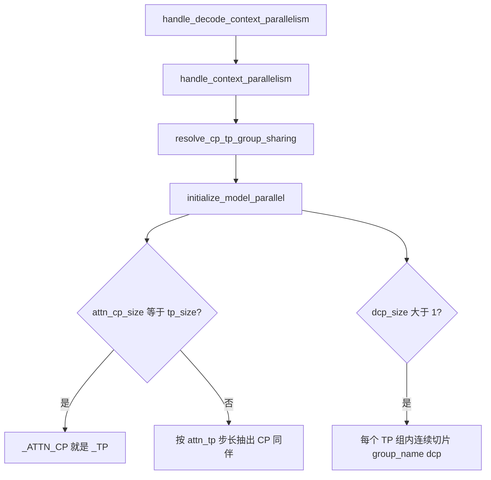
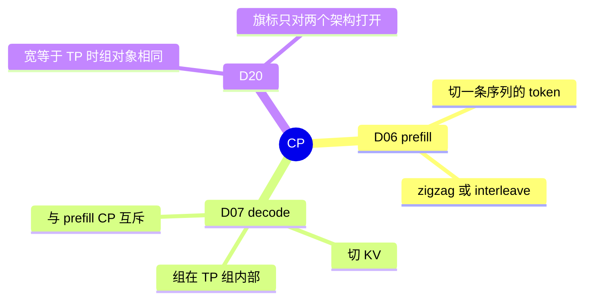

# 上下文并行

对应 D06、D07、D20。树是 `297e54fd105e974cdf401e5b4d20253a22c16f90`。**源码路径推断，未实测**。

特性页写开关：[03-Prefill-CP](../03-特性/07-并行切分/03-Prefill-CP.md)（B40、B82、B85）、[04-Decode-CP](../03-特性/07-并行切分/04-Decode-CP.md)（B41）。特性页把 D07 的平台 `RuntimeError` 留到本页。DSA 按层切缓存是 B84，不在这三条轴里。

## 场景与硬件

两条 CP 切的东西不同，而且互斥。

| 场景 | 硬件或平台前提 | 轴 |
| --- | --- | --- |
| 一条 prefill 很长，要把这条序列的 token 分到多张卡 | `--enable-prefill-cp`，`--attn-cp-size`，`--cp-strategy` 必须是 `interleave` 或 `zigzag`。未设策略则 `ValueError` | D06 |
| 平台是 MUSA | `validate_prefill_cp_platform` 拒绝，文案写 prefill CP 在 MUSA 上已废弃 | D06 的门 |
| 平台是 HIP | 只允许架构 `DeepseekV4ForCausalLM` | D06 的门 |
| DeepSeek V3.2 | zigzag 被拒绝，必须 interleave | D06 |
| MiMo V2 / V2-Flash | 只允许 zigzag；多模态还要 `--language-only` 或 `--language-model-only` | D06 |
| Nemotron-H | `attn_cp_size>1` 直接拒绝 | D06 |
| LongCat-Flash | `--enable-prefill-cp` 且 `attn_cp_size>1` 拒绝 | D06 |
| 同时开 Aiter all-reduce 融合 | `attn_cp_size>1` 时断言失败 | D06，见 B92 |
| decode 的 KV 很长，prefill 仍按普通方式算 | `--dcp-size>1`，并且不能再开 `--enable-prefill-cp` | D07 |
| D07 的设备 | `initialize_model_parallel` 在 `dcp_size>1` 且平台不是 HIP、CUDA、NPU、XPU 时抛 `RuntimeError`。文档字符串仍写「只支持 AMD HIP」，以这句 `RuntimeError` 为准 | D07 |
| `fi_a2a` | `handle_decode_context_parallelism` 要求 CUDA。帮助文本进一步要求 Blackwell，且 DCP 组在同一个 MNNVL 域。`is_fi_a2a_supported` 还要求 SM100，并且要么是 fabric 设备，要么本节点的 TP 宽能被 `dcp_size` 整除 | D07 的通信 |
| GLM-5.3-Flash 或 Qwen4-Exp，CP 宽已经等于整个 TP | `resolve_cp_tp_group_sharing` 写下 `enable_cp_tp_group_sharing`。组对象与 `_TP` 是同一个 | D20 |

`dcp_size>1` 与 `--enable-prefill-cp` 在 `handle_decode_context_parallelism` 里 `ValueError`。B85（`--enable-cp-decode-attn-tp`）是 prefill CP 仍开着时，decode 把复制的 attention 线性层切到本地分片，不是 D07。

## 在组里的位置

CP 不增加 WORLD。`attn_cp_size` 从 `tp_size` 里除出来，剩下的是 D05 的 `attn_tp_size`。

## D06 Prefill CP

S2 的 `handle_context_parallelism`：

- 经注册表调用 `validate_prefill_cp_platform`，让更早注册的树外替换也能挡住这次调用。
- `tp_size` 必须能被 `attn_cp_size` 整除，也必须能被 `attn_dp_size * attn_cp_size` 整除。这里的 `tp_size` 是世界宽度，不是除完之后的 attention TP。
- `moe_dp_size>1` 时还要求 `ep_size * moe_dp_size <= tp_size`，`pp_size==1`，并且两者相等时 `ep_size * moe_dp_size == tp_size`。PP 那条 assert 的文案写 context parallelism，但它挂在 `moe_dp_size>1` 分支里。
- `attn_cp_size != moe_dp_size` 时只允许 `moe_dp_size==1`。于是 MoE DP 一旦大于 1，就必须和 attention CP 同宽。
- 最后 `init_cp_strategy`。`enable_prefill_cp` 为假或 `cp_size<=1` 时策略是空。否则 `zigzag` 建成 `ZigzagCPStrategy`，`interleave` 建成 `InterleaveCPStrategy`。

建组（`group_name="attn_cp"`）：`attn_cp_size == tp_size` 时 `_ATTN_CP = _TP`。否则在每个 TP 块、每个 attention DP、每个 attention TP 下标上，按步长 `attn_tp_size` 抽出 CP 同伴。文档字符串的 8 卡例子（`attn_cp=2`，`attn_tp=4`，隐含 `attn_dp=1`，故 `tp_size=8`）得到四组：`[g0,g4]` `[g1,g5]` `[g2,g6]` `[g3,g7]`。相邻 rank 应在同一机箱，同一段文档要求的。

两种切法，从策略类的注释和 `build_metadata` 能读到的部分：

- `zigzag`：把一条序列切成 `2 * cp_size` 段。rank `r` 拿第 `r` 段和从末尾数的第 `r` 段，也就是一头一尾。因果注意力里早段和晚段的长度可以配平。
- `interleave`：下标模 `cp_size`。字段帮助文本写 token index modulo the CP size。`moe_num_token_non_padded` 把补齐后的无效行挡在 dispatch / combine 的 all-to-all 之外；有效行是每个本地分片的前缀。

`can_apply`（interleave）要求前向模式是 context-parallel extend，序列长度至少为 `cp_size`。不满足时这条策略不把本步当成 CP extend。zigzag 的块大小在 `build_metadata` 里按长度整除再摊余数。下标的完整推导在 `layers/cp/zigzag.py` 和 `interleave.py`，本页不把循环再抄一遍。

数据面角色：

| 函数 | 做什么 | 角色 |
| --- | --- | --- |
| `validate_prefill_cp_platform` | MUSA 拒绝 | 平台门 |
| `handle_context_parallelism` | 宽度、策略、Aiter、与 MoE DP 的整除 | S2 |
| `init_cp_strategy` | 进程内绑上 zigzag 或 interleave | 切 token 的算法 |
| `ZigzagCPStrategy.build_metadata` | 一头一尾两段的长度和本地下标 | D06 数据面 |
| `InterleaveCPStrategy.build_metadata` | 按模切，并记录补齐 | D06 数据面 |
| `init_model_parallel_group`（`attn_cp`） | 抽出 CP 同伴，或别名到 TP | 组 |
| `get_attn_cp_group` | 前向时拿这组做序列上的集合通信 | 通信 |

Prefill 的 attention 在 CP 同伴之间交换各自持有的 token 段。MoE 若 `moe_dp_size < attn_cp_size`，`initialize_model_parallel` 让 `_MOE_DP = _ATTN_CP`，用已有的 DP all-gather / scatter 在进专家之前把 CP 同伴的 token 收齐。这是 D09 的别名，不是第二套 CP 组。

## D07 Decode CP

`handle_decode_context_parallelism` 先跑 `_dcp_comm_backend_default`：

| 条件 | `dcp_comm_backend` |
| --- | --- |
| 用户已经写了 | 保持 |
| `dcp_size<=1` | `ag_rs` |
| `is_fi_a2a_supported` | `fi_a2a` |
| CUDA、HIP 或 XPU | `a2a` |
| 其余平台 | `ag_rs` |

然后检查：`dcp_size<1` 非法；`dcp_size>1` 不能同时 `enable_prefill_cp`；`a2a` / `fi_a2a` 在 `dcp_size<=1` 时没有意义；`fi_a2a` 在非 CUDA 上拒绝；`--dcp-replicate-q-proj` 只在 `dcp_size>1` 且后端是 `a2a` 或 `fi_a2a` 时合法，用来去掉 Q 在头维上的 all-gather，换成每 rank 自己算完整 Q。

建组在 `initialize_model_parallel` 开头，先于 attention CP 组：

- `decode_context_parallel_size` 小于 1：`RuntimeError`。
- 大于 1，且 `is_hip()`、`is_cuda()`、`_is_npu`、`_is_xpu` 都为假：`RuntimeError`，文案列出 AMD HIP、CUDA、NPU、Intel XPU。
- `tp_size % dcp_size != 0`：`RuntimeError`。这里除的是张量并行宽度，不是 `attn_tp_size`。弹性扩容那条额外断言 `attn_tp_size % dcp_size == 0`，只在 `handle_elastic_ep` 的 scale 分支。

`dcp_size>1` 时，每个 TP 组再按连续的 `dcp_size` 个 rank 切片，`group_name="dcp"`。例如 TP 组 `[g0,g1,g2,g3]`、`dcp_size=2`，得到 `[g0,g1]` 和 `[g2,g3]`。`dcp_size==1` 时 `_DCP` 保持空，读它的代码会失败；派生字段 `dcp_enabled` 也只在 `dcp_size>1` 时为真。`attn_dcp_size` 在未启用时被收成 1。

数据面在 `layers/dcp/`。`DecodeContextParallelMetadata` 挂在 `ForwardBatch.attn_dcp_metadata` 上，和 prefill CP 的 metadata 分开。`planner` 填这块 metadata。通信：

- `ag_rs`：all-gather 加 reduce-scatter。帮助文本写的是 AllGather + ReduceScatter。
- `a2a`：`dcp_a2a_lse_reduce` 把各 rank 的 attention 输出和 LSE 打进一次 all-to-all，再在本地做 LSE 合并。注释写这样每层一次 NCCL，而不是两次。
- `fi_a2a`：同一函数走 FlashInfer 的 MNNVL all-to-all。`decode_cp_a2a_init_workspace` 之后必须 barrier，否则一个 rank 会在对端 FIFO 就绪前写入。

attention 后端（FlashInfer MLA、TRT-LLM MLA、Triton、XPU）读 `attn_dcp_size` / `attn_dcp_rank`，把本 rank 的 KV 段送进核。核内部怎么拼，归注意力特性页，不在这里展开。

| 函数 | 做什么 | 角色 |
| --- | --- | --- |
| `_dcp_comm_backend_default` | 按平台和 SM 选 ag_rs / a2a / fi_a2a | 通信种类 |
| `handle_decode_context_parallelism` | 与 prefill CP 互斥，检查 Q 复制旗标 | S2 |
| `initialize_model_parallel` 开头 | 平台 `RuntimeError`，并要求整除 `tp_size` | 门 |
| `init_model_parallel_group`（`dcp`） | TP 组内的连续切片 | 组 |
| `dcp_a2a_lse_reduce` | a2a / fi_a2a 的输出合并 | 数据面 |
| attention 后端读 `attn_dcp_metadata` | 只算本 rank 的 KV 段 | 计算 |

PD prefill 上 `dcp_size>1` 只打警告：两边布局一致时可以工作，但通常只增加通信。这是 `handle_pd_disaggregation`，不是第二条轴。

## D20 CP 组与 TP 组是同一个对象

两件不同的事：

1. **组对象**。只要 `attn_cp_size == tp_size`，`initialize_model_parallel` 就让 `_ATTN_CP = _TP`，没有新的 `group_name`。此时 `attn_dp_size` 必须是 1，否则 `attn_tp_size = tp / attn_dp / attn_cp` 对不上「CP 宽等于 TP」。这是任何模型都走的别名。
2. **模型契约**。`enable_cp_tp_group_sharing` 只在 `resolve_cp_tp_group_sharing` 里、对白名单架构写成真。白名单是 `Glm5NextForConditionalGeneration`（策略必须 `interleave`）和 `Qwen4ExpForConditionalGeneration`（必须 `zigzag`）。契约是：残差、attention、indexer 按 CP 分片，MoE 和线性注意力仍按 TP 切；线性注意力在需要递推时自己把序列收齐。

契约额外拒绝的组合（函数里的 `unsupported` 表）：

- 两边都拒绝：`enable_dsa_cache_layer_split`、`dcp_size>1`、`enable_mixed_chunk`、`moe_dp_size>1`。
- Qwen4-Exp 再拒绝：`ep_size>1`、a2a 不是 `none`、waterfill、`pp_size>1`、decode 角色的 PD。并关掉 prefill CUDA graph，因为序列集合通信的尺寸跟 batch 有关。
- GLM-5.3-Flash 在 `disaggregation_mode != "null"` 时再拒绝：decode 角色、传输不是 mooncake、投机不是 DFLASH、PP、`dp_size>1`、`ep_size>1`。
- 投机只放行 GLM 的 DFLASH，或同一模型路径上的 EAGLE / NEXTN 且 top-k 是 1。Qwen 开着投机直接拒绝。
- prefill 角色且 `SGLANG_DISAGG_STAGING_BUFFER` 打开则拒绝：decode 把这次 prefill 看成 TP 的 `cp_size`，发送端按 attention TP 1 分阶段，两边的暂存布局会对不上。

线性注意力的头数必须能被 `tp_size` 整除，因为线性注意力仍按整个 TP 组切头。

| 函数 | 做什么 | 角色 |
| --- | --- | --- |
| `resolve_cp_tp_group_sharing` | 白名单、策略、宽度，写下 `enable_cp_tp_group_sharing` | F205 / B82 |
| `initialize_model_parallel` 的 `attn_cp_size == tp_size` 分支 | `_ATTN_CP = _TP` | 组对象，不依赖那个旗标 |
| `CpDecodeAttnTpContext.maybe_use_decode_attn_tp` | B85，decode 步切 attention 线性层 | 权重切法，组仍是 D06 / D01 |

B85 的架构表在 `layers/cp/cp_decode_attn_tp.py`。它不建 D07 的 `dcp` 组。

## 和启动的衔接

`enable_cp_tp_group_sharing` 在 S2 写进并行袋子。建组时只读已经发布的宽度，不再次解析模型。F205 的「插在启动的哪一步」归启动篇；本页写的是组为什么可以是同一个对象。

返回 [分布式目录](README.md)。
