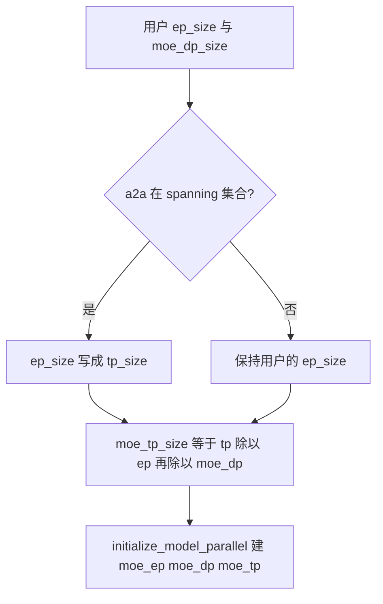
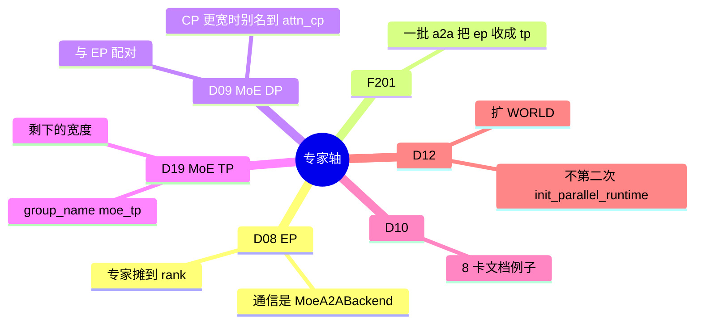
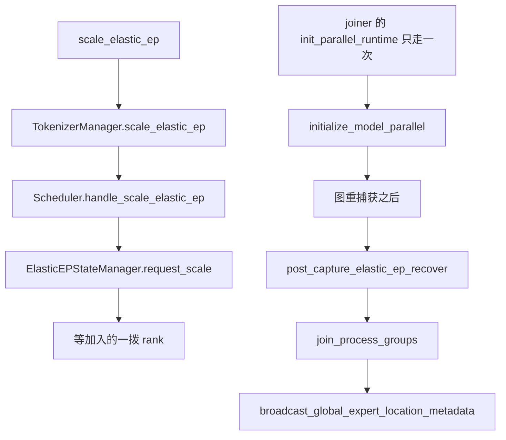

# 专家并行

对应 D08、D09、D10、D12、D19，以及 F201。树是 `297e54fd105e974cdf401e5b4d20253a22c16f90`。**源码路径推断，未实测**。本环境没有 DeepEP。

通信核、GEMM runner、EPLB 怎么搬权重、Waterfill、DWDP、专家包，都在 [04-MoE与DeepEP](../03-特性/04-MoE与DeepEP/README.md)。本页只写专家轴的宽度、组的成员、F201 为何改 `ep_size`，以及一次 MoE 前向停在 dispatcher 的哪一侧。DeepEP 的 dispatch 缓冲和 normal / low_latency 模式不在这里重写，见 [01-DeepEP](../03-特性/04-MoE与DeepEP/01-DeepEP.md)。

## 场景与硬件

| 场景 | 硬件或平台前提 | 轴 |
| --- | --- | --- |
| 稠密模型，或 MoE 但专家都在本卡 | `ep_size=1`，`moe_a2a_backend` 是 `none`。专家权重按 D19 的 MoE TP 切，token 不 all-to-all | D19 |
| 专家数远大于单卡，token 要送到持有该专家的 rank | `moe_ep_size>1`。卡间需要 all-to-all 的带宽。具体传输是 `MoeA2ABackend` 的一个名字 | D08 |
| 一批 a2a 要求专家组盖住整个 TP 组 | F201。命中集合时 `ep_size` 被写成 `tp_size`，于是 `moe_tp_size` 在 `moe_dp_size==1` 时变成 1 | F201，改的是 D08 的宽 |
| 同一 TP 组里，一部分 rank 持有同一份专家、跑不同的 token | `moe_dp_size>1`，并且 `ep_size * moe_dp_size` 与 `tp_size` 的关系满足 `handle_context_parallelism` 里的断言 | D09 |
| 8 卡同时切 attention 序列和专家 | 文档字符串的例子：`attn_cp=2`，`attn_tp=4`，`moe_dp=2`，`moe_ep=4`，TP 组盖住全部 8 卡。相邻 rank 应在同一机箱 | D10 |
| 服务运行中要加 EP rank | `--elastic-ep-backend mooncake`，`--max-ep-size` 大于启动时的 TP。`pp_size` 必须是 1 | D12 |
| NPU | MoE EP 即使宽度等于 TP，也另建一组，不把 `_MOE_EP` 别名到 `_TP` | D08 的平台分支 |

`MoeA2ABackend` 的成员（`layers/moe/utils.py`）：`none`、`deepep`、`mooncake`、`nixl`、`mori`、`ascend_fuseep`、`ascend_tp`、`flashinfer`、`megamoe`、`deepep_v2`、`pplx`、`flashinfer_megamoe`、`customized`。枚举是通信实现。轴仍然是 D08。`ascend_tp` 不在 F201 的集合里，它不会把 `ep_size` 改成 `tp_size`。

## 宽度

`parallel_widths_of` 用配置里的 `ep_size` 当 `moe_ep_size`：

`moe_tp_size = tp_size // moe_ep_size // moe_dp_size`

`moe_tp_size` 是 Derived，用户不直接填。`runtime_context.py` 检查 `tp_size == moe_ep_size * moe_dp_size * moe_tp_size`。

## F201 为何把 ep_size 收成 tp_size

`overrides.py` 的 `_a2a_ep_size` 是一个 post-process。`handle_a2a_moe` 在改 runner、图、deepep 模式之前先跑它。

集合 `_A2A_EP_SPANNING_BACKENDS`：

| 成员 | 备注 |
| --- | --- |
| `megamoe` | |
| `deepep` | |
| `deepep_v2` | 集合字面量里写了两次，frozenset 只留一次 |
| `mooncake` | |
| `nixl` | |
| `ascend_fuseep` | |
| `flashinfer` | |
| `flashinfer_megamoe` | |
| `mori` | |
| `pplx` | |

命中时返回 `{"ep_size": view.tp_size}`。若原来的 `ep_size` 不等于 `tp_size`，打一条 info：expert parallel size is adjusted from … to the tensor parallel size。不命中则不改。

同一文件里 `_a2a_backend_overrides` 更早一步：开了 Waterfill、但 a2a 不是 deepep 或 megamoe 时，把后端改成 `deepep`。改完之后 `_a2a_ep_size` 会看见 `deepep`，于是 EP 同样盖住 TP。Waterfill 本身是 B94，见 [10-Waterfill](../03-特性/04-MoE与DeepEP/10-Waterfill.md)。

这样做的原因，从函数上面的注释能读到的只有一句：这些 a2a 强制专家并行盖住 TP 组。核为什么不能在 `ep_size < tp_size` 时工作，注释没有写，标待核。效果是确定的：组的宽度变成整个 TP，`moe_tp_size` 在没有 MoE DP 时为 1，专家不再在 TP 维上再切一刀，token 的 all-to-all 覆盖所有 TP rank。

`none` 不在集合里。标准路径保持用户的 `ep_size`。DWDP 会把 a2a 写成 `none` 并把 `ep_size` 写成 `dwdp_size`，那是 `handle_dwdp` 在 `handle_a2a_moe` 之前的改写，见特性页。

## D08、D09、D19 三组怎么排

`initialize_model_parallel` 在 attention 组之后建这三组。NPU 上即使 `moe_ep_size == tp_size` 也另建 `_MOE_EP`。其它平台在宽度相等时 `_MOE_EP = _TP`。

否则 EP 组的取法：每个 TP 块、每个 `moe_dp`、每个 `moe_tp` 下标上，按步长 `moe_tp_size` 抽出 `moe_ep_size` 个 rank。`group_name="moe_ep"`。不用 PyNCCL，不用自定义 all-reduce。

MoE DP：

- `attn_cp_size > moe_dp_size` 时 `_MOE_DP = _ATTN_CP`。注释：CP rank 必须在进 MoE 之前共享 token，已有的 DP all-gather / scatter 顺手做这件事。
- `moe_dp_size == tp_size` 时 `_MOE_DP = _TP`。
- 否则按步长 `moe_tp_size * moe_ep_size` 抽出同伴，`group_name="moe_dp"`。

MoE TP：宽度等于 `tp_size` 时别名到 `_TP`。否则每个 `(ep, dp)` 组合一块连续的 `moe_tp_size` 个 rank，`group_name="moe_tp"`。同样不用 PyNCCL 和自定义 all-reduce。

| 函数 | 做什么 | 角色 |
| --- | --- | --- |
| `_a2a_backend_overrides` | Waterfill 时把 a2a 收成 deepep | F201 的前一步 |
| `_a2a_ep_size` | spanning 集合上把 `ep_size` 写成 `tp_size` | F201 |
| `handle_a2a_moe` | 调用上面两个 pass，再按后端改图和 runner | S2，核的互斥在特性页 |
| `moe_ep_size_of` / `moe_tp_size_of` | 发布时的派生宽度 | 袋子 |
| `init_model_parallel_group`（`moe_ep` / `moe_dp` / `moe_tp`） | 三组，或别名 | 运行时 |
| `get_moe_ep_group` / `get_moe_tp_group` | 前向取组 | 通信入口 |

## D10 八卡例子

文档字符串给出的数字：`attn_cp_size=2`，`attn_tp_size=4`，`moe_dp_size=2`，`moe_ep_size=4`。由 `attn_tp = tp // attn_cp // attn_dp` 得 `attn_dp_size=1`、`tp_size=8`。由 `moe_tp = tp // moe_ep // moe_dp` 得 `moe_tp_size=1`。PP 为 1，所以一张 TP 组就是整个 WORLD。

| 组 | 个数 | 成员 |
| --- | --- | --- |
| TP | 1 | `[g0 … g7]` |
| attention CP | 4 | `[g0,g4]` `[g1,g5]` `[g2,g6]` `[g3,g7]` |
| attention TP | 2 | `[g0,g1,g2,g3]` `[g4,g5,g6,g7]` |
| MoE EP | 2 | `[g0,g1,g2,g3]` `[g4,g5,g6,g7]` |
| MoE DP | 4 | `[g0,g4]` `[g1,g5]` `[g2,g6]` `[g3,g7]` |

同一文档要求相邻 rank 放在同一机箱。16 卡、两台 DGX-1 时，rank 0–7 在第一台，8–15 在第二台。这是放置建议，本环境没有按它摆过机器。

`attn_cp_size` 与 `moe_dp_size` 在这个例子里都是 2，满足「不相等则 MoE DP 必须为 1」的反面：二者相等，MoE DP 可以大于 1。EP 组与 attention TP 组的成员在这组数字下重合，MoE DP 组与 attention CP 组的成员也重合。代码仍按各自的循环建组；宽度相等时才走别名。这里 EP 宽 4、TP 宽 8，所以 EP 是新建的组，不是 `_TP` 的别名。

## 数据面：停在 dispatcher

一次 MoE 前向的公共形状（`FusedMoE.forward_impl`，以及 `ep_moe/layer.py` 的 `forward_impl`）：

| 函数 | 做什么 | 角色 |
| --- | --- | --- |
| `get_moe_a2a_backend` | 把字符串收成 `MoeA2ABackend` | 选 dispatcher 类 |
| `BaseDispatcher.dispatch` | 按专家 id 把 token 送到该专家所在的 rank | D08 的数据面入口 |
| `run_moe_core` | 在本卡的专家上做 GEMM | B22，不在本页 |
| `dispatcher.combine` | 把专家输出送回 token 的原 rank | 与 dispatch 成对 |
| `StandardDispatcher.dispatch` | a2a 是 `none` 时的路径。需要时对 TP 组 `all_gatherv`，专家按本卡分片算 | D19，没有 all-to-all |

`create_moe_dispatcher` 按后端名选 `DeepEP`、`Mooncake`、`Nixl`、`FlashInfer`、`Pplx`、`Mori`、Ascend 等类。类和启动约束在 [03-其它a2a](../03-特性/04-MoE与DeepEP/03-其它a2a.md)、[01-DeepEP](../03-特性/04-MoE与DeepEP/01-DeepEP.md)、[02-mori](../03-特性/04-MoE与DeepEP/02-mori.md)。`customized` 没有专用 dispatcher，特性页已经写了。

共享专家的更窄 TP 是 D11，组在 [01-张量与流水](01-张量与流水.md) 建，计算仍走上面的 dispatcher。

## D12 Elastic EP

已有的 EP 世界上扩缩，不是一条新的宽度公式。启动时的组仍由 `initialize_model_parallel` 建。扩容时只有 WORLD 被拉长；joiner 这一拨进程的模型并行组是自己的固定组。`init_parallel_runtime` 的文档写明：同进程第二次调用会 `RuntimeError`；弹性加入直接调 `initialize_model_parallel`，不再进 `init_parallel_runtime`。

`_init_parallel_groups` 对 scale joiner：

- `world_size = ep_join_rank_offset + tp_size * pp_size`
- `rank = offset + tp_size * pp_rank + tp_rank`
- `recovered_rank` 只在「是 joiner 且不是 scale joiner」时传给 `initialize_model_parallel`。scale joiner 的 `max_world_size` 这次调用传 `None`。

进程组后端：设备是 cuda 且 `elastic_ep_backend == "mooncake"` 时，`_resolve_backend` 把 backend 改成 `mooncake`。`init_distributed_environment` 为此构造 `MooncakeBackendOptions`，活跃 rank 张量的长度在 `max_world_size > world_size` 时用最大宽度。这是 D16 的一个取值，触发条件在 D12。

控制面（特性页写开关断言，这里写调用序）：

| 函数 | 做什么 | 角色 |
| --- | --- | --- |
| `handle_elastic_ep` | 绑 EPLB 算法，检查 `max_ep_size`、offset、`pp_size`、负载方法 | S2。运行时扩容还要求 backend 是 mooncake |
| `scale_elastic_ep` | `POST /scale_elastic_ep`，读 `new_ep_size` | HTTP |
| `TokenizerManager.scale_elastic_ep` | 发给各 DP scheduler，记下 pending | 转发 |
| `Scheduler.handle_scale_elastic_ep` | 拒绝不大于当前宽度、超过 `max_world_size`、或切不完整 attention 副本的目标 | 调度器上的门 |
| `DataParallelController.add_elastic_workers` | 把预绑的 ZMQ 槽标成活跃 | 路由面变宽 |
| `join_scale_process_group` | 只 `join_group(WORLD)`，再刷新 EP 成员 | 追加扩容 |
| `join_process_groups` | WORLD 以及每个启动时建的组，device 和 cpu 都 `join_group` | 恢复路径 |
| `post_capture_elastic_ep_recover` | 调用 `join_process_groups`，广播专家位置，重置状态 | 图之后 |
| `maybe_recover_ep_ranks` | 看 `active_ranks` 里谁掉了，再走 Mooncake 的恢复。注释假定 `pp_size==1`，TP 下标等于全局 rank | 掉线恢复 |

`handle_scale_elastic_ep` 成功时只是 `request_scale` 并暂时关掉 EPLB rebalance，然后等加入的一拨。权重张量在 `join_group` 之后怎么搬，本页跟到 `maybe_recover_ep_ranks` 和专家位置广播为止。清单原来说这段集合通信没跟完；特性页也把 mooncake（进程组）和 nixl（scale 路径上 `handle_elastic_ep` 断言的 a2a）各管哪一段标成待核。这里同样待核，不补一段没读完的传输过程。

`physical_ep_size_to_dp_size` 把物理 EP 宽换成 attention 副本个数，控制器用它预留槽。`attn_dp_enabled_of` 对 scale joiner 为真，即使这拨自己的 `attn_dp_size` 是 1。

## 和别的轴

- FFN 仍可能在 D01 的 TP 组上 all-reduce；专家 GEMM 在 D08/D19 的组上。空的 attention DP rank 要参加 all-to-all，是 F193。
- D11 的共享专家子组不替代 `moe_ep`。
- `moe_dense_tp_size` 只允许空、1 或 `tp_size`（`check_server_args`）。它切的是 MoE 旁边的稠密 MLP，不是 `moe_tp_size`。

返回 [分布式目录](README.md)。
