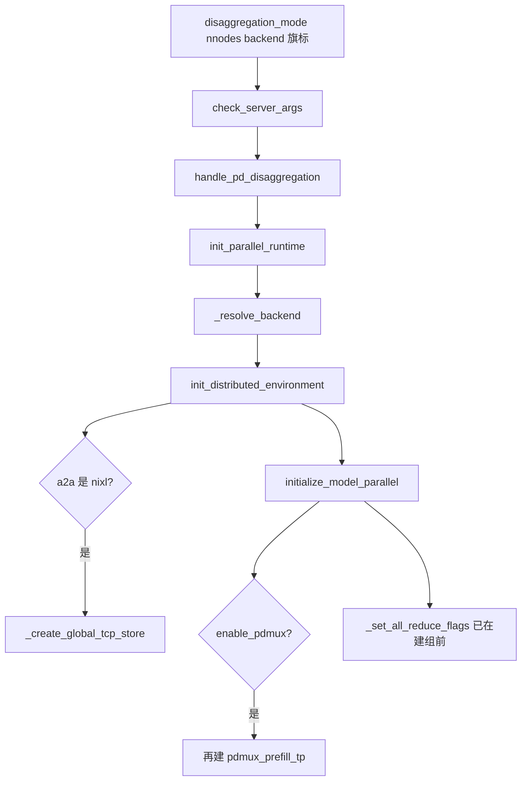
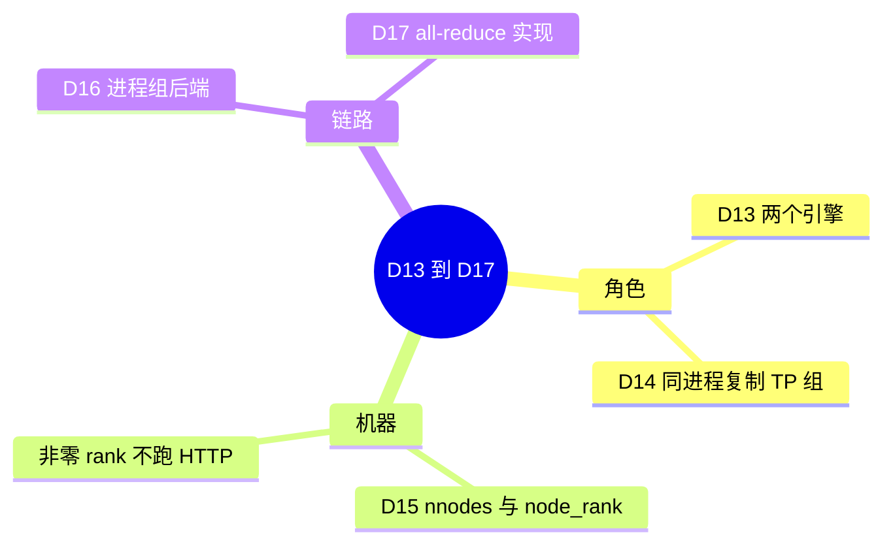

# 分离、多机与通信

对应 D13–D17。树是 `297e54fd105e974cdf401e5b4d20253a22c16f90`。**源码路径推断，未实测**。

这五条都不是 `initialize_model_parallel` 里新的宽度。D13、D14 改的是谁跑 prefill、谁跑 decode，以及要不要为第二条流再复制一个 TP 组。D15 把已经算好的 `tp_size * pp_size` 摊到多台机器。D16 是 WORLD 用哪一个 `torch.distributed` 后端。D17 是 TP all-reduce 用哪一种实现。

PD 的事件循环是 F179–F188，在 [07-PD分离](../02-流程/03-调度与推理/07-PD分离.md)。特性开关在 [03-PD分离](../03-特性/06-调度与PD/03-PD分离.md)、[04-PDmux](../03-特性/06-调度与PD/04-PDmux.md)、[05-PD角色切换](../03-特性/06-调度与PD/05-PD角色切换.md)。自定义 all-reduce 的融合旗标在 [06-集合通信](../03-特性/07-并行切分/06-集合通信.md)（B70、B92、B93）。F199（非零 node 不提供业务 HTTP）归启动。本页写它们和进程组的关系。

## 场景与硬件

| 场景 | 硬件或平台前提 | ID |
| --- | --- | --- |
| 提示词很长、解码很短，希望两批 GPU 各干一件事 | 两个（或更多）引擎。`--disaggregation-mode prefill` 与 `decode`。中间的 KV 走传输后端，不走模型并行组 | D13 |
| 同一进程里既 prefill 又 decode，KV 不出卡 | `enable_pdmux`。模式仍是 `null`，`pp_size=1`，overlap 关掉。第二条流要自己的 NCCL 状态 | D14 |
| 一个 TP 或 PP 世界跨多台机器 | `nnodes>1`，每台设 `node_rank`。`(tp_size * pp_size) % nnodes == 0`（scale joiner 除外）。`dp_size>1` 不允许 | D15 |
| 选集合通信库 | CUDA 默认 `nccl`，XPU `xccl`，HPU `hccl`，CPU `gloo`，NPU `hccl`（`SGLANG_ZBAL_LOCAL_MEM_SIZE>0` 时表里是 `zbal`），MUSA `mccl`。elastic EP 且设备是 cuda 时改成 `mooncake` | D16 |
| 同机 TP，想避开 NCCL 的小消息路径 | 自定义 all-reduce。调用方要保证组成员在同一节点。支持的组宽是 2、4、6、8，并且要认到 NVLink（ROCm / MUSA 有各自的尺寸上限） | D17 |

传输后端的可选名（`DISAGG_TRANSFER_BACKEND_CHOICES`）：`mooncake`、`nixl`、`ascend`、`fake`、`mori`、`mooncake_tcp`。`mooncake_tcp` 在 `handle_pd_disaggregation` 里被改写成 `mooncake`，并设 `MC_FORCE_TCP=1`，走 TCP 而不是 RDMA。这些名字和 MoE a2a、HiCache 的 mooncake / nixl 同库不同字段。

## 它们挂在哪

## D13 PD 分离

`disaggregation_mode` 取 `null`、`prefill`、`decode`。`null` 时 `dispatch_event_loop` 走普通、overlap、PP 或 PD mux。`prefill` / `decode` 各走自己的循环；`pp_size>1` 时再进 PP 的分离循环。

两个引擎各自调用 `init_parallel_runtime`，各自有一张 `tp_size * pp_size` 的 WORLD。KV 页不经过 `_TP` 的 all-reduce，而走传输后端的连接（`disaggregation/prefill.py`、`decode.py`，以及 mooncake / nixl / mori / ascend 的 `conn.py`）。`fake` 用来把这条路径接上但不传真页。校验和旗标 `disaggregation_enable_kv_checksum` 在两边都开时，对每条请求的页算 Adler-32；布局不一致（TP 宽、PP 级、page、dtype）的 prefill 会放行并告警一次。

`handle_pd_disaggregation` 还把 decode 侧的若干缓存策略收紧。那些互斥在特性页和调度篇。本页只确定：角色分裂不改 D01–D12 的宽度公式，只是两张（或更多张）这样的 WORLD，中间加一条 KV 传输。

| 函数 | 做什么 | 角色 |
| --- | --- | --- |
| `handle_pd_disaggregation` | 规范化传输后端，检查角色相关的旗标 | S2 |
| `dispatch_event_loop` | 按模式选 prefill 或 decode 循环 | 调度入口 |
| prefill 侧的 bootstrap 队列 | KV 传输登记完成后才进本地 prefill | F156，过程在调度篇 |
| decode 侧的 prealloc 队列 | KV 到齐后以 `PREBUILT` 并进 running | F157、F203 |
| 各 `conn.py` 的传输 | 按后端把页从 prefill 送到 decode | D13 的数据面 |

## D14 PD mux

`_init_parallel_groups` 把 `duplicate_tp_group=get_disagg().enable_pdmux` 传进 `initialize_model_parallel`。为真时，用和 `_TP` 相同的 rank 表再建一组，`group_name="pdmux_prefill_tp"`。若 `_TP` 已有 PyNCCL，两边的 `pynccl_comm.disabled` 都被设成假。注释和特性页的说法一致：两条 stream 不要共用一个 NCCL group 的状态。

模式必须仍是 `null`，所以 `dispatch_event_loop` 在 NULL 分支里看到 `enable_pdmux` 就进 `event_loop_pdmux`，不会同时进 PP 循环。`pp_size` 必须是 1，overlap 关掉。这些条件在特性页。复制出来的组只增加通信器，不增加 GPU，也不改变 `world_size`。

| 函数 | 做什么 | 角色 |
| --- | --- | --- |
| `initialize_model_parallel` 的 `duplicate_tp_group` 分支 | 同一批 rank 再建 `pdmux_prefill_tp` | D14 的组 |
| `event_loop_pdmux` | 同一 scheduler 上两条 stream | 调度 |
| `role_switch.run_event_loop_supervisor` | `enable_pd_role_switch` 时在循环外再包一层，空闲才换角色 | B39，不是第三条组 |

角色热切换不复制 TP 组。它拆的是队列和循环，KV 池不重建。过程在特性页和 F185。

## D15 多机

`check_server_args`：不是 scale joiner 时，`(tp_size * pp_size) % nnodes == 0`。失败文案写的是 tp_size must be divisible by number of nodes，实际除的是乘积。`dp_size>1` 另要求 `nnodes==1`。

`launch_tensor_parallel_group` 把本节点要起的 rank 算出来：

- `pp_size_per_node = max(pp_size // nnodes, 1)`
- `nnodes_per_pp_rank = max(nnodes // pp_size, 1)`
- 本节点的 `pp_rank` 区间由 `node_rank // nnodes_per_pp_rank` 决定
- `tp_size_per_node = tp_size // nnodes_per_pp_rank`
- 本节点的 `tp_rank` 区间由 `node_rank % nnodes_per_tp_group` 决定

scale joiner 不按这个取模切 TP，它枚举自己的整个 `tp_size`。attention DP 的端口表由节点 0 `_broadcast_worker_ports` 发到其它节点，端点是 `dist_init_addr` 的 host 加上握手端口偏移；没有 `dist_init_addr` 时用本机 host。

HTTP：`http_server.py` 在 `_launch_subprocesses` 返回后，若 `node_rank>=1` 就直接 return。子进程已经等到 scheduler 退出才回到这里。业务 HTTP 只在 node 0。这是 F101 / F199。

Rendezvous：`_resolve_dist_init_method`。环境变量 `SGLANG_DISTRIBUTED_INIT_METHOD_OVERRIDE` 优先，设成 `env://` 时 torch 用外部的 `MASTER_ADDR` / `MASTER_PORT`。否则用 `dist_init_addr`（别名 `--nccl-init-addr`）。都没有则用本机 host 加 `nccl_port`。多机若不设地址，各节点会去连自己的 127.0.0.1，组不起来。未实测，这是从分支读出来的。

| 函数 | 做什么 | 角色 |
| --- | --- | --- |
| `check_server_args` | 乘积整除节点数，副本 DP 限制单节点 | 门 |
| `launch_tensor_parallel_group` | 本节点只起自己的 pp/tp rank | 进程拓扑 |
| `_broadcast_worker_ports` | attention DP 时把 ZMQ 端口从节点 0 发到其余节点 | 跨机控制面 |
| `_resolve_dist_init_method` | TCP rendezvous 地址 | D16 的入口 |
| `http_server` 里 `node_rank>=1` 的返回 | 不起业务 HTTP | F199 |

## D16 进程组后端

`get_default_distributed_backend` 走当前平台的 `get_torch_distributed_backend_str`。对得上设备时用平台自己的字符串，否则查 `_DEVICE_TO_DISTRIBUTED_BACKEND`，再不行是 `gloo`。

| 设备 | 默认 backend 字符串 | 出处 |
| --- | --- | --- |
| cuda | `nccl` | `platforms/cuda.py` 与对照表 |
| xpu | `xccl` | 对照表 |
| hpu | `hccl` | 对照表 |
| cpu | `gloo` | `platforms/cpu.py` |
| npu | `hccl`，或 `SGLANG_ZBAL_LOCAL_MEM_SIZE>0` 时对照表里的 `zbal` | 对照表 |
| musa | `mccl` | `platforms/musa.py` |

`_resolve_backend` 在此之后还有一处改写：`device=="cuda"` 且 `elastic_ep_backend=="mooncake"` 时改成 `"mooncake"`。`init_distributed_environment` 看到这个字符串就构造 `MooncakeBackendOptions`（活跃 rank 的 int32 CUDA 张量，扩容时带 `max_world_size` 和 `recovered_rank`），传给 `init_process_group`。其它后端用 `get_torch_distributed_pg_options()`。

这和 `maybe_init_shared_mooncake_transfer_engine` 不是一件事。传输引擎在建组之前，服务 PD、HiCache、encoder 分离或 elastic EP 的 KV / 权重搬运。进程组后端只在上面那个 if 里变成 mooncake。F110 把这两处分开写了，本页沿用那个分法。

NIXL：`init_process_group` 之后，若 `moe_a2a_backend=="nixl"`，调用 `_create_global_tcp_store`。注释写给 NIXL 做协调。`recovered_rank` 或 `max_world_size > world_size` 时允许动态成员。建失败只打日志，不把 WORLD 拆掉。NIXL 传页本身归 D13 和 D08 的 dispatcher，不在这个 TCPStore 函数里。

超时来自 `get_parallel().dist_timeout`，传给 `init_process_group`。

| 函数 | 做什么 | 角色 |
| --- | --- | --- |
| `get_default_distributed_backend` | 平台默认字符串 | D16 的默认 |
| `_resolve_backend` | elastic EP + cuda 时改成 mooncake | F110 的进程组半边 |
| `init_distributed_environment` | `init_process_group`，再发布 `_WORLD` | WORLD |
| `_create_global_tcp_store` | nixl a2a 的协调存储 | F109 |
| `maybe_init_shared_mooncake_transfer_engine` | KV / 权重传输，不是 process group | 不要和 D16 合成一件事 |

## D17 自定义 all-reduce

`_set_all_reduce_flags` 在建组之前：

- `set_custom_all_reduce(not disable_custom_all_reduce)`
- `set_mscclpp(enable_mscclpp)`
- `set_torch_symm_mem_all_reduce(enable_torch_symm_mem)`
- `set_flashinfer_allreduce_only`：融合后端非空，且不是 cutedsl（cutedsl 没有给带 tag 的组用的旧 workspace）

`CustomAllreduce` 的文档要求调用方保证组成员在同一节点，每个 communicator 绑一张卡。支持的 `world_size` 是 2、4、6、8。`can_use_custom_all_reduce_with_nvlink` 失败则构造函数直接返回，`disabled` 保持真。HIP 把单次上限放到 16MB 量级，MUSA 放到 128MB 量级，CUDA 路径是 8MB 量级的 `_MAX_CAR_SIZE`。PP 组、MoE EP 组、MoE TP 组、共享专家组在建组时写死 `use_custom_allreduce=False`。自定义核服务的是同机 TP 的小消息带宽，不是级间 P2P，也不是专家 all-to-all。

`GroupCoordinator.all_reduce` 在组宽大于 1、且不在编译器跟踪里时，按这个顺序挑：

1. HPU communicator，若存在且未禁用。
2. XPU communicator。编译图时改走 inplace 自定义算子，避免 Dynamo 把 all-reduce 拆开。
3. 能用 FlashInfer all-reduce 则走它。
4. 记录 MSCCL++ 与自定义 all-reduce 是否认领这块输入。
5. 对称内存开着、且上面两者都不认领时，走 PyNCCL 的原地 all-reduce。
6. 否则 `outplace_all_reduce` 或 `inplace_all_reduce`，落到进程组后端。

CPU 上另有一条共享内存 all-reduce：`_init_cpu_threads_env` 只在 Intel AMX 或 arm64 上调用 `sgl_kernel`，并把 `LOCAL_SIZE` 设成 `tp_size`。其它 CPU 打警告后不用这条路径。

确定性推理会关掉自定义 all-reduce、torch 对称内存和 Aiter 融合，见特性页。Aiter 融合与 FlashInfer 融合是另外两条把 all-reduce 和 RMSNorm 叠在一起的核，不是新的进程组。Prefill CP 拒绝 Aiter 融合。

| 函数 | 做什么 | 角色 |
| --- | --- | --- |
| `_set_all_reduce_flags` | 按封口后的旗标安装实现 | 建组前 |
| `set_custom_all_reduce` / `set_mscclpp` / `set_torch_symm_mem_all_reduce` | 三个开关 | B70 |
| `CustomAllreduce.__init__` | 同机、组宽、NVLink，否则保持禁用 | D17 的硬件门 |
| `GroupCoordinator.all_reduce` | 运行时在几种实现里挑 | 数据面 |
| `tensor_model_parallel_all_reduce` | 行并行线性层进来的入口 | 调用点在 D01 |
| `_init_cpu_threads_env` | AMX 或 arm64 上的共享内存 all-reduce | CPU |

## 组合时先看哪一条限制

- 多机加副本 DP：被 `check_server_args` 拒绝。多机的数据并行走 D04。
- 多机加 TP：WORLD 仍是 `tp_size * pp_size`，本节点只起一段 rank。all-reduce 走 D16，自定义核因「同一节点」的前提用不上整组，除非整个 TP 组恰好落在一台机器上。
- PD 加 PP：分离循环里有 `event_loop_pp_disagg_*`。mux 要求 `pp_size=1`，所以 D14 与 D02 不同时开。
- PD 加 D07：prefill 角色只打警告，不改组。
- mooncake 三个用途不要并成一个旗标：进程组后端（D16，仅 elastic EP）、KV 传输引擎（D13 / HiCache）、MoE a2a 的 `mooncake` 字符串（D08）。

返回 [分布式目录](README.md)。
