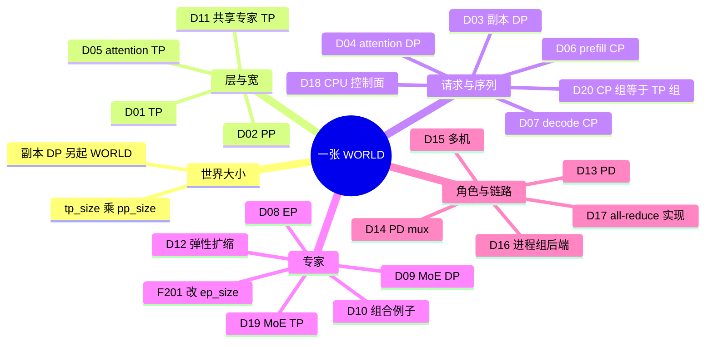
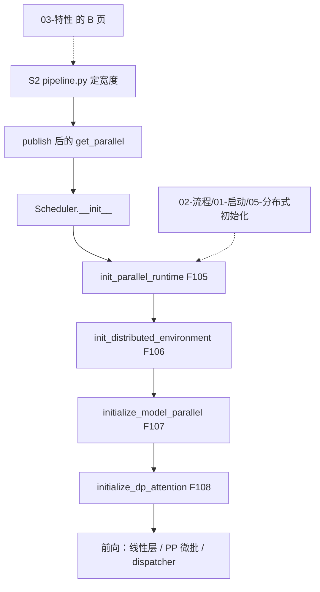

# 04 分布式

清单 D 的 D01–D20，加上 F201。特性页写开关把尺寸定成什么样；本目录写这些尺寸在同一张 WORLD 里怎么切成进程组、启动时哪一步建组、前向时数据走哪条集合通信。

树是 `297e54fd105e974cdf401e5b4d20253a22c16f90`。运行时行为 **源码路径推断，未实测**。本环境没有多卡、多机或 DeepEP 的实跑记录。

扩散运行时另有 `multimodal_gen/runtime/distributed/parallel_state.py`。D01–D20 写的是 `srt` 这条 LLM 服务路径。

## 先看场景

`initialize_model_parallel` 的文档字符串把世界大小钉死：`world_size` 等于 `tp_size * pp_size`。Attention DP、prefill CP、decode CP、MoE DP / EP / TP 都在这个 WORLD 里面再切，不另起一张卡。模型副本 DP（`dp_size`）是例外：每个副本自己一张 WORLD，进程数才乘 `dp_size`，而且 `check_server_args` 要求 `nnodes == 1`。

| 你手里的硬件和模型 | 本树里对应的轴 | 页 |
| --- | --- | --- |
| 单机，模型宽到一张卡放不下，卡间是 NVLink 或同机 PCIe | D01 TP。同机且组宽是 2/4/6/8 时，自定义 all-reduce 才有机会接上（D17） | [01](01-张量与流水.md) |
| 层数多，单卡放不下全部层；级间传的是激活，不是每层一次 all-reduce | D02 PP。`pp_size>1` 关掉 overlap，走 `event_loop_pp` | [01](01-张量与流水.md) |
| 头很少，再切头会把 attention 切碎；请求可以分给不同 scheduler | D04 attention DP，再加 D18 的 CPU 控制面。GPU 数仍是 `tp_size * pp_size`。跨节点用这条，不用 `dp_size` | [02](02-数据并行.md) |
| 单机多卡，想要多份完整权重换吞吐，卡之间不切模型 | D03 副本 DP。多节点被断言拒绝 | [02](02-数据并行.md) |
| 一条 prefill 很长，要把这条序列的 token 切开 | D06。策略 `interleave` 或 `zigzag`。MUSA 拒绝；HIP 只放行 DeepSeek V4 | [03](03-上下文并行.md) |
| decode 的 KV 很长，要在 TP 组内把 KV 切开，并且 prefill CP 关着 | D07。执行期的平台门是 HIP、CUDA、NPU、XPU | [03](03-上下文并行.md) |
| GLM-5.3-Flash 或 Qwen4-Exp，prefill CP 的宽已经等于整个 TP | D20。组对象与 TP 是同一个；旗标 `enable_cp_tp_group_sharing` 另写模型契约 | [03](03-上下文并行.md) |
| MoE，专家数远大于单卡，token 要送到专家所在的 rank | D08 EP，通信实现是 `MoeA2ABackend`。DeepEP / mori / MegaMOE 的核在特性页，不在这里重写。F201 会把一批 a2a 的 `ep_size` 收成 `tp_size` | [04](04-专家并行.md) |
| 同一 TP 组里，专家 all-to-all 的同时还有一份 MoE 数据并行 | D09，剩下的宽度是 D19 MoE TP | [04](04-专家并行.md) |
| 8 卡上同时有 attention CP 和 MoE EP | D10 就是文档字符串里的那张分组表 | [04](04-专家并行.md) |
| Kimi-K3，共享专家要比 attention TP 更窄 | D11。宽度整除 attention TP，子组不跨 attention 副本 | [01](01-张量与流水.md) |
| 服务已经起来，还要往 EP 世界里加 rank | D12。运行时扩容的进程组后端是 mooncake；joiner 直接 `initialize_model_parallel`，不再进一次 `init_parallel_runtime` | [04](04-专家并行.md) |
| prefill 与 decode 拆成两个引擎，中间传 KV | D13。这是角色分裂，WORLD 公式不变。同一进程两条 stream 是 D14 | [05](05-分离多机与通信.md) |
| 多机，`nnodes>1` | D15。`(tp_size * pp_size) % nnodes == 0`。`node_rank>=1` 不提供业务 HTTP | [05](05-分离多机与通信.md) |
| 选 NCCL、HCCL、MCCL、XCCL、gloo，或 elastic EP 的 mooncake 进程组 | D16 | [05](05-分离多机与通信.md) |

相邻但不是新轴：LayerNorm 序列并行（B65，[03-LayerNorm-SP](../03-特性/09-其它/03-LayerNorm-SP.md)）、DWDP（B46）、Waterfill（B94）、EPLB（B44）、B85 的 decode 切权。HiSparse、Radix、CUDA graph 不是并行方案。

## 轴怎么挂在一起

Attention 在 TP rank 上的布局（`derive_attention_ranks`）是 `(dp, cp, tp)`，tp 变化最快：

`tp_rank = (attn_dp_rank * attn_cp_size + attn_cp_rank) * attn_tp_size + attn_tp_rank`

MoE 的宽度（`parallel_widths_of`）是：

`moe_tp_size = tp_size // moe_ep_size // moe_dp_size`

`attn_tp_size = tp_size // attn_dp_size // attn_cp_size`

两条都在 `runtime_context.py` 里用乘法关系检查：`tp_size` 等于 attention 三维的积，也等于 MoE 三维的积。

## 和启动、特性的分工

S2 里和轴有关的 hook 顺序（`arg_groups/pipeline.py`）：`handle_decode_context_parallelism`，再 `handle_dwdp`，再 `handle_data_parallelism`，再 `handle_context_parallelism`（里面调用 `resolve_cp_tp_group_sharing`），再 `handle_a2a_moe`（里面跑 `_a2a_ep_size`，F201），再 `handle_shared_experts_tp`，再 `handle_elastic_ep`，再 `_pipeline_parallel_overlap_disable`。更早的 `handle_pd_disaggregation` 在并行 hook 之前。`check_server_args` 在启动更前面，管 `nnodes` 和副本 DP。

组建完之后的预热、KV 预算，仍归 [05-分布式初始化](../02-流程/01-启动/05-分布式初始化.md)。本目录不重写 F105 的「只能建一次」。

| 页 | ID |
| --- | --- |
| [01-张量与流水](01-张量与流水.md) | D01、D02、D05、D11 |
| [02-数据并行](02-数据并行.md) | D03、D04、D18 |
| [03-上下文并行](03-上下文并行.md) | D06、D07、D20 |
| [04-专家并行](04-专家并行.md) | D08、D09、D10、D12、D19，以及 F201 |
| [05-分离多机与通信](05-分离多机与通信.md) | D13–D17 |

特性交叉：B17、B18、B40–B42、B70、B82、B85、B92、B93 在 [07-并行切分](../03-特性/07-并行切分/README.md)。B19–B22、B43–B47、B94 在 [04-MoE与DeepEP](../03-特性/04-MoE与DeepEP/README.md)。B37–B39 在 [06-调度与PD](../03-特性/06-调度与PD/README.md)。

## 本目录没钉死的

- 没有多卡轨迹。组的成员表来自 `initialize_model_parallel` 的循环和文档字符串，集合通信是否在目标机上真的通，未实测。
- Elastic EP 在 `join_group` 之后的权重搬迁，只跟到 `join_process_groups`、`maybe_recover_ep_ranks` 和专家位置广播。特性页同样把 mooncake 与 nixl 的分工标成待核。
- `get_pp_indices` 是层区间的公共算法。`starcoder2.py` 用自己的整除。没有逐个模型文件核对谁绕开了这个函数。
- `initialize_model_parallel` 的文档字符串仍写 decode CP「目前只支持 AMD HIP」。函数开头的 `RuntimeError` 放行 HIP、CUDA、NPU、XPU。以抛出的那句为准，文档字符串滞后，标待核是否还有更早的平台门。
