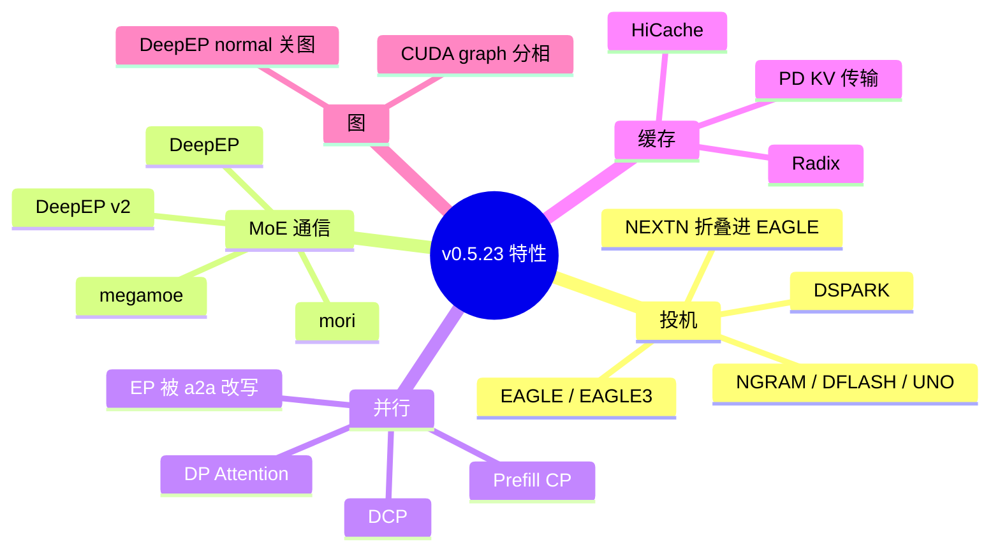
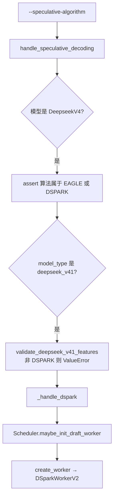
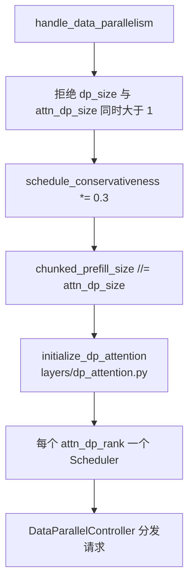

# 04 特性详解

每节都按同一组问题写：解决什么、何时启用、怎么打开、调用链、会踩到的断言。旗标默认值以 05 的表为准，这里不重复整表。

## 总览



## MTP 与投机解码

MTP（multi-token prediction）在本树里不是一个单独的 `--enable-mtp`。它落在投机解码框架上：目标模型跑完一步，draft worker 提出若干 token，验证通过的留下。

### 算法枚举

`arg_groups/fields/spec.py` 的 `speculative_algorithm`，帮助文本列出：

`EAGLE`、`EAGLE3`、`NEXTN`、`STANDALONE`、`NGRAM`、`DFLASH`、`DSPARK`、`UNO`，外加 `SpeculativeAlgorithm.register` 注册的名字。

`speculative/spec_info.py` 的 `SpeculativeAlgorithm.create_worker` 把名字变成 worker：

| 名字 | worker | 备注 |
| --- | --- | --- |
| `EAGLE` / `EAGLE3` | `EAGLEWorkerV2` | V4 架构级检查只允许 topk=1；V4.1 特征检查再把非 DSPARK 全部拒绝 |
| `NEXTN` | 解析时折叠成 EAGLE | `speculative_hook` 的 alias。Gemma4 的 draft 会走到 `FROZEN_KV_MTP` |
| `STANDALONE` | `StandaloneWorkerV2` | 独立草稿模型 |
| `DSPARK` | `DSparkWorkerV2` | DeepSeek-V4.1 唯一允许的投机算法 |
| `DFLASH` | `DFlashWorkerV2` | |
| `NGRAM` | ngram worker | 不加载神经网络草稿 |

### 启用链



`Scheduler.init_model_worker` 的顺序是：目标 `TpModelWorker` → `maybe_init_draft_worker` → 两边各自 `alloc_memory_pool` → attention backend → CUDA graph。draft 有自己的池，不和目标池混用。

### DSPARK 怎么开

CLI：

```text
--speculative-algorithm DSPARK
--speculative-dspark-block-size 5
```

`5` 来自 V4.1-Flash config 的 `dspark_block_size`。`_handle_dspark` 会：

- 要求 `device` 字符串以 `cuda`、`npu` 或 `xpu` 开头。ROCm 上 PyTorch 的设备名通常仍是 `cuda`，这条字符串检查因此能过；真正的 HIP 限制在后面的 hook 里。
- `speculative_num_steps` 不是 1 就改成 1。
- 草稿路径：checkpoint 自带则把 `speculative_draft_model_path` 设为 `model_path`；有 `dspark` 子目录则指向子目录；否则 `ValueError`，必须自己传 `--speculative-draft-model-path`。
- `pp_size != 1` 只允许 PD 的 prefill 节点。V4.1 另外禁止任何 PP，所以这条组合在 V4.1 上到不了这里。
- DP attention 时必须 `--enable-dp-lm-head`。
- DP attention 且不是 NPU 时，`moe_a2a_backend` 只能是 `none`、`megamoe`、`mori`。
- 上一条里后端不是 `none` 时，还要 `SGLANG_RAGGED_VERIFY_MODE=static`。
- DP attention 时 `attn_cp_size` 必须是 1。

config 里的 `dspark_target_layer_ids = [37, 38, 39]` 和 `num_nextn_predict_layers = 3` 是草稿要挂上的最后三层，不是 CLI。`dspark_n_routed_experts = 128` 是草稿 MoE 的专家数，比目标的 384 小。

### EAGLE / 经典 MTP 何时还能用

非 V4.1 的 DeepSeek-V4 在 `deepseek_v4_hook.py` 允许 `EAGLE` 且 `speculative_eagle_topk == 1`。V3 系列走 `models/deepseek_v2.py` 的 NextN 权重（测试里常见 `lmsys/DeepSeek-V3-NextN`）和 `NEXTN`/`EAGLE` 路径。不要把 V3 的 `--speculative-algorithm NEXTN` 套到 V4.1-Flash 上。

## DeepEP

DeepEP 是 MoE 的 token all-to-all，不是专家计算 kernel。计算后端是 `moe_runner_backend`（triton、flashinfer、deep_gemm 等），通信后端是 `moe_a2a_backend`。

### 打开

```text
--moe-a2a-backend deepep
--deepep-mode auto          # auto | normal | low_latency
```

`deepep` 在 `_A2A_EP_SPANNING_BACKENDS` 里。`_a2a_ep_size` 发现 `ep_size != tp_size` 就把 EP 改成 TP，并打 info 日志。你写 `--ep-size 8 --tp 16 --moe-a2a-backend deepep`，跑起来是 EP 16。

`deepep_mode`（`exec_.py`）：

| 值 | 行为 |
| --- | --- |
| `auto` | 注释写 decode 用低延迟、prefill 用 normal。具体切换在 dispatcher |
| `normal` | `moe_hook.py` 打警告并关掉 decode 与 prefill 的 CUDA graph |
| `low_latency` | 保留 graph。CuteDSL FP4 路径会强制 low_latency，`normal` 直接报错 |

实现：`layers/moe/token_dispatcher/deepep.py` 的 `DeepEPBuffer.get_deepep_buffer`，按模式分配 NVL/RDMA buffer；`set_dispatch_mode_as_normal` / `set_dispatch_mode_as_low_latency`。

CUDA graph 捕获时，`speculative/*cuda_graph_runner.py` 里的 `DeepEPCudaGraphRunnerAdapter.capture/replay` 把 buffer 的生命周期套进图。`deepep_mode=normal` 已经把图关掉，这条 adapter 不会在那条路径上工作。

### DeepEP v2

```text
--moe-a2a-backend deepep_v2
--deepep-v2-mode hybrid     # direct | hybrid
```

`moe_hook.py` 对 v2 的限制：runner 只能是 `deep_gemm`；关 TBO/SBO；关 shared expert fusion；`direct` 在 `nnodes > 1` 时 `ValueError`；prefill CUDA graph 关闭。v2 的 mode **不**读取 v1 的 `--deepep-mode`。

### 和 DP Attention、DSPARK 的交叉

- Waterfill（`--enable-waterfill`）会把 a2a 强制成 `deepep` 或要求已经是 `deepep`/`megamoe`（`overrides.py` `_a2a_backend_overrides`）。
- V4.1 + DSPARK + `attn_dp_size>1` **不能**选 `deepep`。四机 HIP 配置用 `mori`，见 02。
- `mori` 同样属于 spanning 后端，EP 一样会被改成 `tp_size`。区别是 dispatcher 实现和 DSPARK 白名单，不是 EP 宽度公式。

## DP Attention

### 它是什么

`attn_dp_size` 的帮助文本：TP 组内部划出若干数据并行的 attention 组，每组一个 scheduler；FFN 仍然是张量并行（或再被 EP 切）。

和 `dp_size` 的差别：`dp_size` 是整模副本，GPU 数乘上去，而且 `nnodes != 1` 时禁止。`attn_dp_size` 不增加进程数之外的副本，进程数仍是 `tp * pp`（再乘 `dp_size`，若为 1 则不变）。

### 打开

```text
--tp 16 --attn-dp-size 4 --dp-size 1
```

废弃写法 `--dp-size 4 --enable-dp-attention` 会被改成上面这种 `attn_dp_size=4, dp_size=1`。`--enable-dp-attention` 本身是 `no_cli` 字段，只留了一个 `DeprecatedStoreTrueAction`。

### 调用链



`initialize_dp_attention` 用 `compute_dp_attention_world_info` 写 `attn_dp_rank`。对称 all-to-all（DeepEP v2、pplx 等）在 `dp_attention.py` 里倾向按最大长度 padding，否则集合通信的 shape 对不齐。

LM head：

- `--enable-dp-lm-head` 要求 attention DP 已经打开。DSPARK 在 DP attention 下强制它。
- `--enable-tp-lm-head-all-to-all` 也要求 attention DP。默认只在 PD 的 decode、且 `tp_size == attn_dp_size`、`attn_cp_size == 1` 时打开。它和 `--enable-dp-lm-head` 互斥。

FlashInfer MegaMOE 要求 `attn_dp_size == tp_size`（纯 DP attention，attention 本身不再 TP）。V4.1-Flash 的推荐配置是 `attn_dp=4, tp=16`，**不要**再开 megamoe，除非把 `attn_dp` 改成 16。

ROCm 上 `--enable-encoder-swa-bounded-replay` 与 DP attention 互斥（`validate_deepseek_v41_features`）。四机配置若开了 `attn-dp-size 4`，就不要同时开 encoder SWA bounded replay。

## Prefill CP（笔记里的 PCP）与 DCP

Prefill CP 把一条序列的 token 切到多个 rank 上做预填充。

```text
--enable-prefill-cp --cp-strategy interleave
```

`cp_strategy` 必填，取值 `zigzag` 或 `interleave`。`parallel_hook` 要求 `tp_size` 能被 `attn_cp_size` 整除，也能被 `attn_dp_size * attn_cp_size` 整除。DeepSeek-V4 的 `validate_deepseek_v4_cp` 会把 `attn_cp_size` **改写**成 `tp_size / attn_dp_size`，也就是把剩余的 TP 全部拿去切序列。

HIP 上这条改写到达之前就会失败：多节点、V4.1、decoder SWA bounded replay、two-batch overlap 都在 unsupported 列表里。所以 PCP 不是四机 BW1100 跑 V4.1-Flash 的手段。

DCP（`--dcp-size`）切的是 decode 阶段的 KV，组建在 `parallel_state.py` 的 `dcp` 组。它和 prefill CP 互斥。通信后端 `ag_rs`（all-gather + reduce-scatter）、`a2a`、`fi_a2a`。`fi_a2a` 只允许 CUDA。`dcp_size` 必须整除 attention TP。

## 其它会改启动行为的特性

| 特性 | 开关 | 机制要点 |
| --- | --- | --- |
| Chunked prefill | `--chunked-prefill-size`，`-1` 关 | 长 prompt 拆成多步 extend。DP attention 时解析阶段会除以 `attn_dp_size`。V4 的 trtllm attention 要求它大于 0（`deepseek_v4_hook.py`） |
| CUDA graph | `--cuda-graph-backend-decode` / `--cuda-graph-backend-prefill` | 分相配置。`--disable-cuda-graph` 已废弃。DeepEP normal、DeepEP v2 的 prefill、DWDP 会在 hook 里把对应相关掉 |
| HiCache | `--enable-hicache` | `hicache_hook.py`：与 unified external linker 互斥，可把 host/L3 接进 radix |
| PD 分离 | `--disaggregation-mode prefill\|decode` | prefill 节点算 prompt 并传 KV，decode 节点只解码。传输后端 `mooncake`、`nixl` 等。V4.1 + DSPARK 的 PD 还要求 ragged verify static，且传输后端是 mooncake 或 nixl |
| LoRA | `--enable-lora` 及 `lora` 命名空间 | `lora_hook.check_lora_server_args`。部分 MoE runner 会强制关掉 shared expert fusion |
| Radix | 默认开，策略 `--radix-eviction-policy` | 见 08。`enable_dp_attention` 时代的 session radix 在 V4.1 encoder replay 里被点名禁止 |
| Engram | 无单独 CLI，由 config 的 `engram_layer_ids` 决定 | 环境变量 `SGLANG_ENABLE_DSV41_ENGRAM_HOST_TABLE`、`SGLANG_DSV41_ENGRAM_HOST_TABLE_LAYOUT`。实现 `layers/engram.py` |
| EPLB | expert 负载记录相关 HTTP：`/start_expert_distribution_record` 等 | 统计 routed expert，不改变 EP 宽度 |
| Elastic EP | `entrypoints/elastic_ep.py` 的 `/scale_elastic_ep` | `parallel_hook` 要求已经是 attention DP、`enable_dp_lm_head`、`ep_size==tp_size`、`moe_a2a_backend==nixl`、无 CP、无 PP。和 mori 的静态 16 卡配置不是同一条路径 |
| DWDP | `--dwdp-size` | 必须等于 `tp_size`，强制纯 DP attention、EP=TP、a2a none、无 PP、无投机、无 CUDA graph。权重预取替代 token all-to-all |

## 环境变量（V4.1 路径上真正会改行为的）

这些不在 ServerArgs 表里，但启动日志和 assert 会提到它们。定义集中在 `srt/environ.py`。

| 变量 | 作用 |
| --- | --- |
| `SGLANG_ENABLE_DSV41_ENGRAM_HOST_TABLE` | Engram 表放 host。V4.1-Flash 双卡测试依赖它 |
| `SGLANG_DSV41_ENGRAM_HOST_TABLE_LAYOUT` | host 表布局，例如 shared |
| `SGLANG_RAGGED_VERIFY_MODE` | DSPARK 在 DP MoE 下必须是 `static` |
| `SGLANG_OPT_USE_ONLINE_COMPRESS` | 在线 KV 压缩。和投机步数有 assert（`pool_configurator.py`） |
| `SGLANG_DSV4_KV_LAYOUT` | V4 KV 布局 |
| `SGLANG_DSV4_FP4_DEQUANT` | 关掉 V4 的 FP4 expert 快路径时会被 `deepseek_v4.py` 的 override 读到 |
| `SGLANG_RUST_SERVER` | 主进程不跑 Python HTTP/tokenizer，由 Rust server 接手 |
| `SGLANG_AMD_USE_FLYDSL_MEGA_MOE` | HIP 上 MegaMOE 改用 aiter MegaMoEv2（`mega_moe_hook.py`） |

完整 CLI 仍以 05 为准。这里的环境变量只列会改变 V4.1 / DeepEP / DSPARK 分支的那些。
