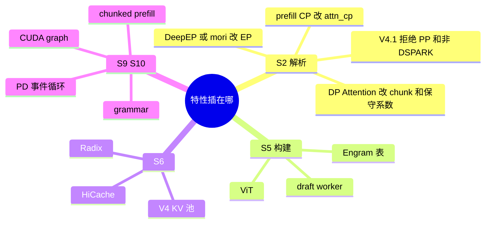

# 04 特性详解

每节固定四块：插在哪一阶段、目的、原理、相关字段或结构。开关的声明默认在 05。这里写的是它们如何互相改写。

## 投机与 MTP

MTP 在这棵树里不是 `--enable-mtp`。它是投机框架：目标模型一步，草稿提出多个 token，验证留下。阶段：S2 决定算法和草稿路径，S5 `maybe_init_draft_worker` 建第二个 worker 和池，S10 用 `ForwardMode.TARGET_VERIFY` 与 `DRAFT_EXTEND_V2`。

| 算法名 | worker | 和 V4.1 的关系 |
| --- | --- | --- |
| `EAGLE` / `EAGLE3` | `EAGLEWorkerV2` | V4 通用检查允许 topk=1；`validate_deepseek_v41_features` 再拒绝 |
| `NEXTN` | 解析时折成 EAGLE | 对 V4.1 同样被拒绝。config 里的 next-n 层是 DSPARK 用的结构 |
| `STANDALONE` | `StandaloneWorkerV2` | 独立草稿权重 |
| `DSPARK` | `DSparkWorkerV2` | V4.1 唯一允许 |
| `DFLASH` | `DFlashWorkerV2` | |
| `NGRAM` | ngram worker | 不加载神经网络草稿 |

DSPARK 的原理：草稿看 config 里的 `dspark_target_layer_ids`（37、38、39）和 `dspark_block_size`（5），专家数是 128 而不是 384。`_handle_dspark` 把 `speculative_num_steps` 收成 1。草稿路径优先用主 checkpoint 或其中的子目录，否则必须自己传 `--speculative-draft-model-path`。

和 DP attention 叠在一起时还有四条：必须 `--enable-dp-lm-head`；非 NPU 的 a2a 只能是 `none`、`megamoe`、`mori`；a2a 不是 `none` 时要 `SGLANG_RAGGED_VERIFY_MODE=static`；`attn_cp_size` 必须是 1。`device` 字符串必须以 `cuda`、`npu` 或 `xpu` 开头。ROCm 上设备名通常仍是 `cuda`，这条能过，HIP 的限制在别的 hook。

| 结构 | 字段 | 含义 |
| --- | --- | --- |
| 草稿模型 | `DeepseekV4ForCausalLMDSpark` | 只跑草稿层 |
| 请求 | `Req.output_ids` | 已接受的 token，验证失败会截断 |
| 批 | `ForwardMode.TARGET_VERIFY` | 目标模型一次看多个候选 |

## DeepEP 与 mori

目的：专家并行时把 token 送到持有该专家的 rank。它是通信，不是 GEMM。GEMM 是 `moe_runner_backend`。

阶段：S2 `handle_a2a_moe` 和 `overrides.py` 的 `_a2a_ep_size`。`deepep`、`deepep_v2`、`mori`、`megamoe`、`flashinfer`、`nixl`、`mooncake` 等在 `_A2A_EP_SPANNING_BACKENDS` 里，`ep_size` 被改成 `tp_size`。S10 的 dispatcher 才真正搬运。

| 模式 | 效果 |
| --- | --- |
| `deepep_mode=auto` | 注释约定 decode 低延迟、prefill normal，由 dispatcher 切换 |
| `deepep_mode=normal` | `moe_hook` 关掉 decode 和 prefill 的 CUDA graph |
| `deepep_mode=low_latency` | 保留图。CuteDSL FP4 会强制这个值 |
| `deepep_v2` + `direct` | `nnodes>1` 直接 ValueError，要改 `hybrid` |
| `deepep_v2` | runner 只能 `deep_gemm`，关 shared expert fusion，关 prefill 图 |

`DeepEPBuffer.get_deepep_buffer` 按模式分配 NVL/RDMA buffer。CUDA graph 捕获时 `DeepEPCudaGraphRunnerAdapter` 把 buffer 套进图。`normal` 已经关图，adapter 不会在那条路径工作。

mori 走同一条 EP 公式，但实现是 AMD 的 all-to-all。DSPARK 加 attention DP 时白名单包含 mori、不包含 deepep。四机 HIP 因此用 mori。Waterfill 会把后端强制成 deepep 或要求已经是 deepep/megamoe，和这条白名单冲突，不要和 DSPARK+DP attention 一起开。

## DP Attention

目的：KV 头只有 1 时，不要把 attention 切成很多份跨机 all-reduce；把不同请求分到不同 scheduler，MoE 仍看全部 rank。

它不增加 GPU。`dp_size` 才增加整模副本，并且 `nnodes!=1` 时被 `check_server_args` 禁止。两者不能同时大于 1。

阶段：S2 `handle_data_parallelism` 做整除、把 `schedule_conservativeness` 乘 0.3、把 `chunked_prefill_size` 除以组数。S3 为每个组起一个 scheduler。S8 `DataParallelController` 分发。S10 `initialize_dp_attention` 写下 `attn_dp_rank`。没有请求的组仍要发 `ForwardMode.IDLE`，否则别人的 all-to-all 没有对端。

旧旗标 `--dp-size N --enable-dp-attention` 在 S2 收成 `attn_dp_size=N, dp_size=1`。

| 相关字段 | 约束 |
| --- | --- |
| `enable_dp_lm_head` | 要求 attention DP。DSPARK 在 DP attention 下强制打开 |
| `enable_tp_lm_head_all_to_all` | 也要求 attention DP，且和 dp lm head 互斥。默认只在 PD decode、纯 DP attention、无 CP 时开 |
| MegaMOE | 要求 `attn_dp_size==tp_size`。建议的 4/16 配置不能开它 |
| encoder SWA bounded replay | HIP 上与 attention DP 互斥 |

每个组有自己的 radix。前缀亲和要靠 `routed_dp_rank`，不靠树的跨进程共享。

## Prefill CP（PCP）与 DCP

Prefill CP 把一条序列的 token 切到多个 rank 上做预填充。`cp_strategy` 必填，`interleave` 或 `zigzag`。S2 的 `validate_deepseek_v4_cp` 会把 `attn_cp_size` 改成 `tp/attn_dp`，也就是把剩下的 TP 全部拿去切序列。

HIP 上这一步之前就会失败：多节点、V4.1、decoder SWA bounded replay、two-batch overlap 都在拒绝列表里。非 NPU 还要求 `tp<=8` 且不能开 attention DP。zigzag 只允许 NPU。所以 PCP 不是四机 BW1100 跑 V4.1 的手段。

DCP 切的是 decode 的 KV，组在 `parallel_state.py`。它和 prefill CP 互斥。`fi_a2a` 只允许 CUDA。`dcp_size` 必须整除 attention TP。

## 其它特性

| 特性 | 阶段 | 原理要点 |
| --- | --- | --- |
| Chunked prefill | S9 | `chunked_prefill_size=-1` 表示关。长提示拆成多次 EXTEND。DP attention 时 S2 会把块缩小 |
| CUDA graph | S2 定，S5 末捕获 | 分 decode/prefill。`--disable-cuda-graph` 已废弃。DeepEP normal、v2 的 prefill、DWDP 会关对应相 |
| HiCache | S2 `handle_hicache`，S6 接树 | `--enable-hicache`。与某类 unified external linker 互斥。它是树的 host/L3，不是第三种树 |
| PD | S2 定模式，S9 换循环 | prefill 算提示并传 KV，decode 用 `ForwardMode.PREBUILT`。V4.1+DSPARK 的 PD 还要 ragged static，传输是 mooncake 或 nixl |
| LoRA | S5、S8 | `check_lora_server_args`。部分 MoE runner 会关掉 shared expert fusion |
| Radix | S6 建，S9 用 | 默认开。细节在 08 |
| Engram | S5 | 无 CLI。层号来自 config。host 表靠 `SGLANG_ENABLE_DSV41_ENGRAM_HOST_TABLE` |
| Elastic EP | 运行中 | 要求已经是 attention DP、dp lm head、`ep==tp`、a2a 为 `nixl`、无 CP、无 PP。和静态 mori 不是一条路径 |
| DWDP | S2 `handle_dwdp` | 宽度必须等于 `tp`，强制纯 DP attention、a2a none、无 PP、无投机、无 CUDA graph。用权重预取代替 token all-to-all。和 DSPARK 冲突 |

## V4.1 会改行为的环境变量

它们不在 ServerArgs 表里，定义在 `srt/environ.py`。

| 变量 | 作用的阶段 |
| --- | --- |
| `SGLANG_ENABLE_DSV41_ENGRAM_HOST_TABLE` | S5，表放 host |
| `SGLANG_DSV41_ENGRAM_HOST_TABLE_LAYOUT` | host 表布局 |
| `SGLANG_RAGGED_VERIFY_MODE` | S2，DSPARK 在 DP MoE 下必须 `static` |
| `SGLANG_OPT_USE_ONLINE_COMPRESS` | S6/S10 在线压缩，和投机步数有断言 |
| `SGLANG_DSV4_KV_LAYOUT` | S6 布局 |
| `SGLANG_RUST_SERVER` | S3 跳过 Python HTTP |
| `SGLANG_AMD_USE_FLYDSL_MEGA_MOE` | HIP 上 MegaMOE 改用 aiter |
