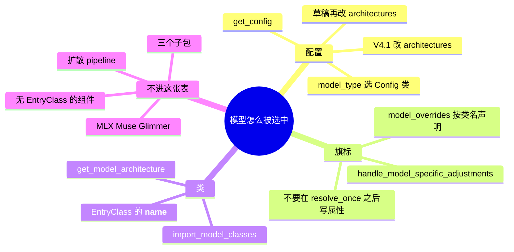
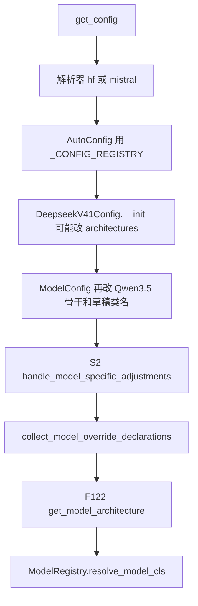
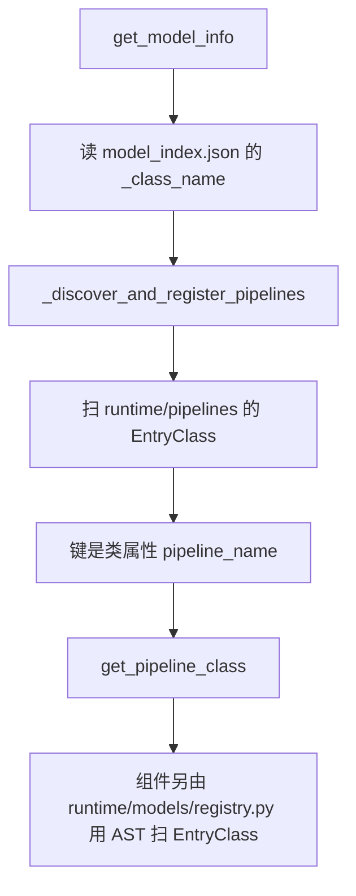

# 注册表

清单 C.1 的 M01–M15。本页写清一件事：checkpoint 里的架构字符串怎样变成 Python 类，以及哪些模块根本不走这张表。

树是 `297e54fd105e974cdf401e5b4d20253a22c16f90`。下面的调用序是读源码得到的，**源码路径推断，未实测**。合入年不在本页，见 [02-2026年前](02-2026年前.md) 和 [03-2026起](03-2026起.md)。家族和特性的格子在 [04-模型与特性矩阵](04-模型与特性矩阵.md)。

LLM 侧带 `EntryClass` 的文件 225 个、类 290 个（键是类的 `__name__`，不是文件名）。按年拆开的全表在后两页，两表并集覆盖这些类。同目录另有 29 个没有 `EntryClass` 的模块，加上三个子包，都不进 `ModelRegistry`。扩散组件 96 行，pipeline 文件 51 个、`pipeline_name` 70 个，走另一张表。

## 场景

| 场景 | 走哪条注册 | 硬件或平台 |
| --- | --- | --- |
| 普通文本或 VLM 服务 | LLM `ModelRegistry`。键是 HF `architectures` | 平台不决定类名。类找到之后，attention / MoE 后端才看 CUDA、HIP、NPU、XPU |
| 草稿 worker | 同一张表。`ModelConfig._config_draft_model` 先把 `architectures[0]` 改成 NextN / MTP / DSpark | 草稿不另建进程组。见启动 F206 |
| `--model-impl transformers`，或原生表里没有这个架构 | `resolve_transformers_arch`，再落到 `TransformersForCausalLM` 一类 | 注册表的 warning 写性能不保证 |
| `model_impl == MINDSPORE` | 架构收成 `MindSporeForCausalLM` | NPU 路径。worker 细节在启动篇 |
| EmbeddingGemma | 不看 checkpoint 里的 `Gemma3TextModel`，改查 `EmbeddingGemmaModel` | 双向 embedding |
| Mixtral，量化名不在 fp8 / compressed-tensors / gptq_marlin / awq_marlin / quark_int4fp8_moe | 改查 `QuantMixtralForCausalLM` | 量化方法来自 config，不是 GPU 型号 |
| DeepSeek V4.1 | 类仍是 `DeepseekV4ForCausalLM`。`model_type` 写成 `deepseek_v41` | `flashmla_mega` 要求 CUDA 且 SM100/SM103。MXFP8 稠密 GEMM 的默认后端也要求 CUDA、非 HIP、SM100。NPU 上 V4 把 page size 收成 128，KV dtype 收成 bfloat16 |
| DeepSeek V4，`--dsv4-attn-backend trtllm` | 仍是同一个类 | CUDA SM100/SM103，KV 为 fp8_e4m3，关掉 HiSparse、CP、PD，并要求 chunked prefill |
| HIP 上的 DeepSeek V4 | 同一个类。`apply_deepseek_v4_defaults` 默认关掉 `SGLANG_OPT_FLASHMLA_SPARSE_PREFILL` | ROCm/HIP。注释点名 DeepSeek-V4-Flash 在 MI355X 上稀疏 prefill 结果不对 |
| 外部模型包 | `SGLANG_EXTERNAL_MODEL_PACKAGE` 置位时只装这个包，内置导入推迟 | 无额外硬件门 |
| 扩散服务 | `multimodal_gen` 的 pipeline 表。键是 `pipeline_name`，来自 `model_index.json` 的 `_class_name` | 与 LLM 的 TP/EP 世界不是同一套。cache-dit 是 B96 |
| MLX 上的 Muse Glimmer | 不进 `ModelRegistry`。mlx-lm 按 checkpoint 的 `model_file` 加载 | `use_mlx()` 的硬件门在启动 F44 / F111 |

## 先分清两次查找

配置字符串和 Python 类是两步。S2 解析旗标时已经有 `hf_config`。权重要到 F122 才按类构造模块。

## 调用栈

| 次序 | 函数 | 做什么 | 角色 |
| --- | --- | --- | --- |
| 导入期 | `import_model_classes` | `pkgutil` 扫包，读模块级 `EntryClass` | 造表。M01、M02 |
| 导入期 | `ModelRegistry.register` | 默认登记 `sglang.srt.models` | 全局表。M03。外部包则推迟。M04 |
| S2 之前 | `get_config` | 选解析器，得到 `PretrainedConfig` | M10。V4.1 的改名发生在 Config 构造里。M09 |
| 构造 `ModelConfig` | `ModelConfig.__init__` | 拷贝 config，改少数架构字符串，再 `_config_draft_model` | M09、M13 |
| S2 | `handle_model_specific_adjustments` | 按 `architectures[0]` 收集 override，并做 DSA / V4 校验 | M11。拒绝表是 F197 |
| F122 | `get_model_architecture` | 特例改名，然后 `resolve_model_cls` | M06、M07、M08 |
| 扩散启动 | `get_model_info` | 读 `model_index.json` 的 `_class_name`，对上 `pipeline_name` | M14 |

## M01 扫描包

`srt/models/registry.py` 的 `import_model_classes`。`importlib.import_module` 打开包，`pkgutil.iter_modules` 只看这一层。`ispkg` 为真就跳过，所以 `deepseek_common/`、`dots3_common/`、`inkling_common/` 整包不进表。非包的 `.py` 才 `import_module`。导入抛错时，`strict` 为假就打 warning 并继续。

角色：启动导入 `ModelRegistry` 时把内置模型装进内存。扫的是类，不是权重。

## M02 入口是 `EntryClass`

模块级名字 `EntryClass`。可以是一个类，或类的列表。字典的键是 **类的 `__name__`**，重复就 `assert`。文件名不参与查找。`bailing_moe.py` 同时登记 `BailingMoEForCausalLM`（E 大写）和 `BailingMoeForCausalLM`，这是两个类，不是笔误。

Mistral3 的源码标识符是 `_Mistral3ConditionalGeneration`，导入前把 `__name__` 写成 `"Mistral3" + "ForConditionalGeneration"`。表里的键是运行时名字。见 M12。

## M03 全局表

`ModelRegistry = _ModelRegistry()`。没有外部包时，模块底部调用 `register("sglang.srt.models")`，内部再 `import_model_classes`。`resolve_model_cls` 先用调用方传来的第一个架构名在已装表里查；查不到再 `_load_default_models`，经 `_normalize_archs` 过滤，按顺序 `_try_load_model_cls`。一个都没有就 `_raise_for_unsupported`。

角色：进程内一张字典。后面的 loader 不自己扫目录。

## M04 外部包

环境变量 `SGLANG_EXTERNAL_MODEL_PACKAGE` 有值时，把 `_default_models_loaded` 设成假，只 `import_model_classes` 这个包。注释写这是为了外部模型时少导入内置包。`register` 默认不允许覆盖已有架构，除非 `overwrite=True`。

## M05 禁用

`SGLANG_DISABLED_MODEL_ARCHS` 按 **模块名**（路径最后一段，不是类名）跳过。被跳过的文件里所有 `EntryClass` 都不会进表。

## M06 `get_model_architecture`

`model_loader/utils.py`。读 `hf_config.architectures`，做完 M08 的改名，再 `ModelRegistry.resolve_model_cls`。返回 `(model_cls, resolved_arch)`，并写到 `model_config._resolved_model_arch` 和 `_resolved_model_impl`。

调用点在 loader 的 `_initialize_model`（F122 那一页）。此时旗标已经在 S2 收过，类才被实例化。

## M07 兜底

`_normalize_archs`：名单里没有的架构会在过滤结果末尾追加 `TransformersForCausalLM`。`resolve_transformers_arch` 在「原生不支持」或显式 `--model-impl transformers` 时改写架构列表，并 warning：功能子集，性能不保证。`Transformers*` 的多个类在 `transformers.py`，见矩阵最后一行。

原生支持且 `model_impl` 不是 `TRANSFORMERS`、也不是 `MINDSPORE` 时，不会走这个兜底。

## M08 特例改名

仍在 `get_model_architecture` 里，发生在查表之前：

| 条件 | 改成 |
| --- | --- |
| `model_config.is_embedding_gemma` | `EmbeddingGemmaModel`。注释：checkpoint 序列化名是 `Gemma3TextModel` |
| `MixtralForCausalLM` 且量化不在支持列表 | `QuantMixtralForCausalLM` |
| `model_impl == MINDSPORE` | `MindSporeForCausalLM` |

这三处改的是查找用的字符串，不改文件名。

## M09 HF config 改架构字符串

类名表认的是改完之后的字符串。

DeepSeek V4.1 没有单独的 `EntryClass`。`utils/hf_transformers/common.py` 的 `_CONFIG_REGISTRY` 把 `model_type` `deepseek_v41` 指到 `DeepseekV41Config`。该类 `__init__` 调用 `normalize_deepseek_v41_config`：`model_type` 写成 `deepseek_v41`，`architectures == ["DeepseekV41ForCausalLM"]` 时改成 `["DeepseekV4ForCausalLM"]`。运行时类在 `models/deepseek_v4.py`。`get_config` 若发现 config 已是 `DeepseekV41Config`，对 `model_override_args` 再走一遍同一个函数。

同一次 `ModelConfig.__init__` 里还有几处改字符串，不是 V4 专属：

| 条件 | 改成 | 角色 |
| --- | --- | --- |
| `architectures == ["Qwen3_5Model"]` 且读到 decision config | `Qwen3_5ForConditionalGeneration` | 裸骨干加上 readout |
| `architectures == ["Qwen3_5TextModel"]` 且有 pointer head | `Qwen3_5ForCausalLM` | 没有 LM head 的 Kev 骨干 |
| `get_config` 里的 Kev LoRA，基座 `model_type == qwen3_5` | `Qwen3_5ForCausalLM` | `load_pointer_adapter` 之后 `_set_architectures` |

V4 与 V4.1 的差别在 `model_type`，不在类名。拒绝非 DSPARK、HiSparse、PP 的函数看的是 `model_type == "deepseek_v41"`。见矩阵页 F197。

`common.py` 里 `_DeepseekV4ConfigAlias` 的 `model_type` 是 `deepseek_v4`，挂在同一张 `_CONFIG_REGISTRY`。V4 不把架构改成别的类。

## M10 配置解析器插件

`configs/model_config_parser_registry.py`。`register_model_config_parser(name)` 把解析器类放进 `_MODEL_CONFIG_PARSER_REGISTRY`。`get_model_config_parser` 每次新造一个实例。`"auto"` 不在这里解析。

`get_config`（`utils/hf_transformers/config.py`）才决定名字：GGUF 没有 sidecar 且能原生读时直接 `build_gguf_config`；否则 `auto` 在 `is_mistral_model` 时选 `mistral`，不然 `hf`。已登记的两个实现：

| 名字 | 类 | 做什么 |
| --- | --- | --- |
| `hf` | `HfModelConfigParser` | 先试 Longcat、再试没有 `model_type` 的原始 Mamba，否则 `AutoConfig.from_pretrained`。之后改 Phi-4MM 的 vision config、Longcat 的 `model_type`、Gemma4 的 attention 字段 |
| `mistral` | `MistralModelConfigParser` | `load_mistral_config` |

原始 Mamba 那条会造 `MambaConfig`，`architectures=["MambaForCausalLM"]`。这是 M09 的同类改写，发生在解析器内部。

## M11 模型默认旗标

`arg_groups/model_overrides/` 每个家族一个模块。导入 `model_overrides` 包时这些模块被拉起来，用 `_register_for(架构名)` 登记。谓词形式是 `register_model_override_predicate`，本树里 `_step3p_overrides` 用它匹配类名里含 `Step3p5ForCausalLM` 或 `Step3p7ForConditionalGeneration`。常量表 `MODEL_OVERRIDES` 只写了两条 dtype：`MistralLarge3ForCausalLM` 和 `PixtralForConditionalGeneration` 收成 bfloat16。

S2 的 `handle_model_specific_adjustments`：

1. 用 `model_config_of` 拿到 config，取 `architectures[0]`。
2. 先做与家族无关的拒绝（NPU 上 DCP 仅 DSA、Intern-S2-Mobius 拒绝 PP/EP、DSA cache 切层仅 DSA）。
3. `collect_model_override_declarations`：常量，然后精确类名的函数，然后谓词函数。空字典丢掉。
4. `validate_declarations` 之后把声明放进 `_resolved_overrides`。读者走 `resolving_view` / `resolved_view`，不直接改已经封口的字段。
5. 少数架构再调 hook：`KimiLinearForCausalLM` 与 `KimiK3ForConditionalGeneration` 走 `apply_kimi_k3_linear_attn_defaults` 和 `apply_kimi_k3_spec_backend_defaults`；`Glm5NextForConditionalGeneration` 走 `apply_glm5_next_spec_backend_defaults`；`DeepseekV4ForCausalLM` 走 `apply_deepseek_v4_defaults`。
6. `is_deepseek_dsa` 为真的那一批类（含 `GlmMoeDsaForCausalLM`、`Glm5NextForConditionalGeneration`、`KimiK25ForConditionalGeneration`、`HYV4ForCausalLM`）在这里设 DSA 的 index top-k 阈值，并可能改 prefill 图。attention 后端 `dsa` 本身写在 `model_overrides/deepseek_v2.py` 的 `_deepseek_family_overrides`，不写在 hook 后半。

`_register_for` 的注释要求提供者不要改 `server_args` 或 `hf_config`，只返回字段字典。清单写明：不要在 `resolve_once` 之后写属性。

各模块登记了哪些类，矩阵页有索引。字段没有逐项抄完的，那里标待核。

## M12 Mistral3 类名被拆开

GitHub push protection 把上游那个连续类名当成密钥。运行时名字没有改。`models/mistral.py` 在 `EntryClass` 赋值前执行 `_Mistral3ConditionalGeneration.__name__ = "Mistral3" + "ForConditionalGeneration"`。AST 只能看到 `_Mistral3ConditionalGeneration`。年代表写运行时名字，并注明这件事。

扩散侧 `multimodal_gen/runtime/models/encoders/mistral_3.py` 的 `EntryClass` 本身就是这个拼接表达式。组件注册表用 AST 把加法拼回去，见 M14。

涉及文件以 [README](../README.md#与上游树的唯一差异) 为准。

## M13 草稿架构改名

`ModelConfig._config_draft_model`，只在 `is_draft_model` 时改 `architectures[0]`。键仍然是改完的类名，类必须已经在 M02 的表里。启动篇 F206 写的是这一步插在加载的哪里。本页只列改写对照。

| 原来的 `architectures[0]` | 改成 | 额外动作 |
| --- | --- | --- |
| Dots3，且文本 config 是 `Dots3Config` | `configure_draft_model()` 的返回值 | 交给 config |
| `DSparkMiniMaxDraftModel` 且算法是 DSPARK | 仍用该类，`configure_minimax_m3_dspark` 换 config | 显式草稿量化为空时清掉量化 config |
| `DeepseekV3ForCausalLM` / `DeepseekV32ForCausalLM` | `DeepseekV3ForCausalLMNextN` | |
| `GlmMoeDsaForCausalLM` | `GlmMoeDsaForCausalLMNextN` | GLM-5.2 的 MTP 头。类注释与 DeepSeek 的层号不同 |
| `DeepseekV4ForCausalLM` | 打包了 DSpark 且算法是空或 DSPARK → `DeepseekV4ForCausalLMDSpark`；否则 `DeepseekV4ForCausalLMNextN` | NextN 把 `num_nextn_predict_layers` 设为 1 |
| `Glm4MoeForCausalLM` | `Glm4MoeForCausalLMNextN` | |
| `Glm4MoeLiteForCausalLM` | `Glm4MoeLiteForCausalLMNextN` | |
| `Glm5NextForConditionalGeneration` | `Glm5NextForConditionalGenerationNextN` | 文本 config 同步；`linear_attn_config` 清空 |
| `GlmOcrForConditionalGeneration` | `GlmOcrForConditionalGenerationNextN` | |
| `LongcatFlashForCausalLM` | `LongcatFlashForCausalLMNextN` | `num_hidden_layers` 改成 nextn 层数 |
| `MiMoForCausalLM` | `MiMoMTP` | |
| MiMo V2 的主架构 | `MiMoV2MTP` | `num_nextn_predict_layers = 1` |
| `Step3p5ForCausalLM` | `Step3p5MTP` | |
| `InklingForConditionalGeneration` | `InklingForConditionalGenerationMTP` | 有 local MTP 时可能改滑窗 |
| `GigaChat35ForCausalLM` | `GigaChat35ForCausalLMNextN` | |
| `Step3p7ForConditionalGeneration` | 换成文本 config，架构 `Step3p5MTP` | |
| Bailing MoE 的四个主类 | `BailingMoeForCausalLMNextN` | |
| `Ernie4_5_MoeForCausalLM` | `Ernie4_5_MoeForCausalLMMTP` | |
| `Qwen3NextForCausalLM` | `Qwen3NextForCausalLMMTP` | nextn 层数 1 |
| `Qwen4ExpForConditionalGeneration` | `Qwen4ExpForCausalLMMTP` | 先深拷贝，避免改到目标的 config；层数收成 1 |
| `Qwen3MoeForCausalLM` | `Qwen3MoeForCausalLMMTP` | |
| Qwen3.5 四个类，以及 InternS2 Preview / Mobius | `Qwen3_5ForCausalLMMTP` | Mobius 另把专家数改成 MTP 自己的那套 |
| `ExaoneMoEForCausalLM` / `ExaoneMoeForCausalLM` | `ExaoneMoEForCausalLMMTP` | |
| `NemotronH_Omni_Reasoning_V3` | 换成文本 config，架构 `NemotronHForCausalLMMTP` | |
| `NemotronHForCausalLM` / `NemotronHPuzzleForCausalLM` | `NemotronHForCausalLMMTP` | |
| `HYV3ForCausalLM` | `HYV3ForCausalLMNextN` | |
| `HYV4ForCausalLM` | `HYV4ForCausalLMNextN` | |

没有出现在这张表里的架构，草稿仍用原来的 `architectures[0]` 去查 `ModelRegistry`。

## M14 扩散是另一张表

LLM 的 `architectures` 不选扩散 pipeline。

`_discover_and_register_pipelines` 用 `pkgutil.walk_packages` 扫 `sglang.multimodal_gen.runtime.pipelines`，这点和 LLM 的 `iter_modules` 不同，子模块也会进。`EntryClass` 必须是 `ComposedPipelineBase` 的子类。同名 `pipeline_name` 后写覆盖先写，并打 warning。`get_pipeline_class` 按这个名字取类。

组件表在 `runtime/models/registry.py` 的 `_discover_and_register_models`。它只扫 `runtime/models/` 下一层目录里的 `.py`（adapter、dits、encoders、schedulers、vaes、vocoder 等），用 AST 读 `EntryClass`，能把 `"Mistral3" + "ForConditionalGeneration"` 拼回运行时名字。`scheduling_helios.py` 的第二项是字符串 `"HeliosDMDScheduler"`，同文件有 `HeliosDMDScheduler = HeliosScheduler`，是别名，不是第二个类体。

年代不按头年份拆。全表在本页后部。特性侧的扩散行为是 B54，加载开关是启动 F24。cache-dit（B96）没有按 pipeline 核对，格子保持空。

## M15 MLX 文本模型不进 `ModelRegistry`

`hardware_backend/mlx/models/muse_glimmer_mlx.py`。文件头写：由 mlx-lm 按 checkpoint 里的 `model_file` 加载；这份文件是维护副本，必须能单独 import，不能依赖 sglang。头年份含 2023 与 2026，合入年待核。CUDA 侧对应 `models/muse_glimmer.py` 的 `MuseGlimmerForCausalLM` 和 `MuseGlimmerForConditionalGeneration`，那两个在 LLM 表里。

`EntryClass = Model` 写在 mlx 文件里，但扫描包是 `sglang.srt.models`，这个路径不在其中。

## 三个子包

`import_model_classes` 不进入子包。它们是共享实现，不是另一套架构名。

| 包 | 文件头 | 里面有什么 |
| --- | --- | --- |
| `srt/models/deepseek_common/` | `__init__.py` 为空 | attention forward（MHA / MLA，含 CPU 与 ROCm）、`moe_transport.py`、`deepseek_weight_loader.py`、`decoder_swa_bounded_replay.py`，以及 `amd/` 下的 HIP / gfx95 / fused mHC。调用点未在本页逐函数展开 |
| `srt/models/dots3_common/` | Shared implementation modules for Dots3 | `modeling.py`、`nextn.py`、`fp8.py`，以及 omni 的 audio / vision / towers |
| `srt/models/inkling_common/` | registry-skipped support package。头年份 2026，合入年待核 | attn、moe、sconv、lora、norm、quantization、kernels |

`deepseek_common/amd/deepseek_v4_*.py` 是 V4 在 ROCm 上的核与融合，不是新的 `EntryClass`。V4 的类仍在 `deepseek_v4.py`。

## 无 `EntryClass` 的同目录模块

29 个。复审时的引用点，加上本轮对上的 import。它们不是 HF 架构名。

| 文件 | 代表符号 | 谁引用 |
| --- | --- | --- |
| `deepseek_v41_vit.py` | `ViT`，`Aligner` | `deepseek_v4.py` |
| `deepseek_v4_boundary.py` | 模块，被当成 `hc_boundary` | `deepseek_v4.py`，`deepseek_v4_dspark.py`，`deepseek_v4_nextn.py` |
| `deepseek_v4_mhc.py` | `HcState` 等 | mHC 层，B76。不是注册类 |
| `deepseek_v4_platform_stage.py` | `NonCudaDSparkMixin` 等 | `deepseek_v4.py`，`deepseek_v4_dspark.py` |
| `deepseek_v4_replay_tail.py` | `in_replay_tail_graph` | `deepseek_v4.py`；`deepseek_v4_backend.py` |
| `dots_vlm_vit.py` | `DotsVisionTransformer` | `dots_ocr.py` |
| `ernie45_moe_vl.py` | `Ernie4_5_VLMoeModel` | `ernie45_vl.py` |
| `gemma3n_audio.py` | `Gemma3nAudioEncoder` | `gemma3n_mm.py` |
| `gemma4_audio.py` | `Gemma4AudioEncoder` | `gemma4_mm.py`，`embedding_gemma2.py` |
| `gemma4_vision.py` | `Gemma4VisionEncoder` | `gemma4_mm.py`，`gemma4_diffusion.py` |
| `idefics2.py` | `Idefics2VisionTransformer` | `phi4mm.py`，`minicpmv.py`，`minicpmo.py` |
| `kimi_k3_rocm_quant.py` | ROCm 量化辅助 | `kimi_k3.py` 函数内延迟 import |
| `kimi_k3_vl.py` | `KimiK3VisionTower` | `kimi_k3.py` |
| `kimi_vl_moonvit.py` | `MoonVitPretrainedModel` | `kimi_vl.py`，`kimi_k25.py`，`kimi_k3_vl.py` |
| `mimo_audio.py` | `AudioEncoderMixin` | `mimo_v2.py`，`mimo_v2_asr.py` |
| `mimo_vl.py` | `MiMoVisionTransformer` | `mimo_v2.py` |
| `minicpmv_vit.py` | 视觉块 | `minicpmv.py` |
| `minimax_vl_common.py` | 共享视觉块 | `minimax_m3_vl.py` |
| `muse_spark.py` | `MuseSparkTextForCausalLM` | `muse_spark_omni.py`。`MuseSparkForConditionalGeneration` 在后者，C.4 已有 |
| `nemotron_h_nvfp4_layout.py` | `Nvfp4LayoutCycle` | `nemotron_h.py` |
| `nemotron_h_utils.py` | `make_stage_boundary`，`stage_facts` | `nemotron_h.py` |
| `parakeet.py` | `ProjectedParakeet`，`ParakeetExtractor` | `nano_nemotron_vl.py` |
| `phi4mm_audio.py` | `AudioEmbedding` | `phi4mm.py` |
| `phi4mm_utils.py` | 工具 | `phi4mm_audio.py` |
| `qwen4_exp_ple_table.py` | `PleFilePrefetcher` | Qwen4-Exp 的 PLE，B81。无 `EntryClass` |
| `radio.py` | `RadioModel` | `nano_nemotron_vl.py` |
| `siglip.py` | `SiglipVisionModel` | `gemma3_mm.py`；扩散 `encoders/gemma_3.py` |
| `siglip2.py` | `Siglip2Model` | `lfm2_vl.py`，`cosmos3_edge.py` |
| `utils.py` | 共享工具 | 不是模型 |

## 扩散组件

M14 的组件表。键是类名，不是 `pipeline_name`。年代 **待核**，不按年拆。未实测。

本表 96 行。

| 文件 | EntryClass |
| --- | --- |
| `multimodal_gen/runtime/models/adapter/anima.py` | `AnimaTextConditioner` |
| `multimodal_gen/runtime/models/adapter/ltx_2_connector.py` | `LTX2TextConnectors` |
| `multimodal_gen/runtime/models/adapter/ltx_2_duration_head.py` | `LTX2DurationHead` |
| `multimodal_gen/runtime/models/bridges/mova_dual_tower.py` | `DualTowerConditionalBridge` |
| `multimodal_gen/runtime/models/decoders/ltx_2_5_diffusion_decoder.py` | `LTX2VideoDiffusionDecoderModel` |
| `multimodal_gen/runtime/models/dits/anima.py` | `AnimaTransformer3DModel` |
| `multimodal_gen/runtime/models/dits/causal_wanvideo.py` | `CausalWanTransformer3DModel` |
| `multimodal_gen/runtime/models/dits/cosmos3_multiview.py` | `Cosmos3MultiviewTransformer` |
| `multimodal_gen/runtime/models/dits/cosmos3_sim_auto.py` | `Cosmos3SimAutoTransformer` |
| `multimodal_gen/runtime/models/dits/cosmos3video.py` | `Cosmos3OmniTransformer` |
| `multimodal_gen/runtime/models/dits/cosmos_dreams.py` | `CosmosDreamsTransformer` |
| `multimodal_gen/runtime/models/dits/ernie_image.py` | `ErnieImageTransformer2DModel` |
| `multimodal_gen/runtime/models/dits/flux.py` | `FluxTransformer2DModel` |
| `multimodal_gen/runtime/models/dits/flux3.py` | `Flux3Transformer` |
| `multimodal_gen/runtime/models/dits/flux3_image.py` | `Flux3ImageDiT` |
| `multimodal_gen/runtime/models/dits/flux_2.py` | `Flux2Transformer2DModel` |
| `multimodal_gen/runtime/models/dits/glm_image.py` | `GlmImageTransformer2DModel` |
| `multimodal_gen/runtime/models/dits/helios.py` | `HeliosTransformer3DModel` |
| `multimodal_gen/runtime/models/dits/hunyuan3d.py` | `Hunyuan3D2DiT` |
| `multimodal_gen/runtime/models/dits/hunyuan3d_paint.py` | `Hunyuan3DPaintUNet` |
| `multimodal_gen/runtime/models/dits/hunyuan_image3.py` | `HunyuanImage3ForCausalMM` |
| `multimodal_gen/runtime/models/dits/hunyuanvideo.py` | `HunyuanVideoTransformer3DModel` |
| `multimodal_gen/runtime/models/dits/ideogram.py` | `Ideogram4Transformer2DModel` |
| `multimodal_gen/runtime/models/dits/joy_image.py` | `JoyTransformer3DModel`, `JoyImageEditTransformer3DModel` |
| `multimodal_gen/runtime/models/dits/kandinsky6.py` | `Kandinsky6Transformer3DModel` |
| `multimodal_gen/runtime/models/dits/kandinsky6_sr.py` | `Kandinsky6SRTransformer3DModel` |
| `multimodal_gen/runtime/models/dits/krea2.py` | `Krea2Transformer2DModel` |
| `multimodal_gen/runtime/models/dits/lingbot_video_moe.py` | `LingBotVideoTransformer3DModel` |
| `multimodal_gen/runtime/models/dits/lingbot_world.py` | `LingBotWorldTransformer3DModel`, `CausalLingBotWorldTransformer3DModel` |
| `multimodal_gen/runtime/models/dits/llada_image.py` | `LLaDAImageTransformer2DModel`, `LLaDAImageQueryFormerModel`, `LLaDAImageTextProjectionModel`, `LLaDAImageSigVQModel` |
| `multimodal_gen/runtime/models/dits/longcat_image.py` | `LongCatImageTransformer2DModel` |
| `multimodal_gen/runtime/models/dits/longlive2.py` | `LongLive2Transformer3DModel` |
| `multimodal_gen/runtime/models/dits/ltx_2.py` | `LTX2VideoTransformer3DModel` |
| `multimodal_gen/runtime/models/dits/ming_image.py` | `MingImageTransformer2DModel` |
| `multimodal_gen/runtime/models/dits/minimax_h3.py` | `MiniMaxH3DiTModel` |
| `multimodal_gen/runtime/models/dits/moss_image.py` | `MOSSImageTransformer` |
| `multimodal_gen/runtime/models/dits/mova_audio_dit.py` | `WanAudioModel` |
| `multimodal_gen/runtime/models/dits/mova_video_dit.py` | `WanModel` |
| `multimodal_gen/runtime/models/dits/nomas.py` | `NomasTransformer3DModel` |
| `multimodal_gen/runtime/models/dits/qwen_image.py` | `QwenImageTransformer2DModel` |
| `multimodal_gen/runtime/models/dits/qwen_image21.py` | `QwenImage21Transformer2DModel` |
| `multimodal_gen/runtime/models/dits/sana.py` | `SanaTransformer2DModel` |
| `multimodal_gen/runtime/models/dits/sana_video.py` | `SanaVideoTransformer3DModel` |
| `multimodal_gen/runtime/models/dits/sana_video2.py` | `SanaVideo2Transformer3DModel` |
| `multimodal_gen/runtime/models/dits/sana_wm.py` | `SanaWMTransformer3DModel` |
| `multimodal_gen/runtime/models/dits/sana_wm_refiner_transformer.py` | `SanaWMLTX2VideoRefiner` |
| `multimodal_gen/runtime/models/dits/stable_diffusion.py` | `StableDiffusionUNet2DConditionModel` |
| `multimodal_gen/runtime/models/dits/stablediffusion3.py` | `SD3Transformer2DModel` |
| `multimodal_gen/runtime/models/dits/wan_animate_2.py` | `WanAnimate2Transformer3DModel` |
| `multimodal_gen/runtime/models/dits/wanvideo.py` | `WanTransformer3DModel` |
| `multimodal_gen/runtime/models/dits/zimage.py` | `ZImageTransformer2DModel` |
| `multimodal_gen/runtime/models/encoders/clip.py` | `CLIPTextModel`, `CLIPTextModelWithProjection`, `CLIPVisionModel` |
| `multimodal_gen/runtime/models/encoders/gemma2.py` | `Gemma2Model` |
| `multimodal_gen/runtime/models/encoders/gemma_3.py` | `Gemma3ForConditionalGeneration` |
| `multimodal_gen/runtime/models/encoders/hunyuan3d.py` | `SingleImageEncoder`, `DualImageEncoder`, `DinoImageEncoder`, `DinoImageEncoderMV` |
| `multimodal_gen/runtime/models/encoders/ideogram.py` | `IdeogramQwen3VLTextEncoder` |
| `multimodal_gen/runtime/models/encoders/llama.py` | `LlamaModel` |
| `multimodal_gen/runtime/models/encoders/ming_image.py` | `MingImageEncoder` |
| `multimodal_gen/runtime/models/encoders/minimax_h3_qwen3vl.py` | `MiniMaxH3Qwen3VLEncoder` |
| `multimodal_gen/runtime/models/encoders/mistral_3.py` | `Mistral3ForConditionalGeneration` |
| `multimodal_gen/runtime/models/encoders/qwen2_5vl.py` | `Qwen2_5_VLForConditionalGeneration` |
| `multimodal_gen/runtime/models/encoders/qwen3.py` | `Qwen3ForCausalLM` |
| `multimodal_gen/runtime/models/encoders/qwen3_5.py` | `Qwen3_5Model` |
| `multimodal_gen/runtime/models/encoders/qwen3vl.py` | `Qwen3VLForConditionalGeneration` |
| `multimodal_gen/runtime/models/encoders/t5.py` | `T5EncoderModel`, `UMT5EncoderModel` |
| `multimodal_gen/runtime/models/schedulers/flow_match_pair.py` | `FlowMatchPairScheduler` |
| `multimodal_gen/runtime/models/schedulers/hunyuan3d_scheduler.py` | `Hunyuan3DFlowMatchEulerDiscreteScheduler`, `Hunyuan3DConsistencyFlowMatchEulerDiscreteScheduler` |
| `multimodal_gen/runtime/models/schedulers/kandinsky6_piflow.py` | `PiflowScheduler` |
| `multimodal_gen/runtime/models/schedulers/moss_image.py` | `MOSSImageScheduler` |
| `multimodal_gen/runtime/models/schedulers/scheduling_comfyui_passthrough.py` | `ComfyUIPassThroughScheduler` |
| `multimodal_gen/runtime/models/schedulers/scheduling_dpm_solver_multistep.py` | `DPMSolverMultistepScheduler` |
| `multimodal_gen/runtime/models/schedulers/scheduling_flow_match_euler_discrete.py` | `FlowMatchEulerDiscreteScheduler` |
| `multimodal_gen/runtime/models/schedulers/scheduling_flow_unipc_multistep.py` | `FlowUniPCMultistepScheduler` |
| `multimodal_gen/runtime/models/schedulers/scheduling_helios.py` | `HeliosScheduler`, `HeliosDMDScheduler`（字符串别名，赋值给 `HeliosScheduler`） |
| `multimodal_gen/runtime/models/schedulers/scheduling_self_forcing_flow_match.py` | `SelfForcingFlowMatchScheduler` |
| `multimodal_gen/runtime/models/schedulers/scheduling_unipc_multistep.py` | `UniPCMultistepScheduler` |
| `multimodal_gen/runtime/models/upsampler/kandinsky6_sr_latent_upscaler.py` | `Kandinsky6SRLatentUpscalerBank` |
| `multimodal_gen/runtime/models/vaes/autoencoder.py` | `AutoencoderKL` |
| `multimodal_gen/runtime/models/vaes/autoencoder_dc.py` | `AutoencoderDC` |
| `multimodal_gen/runtime/models/vaes/autoencoder_kl_flux2.py` | `AutoencoderKLFlux2` |
| `multimodal_gen/runtime/models/vaes/autoencoder_kl_qwenimage.py` | `AutoencoderKLQwenImage` |
| `multimodal_gen/runtime/models/vaes/autoencoder_kl_qwenimage21.py` | `AutoencoderKLQwenImage21` |
| `multimodal_gen/runtime/models/vaes/cosmos3_avae.py` | `Cosmos3AVAEAudioTokenizer` |
| `multimodal_gen/runtime/models/vaes/dac.py` | `DAC` |
| `multimodal_gen/runtime/models/vaes/flux3_image_vae.py` | `Flux3ImageVAE` |
| `multimodal_gen/runtime/models/vaes/flux3_video_vae.py` | `Flux3VideoVAE` |
| `multimodal_gen/runtime/models/vaes/hunyuan3d_vae.py` | `ShapeVAE` |
| `multimodal_gen/runtime/models/vaes/hunyuanvae.py` | `AutoencoderKLHunyuanVideo` |
| `multimodal_gen/runtime/models/vaes/kandinsky6_audio.py` | `Kandinsky6AudioVAE` |
| `multimodal_gen/runtime/models/vaes/kandinsky6_sr_vae.py` | `Kandinsky6SRVAE` |
| `multimodal_gen/runtime/models/vaes/ltx_2_audio.py` | `AutoencoderKLLTX2Audio` |
| `multimodal_gen/runtime/models/vaes/ltx_2_vae.py` | `AutoencoderKLLTX2Video`, `AutoencoderKLCausalLTX2Video` |
| `multimodal_gen/runtime/models/vaes/minimax_h3.py` | `MiniMaxH3VideoVAE`, `MiniMaxH3AudioVAE` |
| `multimodal_gen/runtime/models/vaes/nomas.py` | `NomasPixelUMMDecoder` |
| `multimodal_gen/runtime/models/vaes/wanvae.py` | `AutoencoderKLWan` |
| `multimodal_gen/runtime/models/vocoder/ltx_2_vocoder.py` | `LTX2Vocoder` |

## 扩散 pipeline

M14 的 pipeline 表。键是类属性 `pipeline_name`。一个文件可以有多条。年代 **待核**。未实测。

51 个文件，70 个名字。

| 文件 | pipeline_name |
| --- | --- |
| `runtime/pipelines/anima_pipeline.py` | `AnimaModularPipeline` |
| `runtime/pipelines/cosmos3_pipeline.py` | `Cosmos3OmniPipeline`, `Cosmos3OmniDiffusersPipeline` |
| `runtime/pipelines/cosmos3_simulation.py` | `CosmosDreamsPipeline`, `Cosmos3NanoSimBimanualPipeline`, `CosmosDreamsRealtimePipeline`, `Cosmos3NanoSimTransferPipeline`, `Cosmos3MultiviewPipeline`, `Cosmos3NanoSimAutoPipeline` |
| `runtime/pipelines/diffusers_pipeline.py` | `DiffusersPipeline` |
| `runtime/pipelines/ernie_image.py` | `ErnieImagePipeline` |
| `runtime/pipelines/flux.py` | `FluxPipeline` |
| `runtime/pipelines/flux3_action.py` | `Flux3ActionPipeline` |
| `runtime/pipelines/flux3_image.py` | `Flux3ImagePipeline` |
| `runtime/pipelines/flux_2.py` | `Flux2Pipeline` |
| `runtime/pipelines/flux_2_klein.py` | `Flux2KleinPipeline` |
| `runtime/pipelines/flux_2_nvfp4.py` | `Flux2NvfpPipeline` |
| `runtime/pipelines/glm_image.py` | `GlmImagePipeline` |
| `runtime/pipelines/helios_pipeline.py` | `HeliosPipeline`, `HeliosPyramidPipeline` |
| `runtime/pipelines/hunyuan3d_pipeline.py` | `Hunyuan3D2Pipeline` |
| `runtime/pipelines/hunyuan_image3.py` | `HunyuanImage3Pipeline` |
| `runtime/pipelines/hunyuan_pipeline.py` | `HunyuanVideoPipeline` |
| `runtime/pipelines/ideogram.py` | `Ideogram4Pipeline`, `Ideogram4Nvfp4Pipeline`, `Ideogram4FastPipeline`, `Ideogram4InstantPipeline` |
| `runtime/pipelines/joy_echo_pipeline.py` | `JoyEchoPipeline` |
| `runtime/pipelines/joy_image.py` | `JoyImageEditPipeline` |
| `runtime/pipelines/kandinsky6_pipeline.py` | `Kandinsky6TI2VAPipeline` |
| `runtime/pipelines/kandinsky6_sr_pipeline.py` | `Kandinsky6SRPipeline` |
| `runtime/pipelines/krea2.py` | `Krea2Pipeline` |
| `runtime/pipelines/lingbot_video_moe.py` | `LingBotVideoPipeline` |
| `runtime/pipelines/lingbot_world_causal_dmd_pipeline.py` | `LingBotWorldCausalDMDPipeline` |
| `runtime/pipelines/llada_image.py` | `LLaDAImagePipeline` |
| `runtime/pipelines/longcat_image.py` | `LongCatImagePipeline`, `LongCatImageEditPipeline` |
| `runtime/pipelines/longlive2_pipeline.py` | `LongLive2Pipeline` |
| `runtime/pipelines/ltx_2_pipeline.py` | `LTX2Pipeline`, `LTX2TwoStagePipeline`, `LTX2TwoStageHQPipeline` |
| `runtime/pipelines/ming_image_pipeline.py` | `MingImagePipeline` |
| `runtime/pipelines/minimax_h3_pipeline.py` | `MiniMaxH3Pipeline`, `FastH3Pipeline` |
| `runtime/pipelines/minimax_h3_vdn_pipeline.py` | `VDNH3Pipeline` |
| `runtime/pipelines/moss_image.py` | `MOSSImagePipeline` |
| `runtime/pipelines/mova_pipeline.py` | `MOVA`, `MOVAPipeline` |
| `runtime/pipelines/nomas_pipeline.py` | `NomasPipeline` |
| `runtime/pipelines/pi05.py` | `Pi05Pipeline` |
| `runtime/pipelines/qwen_image.py` | `QwenImagePipeline`, `QwenImageEditPipeline`, `QwenImageEditPlusPipeline`, `QwenImageLayeredPipeline` |
| `runtime/pipelines/qwen_image21.py` | `QwenImage21Pipeline` |
| `runtime/pipelines/sana.py` | `SanaPipeline` |
| `runtime/pipelines/sana_video.py` | `SanaVideoPipeline` |
| `runtime/pipelines/sana_video2.py` | `SanaVideo2Pipeline` |
| `runtime/pipelines/sana_wm_pipeline.py` | `SanaWMPipeline`, `SanaWMTwoStagePipeline` |
| `runtime/pipelines/sana_wm_realtime_pipeline.py` | `SanaWMRealtimePipeline` |
| `runtime/pipelines/sensenova_u1.py` | `SenseNovaU1Pipeline` |
| `runtime/pipelines/stable_diffusion_3.py` | `StableDiffusion3Pipeline` |
| `runtime/pipelines/wan_animate_2_pipeline.py` | `WanAnimate2Pipeline` |
| `runtime/pipelines/wan_causal_dmd_pipeline.py` | `WanCausalDMDPipeline` |
| `runtime/pipelines/wan_dmd_pipeline.py` | `WanDMDPipeline` |
| `runtime/pipelines/wan_i2v_dmd_pipeline.py` | `WanImageToVideoDmdPipeline` |
| `runtime/pipelines/wan_i2v_pipeline.py` | `WanImageToVideoPipeline` |
| `runtime/pipelines/wan_pipeline.py` | `WanPipeline` |
| `runtime/pipelines/zimage_pipeline.py` | `ZImagePipeline` |

VLA 的 `Pi05Pipeline` 和 SenseNova U1 在 pipeline 表里，不在组件的 DiT/VAE 表里。`DiffusersPipeline` 是后端切到 diffusers 时的入口，不是某一个 checkpoint 的架构名。

返回 [模型目录](README.md)。
