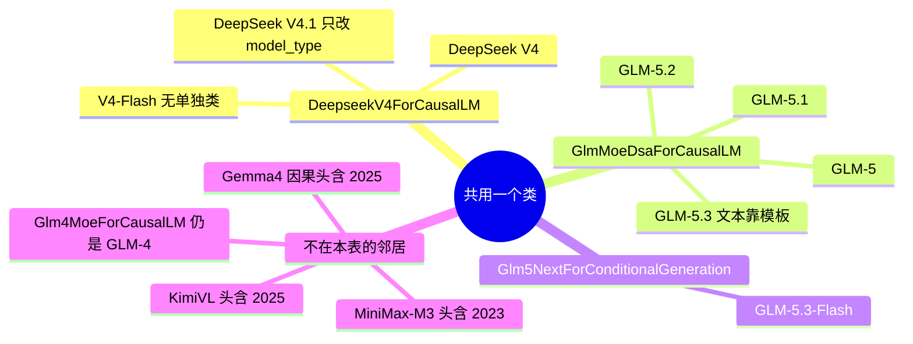

# 2026 起

本页是年代表的后一张。合入年全部 **待核**。没有全历史克隆，就不能把「文件在 v0.5.23 这棵树里」写成「2026 年合入」。

进本表的两条规则：

1. 文件头前 12 行的年份集合只含 2026，或只含 2026 与无效的 2027。
2. 清单 C.3 的产品名，以及 DeepSeek V4、GLM-5.2、Kimi、Qwen3 / Qwen4 这一类要单独能搜到的名字。头上没有年份，或头年份更早，仍然单列，并在「为何在本表」里写明。

同一类可以占多行产品名。类名行与产品名行加在一起是这一张表。没有被点名的类，若文件属于上面的产品，用产品名填第一列，避免只剩文件名。

GLM-5.2 没有 `glm5_2.py`。`is_glm_moe_dsa` 写明主架构和 NextN 头都是 `GlmMoeDsaForCausalLM` / `GlmMoeDsaForCausalLMNextN`，定义在 `glm4_moe.py`。`resolve_python_chat_template` 写明 GLM-5、5.1、5.2 与 GLM-5.3 共用这个类，靠 checkpoint 模板区分；5.3-Flash 才是 `Glm5NextForConditionalGeneration`。

DeepSeek V4.1 没有 `DeepseekV41ForCausalLM` 这个 `EntryClass`。`DeepseekV41Config.__init__` 把架构字符串收成 `DeepseekV4ForCausalLM`，`model_type` 留在 `deepseek_v41`。拒绝非 DSPARK、HiSparse、PP 看的是这个 `model_type`，不是另一个类。见矩阵页。

Qwen3-MoE、MiMo V2、MiniMax-M2、GLM-5.3-Flash 的 NextN 文件头带 2023 或 2024。那只说明版权行抄过更早的年份。产品名仍列在这里，合入年待核。

Gemma4 拆在两页：`gemma4_causal.py`、`gemma4_mm.py` 头含 2025，在前一页；`gemma4_diffusion.py`、`gemma4_mtp.py`、`gemma4_unified.py` 头只含 2026，在本表。

扩散不按年拆。无 `EntryClass` 的 PLE 表因为产品名在清单里，本表有一行，其余组件在 [01-注册表](01-注册表.md)。

运行时行为 **源码路径推断，未实测**。

本表 56 行。其中前 19 行是点名的产品（含共用类的多行），后面是其余归入本表的类。

| 产品名 | 架构类 | 文件 | 头年份 | 为何在本表 | 合入年 |
| --- | --- | --- | --- | --- | --- |
| DeepSeek V4 | `DeepseekV4ForCausalLM` | `srt/models/deepseek_v4.py` | 无 | 主架构。无单独的 V4.1 类 | 待核 |
| DeepSeek V4.1 | `DeepseekV4ForCausalLM` | `srt/configs/deepseek_v41.py`；类在 `srt/models/deepseek_v4.py` | 无 | 无单独 EntryClass。`normalize_deepseek_v41_config` 把 `DeepseekV41ForCausalLM` 收成该类，`model_type` 写成 `deepseek_v41`。配置在 `srt/configs/deepseek_v41.py` | 待核 |
| DeepSeek-V4-Flash | `DeepseekV4ForCausalLM` | `srt/arg_groups/choices.py` 注释；类仍是 `srt/models/deepseek_v4.py` | 无 | 无单独类。`choices.py` 的 `expert_pack` 注释点名 DeepSeek-V4-Flash-0731 GGUF | 待核 |
| DeepSeek V4 DSpark 草稿 | `DeepseekV4ForCausalLMDSpark` | `srt/models/deepseek_v4_dspark.py` | 无 | F206：打包了 DSpark 且算法为空或 DSPARK 时改成这个类 | 待核 |
| DeepSeek V4 NextN | `DeepseekV4ForCausalLMNextN` | `srt/models/deepseek_v4_nextn.py` | 无 | F206：未走 DSpark 时的 MTP 头 | 待核 |
| GLM-5 | `GlmMoeDsaForCausalLM` | `srt/models/glm4_moe.py` | 2025、2026 | 与 5.1 / 5.2 / 5.3 文本共用类。`python_chat_template.py` | 待核 |
| GLM-5.1 | `GlmMoeDsaForCausalLM` | `srt/models/glm4_moe.py` | 2025、2026 | 同上。架构字符串不能区分 5 / 5.1 / 5.2 | 待核 |
| GLM-5.2 | `GlmMoeDsaForCausalLM` | `srt/models/glm4_moe.py` | 2025、2026 | `is_glm_moe_dsa` 的文档写明 GLM-5.2。类定义在 `glm4_moe.py`，没有 `glm5_2.py` | 待核 |
| GLM-5.3（文本） | `GlmMoeDsaForCausalLM` | `srt/models/glm4_moe.py` | 2025、2026 | 仍是该类。要 checkpoint 模板命中 `glm-5.3` 才换 Python 模板（F207） | 待核 |
| GLM-5.2 MTP 头 | `GlmMoeDsaForCausalLMNextN` | `srt/models/glm4_moe.py` | 2025、2026 | F206 把主架构改成这个类名 | 待核 |
| GLM-5.3-Flash | `Glm5NextForConditionalGeneration` | `srt/models/glm5_next.py` | 无 | 另一类。`model_type=glm5_next` | 待核 |
| GLM-5.3-Flash NextN | `Glm5NextForConditionalGenerationNextN` | `srt/models/glm5_next_nextn.py` | 2023、2024 | 草稿类。文件头含 2023–2024，仍按产品名放本表 | 待核 |
| Kimi K2.5 | `KimiK25ForConditionalGeneration` | `srt/models/kimi_k25.py` | 无 | 在 `_DEEPSEEK_FAMILY_ARCHS` 里 | 待核 |
| Kimi K2.5 EAGLE3 | `Eagle3DeepseekV2ForCausalLM` | `srt/models/kimi_k25_eagle3.py` | 无 | 类名不含 Kimi。文件是 K2.5 的草稿 | 待核 |
| Kimi K3 | `KimiK3ForConditionalGeneration` | `srt/models/kimi_k3.py` | 无 | `is_kimi_k3` | 待核 |
| Kimi K3 Linear | `KimiK3LinearForCausalLM` | `srt/models/kimi_k3.py` | 无 | `is_kimi_k3` 的另一个类 | 待核 |
| Kimi Linear | `KimiLinearForCausalLM` | `srt/models/kimi_linear.py` | 无 | `hybrid_kda_config` 经 `kimi_linear_config` | 待核 |
| Qwen4-Exp PLE | `（无单独 EntryClass）` | `srt/models/qwen4_exp_ple_table.py` | 无 | 无 EntryClass。表在 `qwen4_exp_ple_table.py`，B81 | 待核 |
| MiniMax-M2 | `MiniMaxM2ForCausalLM` | `srt/models/minimax_m2.py` | 2023、2024 | 清单 C.3 产品名。文件头是 2023–2024，合入年仍待核 | 待核 |
| Beam | `BeamForCausalLM` | `srt/models/beam.py` | 2026 | 头年份只含 2026 | 待核 |
| Cohere2 MoE | `Cohere2MoeForCausalLM` | `srt/models/cohere2_moe.py` | 2026 | 头年份只含 2026 | 待核 |
| Cohere2 Vision | `Cohere2VisionForConditionalGeneration` | `srt/models/cohere2_vision.py` | 2026 | 头年份只含 2026 | 待核 |
| Gemma4 扩散 | `DiffusionGemmaForBlockDiffusion` | `srt/models/gemma4_diffusion.py` | 2026 | 头年份只含 2026 | 待核 |
| Gemma4 MTP | `Gemma4AssistantForCausalLM` | `srt/models/gemma4_mtp.py` | 2026 | 头年份只含 2026 | 待核 |
| Gemma4 Unified MTP | `Gemma4UnifiedAssistantForCausalLM` | `srt/models/gemma4_mtp.py` | 2026 | 头年份只含 2026 | 待核 |
| Gemma4 Unified | `Gemma4UnifiedForConditionalGeneration` | `srt/models/gemma4_unified.py` | 2026 | 头年份只含 2026 | 待核 |
| GLM-4 MoE Lite | `Glm4MoeLiteForCausalLM` | `srt/models/glm4_moe_lite.py` | 2026、2027 | 头年份只含 2026 与无效的 2027 | 待核 |
| GLM-4 MoE Lite NextN | `Glm4MoeLiteForCausalLMNextN` | `srt/models/glm4_moe_lite_nextn.py` | 2026、2027 | 头年份只含 2026 与无效的 2027 | 待核 |
| Hunyuan V3 | `HYV3ForCausalLM` | `srt/models/hunyuan_v3.py` | 2026 | 头年份只含 2026 | 待核 |
| Hunyuan V3 NextN | `HYV3ForCausalLMNextN` | `srt/models/hunyuan_v3_nextn.py` | 2026 | 头年份只含 2026 | 待核 |
| Hunyuan V4 | `HYV4ForCausalLM` | `srt/models/hunyuan_v4.py` | 无 | 无头年份。按清单 C.3 的产品名归入本表，合入年不是头年份 | 待核 |
| Hunyuan V4 NextN | `HYV4ForCausalLMNextN` | `srt/models/hunyuan_v4_nextn.py` | 无 | 无头年份。按清单 C.3 的产品名归入本表，合入年不是头年份 | 待核 |
| LFM2-VL | `Lfm2VlForConditionalGeneration` | `srt/models/lfm2_vl.py` | 2026 | 头年份只含 2026 | 待核 |
| MiMo V2 | `MiMoV2ForCausalLM` | `srt/models/mimo_v2.py` | 2023、2024 | 头年份不能分边。按清单 C.3 的产品名归入本表，不把版权年当合入年 | 待核 |
| MiMo V2 Flash | `MiMoV2FlashForCausalLM` | `srt/models/mimo_v2.py` | 2023、2024 | 头年份不能分边。按清单 C.3 的产品名归入本表，不把版权年当合入年 | 待核 |
| MiMo V2 ASR | `MiMoV2ASRForCausalLM` | `srt/models/mimo_v2_asr.py` | 无 | 无头年份。按清单 C.3 的产品名归入本表，合入年不是头年份 | 待核 |
| MiMo V2 MTP | `MiMoV2MTP` | `srt/models/mimo_v2_nextn.py` | 2023、2024 | 头年份不能分边。按清单 C.3 的产品名归入本表，不把版权年当合入年 | 待核 |
| Qwen3 | `Qwen3ForCausalLM` | `srt/models/qwen3.py` | 无 | 无头年份。按清单 C.3 的产品名归入本表，合入年不是头年份 | 待核 |
| Qwen3.5 | `Qwen3_5MoeForConditionalGeneration` | `srt/models/qwen3_5.py` | 2025 | 头年份不能分边。按清单 C.3 的产品名归入本表，不把版权年当合入年 | 待核 |
| Qwen3.5 | `Qwen3_5ForConditionalGeneration` | `srt/models/qwen3_5.py` | 2025 | 头年份不能分边。按清单 C.3 的产品名归入本表，不把版权年当合入年 | 待核 |
| Qwen3.5 MTP | `Qwen3_5ForCausalLMMTP` | `srt/models/qwen3_5_mtp.py` | 2023、2024 | 头年份不能分边。按清单 C.3 的产品名归入本表，不把版权年当合入年 | 待核 |
| Qwen3.5 文本 | `Qwen3_5MoeForCausalLM` | `srt/models/qwen3_5_text.py` | 2025 | 头年份不能分边。按清单 C.3 的产品名归入本表，不把版权年当合入年 | 待核 |
| Qwen3.5 文本 | `Qwen3_5ForCausalLM` | `srt/models/qwen3_5_text.py` | 2025 | 头年份不能分边。按清单 C.3 的产品名归入本表，不把版权年当合入年 | 待核 |
| Qwen3-ASR | `Qwen3ASRForConditionalGeneration` | `srt/models/qwen3_asr.py` | 无 | 无头年份。按清单 C.3 的产品名归入本表，合入年不是头年份 | 待核 |
| Qwen3 分类 | `Qwen3ForSequenceClassification` | `srt/models/qwen3_classification.py` | 2023、2024 | 头年份不能分边。按清单 C.3 的产品名归入本表，不把版权年当合入年 | 待核 |
| Qwen3 Embedding | `Qwen3Model` | `srt/models/qwen3_embedding.py` | 无 | 无头年份。按清单 C.3 的产品名归入本表，合入年不是头年份 | 待核 |
| Qwen3-MoE | `Qwen3MoeForCausalLM` | `srt/models/qwen3_moe.py` | 2023、2024 | 头年份不能分边。按清单 C.3 的产品名归入本表，不把版权年当合入年 | 待核 |
| Qwen3-MoE MTP | `Qwen3MoeForCausalLMMTP` | `srt/models/qwen3_moe_mtp.py` | 2023、2024 | 头年份不能分边。按清单 C.3 的产品名归入本表，不把版权年当合入年 | 待核 |
| Qwen3-Next | `Qwen3NextForCausalLM` | `srt/models/qwen3_next.py` | 无 | 无头年份。按清单 C.3 的产品名归入本表，合入年不是头年份 | 待核 |
| Qwen3-Next MTP | `Qwen3NextForCausalLMMTP` | `srt/models/qwen3_next_mtp.py` | 2023、2024 | 头年份不能分边。按清单 C.3 的产品名归入本表，不把版权年当合入年 | 待核 |
| Qwen3-Omni | `Qwen3OmniMoeForConditionalGeneration` | `srt/models/qwen3_omni_moe.py` | 2025 | 头年份不能分边。按清单 C.3 的产品名归入本表，不把版权年当合入年 | 待核 |
| Qwen3 Reward | `Qwen3ForRewardModel` | `srt/models/qwen3_rm.py` | 2023、2024 | 头年份不能分边。按清单 C.3 的产品名归入本表，不把版权年当合入年 | 待核 |
| Qwen3-VL | `Qwen3VLForConditionalGeneration` | `srt/models/qwen3_vl.py` | 2025 | 头年份不能分边。按清单 C.3 的产品名归入本表，不把版权年当合入年 | 待核 |
| Qwen3-VL-MoE | `Qwen3VLMoeForConditionalGeneration` | `srt/models/qwen3_vl_moe.py` | 2025 | 头年份不能分边。按清单 C.3 的产品名归入本表，不把版权年当合入年 | 待核 |
| Qwen4-Exp | `Qwen4ExpForConditionalGeneration` | `srt/models/qwen4_exp.py` | 无 | 无头年份。按清单 C.3 的产品名归入本表，合入年不是头年份 | 待核 |
| Qwen4-Exp MTP | `Qwen4ExpForCausalLMMTP` | `srt/models/qwen4_exp_mtp.py` | 无 | 无头年份。按清单 C.3 的产品名归入本表，合入年不是头年份 | 待核 |

返回 [模型目录](README.md)。
