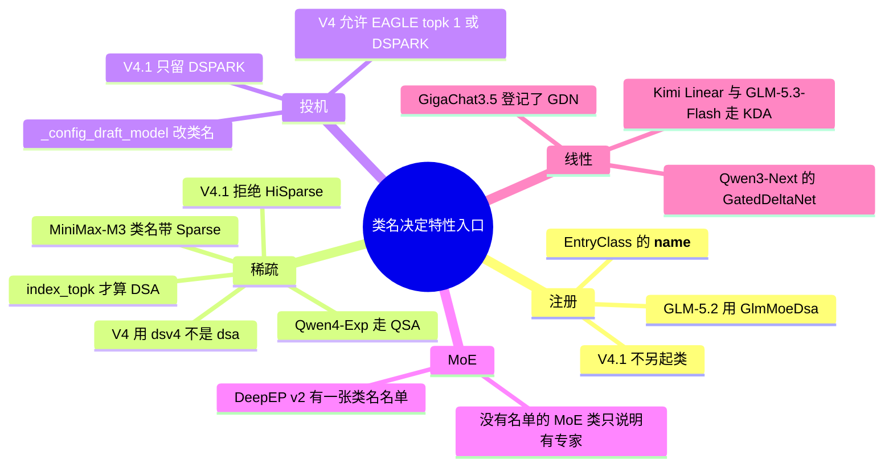

# 模型 × 特性矩阵

清单 C.2。行是主要家族，加上 DeepSeek V4.1、V4-Flash、GLM-5.2、GLM-5.3 文本与 Flash 这种共用类或改名的产品。格子只写本树里对得上的符号。空白表示本页没有写到源码证据，不是「不支持」。

树是 `297e54fd105e974cdf401e5b4d20253a22c16f90`。运行时行为 **源码路径推断，未实测**。特性怎么实现在 [03-特性](../03-特性/README.md)，这里只写「这个家族的代码碰到了哪一条」。

## 场景

矩阵本身不启动服务。下面是格子里已经写明的硬件门，其余空白格没有另加平台结论。

| 家族 | 场景 | 硬件或平台前提 |
| --- | --- | --- |
| DeepSeek V4 | 类固定走 `dsv4` attention | NPU：page 128，KV bfloat16。HIP：默认关掉 FlashMLA 稀疏 prefill |
| DeepSeek V4.1 | 与 V4 同类，`model_type=deepseek_v41` | `flashmla_mega` 与 `trtllm` attention 都要求 CUDA SM100/SM103。`trtllm` 还要求 fp8 KV、无 HiSparse、无 CP、无 PD、chunked prefill |
| DSA 家族（V3.2、GLM-5.2、GLM-5.3-Flash、Kimi K2.5、Hunyuan V4 等，且 `index_topk` 非空） | 未指定 attention 时收成 `dsa` | prefill CP 注释写只在单机 `tp_size<=8` 试过。zigzag 把 a2a 收成 deepep。ROCm 上 aiter 的 paged-MQA 不可用时 page size 为 1。HIP 上的 prefill CP 只放行 `DeepseekV4ForCausalLM` |
| GLM-5.2，SM120，FP8 KV | DSA 的 prefill/decode 后端 | 非 HIP 时收成 `flashinfer_sparse_mla` |
| Qwen4-Exp | 压缩 QSA 把 page size 收成 64 | fp8 indexer 要求 CUDA SM90 或 SM100 |
| Qwen3-MoE 家族的 W4A16 NVFP4 | MoE runner | 这段逻辑包在 `is_sm100` 里 |
| MiniMax-M2 | modelopt fp4 的 MoE runner | SM100 上才把 runner 收成 `flashinfer_trtllm_routed` |
| MiMo V2 | 未指定 attention | SM100 收成 `fa4`。prefill CP 只接受 zigzag；多模态还要 `--language-only` |
| Hunyuan V4 | 在 DSA 家族 override 里 | 直接拒绝 prefill CP 和 `dcp_size>1` |
| Kimi K3 | decode attention 用 `cutedsl_mla` 且开 DCP | 要求 FlashInfer 的 `trtllm_batch_decode_with_kv_cache_mla` 带 `enable_dcp` |

## 家族怎样挂到特性上

`is_deepseek_dsa` 为真要同时满足两件事：类名在它的名单里，并且 `index_topk` 不是空。名单里有 DeepSeek V3 / V3.2 与其 NextN、Mistral Large 3、Pixtral、`GlmMoeDsa` 与其 NextN、GLM-5.3-Flash 与其 NextN、Longcat Flash 与其 NextN、Dots3 与其 NextN、Hunyuan V4 与其 NextN。DeepSeek V4 不在这张名单里，它走 `dsv4`。

## 矩阵

| 家族 | 注册 | attention | MTP / 投机 | MoE / DeepEP | 稀疏 | 线性或 Mamba | 多模态 | DP attn 与其它已核对 |
| --- | --- | --- | --- | --- | --- | --- | --- | --- |
| Llama 系密集 | `llama.py`：`LlamaForCausalLM`，同文件还有 Phi-3、InternLM3、IQuestCoder | 无 `model_overrides` 登记 | `llama_eagle.py`，`llama_eagle3.py` |  |  |  | `llava.py` 的多个 `Llava*` |  |
| Qwen2 密集 | `qwen2.py` `Qwen2ForCausalLM` | 无家族 override | `qwen2_eagle.py` |  |  |  | `qwen2_vl.py`，`qwen2_5_vl.py`，`qwen2_audio.py` |  |
| Qwen2-MoE | `qwen2_moe.py` `Qwen2MoeForCausalLM` |  |  | 类名是 MoE。不在 DeepEP v2 名单 |  |  |  |  |
| Mixtral | `mixtral.py` `MixtralForCausalLM`。量化改名见 M08 |  |  | 类是 MoE。EP 是否默认：无 override 证据 |  |  |  |  |
| DeepSeek V2 / V3 / V3.2 | `deepseek_v2.py` 三个 `ForCausalLM` | `index_topk` 非空时 `_deepseek_family_overrides` 把后端收成 `dsa`。V2 不在 `is_deepseek_dsa` 的类名名单 | F206 把 V3 / V3.2 收成 `DeepseekV3ForCausalLMNextN`。算法名 NEXTN 折成 EAGLE 是 B03 | `_DEEPEP_V2_MODELS` 有 V3，没有 V2。DSA 且 zigzag CP 时 a2a 收成 deepep | DSA 还要 `index_topk`。HiSparse 走 `_dsa_split_backend_resolution`，不是 V4.1 的拒绝 |  | `deepseek_vl2.py`，`deepseek_ocr.py` | prefill CP 时改 `attn_dp_size` 并把 `dp_size` 收成 1。V3.2 拒绝 zigzag |
| DeepSeek V4 | `deepseek_v4.py` `DeepseekV4ForCausalLM` | `_deepseek_v4_overrides` 写成 `dsv4`。实现在 `deepseek_v4_backend.py` | `apply_deepseek_v4_defaults` 只允许 EAGLE（topk 1）或 DSPARK。草稿类见 M13 | 在 DeepEP v2 名单。override 里按 checkpoint 选 MoE runner | `dsv4` 这一支。`trtllm` 子后端拒绝 HiSparse。V4 不在 `is_deepseek_dsa` 名单 |  | 引用 `deepseek_v41_vit.py` 的 `ViT` / `Aligner`。是不是每个 checkpoint 都带视觉：待核 | HIP 上 prefill CP 只放行这个类。mHC 层在 `deepseek_v4_mhc.py`，不是 EntryClass |
| DeepSeek V4.1 | 无单独类。`DeepseekV41Config` 收成上一行的类，`model_type=deepseek_v41` | 仍是 `dsv4`。`flashmla_mega` 只接受这个 `model_type` | `validate_deepseek_v41_features` 拒绝 DSPARK 以外的投机 | 与 V4 同一类，DeepEP v2 名单认的是类名 | **拒绝 HiSparse** |  | `vision_n_layers>0` 时 `ModelConfig` 把本模型算成多模态 | 无条件拒绝 PP、two-batch overlap。DP attention 的限制只在 decoder SWA replay 打开时，见下节 |
| DeepSeek-V4-Flash | 无单独类。`choices.py` 注释把它放进 `expert_pack` 的 GGUF 范围 | 与 V4 同类。HIP 上默认关掉 FlashMLA 稀疏 prefill 的注释点了这个名字 |  | `expert_pack` 要求并行度全部为 1（B47） |  |  |  |  |
| Qwen3 密集 | `qwen3.py` `Qwen3ForCausalLM` | 无该架构的 `@_register_for` | 未见把该类改成 MTP 类 |  |  |  |  | 分类、embedding、reward 是同族的另外三个类，见年代表 |
| Qwen3-MoE | `qwen3_moe.py` `Qwen3MoeForCausalLM` |  | F206 → `Qwen3MoeForCausalLMMTP` | 在 DeepEP v2 名单。`_qwen3_moe_family_overrides` 在 SM100 上处理 W4A16 NVFP4 |  |  |  | 也在 FlashInfer allreduce 融合的类名集合里 |
| Qwen3-Next | `qwen3_next.py` `Qwen3NextForCausalLM` | SM100 且未指定后端时，`_qwen3_5_hybrid_overrides` 会改 attention | F206 → `Qwen3NextForCausalLMMTP` | 同一个 MoE 家族 override 也登记了这个类 |  | `Qwen3GatedDeltaNet`，`Qwen3HybridLinearDecoderLayer` |  |  |
| Qwen3.5 | `qwen3_5.py` / `qwen3_5_text.py` 的因果与 conditional、含 Moe 的类 | conditional 变体走上面的 hybrid override | F206 把四个类收成 `Qwen3_5ForCausalLMMTP` | Moe 变体在 MoE 家族 override 和类名里。DeepEP v2 名单没有 `Qwen3_5*` |  | `triton_gdn_fused_proj.py` 的注释写 Qwen3.5 的投影布局。是不是每一层都是线性注意力：待核 | conditional 类名 | `Qwen3_5Model` 带 decision config 时会改架构字符串，见 M09 |
| Qwen3-VL / Omni / ASR | `qwen3_vl.py`，`qwen3_vl_moe.py`，`qwen3_omni_moe.py`，`qwen3_asr.py` | VL 有 Hopper 档的 override（`large_hopper_qwen3_vl_model_type`，显存阈值在函数里） |  | VL-MoE 在 MoE 家族 override 里 |  |  | 类名是 conditional / ASR | ASR 入口是 B87 |
| Qwen4-Exp | `qwen4_exp.py` `Qwen4ExpForConditionalGeneration` | SM100 上在 triton 与 trtllm_mha 之间选，并改 page size | F206 → `Qwen4ExpForCausalLMMTP`。草稿会深拷贝 config | `num_experts` 非空时 override 把 `moe_dense_tp_size==1` 清成空。也在 MoE 家族 override 里 | `parse_qsa_profile`。压缩 QSA 把 page size 固定为 64。核注释在 `qsa_indexer.py` | PLE 表无 EntryClass，`qwen4_exp_ple_table.py` | conditional 类名 | 统一内存直接拒绝。PD + mori + PP 直接拒绝。CP 与 TP 同宽时的契约在 D20 |
| MiniMax-M2 | `minimax_m2.py` `MiniMaxM2ForCausalLM` |  |  | override 开 TF32。SM100 且 modelopt fp4 时 MoE runner 为 `flashinfer_trtllm_routed`。不在 DeepEP v2 名单 |  |  |  |  |
| MiniMax-M3 | `minimax_m3.py` `MiniMaxM3SparseForCausalLM`，VL 在 `minimax_m3_vl.py` | `minimax_m3.py` 的 override 登记了这两个类。后端名未在本页逐项摘，待核 | DSPARK 草稿可走 `configure_minimax_m3_dspark`（M13） |  | 类名带 Sparse。`minimax_sparse_backend.py` 在注意力目录 |  | VL 类 |  |
| GLM-4 MoE | `glm4_moe.py` `Glm4MoeForCausalLM` |  | F206 → `Glm4MoeForCausalLMNextN` | SM100、a2a 为 none、runner 为 auto 时，runner 可收成 `flashinfer_trtllm`。不在 DeepEP v2 名单 |  |  | `glm4v.py`，`glm4v_moe.py` | 强制 TF32。与下面的 DSA 类同文件，不是 GLM-5.2 |
| GLM-4 MoE Lite | `glm4_moe_lite.py` `Glm4MoeLiteForCausalLM` |  | F206 → `Glm4MoeLiteForCausalLMNextN` | 类名是 MoE。不在 DeepEP v2 名单 |  |  |  | 在 FlashInfer allreduce 融合的类名集合里。头年份含 2027，无效 |
| GLM-5 / 5.1 / 5.2 | 没有 `glm5_2.py`。类是 `GlmMoeDsaForCausalLM` | `index_topk` 非空时与 DeepSeek DSA 同一套 override，后端 `dsa` | F206 → `GlmMoeDsaForCausalLMNextN` | 在 DeepEP v2 名单 | DSA，条件同上。SM120 + FP8 KV 时 prefill/decode 收成 `flashinfer_sparse_mla` |  |  | `model_hook.py` 对这个类在 decode 打开 Aiter allreduce 融合。也在 FlashInfer 融合名单里 |
| GLM-5.3（文本） | 仍是 `GlmMoeDsaForCausalLM` | 与上一行相同，只要 `index_topk` 非空 | 与上一行相同 | 与上一行相同 | 与上一行相同 |  | 模板路径要求文本，不能带图像标记（`resolve_python_chat_template`） | 架构字符串区分不了 5.2 和 5.3 |
| GLM-5.3-Flash | `glm5_next.py` `Glm5NextForConditionalGeneration` | 在 `is_deepseek_dsa` 与家族 override 里 | `glm5_next_nextn.py`。S2 调 `apply_glm5_next_spec_backend_defaults` | 在 DeepEP v2 名单 | DSA，条件是 `index_topk` | `glm5_next_config`：`model_type=glm5_next` 且不是草稿时，`hybrid_kda_config` 认它。草稿会把 `linear_attn_config` 清空 | `Glm5Next` 的 conditional 类名。Python 模板要求图像标记与 Flash 对齐 | CP 与 TP 同宽的契约在 D20，要 `interleave` |
| Kimi K2.5 | `kimi_k25.py` `KimiK25ForConditionalGeneration` | 在 DSA 家族 override 里 | `kimi_k25_eagle3.py` 的类名是 `Eagle3DeepseekV2ForCausalLM` | 家族 override 的量化注释写 Kimi K2.5 走 compressed-tensor int4。DeepEP v2 名单没有这个类名 | DSA 仍要 `index_topk` |  | conditional。视觉块 `kimi_vl_moonvit.py` 无 EntryClass |  |
| Kimi K3 | `kimi_k3.py` 的 `KimiK3ForConditionalGeneration` 与 `KimiK3LinearForCausalLM`。`is_kimi_k3` | 两个 override 函数登记在 conditional 类上。字段未逐项摘 | S2 对 conditional 类调用 `apply_kimi_k3_spec_backend_defaults` | MoE override 另有一份。`expert_pack` 注释另点文本 Kimi K3 的 Q2_K。类内注释写 waterfill 会改 top-k 之后的路由 |  | conditional 与 `KimiLinearForCausalLM` 在 S2 调用 `apply_kimi_k3_linear_attn_defaults`。KDA 的 config 入口是 `kimi_linear_config` | `kimi_k3_vl.py` 无 EntryClass | DCP + `cutedsl_mla` 有 FlashInfer 版本门。共享专家 TP 是 D11。ROCm 量化在 `kimi_k3_rocm_quant.py` |
| Kimi Linear | `kimi_linear.py` `KimiLinearForCausalLM` |  |  |  |  | S2 与 Kimi K3 共用线性注意力默认。`kimi_linear_config` 认 `KimiLinearConfig` |  |  |
| Hunyuan V3 | `hunyuan_v3.py` `HYV3ForCausalLM`。头年份 2026 |  | F206 → `HYV3ForCausalLMNextN` |  |  |  |  | 不在 `is_deepseek_dsa` 名单 |
| Hunyuan V4 | `hunyuan_v4.py` `HYV4ForCausalLM` | 在 DSA 家族 override 里。MXFP8 且 DeepGEMM 可用时，MoE / FP8 GEMM 收成 `deep_gemm` | F206 → `HYV4ForCausalLMNextN`，该类也在家族 override 里 | 家族 override 会改 GEMM。DeepEP v2 名单没有 HYV4 | DSA 要 `index_topk` |  |  | 拒绝 prefill CP 与 `dcp_size>1` |
| MiMo V2 / Flash | `mimo_v2.py` 两个类 | SM100 且未指定时写成 `fa4` | override 在算法为 EAGLE 时打开 multi-layer EAGLE。F206 → `MiMoV2MTP` | 两个类都在 DeepEP v2 名单 |  |  | `mimo_vl.py`、`mimo_audio.py` 无 EntryClass。ASR 类 `MiMoV2ASRForCausalLM` | prefill CP 只要 zigzag；多模态要 `--language-only`。`_derive_hybrid_model` 把这两个类算进 hybrid SWA compress |
| Longcat Flash / Dots3 | `longcat_flash.py`，`dots3.py` | 在 DSA 家族 override 里 | F206 有 Longcat 的 NextN。Dots3 交给 `configure_draft_model` |  | DSA 要 `index_topk` |  | Dots 的视觉在 `dots_vlm_vit.py`，无 EntryClass | 这两支不在 DeepEP v2 的内置名单 |
| Mistral Large 3 / Pixtral | `mistral_large_3.py`，`pixtral.py` | 在 DSA 家族 override 里 |  | `MODEL_OVERRIDES` 把 dtype 收成 bfloat16 | DSA 要 `index_topk` |  | Pixtral 是 conditional |  |
| Mamba / Nemotron-H | `mamba.py`，`mamba2.py`，`nemotron_h.py`，`falcon_mamba.py` | Nemotron-H 有 override。字段未逐项摘 | F206 把 Nemotron-H 收成 `NemotronHForCausalLMMTP` |  |  | `handle_model_specific_adjustments` 在线性注意力 spec 要求时走 mamba radix。原始 Mamba checkpoint 由解析器补 `MambaForCausalLM` | `nano_nemotron_vl.py` |  |
| Gemma4 | `gemma4_causal.py` 等。扩散变体也在 LLM 表 | `_gemma4_overrides` 给四个类设默认 attention，含 `DiffusionGemmaForBlockDiffusion` | `gemma4_mtp.py` 的 assistant 类。不在 `_config_draft_model` 的改写表里 |  |  |  | `gemma4_mm.py`。音频 / 视觉编码器无 EntryClass | 头年份拆在两张年代表。扩散类和 `multimodal_gen` 不是同一条注册 |
| dLLM | `llada2.py`，`sdar.py`，`sdar_moe.py` | `llada2_cfg_flashinfer` 在 attention choices 里 |  | `SDARMoeForCausalLM` 类名是 MoE |  |  |  | 调度侧有 `ForwardMode.DLLM_EXTEND` |
| Transformers 兜底 | `transformers.py` 的多个 `Transformers*` | `resolve_transformers_arch` 写明功能子集、性能不保证 |  | 类名里有 `TransformersMoE*` |  |  | 类名里有 `TransformersMultiModal*` | M07 |

GigaChat3.5 登记了 `LinearAttnModelSpec`，后端类名指向 `GDNAttnBackend`，架构是 `GigaChat35ForCausalLM` 与其 NextN。它不在上表的主行里。Qwen3-Next 的 GDN 是模型文件里的层，不是这条 registry。

## F197 DeepSeek V4.1 拒绝什么

`validate_deepseek_v41_features` 在 `model_type != "deepseek_v41"` 时直接返回（encoder SWA replay 另有一条「必须是 V4.1」的检查）。所以下面的拒绝打在 V4.1 上，不打在所有 `DeepseekV4ForCausalLM` 上。

V4 主路径的 `apply_deepseek_v4_defaults` 仍允许 EAGLE 且 topk 为 1，或 DSPARK。V4.1 再收紧。

`model_type == deepseek_v41` 时，打开了就 `ValueError` 的组合：

| 被拒绝的特性 | 条件 |
| --- | --- |
| DSPARK 以外的投机 | `speculative_algorithm` 非空且不是 DSPARK |
| HiSparse | `enable_hisparse` |
| unified KV 的 Triton 布局 | `is_unified_kv_triton()` |
| TRT-LLM attention 再加 encoder SWA replay | 两个开关同时开 |
| two-batch overlap | `enable_two_batch_overlap` |
| 流水并行 | `pp_size > 1` |

另外两条不是这张无条件表，但同函数里：

- PD 且开了投机：要求 static verify、传输后端是 mooncake 或 nixl、DCP 为 1。prefill CP 只接受 `--enable-prefill-cp` 加 `interleave`。函数原文写 decode 侧 CP 为 1。
- `enable_decoder_swa_bounded_replay` 打开时，还拒绝「prefill CUDA graph 不是 disabled / breakable」，以及不满足下列条件的 DP attention：`attn_dp_size == tp_size`、`attn_cp_size == 1`，并且 a2a 在 HIP 上为 `none`，或在 CUDA 上为 `none` / `megamoe`。

encoder SWA replay 自己的拒绝（硬件、图、ROCm 上的 DP attention 与 PD、unified memory、mixed chunk、LoRA、radix session）在同一函数前半，只在这个开关打开时生效。

## `model_overrides` 索引

导入包才会登记。一个架构可以有多个函数，但不能对同一个字段各写一份。下表是 `@_register_for` 的类名。字段只写本页读过的；没读完的标待核。

| 模块 | 登记的架构 | 已读到的改写 |
| --- | --- | --- |
| `deepseek_v2.py` | V3、V3.2、Kimi K2.5、Mistral Large 3、Pixtral、`GlmMoeDsa`、GLM-5.3-Flash、HYV4 与其 NextN、Longcat Flash 与其 NextN、Dots3 | DSA 时后端 `dsa`；prefill CP 改 DP 宽度；zigzag 收成 deepep |
| `deepseek_v4.py` | `DeepseekV4ForCausalLM` | 后端 `dsv4`，page size，MoE runner，V4.1 的 MXFP8 GEMM |
| `glm4_moe.py` | 只登记 `Glm4MoeForCausalLM`，不含 `GlmMoeDsa` | SM100 的 MoE runner，TF32 |
| `qwen3_moe.py` | Qwen3-MoE、Qwen3-VL-MoE、Qwen3-Next、Qwen3.5 的 Moe 与 conditional、InternS2 Preview、Qwen4-Exp | SM100 上的量化与 W4A16 NVFP4 runner |
| `qwen3_5.py` | Qwen3-Next、Qwen3.5 conditional、InternS2 Preview / Mobius | 仅 SM100 且未指定 attention 时改后端 |
| `qwen3_vl.py` | Qwen3-VL，以及一份含 VL-MoE 的 Hopper 函数 | Hopper 大显存档。阈值在 `large_hopper_qwen3_vl_model_type` |
| `qwen4_exp.py` | `Qwen4ExpForConditionalGeneration` | QSA page size 64，PLE offload 默认，拒绝统一内存 |
| `kimi_k3.py` | `KimiK3ForConditionalGeneration`（两个函数） | 字段未逐项摘，待核。DCP 的 FlashInfer 检查在同文件 |
| `minimax_m2.py` | `MiniMaxM2ForCausalLM` | TF32；SM100 + modelopt fp4 的 MoE runner |
| `minimax_m3.py` | M3 sparse 的因果与 conditional | 字段未逐项摘，待核 |
| `mimo_v2.py` | MiMo V2 与 Flash | multi-layer EAGLE；SM100 上 `fa4` |
| `gemma4.py` | Gemma4 因果、conditional、unified、扩散 | 默认 attention |
| `nemotron_h.py` | Nemotron-H 三个类 | 字段未逐项摘，待核 |
| `gpt_oss.py` | `GptOssForCausalLM` | 按平台选 attention。未逐项对硬件，待核 |
| `exaone.py` | Exaone4 与两个 MoE 类名 | 未指定时按平台选 attention |
| `embedding_gemma2.py` | `EmbeddingGemma2Model` | 文件头写默认 triton，并关 radix |
| `overrides.py` | `MuseSparkForConditionalGeneration` | TF32；KV 默认 fp8；attention DP 时打开 DP 视觉编码器 |
| `overrides.py` 谓词 | 类名包含 Step3p5 或 Step3p7 | Blackwell `fa4`，Hopper `fa3`，EAGLE 时开 multi-layer |
| `bailing_moe_v3.py` | Bailing MoE V3 与其 VL | 待核 |
| `beam.py` | `BeamForCausalLM` | 待核。装饰器之外读到：未指定且条件满足时用 `trtllm_mha` |
| `cohere2_moe.py` | Cohere2 MoE 与 Cohere2 Vision | 待核 |
| `ernie45_vl.py` | Ernie VL MoE | 待核 |
| `falcon_h1.py` | Falcon-H1、Jet-Nemotron、Jet-VLM | 待核。SM100 且未指定时函数可返回 triton |
| `gemma2_gemma3.py` | Gemma2 / Gemma3 / Gemma3n | 待核 |
| `gigachat35.py` | GigaChat3.5 与 NextN | 待核。线性注意力的登记在 config，不在这个 override |
| `granitemoehybrid.py` | `GraniteMoeHybridForCausalLM` | 待核。有 Mamba 且 SM100 时可写 flashinfer |
| `inkling.py` | Inkling 与其 MTP | 待核。文件注释要求 attention 落在 fa4 或 triton |
| `interns2_mobius.py` | InternS2 Mobius | 待核 |
| `iquest_q1.py` | IQuest Q1 与 MTP | 待核 |
| `lfm2.py` | LFM2 与 LFM2-MoE | 待核 |
| `llama4.py` | Llama4 因果与 conditional | 待核 |
| `minicpm.py` | MiniCPM 与 SALA | 待核 |
| `minicpmv.py` | MiniCPM-V 4.6 与 4.7 | 待核 |
| `moss_vl.py` | Moss-VL | 待核 |
| `muse_glimmer.py` | Muse Glimmer 两个类 | 待核。函数名是 FP4 GEMM runner |
| `olmo2.py` | `Olmo2ForCausalLM` | 待核 |

`MODEL_OVERRIDES` 常量只有 Mistral Large 3 与 Pixtral 的 bfloat16。

返回 [模型目录](README.md)。
