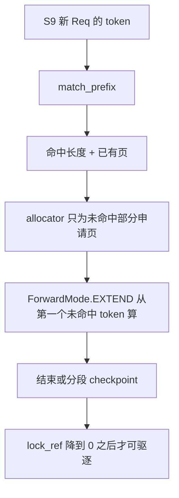

# 08 Radix 前缀缓存

前缀树在 S6 挂到 scheduler，在 S9 的 `get_next_batch_to_run` 之前做匹配，在请求结束时 `checkpoint`。它不是 S7 的 HTTP 缓存。

## 目的

两条请求共享系统提示、后面的用户内容不同。整段哈希要么全中要么重算。树按 token 往下走，分叉点之前的页只有一份。

| 类 | 文件 | 角色 |
| --- | --- | --- |
| `RadixCache` | `mem_cache/radix_cache.py` | 经典树 |
| `UnifiedRadixCache` | `mem_cache/unified_radix_cache.py` | 调度器现在挂上的实现，能接分层存储 |
| `BasePrefixCache` | `base_prefix_cache.py` | `match_prefix` / `insert` / `checkpoint` |
| HiCache | `hicache_hook.py` + 存储后端 | 给树加 host/L3，不是第三种匹配算法 |

## 原理

页大小参与边界。V4 在 S2 把 `page_size` 改成 256，短于一页的共享前缀不会变成可复用页。

## `RadixKey`

| 字段 | 含义 |
| --- | --- |
| `token_ids` | 这一段 token |
| `extra_key` | 额外命名空间。LoRA 名进入 KV 事件，避免不同适配器复用同一段 |
| `cache_salt` | 请求字段。相同 token 也可以被隔开 |
| `is_bigram` | bigram 视图，长度是 `max(0, len-1)`，切片共享边界 token |
| `limit` | 只用前 `limit` 个 token，避免拷贝 |

## `TreeNode`

| 字段 | 含义 |
| --- | --- |
| `children` | 子节点 |
| `parent` | 父 |
| `key` | 这条边上的 `RadixKey` |
| `value` | KV 页下标。`None` 表示页已驱逐，节点还在 |
| `lock_ref` | 仍被运行中请求引用的次数。大于 0 不能驱逐 |
| `last_access_time` / `creation_time` | LRU 和时间策略 |
| `hit_count` | 命中次数 |
| `hash_value` | 每页哈希，给外部事件 |
| `priority` | 带优先级的驱逐 |
| `evicted` | 就是 `value is None` |

节点还在、页没了：下次匹配走到这里，知道要从这里重算，而不是假装命中。

## 和 `ReqKvInfo` 的分工

树上的页属于前缀，不属于某一个请求。`ReqKvInfo.cache_protected_len` 标记 `[0, 这里)` 归树。请求自己的增量在 `[cache_protected_len, kv_allocated_len)`。`cache_inserted_len` 保证同一次请求插入时，每个节点只计一次命中。

`release_kv_cache` → `tree_cache.checkpoint(req, up_to=...)`。`RadixCache.checkpoint` 再走到插入。`UnifiedRadixCache.checkpoint_into_tree` 按 token 段插入。

## 驱逐

`RadixCache.__init__` 用 `get_eviction_strategy`。名字来自 `--radix-eviction-policy`：`lru`、`lfu`、`slru`、`priority`、`tlru`（05 的 memory 节有官方句子的中文说明）。`disable` 时内部改用 `lru`，并且不记录。

可驱逐的是 `lock_ref==0` 的叶子。正在 decode 的请求把沿途节点锁住，所以不会抢走别人正在读的系统提示。显存不够时先驱逐再分配。`mem_fraction_static` 留出的是权重、图、激活之外、这棵树能占用的那一份。

## 和并行、PD、会话

| 场景 | 行为 |
| --- | --- |
| attention DP | 每个 scheduler 一棵树。相同前缀打到两个组会算两次。用 `routed_dp_rank` 或路由器把前缀粘在一组 |
| PD | 命中发生在 prefill。decode 收到的是传来的 KV（`PREBUILT`），不是 decode 本地树的命中 |
| LoRA / `cache_salt` / `extra_key` | 改变键。不同适配器默认不应命中基座页 |
| `--enable-encoder-swa-bounded-replay` | V4.1 明确不支持 `enable_session_radix_cache`。两条缓存路径不要同时开 |
| `--disable-radix-cache` | 树不记录。LPM 会被策略层换掉。每次从零写 KV |

`SchedulePolicy` 的 LPM 用的是同一棵树。调度顺序和 KV 复用是一件事的两面：先选最长命中，第 2 步的 extend 就更短。
