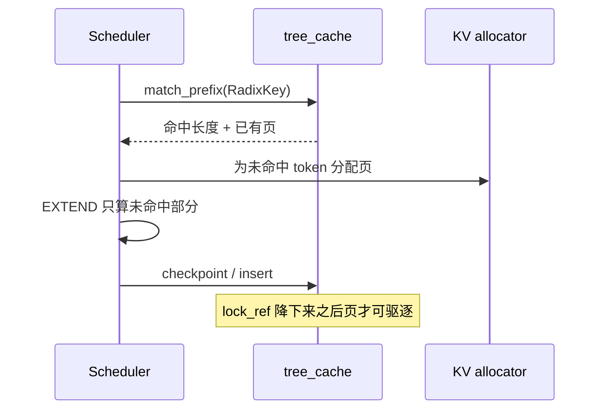

# 08 Radix 前缀缓存

## 为什么是树

两个请求共享系统提示、后面的用户内容不同。块哈希缓存要么整段命中，要么整段重算。Radix 按 token 往下走，分叉点之前的页只存一份，分叉之后各自延长。

v0.5.23 里有两层实现：

| 类 | 文件 | 角色 |
| --- | --- | --- |
| `RadixCache` | `mem_cache/radix_cache.py` | 经典前缀树 |
| `UnifiedRadixCache` | `mem_cache/unified_radix_cache.py` | 现在调度器默认挂上的树，能接分层存储 |
| `BasePrefixCache` | `mem_cache/base_prefix_cache.py` | `match_prefix` / `insert` / `checkpoint` 的接口 |

`HiCache`（`--enable-hicache`）在 `hicache_hook.py` 里和某类 unified external linker 互斥。它不是第三种树，而是给树加 host/L3 后端。

## 节点上有什么

`RadixKey`（`radix_cache.py`）：

| 字段 | 含义 |
| --- | --- |
| `token_ids` | 这一段的 token |
| `extra_key` | 额外命名空间。LoRA 名会进 KV 事件，避免不同适配器复用同一段 KV |
| `cache_salt` | 调用方在请求里传的 `cache_salt`，把本来相同的前缀隔开 |
| `is_bigram` | bigram 视图。长度为 `max(0, len-1)`，切片共享边界 token |
| `limit` | 只使用前 `limit` 个 token，避免拷贝 |

`TreeNode`：

| 字段 | 含义 |
| --- | --- |
| `children` | `defaultdict(TreeNode)` |
| `parent` | 父节点 |
| `key` | 这段边的 `RadixKey` |
| `value` | KV 页下标。`None` 表示已经被驱逐 |
| `lock_ref` | 仍被运行中请求引用的次数。大于 0 不能驱逐 |
| `last_access_time` / `creation_time` | LRU 和时间策略用 |
| `hit_count` | 命中次数 |
| `hash_value` | 每页的哈希 |
| `priority` | 带优先级的驱逐 |

`evicted` 属性就是 `value is None`。页可以被腾走，树节点还在，下次匹配到这里就知道要重算。

## 一次请求上的调用

具体函数：

- 匹配：scheduler 在组 batch 前调用树上的 `match_prefix`。`schedule_policy.py` 也用同一棵树做 LPM。
- 插入：`RadixCache.insert`，请求路径上是 `_insert_cache`。
- 结束：`mem_cache/common.py` 的 `release_kv_cache` → `tree_cache.checkpoint(req, up_to=...)`。`RadixCache.checkpoint` 内部再 `_insert_cache`。`UnifiedRadixCache.checkpoint_into_tree` 按 token 段插入。

页大小参与匹配边界。V4 的 override 把 `page_size` 设为 256，所以前缀命中以 256 token 对齐。短于一页的共享前缀不会变成可复用的页。

## 驱逐

`RadixCache.__init__` 用 `get_eviction_strategy`。策略名来自 `--radix-eviction-policy`，choices 在 `arg_groups/choices.py` 的 `RADIX_EVICTION_POLICY_CHOICES`。`disable` 时内部改用 `lru`，并且不建策略配置。

可驱逐的是 `lock_ref == 0` 且在 `evictable_leaves` 里的叶子。正在 decode 的请求把沿途节点锁住，所以不会把别人正在读的系统提示页抢走。显存不够时，allocator 先让树驱逐，再分配新页。这就是 `mem_fraction_static` 留白的原因：权重、图、激活之外，剩下的才是这棵树能占用的页。

## 和 DP attention、PD、会话的关系

- 每个 scheduler 有自己的 `tree_cache`。attention DP 的四个组不共享一棵树。同一条前缀打到两个组会算两次。外部路由器若要避免这件事，应使用请求上的 `routed_dp_rank` 或 `routing_key`，把相同前缀固定到一个组。`sgl-router` 的 KV-aware 路由做的就是这件事，它不在 worker 进程里。
- PD 分离时 prefill 侧的树和 decode 侧的树不是同一块 GPU 内存。命中发生在 prefill；decode 收到的是传过来的 KV（`ForwardMode.PREBUILT`），不是 decode 本地 radix 的命中。
- `cache_salt` 和 `extra_key` 会改变键。LoRA 请求默认不应命中基座模型的页。
- V4.1 的 `--enable-encoder-swa-bounded-replay` 明确不支持 `enable_session_radix_cache`（`validate_deepseek_v41_features`）。会话级 radix 和 encoder 窗口重放是两条缓存路径，不要同时开。

## 关掉它

`--disable-radix-cache` 让 `RadixCache.disable` 为真。树不再记录、不再驱逐，每次请求都从零写 KV。调度策略里依赖树的 LPM 会被 `SchedulePolicy` 调成不看缓存的策略。调试显存或对比首 token 延迟时用得上，生产上等于把 08 整篇关掉。
