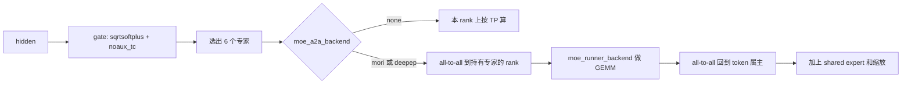

# 09 MoE 路由与采样

路由发生在 S10 的每一层 MoE。采样发生在 S9 的 `process_batch_result`，参数在 S8 已经收成 `SamplingParams`。两边不要混：gate 不看 temperature，sampler 不改专家表。

## V4.1-Flash 的路由常数

来自 config 的 `text_config`，S5 建 gate 时读入，不是 CLI。

| 字段 | 值 | 作用 |
| --- | --- | --- |
| `n_routed_experts` | 384 | 可被选中的专家 |
| `n_shared_experts` | 1 | 每个 token 都经过 |
| `num_experts_per_tok` | 6 | top-k |
| `scoring_func` | `sqrtsoftplus` | `TopKConfig` 走 log1p，NaN 排在前面 |
| `topk_method` | `noaux_tc` | 无辅助损失的 top-k 修正 |
| `norm_topk_prob` | true | k 个权重再归一化 |
| `routed_scaling_factor` | 1.5 | 路由输出缩放 |
| `moe_intermediate_size` | 2304 | 专家 FFN 中间维 |
| `expert_dtype` | `fp4` | 专家权重。dense 仍是 fp8 块 32×32 |
| `dspark_n_routed_experts` | 128 | 只属于草稿。不要按 384 去配草稿的 EP |
| `dspark_num_experts_per_tok` | 3 | 草稿的 k |

## 一层里 token 怎么走

通信和计算是两个开关，都在 S2 定稿：

| 开关 | 定稿时会发生什么 | S10 做什么 |
| --- | --- | --- |
| `moe_a2a_backend=none` | EP 保持声明值，通常是 1 | 专家按 TP 切开，token 不搬家 |
| spanning 后端（`mori`、`deepep`、`deepep_v2`、`megamoe`…） | `_a2a_ep_size` 把 `ep_size` 改成 `tp_size` | 每 rank 持有 `384/ep` 个专家。16 卡是 24 个 |
| `moe_runner_backend=auto` | 按量化改写。V4.1 的 MXFP8 dense 只在 CUDA、非 HIP、SM100 上改成 `flashinfer_cutedsl` | 真正的专家 GEMM |

共享专家融合会被一些 runner 关掉：`flashinfer_trtllm`、`flashinfer_cutedsl`、LoRA MoE（`overrides.py` 的 `_moe_runner_fusion_disable`）。DeepEP v2 也会关。Waterfill 则要求融合开着，并把共享专家当成额外槽丢到最空的 EP rank。

`dp_attention.py` 对 DeepEP v2 这类对称集合通信做 padding，让每个 rank 的 token 行数一致。形状不齐时表现为挂死或 shape 错误，不是选错专家。

四机建议是 `mori` + EP 16 + attention DP 4。attention DP 不减少专家通信。它只让 attention 留在节点内。每个 token 的 6 个专家可能在 6 个节点上，一层有两次跨节点交换（去和回）。DWDP 用权重预取代替这次交换，但 S2 禁止它和投机、CUDA graph 共存，所以 V4.1-Flash 的建议配置不走 DWDP。

## 采样

`sampling/sampling_params.py` 的 `SamplingParams`。`normalize()` 之前调用方设置前半段；`stop_strs`、`is_normalized` 由 `__post_init__` / `normalize` 填写。`None` 会被收成默认，所以 HTTP 里的 null 不会把温度弄成非法。

| 字段 | 默认 | 在流程里的效果 |
| --- | --- | --- |
| `max_new_tokens` | 128 | `/generate` 不传时的长度。OpenAI 的 `max_completion_tokens` 在 S7 写进这里 |
| `temperature` | 1.0 | 1 是完整分布。0 附近由后端当成贪心 |
| `top_p` | 1.0 | 1 表示不截断 |
| `top_k` | 全部（`None` 变成 -1） | |
| `min_p` | 0 | |
| `frequency_penalty` / `presence_penalty` | 0 | |
| `repetition_penalty` | 1 | 1 表示不惩罚 |
| `stop` / `stop_token_ids` / `stop_regex` | 空 | `stop` 拷进 `stop_strs` 后清空 |
| `n` | 1 | 并行样本数 |
| `beam_width` | 空 | 大于 1 时变成 beam，`n` 是返回条数且不超过 beam |
| `json_schema` / `regex` / `ebnf` / `structural_tag` | 空 | 交给 `GrammarManager`，不在 sampler 里编译 |
| `ignore_eos` | 假 | 真则 EOS 不结束 |
| `sampling_seed` | 空 | 配合确定性模式 |
| `logit_bias` | 空 | 按 token 加减 logit |

kernel 由 `--sampling-backend` 选。环境变量打开 KV canary 的 token oracle 时，S1 会把 `token_oracle` 临时加进 choices。

约束解码的顺序：S9 `handle_generate_request` 把带 schema 的请求放进 grammar 队列；`GrammarManager` 按 xgrammar、llguidance 或 outlines 给出允许集合；sampler 套 mask。编译失败在进 GPU 之前返回，不会生成到一半才断。

V4.1 的 reasoning 和 tool call 不在 sampler。它们在 S7 的 `deepseek-v41` parser 和 `DeepSeekV41Detector`。`--reasoning-parser auto` 在 S4 按模板选定。sampler 只看见模板展开后的 token。

`Req.output_ids` 只追加。采样结果先写入这里，再由 S11 的 detokenizer 变成文本。流式间隔看 `stream_interval`：不是每个 token 都打一帧。
