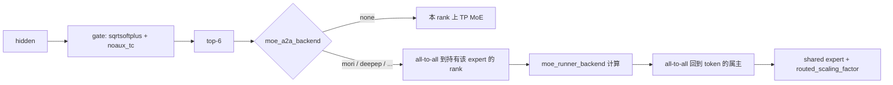

# 09 MoE 路由与采样

## V4.1-Flash 的路由参数

这些数在 config 的 `text_config` 里，模型构建时读进 gate，不是 CLI。

| 字段 | 值 | 代码里的含义 |
| --- | --- | --- |
| `n_routed_experts` | 384 | 可被路由的专家总数 |
| `n_shared_experts` | 1 | 每个 token 都会经过的共享专家 |
| `num_experts_per_tok` | 6 | top-k |
| `scoring_func` | `sqrtsoftplus` | 分数函数。`layers/moe/topk.py` 的 `TopKConfig` 注释写明 sqrtsoftplus 走 log1p，NaN 排在前面，这是 DeepSeek-V4.1 的路由 |
| `topk_method` | `noaux_tc` | 无辅助损失的 top-k 修正 |
| `norm_topk_prob` | true | 选中的 k 个权重再归一化 |
| `routed_scaling_factor` | 1.5 | 路由输出的缩放 |
| `moe_intermediate_size` | 2304 | 专家 FFN 的中间维 |
| `expert_dtype` | `fp4` | 专家权重精度。dense 部分仍是 `quant_method=fp8`、块 32×32、`ue8m0` |

草稿侧更小：`dspark_n_routed_experts = 128`，`dspark_num_experts_per_tok = 3`。DSPARK 的 draft MoE 不要按 384 专家去配 EP。

## 一次 forward 里 expert 怎么走

通信与计算是两个开关：

- `moe_a2a_backend`：token 怎么搬家。`none` 表示不搬家，专家按 TP 切。`mori`、`deepep`、`deepep_v2`、`megamoe` 等在 spanning 列表里时，解析把 `ep_size` 设为 `tp_size`，每个 rank 持有 `384 / ep_size` 个专家。16 卡就是 24 个。
- `moe_runner_backend`：专家 GEMM 用哪个 kernel。`auto` 会按量化格式改写。V4.1 的 MXFP8 dense 在 SM100 CUDA 上会被改成 `flashinfer_cutedsl`；HIP 不走这条（`model_overrides/deepseek_v4.py` 要求 `not is_hip`）。

共享专家融合（shared experts fusion）会被一些 runner 强制关掉：`flashinfer_trtllm`、`flashinfer_cutedsl`、LoRA MoE runner（`overrides.py` `_moe_runner_fusion_disable`）。DeepEP v2 也会关。Waterfill 则要求融合开着，并把共享专家当成一个额外的 routed 槽，丢到当前最空的 EP rank。

`dp_attention.py` 对 DeepEP v2 这类对称集合通信做 padding，使每个 rank 的 token 行数一致。否则 all-to-all 的形状对不上，表现为挂死或 shape assert，而不是错误的专家结果。

## 采样

HTTP 层的采样字段最终变成 `sampling/sampling_params.py` 的 `SamplingParams`。`normalize()` 之前调用方能设的是前半段；`stop_strs`、`is_normalized` 等由 `__post_init__` / `normalize` 填写。

| 字段 | 默认 | 说明 |
| --- | --- | --- |
| `max_new_tokens` | 128 | `/generate` 不传时的生成长度。OpenAI chat 用 `max_completion_tokens` / 已废弃的 `max_tokens`，转换时写进这里 |
| `temperature` | 1.0 | `None` 会被当成 1.0 |
| `top_p` | 1.0 | |
| `top_k` | `TOP_K_ALL`（传 `None` 时变成 -1） | |
| `min_p` | 0.0 | |
| `frequency_penalty` / `presence_penalty` | 0.0 | |
| `repetition_penalty` | 1.0 | |
| `stop` / `stop_token_ids` / `stop_regex` | 空 | `stop` 拷进 `stop_strs` 后清空 |
| `n` | 1 | 并行样本数 |
| `beam_width` | 空 | 大于 1 时变成 beam search，`n` 改成返回条数且 `n <= beam_width` |
| `json_schema` / `regex` / `ebnf` / `structural_tag` | 空 | 交给 `constrained/GrammarManager` |
| `ignore_eos` | false | |
| `sampling_seed` | 空 | |
| `logit_bias` | 空 | |

采样 kernel 由 `--sampling-backend` 选，choices 是 `SAMPLING_BACKEND_CHOICES`。环境变量打开 KV canary 的 token oracle 时，`add_cli_args` 会临时把 `token_oracle` 加进 choices。

约束解码不在 sampler 里做完。scheduler 在 `handle_generate_request` 把带 schema 的请求放进 grammar 队列，`GrammarManager` 按 backend（xgrammar、llguidance、outlines，见 `GRAMMAR_BACKEND_CHOICES`）给出下一步的允许集合，sampler 再应用这个 mask。grammar 编译失败会在请求进入 GPU 之前返回错误，而不是生成到一半才断。

V4.1 的 reasoning 与 tool call 不在采样器里。它们是 tokenizer 侧的 parser：`deepseek-v41` reasoning parser，以及 `function_call/deepseekv41_detector.py` 的 `DeepSeekV41Detector`。`--reasoning-parser auto` 在 `init_tokenizer_manager` 里根据模板选定。采样器只看到已经被模板展开的 token。

## 和四机配置的关系

16 卡、`ep_size=16`、`mori` 时，每个 token 的 6 个专家可能落在 6 个不同节点。all-to-all 的流量大致是「每层、每 token、两次跨节点交换」。`attn_dp_size=4` 不减少专家通信，它只让 attention 留在节点内。若专家通信成为瓶颈，本树给出的替代是 DWDP（权重预取、不要 all-to-all），但 DWDP 禁止投机、禁止 CUDA graph、并且要求 `attn_dp_size == tp_size`。那和 DSPARK 冲突，所以 V4.1-Flash 的建议配置不走 DWDP。
