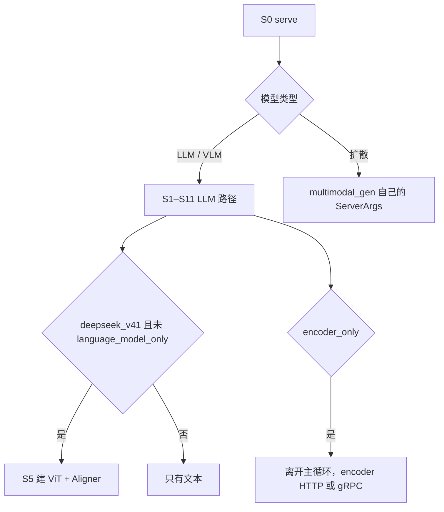

# 10 多模态

「多模态」在 v0.5.23 里是两条栈。它们在 S0 就分开，不共用 ServerArgs。

## VLM 插在 LLM 的哪一段

| 阶段 | 做完的事 |
| --- | --- |
| S2 | `handle_multimodal`。`--enable-multimodal` 对非多模态模型是空操作 |
| S4 | 多模态模型用 `get_mm_processor`，不是纯 `get_tokenizer` |
| S5 | `DeepseekV4ForCausalLM.__init__`：`model_type==deepseek_v41`、视觉层数大于 0、且没有 `--language-model-only` 时建 ViT 和 Aligner |
| S7 | OpenAI 消息里的 `image_url` 收成 `image_data`；原生 `/generate` 直接带 `image_data` |
| S8 | 处理器产出特征。进 GPU 走 `CudaVmmFeatureTransport`。`mm_hashes` 让外部路由器和 worker 用同一个前缀键 |
| S9/S10 | 图像 token 占序列的一段，和文本一起 EXTEND。Radix 匹配的是 token id，不是像素 |

实现文件：`models/deepseek_v41_vit.py`，处理器 `multimodal/processors/deepseek_v41.py` 的 `DeepseekV41ImageProcessor`，绑的类是 `DeepseekV4ForCausalLM`。

### `vision_config`

| 字段 | 值 | 作用 |
| --- | --- | --- |
| `num_hidden_layers` | 32 | ViT 深度 |
| `hidden_size` | 1024 | |
| `num_attention_heads` | 16 | |
| `intermediate_size` | 2816 | |
| `patch_size` | 14 | |
| `downsample_ratio` | 3 | Aligner |
| `max_image_tokens` | 1024 | 单图 token 上限 |
| `min_pixels` | 295936 | 最小像素 |

文本侧 `image_token_id` 是 129264。这个 id 会插入序列，Engram 也认识它。只跑文本时加 `--language-model-only`，S5 不建 ViT。

### 请求字段（S7 → S8）

| 字段 | 作用 |
| --- | --- |
| `image_data` / `video_data` / `audio_data` | URL、路径或 base64。批处理可以是列表的列表 |
| `mm_hashes` | 调用方已经算好的特征哈希。设置后不再对 processor 输出做内部哈希 |
| `mm_content_hashes` | 原始字节的 sha256，不替换特征哈希 |
| `modalities` | 图像、多图、视频 |
| `use_audio_in_video` | 是否从视频抽音频 |
| `mm_processor_kwargs` / `images_config` / `video_config` | 处理器参数 |
| `max_dynamic_patch` 等 | 动态切图 |
| `need_wait_for_mm_inputs` / `encoder_urls` / `num_items_assigned` | encoder 分离。S0 若 `encoder_only`，进程根本不进普通 LLM 循环 |

同一张图像若 processor 输出不稳定，token 段会变，S9 的前缀失效。`mm_hashes` 解决的是路由器和 worker 对同一特征张量达成同一个键。

`--mm-enable-dp-encoder` 把 ViT 复制到各 TP rank 上分图像。`tp_size==1` 时 S2 打警告：没有可分的工作。四机配置的 attention TP 是 4，这个开关有意义，但会复制 ViT 权重。小图可能比单卡算 ViT 更贵，hook 的日志就是这个意思。

## 扩散栈

`multimodal_gen` 在 S0 被选中之后，不再走 `run_resolution_pipeline`。它的 dataclass 字段在 05 后半，注释列是中文说明。入口类和 pipeline 的 `EntryClass` 由 `multimodal_gen/runtime/models/registry.py` 扫源码得到。那里现在也能识别被拆开的字符串字面量，原因见 README 里和上游类名有关的那一处推送限制。

LLM 进程里和「生成图片字节」接近的只有 `GenerateReqInput.return_bytes`，以及 dLLM（`ForwardMode.DLLM_EXTEND`，`exec.dllm` 命名空间）。那仍是 `Scheduler` 上的掩码扩散语言模型，不是 `multimodal_gen`。
