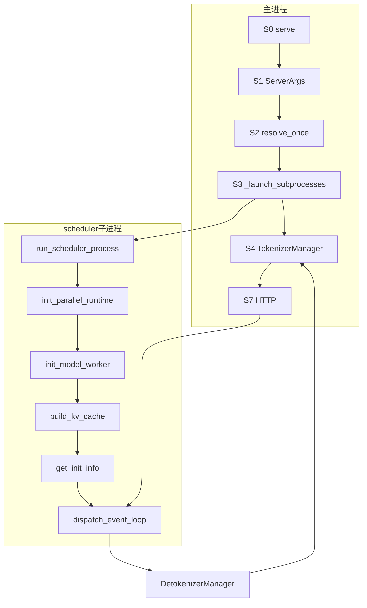

# 全量知识点清单（Batch 1）

本文件是后面三批的核对表，不是深文。树：`297e54fd105e974cdf401e5b4d20253a22c16f90`（标签 `v0.5.23`）。

证据：

- 符号都在本树里。行号会漂，以函数名和文件为准。
- **待核**：源码里看不出，或只有弱信号。
- **源码路径推断，未实测**：调用链能串起来，但本环境没有多卡 / DeepEP，没有跑过。

`05` / `06` 继续当旗标和请求字段附录。本清单不复制那两份表。

## 计数（本轮）

| 类 | 大约多少 | 数的是什么 |
| --- | --- | --- |
| A 流程 | 204 条（F01–F204） | 阶段、hook、调用序、回包分叉、「为何」问题 |
| B 特性 | 75 行（B01–B75） | 模型服务特性，一行一个 |
| C 模型 | 注册点 M01–M12；225 个 LLM 模块文件；95 个扩散模块文件 | 注册表清点；年代表是占位 |
| D 分布式 | 18 行（D01–D18） | 并行轴和相邻机制 |

---

# A. 流程

从粗到细。Batch 2 只写启动段（A.1 的 S0–ready，加上 A.2–A.9、A.15 里标了 Batch 2 的「为何」）。Batch 3 写请求段（A.10–A.14）。

## A.1 粗粒度阶段

| ID | 阶段 | 做完什么 | 符号 | 实测 |
| --- | --- | --- | --- | --- |
| F01 | S0 | 选定后端，装插件 | `python/sglang/cli/serve.py` `serve`；`sglang.srt.plugins.load_plugins` | 源码路径推断，未实测 |
| F02 | S1 | CLI 变成未解析 `ServerArgs` | `python/sglang/srt/server_args.py` `prepare_server_args` | 同上 |
| F03 | S2 | 改写默认值并封口 | `ServerArgs.resolve_once` → `arg_groups/pipeline.py` `run_resolution_pipeline` | 同上 |
| F04 | S3 | 拉起 scheduler / detokenizer，分配 ZMQ | `entrypoints/engine.py` `Engine._launch_subprocesses` | 同上 |
| F05 | 分布式 init | 进程组在 scheduler 子进程里建，不在 HTTP 进程 | `distributed/bootstrap.py` `init_parallel_runtime` | 同上 |
| F06 | S5 | 读 config，按 `architectures` 建模块，加载权重 | `model_executor/model_runner.py` `ModelRunner.load_model` | 同上 |
| F07 | S6 | 按剩余显存建 KV 池，再挂前缀树 | `KVCacheConfigurator.configure`；`kv_cache_builder.build_kv_cache` | 同上 |
| F08 | ready | 子进程把 init 信息写回 pipe | `scheduler.py` `Scheduler.get_init_info`；`run_scheduler_process` 里 `pipe_writer.send` | 同上 |
| F09 | S4 | rank 0 建 tokenizer 和模板 | `engine.py` `init_tokenizer_manager`；`parser/template_manager.py` `TemplateManager` | 同上 |
| F10 | S7 | HTTP 体变成 `GenerateReqInput` | `http_server.py` `generate_request` / `serve_generate_request` | 同上 |
| F11 | S8 | 分词，ZMQ 发给 scheduler | `managers/tokenizer_manager.py` `TokenizerManager.generate_request` | 同上 |
| F12 | S9 | 收请求、组 batch、跑 extend 或 decode | `scheduler.py` `dispatch_event_loop` | 同上 |
| F13 | S10 | `ScheduleBatch` 变成 `ForwardBatch`，前向并采样 | `managers/tp_worker.py` `TpModelWorker.forward_batch_generation` | 同上 |
| F14 | S11 | token id 变文本，流式或一次返回 | `managers/detokenizer_manager.py` `DetokenizerManager` | 同上 |

## A.2 S0 CLI 与进程分叉

| ID | 点 | 符号 |
| --- | --- | --- |
| F15 | 控制台入口 | `pyproject` 把 `sglang` 指到 `sglang.cli.main:main`（`cli/main.py` `main`） |
| F16 | `serve` 解析 `--model-type`，默认 `auto` | `cli/serve.py` `serve`，`ServeBackendRegistry.auto_detect` |
| F17 | 位置参数改成模型路径 | 同文件 `_normalize_positional_model_path` |
| F18 | 插件在分发前加载 | `serve` 里 `load_plugins()` |
| F19 | 兼容入口 | `python/sglang/launch_server.py`：`__main__` 先 `load_plugins` 再 `prepare_server_args`，然后 `run_server` |
| F20 | LLM 默认走 HTTP | `launch_server.py` `run_server` 的 else：`entrypoints/http_server.py` `launch_server` |
| F21 | 仅编码器 | `resolving_view(...).encoder_only` 为真时走 `disaggregation/encoder/http_server.py` `launch_server`，或 `encoder/grpc_server.py` `serve_grpc_encoder` |
| F22 | SMG gRPC | `smg_grpc_mode` 或已折进它的 `grpc_mode`：`entrypoints/grpc_server.py` `serve_grpc` |
| F23 | Ray | `use_ray`：`srt/ray/http_server.py` `launch_server` |
| F24 | 扩散是另一条启动 | `cli/serve.py` 的 backend registry。扩散自己的 `prepare_server_args` 在 `multimodal_gen/runtime/server_args/server_args.py`，不进 LLM 的 `run_resolution_pipeline` |

## A.3 S1 声明

| ID | 点 | 符号 |
| --- | --- | --- |
| F25 | 字段来自 `arg_groups/fields/` 的 `A[...]` | `server_args.py` `ServerArgs.add_cli_args`，`add_cli_args_from_dataclass` |
| F26 | 少量旗标手写 | 同函数里的 `--config`，以及 choices 运行期才定的采样 / reasoning / tool parser。废弃旗标 `--disable-cuda-graph`、`--enable-dp-attention` 也在这里。待核：手写名单以 `add_cli_args` 正文为准，本轮不逐行抄 05 |
| F27 | 这一步结束配置还没改写 | `prepare_server_args` 不调用 `run_resolution_pipeline`。`attention_backend=auto` 之类要到 S2 才落地 |
| F28 | 读到的「当前有效值」 | `arg_groups/overrides.py` `resolving_view` |
| F29 | 合法改写 | `declare_resolution`，记在 `_resolved_overrides` |
| F30 | 封口后赋值会失败 | `pipeline.py` 末尾 `server_args._resolution_finished = True`。`ServerArgs.__setattr__` 拒绝再写。待核：异常类型以 `__setattr__` 正文为准 |

## A.4 S2 hook 全序

文件：`python/sglang/srt/arg_groups/pipeline.py` 函数 `run_resolution_pipeline`。插件经 `resolution_hooks.run_hook` 替换单个 hook，不能换顺序。

`调研笔记/解析流水线.md` 把多步收成约 29 行，并且缺下面表里的 Inkling / Muse Glimmer 图默认、DeepSeek TRT-LLM prefill 图关闭、FlashInfer A2A 预算、MegaMOE token 预算、boundary reduction、dLLM、NVIDIA megakernel、AMD monokernel。Batch 2 以本表和 `pipeline.py` 为准。

dummy / `model_path` 为 `none` 时，在 `handle_hardware_runtime_validation` 之后走 `resolve_boundary_reduction` 并返回，后面的 hook 不跑。

| ID | 次序 | hook | 定义位置 |
| --- | --- | --- | --- |
| F31 | 0 | 冻结 `_raw_input`，继承已有 `_resolved_overrides` | `pipeline.py` 函数体 |
| F32 | 1 | `handle_deprecated_dp_attention` | `parallel_hook.py` |
| F33 | 2 | `handle_mega_moe` | `mega_moe_hook.py` |
| F34 | 3 | `handle_return_hidden_states_mode` | `serving_hook.py` |
| F35 | 4 | `handle_media_url_security` | `serving_hook.py` |
| F36 | 5 | `handle_watermark_config` | `serving_hook.py` |
| F37 | 6 | `handle_hicache_ratio_default` | `hicache_hook.py` |
| F38 | 7 | `handle_offload_compatibility`（第一次） | `memory_hook.py` |
| F39 | 8 | `validate_prefill_decode_interval` | `validation_hook.py` |
| F40 | 9 | `validate_response_store` | `validation_hook.py` |
| F41 | 10 | `validate_sampling_mask_max_tokens` | `validation_hook.py` |
| F42 | 11 | `handle_aux_hidden_state_capture` | `validation_hook.py`。注释写明要在任何读者读 `speculative_algorithm` 之前 |
| F43 | 12 | `validate_prefill_cp_platform` | `parallel_hook.py` |
| F44 | 13 | `handle_hardware_runtime_validation` | `platform_hook.py` |
| F45 | 14 | `handle_model_source_paths` | `model_path_hook.py` |
| F46 | 15 | `apply_muse_spark_env_defaults` | `muse_spark_hook.py`。直接调用，不经 `run_hook`。必须在显存启发式之前 |
| F47 | 16 | `handle_multimodal` | `serving_hook.py` |
| F48 | 17 | `handle_ssl_validation` | `serving_hook.py` |
| F49 | 18 | `handle_asr_validation` | `serving_hook.py` |
| F50 | 19 | `handle_deprecated_args` | `serving_hook.py` |
| F51 | 20 | `handle_prefill_delayer_env_compat` | `serving_hook.py` |
| F52 | 21 | `handle_missing_default_values` | `serving_hook.py` |
| F53 | 22 | `handle_expert_pack` | `expert_pack_hook.py` |
| F54 | 23 | `handle_pd_disaggregation` | `pd_disaggregation_hook.py`。注释：先于 CUDA graph |
| F55 | 24 | `validate_prefill_only_disable_kv_cache_args` | `kv_cache_hook.py` |
| F56 | 25 | `handle_decode_context_parallelism` | `parallel_hook.py` |
| F57 | 26 | `apply_inkling_prefill_cuda_graph_default` | `cuda_graph_hook.py` |
| F58 | 27 | `apply_muse_glimmer_prefill_cuda_graph_max_bs_default` | `cuda_graph_hook.py` |
| F59 | 28 | `handle_dwdp` | `parallel_hook.py`。注释：必须在 CUDA graph 和 data parallel 之前 |
| F60 | 29 | `handle_cuda_graph_config` | `cuda_graph_hook.py` |
| F61 | 30–36 | `handle_hpu_backends`，`handle_cpu_backends`，`handle_npu_backends`，`handle_mps_backends`，`handle_xpu_backends`，`handle_symm_mem_device_support`，`handle_platform_defaults` | `platform_hook.py` |
| F62 | 37 | `handle_gpu_memory_settings` | `memory_hook.py` |
| F63 | 38 | `handle_model_specific_adjustments` | `model_hook.py`，再进 `model_overrides/` |
| F64 | 39 | `default_unset_prefill_decode_interval` | `validation_hook.py` |
| F65 | 40 | `handle_offload_compatibility`（第二次，模型 override 之后） | `memory_hook.py` |
| F66 | 41 | `_sampling_backend_default` | `overrides.py`，`run_post_process_pass` |
| F67 | 42 | `handle_deterministic_inference` | `attention_hook.py` |
| F68 | 43 | `handle_nvfp4_prefill_kv_dequant_dtype` | `kv_cache_hook.py` |
| F69 | 44 | `handle_attention_backend_compatibility` | `attention_hook.py` |
| F70 | 45 | `disable_prefill_cuda_graph_for_deepseek_trtllm_mla` | `cuda_graph_hook.py` |
| F71 | 46–48 | `handle_mamba_backend`，`handle_int8_mamba_checkpoint`，`handle_linear_attn_backend` | `mamba_hook.py`，`attention_hook.py` |
| F72 | 49–51 | `handle_kv4_compatibility`，`handle_mxfp8_kv_cache_compatibility`，`_page_size_default` | `kv_cache_hook.py`，`overrides.py` |
| F73 | 52–54 | `handle_amd_specifics`，`handle_nccl_pre_warm`，`handle_grammar_backend` | `platform_hook.py`，`serving_hook.py` |
| F74 | 55–56 | `handle_multi_item_scoring`，`handle_prefill_only_disable_kv_cache` | `attention_hook.py`，`kv_cache_hook.py` |
| F75 | 57 | `handle_hicache` | `hicache_hook.py` |
| F76 | 58–60 | `handle_data_parallelism`，`handle_load_balance_method`，`handle_context_parallelism` | `parallel_hook.py`，`serving_hook.py` |
| F77 | 61 | `apply_prefill_cp_cuda_graph_default` | 仅 `enable_prefill_cp` 时，`cuda_graph_hook.py` |
| F78 | 62 | `handle_kv_cache_sharding`（第一次） | `kv_shard_hook.py` |
| F79 | 63–69 | `handle_moe_kernel_config`，`handle_a2a_moe`，`handle_shared_experts_tp`，`handle_eplb_and_dispatch`，`handle_expert_distribution_metrics`，`handle_elastic_ep`，`validate_experimental_sgl_marlin` | `moe_hook.py`，`parallel_hook.py`，`validation_hook.py` |
| F80 | 70 | `_pipeline_parallel_overlap_disable` | `overrides.py`。`pp_size>1` 时关 overlap |
| F81 | 71 | `handle_speculative_decoding` | `speculative_hook.py`。DSPARK 在 `_handle_dspark` |
| F82 | 72 | `resolve_boundary_reduction` | `boundary_reduction.py` |
| F83 | 73 | `handle_layernorm_sp` | `layernorm_sp_hook.py` |
| F84 | 74–75 | `validate_flashinfer_a2a_token_budget`，`validate_mega_moe_token_budget_for_model` | `moe_hook.py`，`mega_moe_hook.py` |
| F85 | 76–82 | `handle_load_format`，`handle_encoder_disaggregation`，`handle_tokenizer_batching`，`handle_environment_variables`，`handle_cache_compatibility`，`handle_page_major_kv_layout`，`handle_unified_memory_pool` | `model_path_hook.py`，`pd_disaggregation_hook.py`，`serving_hook.py`，`kv_cache_hook.py` |
| F86 | 83–87 | `handle_dllm_inference`，`handle_crash_dump_env`，`handle_debug_utils`，`handle_other_validations`，`handle_model_capability_adjustments` | `dllm_hook.py`，`serving_hook.py`，`model_hook.py` |
| F87 | 88–89 | `handle_nvidia_megakernel`，`handle_amd_monokernel` | `kernel_plugins/nvidia/binding.py`，`kernel_plugins/amd/binding.py` |
| F88 | 90 | `finalize_cuda_graph_prefill_max_context` | `cuda_graph_hook.py`，直接调用 |
| F89 | 91–93 | 再跑 `handle_kv_cache_sharding`，然后 `validate_deepep_v2_speculative_draft`，`validate_deepep_v2_dispatch_token_budget` | `kv_shard_hook.py`，`moe_hook.py` |
| F90 | 封口 | `_resolution_finished = True` | `pipeline.py` |
| F91 | S3 才跑 | `check_server_args` 不在这张表 | `validation_hook.py`，由 `Engine._launch_subprocesses` 在 `publish` 之前调用 |

V4.1 特征拒绝不在 pipeline 的顶层名字里。`handle_model_specific_adjustments` 会进 `arg_groups/deepseek_v4_hook.py` `validate_deepseek_v41_features`：`model_type == "deepseek_v41"` 时拒绝非 DSPARK 投机、HiSparse、unified KV triton、two-batch overlap、PP。源码路径推断，未实测。

## A.5 S3 进程拓扑

`http_server.launch_server` 调 `Engine._launch_subprocesses`（`entrypoints/engine.py`）。

| ID | 点 | 符号 |
| --- | --- | --- |
| F92 | 再次 `resolve_once` | 已成功则直接返回 |
| F93 | `publish(server_args, role="tokenizer")` | `runtime_context.publish`。失败时 `restore_context` |
| F94 | ZMQ 与 NCCL 端口 | `server_args.py` `PortArgs.init_new` |
| F95 | 可选权重缓存守护进程 | `weight_cache_mode == "daemon"` 时 `_launch_weight_cache_daemons` |
| F96 | 可选远端权重 bootstrap | `EngineInfoBootstrapServer`，`entrypoints/engine_info_bootstrap_server.py` |
| F97 | scheduler 进程个数 | `_launch_scheduler_processes`。`num_dp_ranks = dp_size * attn_dp_size` 的乘积在 `fields/parallel.py` 的注释里。attention DP 不增加 GPU，但增加 scheduler |
| F98 | 子进程入口 | `scheduler.py` `run_scheduler_process`：`load_plugins`，`publish`（scheduler 角色），构造 `Scheduler`，`pipe_writer.send(get_init_info())`，再 `run_event_loop` |
| F99 | DP 控制器 | `managers/data_parallel_controller.py` `DataParallelController`。多于一个 DP rank 时由 launcher 拉起。待核：精确 `if` 在 `_launch_scheduler_processes` 正文，本轮未逐行贴出 |
| F100 | rank 0 的 detokenizer | `DetokenizerManager`，进程入口是 `_launch_subprocesses` 传入的 `run_detokenizer_process_func` |
| F101 | `node_rank >= 1` | 不建 tokenizer。`wait_for_ready` 之后可起 follower gRPC（`start_follower_grpc_server`），再阻塞到 scheduler 退出。可选 dummy health：`launch_dummy_health_check_server` |
| F102 | Rust server | 环境变量 `SGLANG_RUST_SERVER`（`srt/environ.py`）。为真时主进程不建 Python detokenizer / `TokenizerManager`，改 `start_disagg_service_for_rust_server` |
| F103 | IPC 名字 | `managers/scheduler_components/ipc_channels.py` `SchedulerIpcChannels` |
| F104 | 进程标题 | `configure_scheduler_process` 写成 `sglang::scheduler_DP.._TP.._EP..` |

## A.6 分布式 init 插在哪

发生在 `Scheduler.__init__`，早于 `init_model_worker`。细节见 D。

| ID | 点 | 符号 |
| --- | --- | --- |
| F105 | 一次初始化 | `distributed/bootstrap.py` `init_parallel_runtime`。同进程第二次调用直接 `RuntimeError` |
| F106 | 建 WORLD | 同文件 `_init_parallel_groups` → `parallel_state.init_distributed_environment` |
| F107 | 建 TP/PP/EP/CP 组 | `parallel_state.initialize_model_parallel`。宽度从 `get_parallel()` 读，不从函数参数读 |
| F108 | attention DP 的 rank 标记 | `layers/dp_attention.py` `initialize_dp_attention`，由 `_init_parallel_groups` 调用 |
| F109 | NIXL 的 TCPStore | `init_distributed_environment` 在 `moe_a2a_backend == "nixl"` 时 `_create_global_tcp_store` |
| F110 | Mooncake 作为 process group backend | `init_distributed_environment` 在 `backend == "mooncake"` 时用 `MooncakeBackendOptions` |

## A.7 S5 模型与权重

`Scheduler.init_model_worker` 的顺序（`scheduler.py`）：

| ID | 次序 | 符号 |
| --- | --- | --- |
| F111 | 1 | `init_tp_model_worker` → `TpModelWorker` → `ModelRunner` |
| F112 | 2 | 可选 `tp_worker.start_startup_weight_load`（`get_model().is_startup_weight_load_overlap`） |
| F113 | 3 | `maybe_init_draft_worker`。算法名来自 `SpeculativeAlgorithm.from_string` |
| F114 | 4 | `init_memory_pools`：先 `init_target_memory_pool`，再草稿 `alloc_memory_pool` |
| F115 | 5 | `init_all_attention_backends` |
| F116 | 6 | `init_all_cuda_graphs` |
| F117 | 7 | 若 `token_to_kv_pool.post_capture_active`：`kv_cache_builder.prepare_hicache_staging`，图捕获后再 `post_capture_resize_kv_pool` |
| F118 | 8 | `model_worker` 指到 `draft_worker`，否则指到 `tp_worker` |
| F119 | 9 | `tp_worker.get_worker_info` 取出 `max_total_num_tokens` 等 |

`ModelRunner.initialize`（在 worker 构造里，早于上面的池）的顺序：

| ID | 点 | 符号 |
| --- | --- | --- |
| F120 | 显存节省、远端传输、专家位置、EPLB、elastic EP、token oracle | `init_memory_saver_adapter`，`maybe_init_remote_instance_transfer_engine`，`maybe_init_expert_location_metadata`，`maybe_init_eplb_manager`，`maybe_init_elastic_ep`，`init_token_oracle` |
| F121 | 采样器对象 | `create_sampler()` 赋给 `self.sampler` |
| F122 | 加载 | `load_model` |
| F123 | MoE top-k 预处理 | `prepare_moe_topk` |
| F124 | DWDP | `maybe_init_dwdp` |
| F125 | LoRA、batch invariant、KV dtype、megakernel | `maybe_init_lora_manager`，`maybe_enable_batch_invariant_mode`，`configure_kv_cache_dtype`，`install_megakernel` |

权重 loader 的类在 `model_loader/loader.py`：`DefaultModelLoader`，`LayeredModelLoader`，`DummyModelLoader`，`ShardedStateLoader`，`PreshardedModelLoader`，`BitsAndBytesModelLoader`，`GGUFModelLoader`，`RemoteInstanceModelLoader`，`RemoteModelLoader`，`ModelOptModelLoader`，`RunaiModelStreamerLoader`，`QuantizedRLModelLoader`。选哪一个由 S2 的 `handle_load_format` 和 `LOAD_FORMAT_CHOICES` 决定。

架构解析见 C。`get_model_architecture` 在 `model_loader/utils.py`。

## A.8 S6 KV 与前缀树

池和树不是同一步。

| ID | 点 | 符号 |
| --- | --- | --- |
| F126 | 池的预算 | `ModelRunner.alloc_memory_pool` 调 `KVCacheConfigurator.configure`（`mem_cache/kv_cache_configurator.py`） |
| F127 | 目标池入口 | `Scheduler.init_target_memory_pool` → `TpModelWorker.alloc_memory_pool` |
| F128 | 草稿池 | `draft_worker.alloc_memory_pool`，并 `init_hicache_draft_plan` |
| F129 | 前缀树 | `Scheduler.__init__` 在 `init_model_worker` 之后调 `kv_cache_builder.build_kv_cache`，结果放进 `self.tree_cache` |
| F130 | 树的实现 | `mem_cache/registry.py` 按配置选 `RadixCache`（`radix_cache.py`）或 `UnifiedRadixCache`（`unified_radix_cache.py`）。另有 `PureSWARadixCache`，`FlexKVRadixCache`，`LMCacheUnifiedRadixCache` |
| F131 | 逻辑页到物理页 | `mem_cache/memory_pool.py` `ReqToTokenPool`；请求侧 `schedule_batch.py` `ReqKvInfo` |
| F132 | V4 池 | `mem_cache/deepseek_v4_memory_pool.py` `DeepSeekV4TokenToKVPool` |
| F133 | HiSparse 协调器 | 池后 `ModelRunner.maybe_init_hisparse_coordinator`；scheduler 侧 `init_hisparse_coordinator` 从 runner 取出 |
| F134 | chunked prefill 状态 | `Scheduler.init_chunked_prefill`，在树建完之后 |
| F135 | session | `init_running_status` 里 `SessionController(self.tree_cache)`（`session/session_controller.py`） |

## A.9 ready

| ID | 点 | 符号 |
| --- | --- | --- |
| F136 | 子进程在 `Scheduler(...)` 返回后才发 pipe | `run_scheduler_process`：`pipe_writer.send(scheduler.get_init_info())`。此时 F111–F135 已结束 |
| F137 | 父进程等齐 | `Engine._launch_scheduler_processes` 内部的 `wait_for_ready` |
| F138 | 然后才是 HTTP | rank 0 在 ready 之后建 detokenizer 和 tokenizer，`launch_server` 再跑 uvicorn。源码路径推断，未实测 |
| F139 | 健康检查 | `http_server.py` `GET /health`，`/health_generate`，`/ready` |

## A.10 请求对象与入口

| ID | 点 | 符号 |
| --- | --- | --- |
| F140 | 原生生成 | `POST/PUT /generate` → `generate_request` → `serve_generate_request` |
| F141 | 请求体 | `managers/io_struct.py` `GenerateReqInput`。OpenAI 层先变成它：`entrypoints/openai/serving_chat.py` `OpenAIServingChat`，`serving_completions.py` `OpenAIServingCompletion` |
| F142 | 规范化 | `GenerateReqInput.normalize_batch_and_arguments`；优先级默认 `_set_default_priority` |
| F143 | 分词 | `_tokenize_one_request` → `TokenizedGenerateReqInput`（同文件） |
| F144 | 下发 | `_send_one_request`。有 attention DP 时先到 `DataParallelController`。待核：controller 的路由函数名，Batch 3 再钉 |
| F145 | scheduler 收包 | `scheduler_components/request_receiver.py` `SchedulerRequestReceiver`，循环里 `ingest_requests` |
| F146 | 运行中的请求 | `schedule_batch.py` `Req`，其 KV 视图 `ReqKvInfo` |
| F147 | 一轮调度 | `ScheduleBatch` |
| F148 | 一轮前向 | `model_executor/forward_batch_info.py` `ForwardBatch`，模式 `ForwardMode` |
| F149 | 采样参数 | `sampling/sampling_params.py` `SamplingParams`。S8 规范化，S10 使用 |

`ForwardMode` 的成员：`EXTEND`（注释写明也叫 prefill），`DECODE`，`MIXED`（chunked prefill 时 extend 与 decode 同批），`IDLE`（attention DP 空组），`TARGET_VERIFY`，`DRAFT_EXTEND_V2`，`PREBUILT`（PD decode），`SPLIT_PREFILL`（PD mux），`DLLM_EXTEND`。

其它 HTTP 入口（协议，不是第二条调度器）：`/v1/chat/completions`，`/v1/completions`，`/v1/embeddings` 一族，`/v1/rerank`，`/v1/score`，`/v1/responses`，`/v1/messages`（Anthropic，`entrypoints/anthropic/serving.py`），Ollama 的 `/api/chat` 与 `/api/generate`，`/v1/systemone`，`/invocations`，`/vertex_generate`，`/encode`，`/classify`，`/v1/audio/transcriptions`。字段表在 06，本轮不展开。

## A.11 调度、prefill / decode、KV

`dispatch_event_loop`（`scheduler.py`）按模式选循环：

| ID | 条件 | 循环 |
| --- | --- | --- |
| F150 | `enable_pd_role_switch` | `disaggregation/role_switch.py` `run_event_loop_supervisor`，内部仍调 `_dispatch_event_loop_once` |
| F151 | `disaggregation_mode == NULL` 且 `enable_pdmux` | `multiplex/multiplexing_mixin.py` `event_loop_pdmux` |
| F152 | NULL 且 `pp_size > 1` | `event_loop_pp`（`managers/scheduler_pp_mixin.py` `SchedulerPPMixin`） |
| F153 | NULL 且 overlap，MLX | `hardware_backend/mlx/scheduler_mixin.py` `event_loop_overlap_mlx` |
| F154 | NULL 且 overlap | `event_loop_overlap` |
| F155 | NULL 且不 overlap | `event_loop_normal` |
| F156 | PREFILL | `event_loop_pp_disagg_prefill` / `event_loop_overlap_disagg_prefill` / `event_loop_normal_disagg_prefill`（`disaggregation/prefill.py`） |
| F157 | DECODE | 对应的三个 `event_loop_*_disagg_decode`（`disaggregation/decode.py`） |

`event_loop_normal` 一轮：`ingest_requests` → `get_next_batch_to_run` → `run_batch` → `process_batch_result`。空转走 `on_idle`。

`event_loop_overlap` 把上一批的 `process_batch_result` 和当前批的 `run_batch` 错开，采样在 `launch_batch_sample_if_needed`。开关是 `disable_overlap_schedule`（`fields/schedule.py`，默认 False）。`pp_size>1` 时 S2 的 `_pipeline_parallel_overlap_disable` 会把它打开。源码路径推断，未实测。

| ID | 点 | 符号 |
| --- | --- | --- |
| F158 | 排队策略 | `managers/schedule_policy.py` `SchedulePolicy`。cache-aware：`lpm`，`dfs-weight`，`hrrn`，`shortest-prefill-first`。cache-agnostic：`fcfs`，`lof`，`random`，`routing-key` |
| F159 | 优先级 | `enable_priority_scheduling`，`priority_scheduling_preemption_threshold`（`fields/schedule.py`，scheduler 上同名属性） |
| F160 | chunk | `chunked_prefill_size == -1` 表示关（字段 help）。`enable_mixed_chunk` 允许 MIXED。`enable_dynamic_chunking` 给 PP |
| F161 | KV 匹配与插入 | `BasePrefixCache.match_prefix` / `insert`（`mem_cache/base_prefix_cache.py` 一类接口；`RadixCache` 在 `radix_cache.py`）。Batch 3 再钉 scheduler 里的调用点 |
| F162 | 前向 | `TpModelWorker.forward_batch_generation` → `ModelRunner.forward` |
| F163 | 结果 | `Scheduler.process_batch_result`；decode 细节在 `scheduler_components/batch_result_processor.py` `process_batch_result_decode` |
| F164 | 输出回 tokenizer | `scheduler_components/output_streamer.py` `SchedulerOutputStreamer`。`skip_tokenizer_init` 时 scheduler 直接推回 tokenizer（03 已写，Batch 3 核对 IPC 名） |

## A.12 采样、detokenize、流式与非流式

| ID | 点 | 符号 |
| --- | --- | --- |
| F165 | 采样后端 | `arg_groups/choices.py` `BUILT_IN_SAMPLING_BACKENDS`：`flashinfer`，`pytorch`，`ascend`，`intel_xpu`。S2 `_sampling_backend_default` |
| F166 | 语法约束 | `constrained/grammar_manager.py` `GrammarManager`。后端 `GRAMMAR_BACKEND_CHOICES`：`xgrammar`，`outlines`，`llguidance`，`none`。S2 `handle_grammar_backend` |
| F167 | detokenizer 循环 | `DetokenizerManager.event_loop`；生成走 `handle_batch_token_id_out`，embedding 走 `handle_batch_embedding_out` |
| F168 | tokenizer 等回包 | `_handle_batch_output` 把文本放进 `ReqState`。`_wait_one_response` 直接返回 `_stream_one_response` |
| F169 | 流式与非流式是同一函数 | `_stream_one_response` 用 `is_stream = getattr(obj, "stream", False)`。`finished` 时 yield 一次并 break。未完成时只有 `is_stream` 才 yield |
| F170 | HTTP 流式 | `serve_generate_request` 在 `obj.stream` 时用 `StreamingResponse`，每块 `data: ` + JSON，最后 `data: [DONE]` |
| F171 | HTTP 非流式 | else 分支对 `generate_request(...).__anext__()` 只取第一次 yield，`orjson_response` 一次返回 |
| F172 | 增量流 | `incremental_streaming_output` 时 `_coalesce_streaming_chunks`。非增量流式中间块的 `text` 可以是 None，yield 前用 `state.get_text()` 补上 |

## A.13 Tokenizer 与 chat template

| ID | 点 | 符号 |
| --- | --- | --- |
| F173 | 构造 | `init_tokenizer_manager`（`engine.py`）建 `TokenizerManager` |
| F174 | 模板 | `TemplateManager.initialize_templates`（`parser/template_manager.py`） |
| F175 | 模型 config | `TokenizerManager.__init__` 里 `ModelConfig.from_server_args` |
| F176 | 多模态处理器 | `get_mm_processor`；否则 `get_tokenizer`。处理器目录 `srt/multimodal/processors/` |
| F177 | auto parser | `Engine._launch_subprocesses` 在 publish 前 `resolve_auto_parsers`。`--reasoning-parser auto` / `--tool-call-parser auto` 在这里落地。V4.1 的 reasoning 名 `deepseek-v41` 见 02，本轮不重核 parser 表，标待核：名字是否仍只在 `reasoning_parser_names.py` |
| F178 | chat 展开发生在分词前 | `_tokenize_one_request` 内部。Batch 3 把模板函数名钉死 |

## A.14 PD 分离（本树有）

| ID | 点 | 符号 |
| --- | --- | --- |
| F179 | 模式 | `fields/disagg.py` `disaggregation_mode`：`null` / `prefill` / `decode` |
| F180 | S2 | `handle_pd_disaggregation`，以及更后的 `handle_encoder_disaggregation` |
| F181 | 传输后端 | `disaggregation_transfer_backend`，choices：`mooncake`，`nixl`，`ascend`，`fake`，`mori`，`mooncake_tcp` |
| F182 | prefill 循环 | `disaggregation/prefill.py` `SchedulerDisaggregationPrefillMixin` |
| F183 | decode 循环 | `disaggregation/decode.py` `SchedulerDisaggregationDecodeMixin`。KV 已在对端算好时用 `ForwardMode.PREBUILT` |
| F184 | bootstrap 端口 | `disaggregation_bootstrap_port`，默认 8998 |
| F185 | 角色热切换 | `enable_pd_role_switch`，`disaggregation/role_switch.py` |
| F186 | 同进程 mux | `enable_pdmux`，`event_loop_pdmux` |
| F187 | 编码器分离 | `encoder_only`，见 F21。这是第三条进程，不是 PD 的 prefill |
| F188 | 校验和 | `disaggregation_enable_kv_checksum`。help 写 Adler-32，布局不一致时放行并告警 |

## A.15 「为何」——留给后面批次填，本轮只列问题

| ID | 问题 | 先看 | 批次 |
| --- | --- | --- | --- |
| F189 | 为何 tokenizer、scheduler、detokenizer 拆进程，而不是一个进程三条线程？ | `Engine._launch_subprocesses` 文档字符串 | 2 |
| F190 | 为何 `resolve_once` 只能成功一次，改写必须走 `declare_resolution`？ | `ServerArgs.__setattr__`，`_resolution_finished` | 2 |
| F191 | 为何 S1 的默认值不能拿来解释运行时？ | F27，以及 `model_overrides/` | 2 |
| F192 | 为何 attention DP 不增加 GPU，却增加 scheduler？ | `fields/parallel.py` 里 `attn_dp_size` 与 `dp_size` 的注释 | 2 |
| F193 | 为何空的 attention DP 组仍要 `ForwardMode.IDLE`？ | `ForwardMode.IDLE` 的注释；MoE all-to-all 需要对端 | 3 |
| F194 | 为何草稿和目标各有一块池？ | `init_memory_pools` | 2 |
| F195 | 为何 CUDA graph 在 KV 池之后、树之前或穿插 post-capture resize？ | F114–F117 | 2 |
| F196 | 为何 `pp_size>1` 强制关掉 overlap schedule？ | `_pipeline_parallel_overlap_disable` | 2 |
| F197 | 为何 V4.1 拒绝非 DSPARK、HiSparse、PP？ | `validate_deepseek_v41_features` | 4 |
| F198 | 为何非流式 HTTP 也进 `_stream_one_response`？ | F169–F171 | 3 |
| F199 | 为何 `node_rank>=1` 不提供业务 HTTP？ | F101 | 2 |
| F200 | 为何前缀树挂在 scheduler 而不是 `ModelRunner.forward` 里现查？ | F129，`tree_cache` | 3 |
| F201 | 为何 DeepEP 一类 a2a 会把 `ep_size` 改成 `tp_size`？ | `overrides.py` 的 `_a2a_ep_size`，`_A2A_EP_SPANNING_BACKENDS`。待核：集合的当前成员，Batch 4 对一下 `moe_hook.py` | 4 |
| F202 | 为何 chunked prefill 在 attention DP 下会被改小？ | `handle_data_parallelism`。02 写了除以组数，Batch 2 核对公式 | 2 |
| F203 | 为何 PD decode 用 `PREBUILT` 而不是普通 `EXTEND`？ | `ForwardMode.PREBUILT` 注释 | 3 |
| F204 | 为何 Rust server 跳过 Python tokenizer？ | F102 | 2 |

---

# B. 特性

一行一个。CLI 名用字段名；连字符旗标在 05。开放问题留给 Batch 4。全部 **源码路径推断，未实测**，除了纯静态的 choices 列表。

| ID | 特性 | 做什么 / 用在哪 | 关键符号 | CLI 或环境变量 | 开放问题 |
| --- | --- | --- | --- | --- | --- |
| B01 | 投机框架 | 目标一步，草稿多 token，再验证。S5 建 draft worker，S10 用 `TARGET_VERIFY` / `DRAFT_EXTEND_V2` | `speculative/spec_info.py` `SpeculativeAlgorithm`，`create_worker` | `--speculative-algorithm` 等，`fields/spec.py` | 每种算法的验证数据结构不同，见 `SpecInputType` |
| B02 | EAGLE / EAGLE3 | 草稿看目标隐状态 | `EAGLEWorkerV2`（`eagle_worker_v2.py`）。`enable_multi_layer_eagle` 时改 `MultiLayerEagleWorkerV2` | `speculative_algorithm=EAGLE/EAGLE3` | `is_eagle()` 目前还包含 `FROZEN_KV_MTP`，注释写了 FIXME |
| B03 | NEXTN 别名 | 名字折成 EAGLE，不是独立 worker | `spec_registry.py` `_RESERVED_ALIASES = {NEXTN}` | `NEXTN` | 和模型文件里的 `*NextN` 类不是一回事 |
| B04 | FROZEN_KV_MTP | 冻结 KV 的 MTP worker | `frozen_kv_mtp_worker_v2.py` `FrozenKVMTPWorkerV2` | `FROZEN_KV_MTP` | scheduler 支持度注释说未立稳 |
| B05 | STANDALONE | 独立草稿权重 | `standalone_worker_v2.py` `StandaloneWorkerV2` | `STANDALONE` | 不携带 draft hidden（`carries_draft_hidden_states` 只对 eagle） |
| B06 | NGRAM | 不加载神经网络草稿 | `ngram_worker.py` `NGRAMWorker` | `NGRAM` | `has_draft_kv()` 为假；不支持 grammar overlap |
| B07 | DFLASH | 另一类草稿 | `dflash_worker_v2.py` `DFlashWorkerV2` | `DFLASH` | 与 DSPARK 同属 `is_dflash_family` |
| B08 | UNO | 独立算法 | `uno_worker_v2.py` `UnoWorkerV2` | `UNO` | `SpecInputType` 有 `UNO_STATE/DRAFT/VERIFY` |
| B09 | DSPARK | V4.1 唯一被 `validate_deepseek_v41_features` 放行的投机 | `dspark_components/dspark_worker_v2.py` `DSparkWorkerV2`；`_handle_dspark` | `DSPARK`，`--speculative-draft-model-path` | ragged verify 仅 DSPARK（`supports_ragged_verify`） |
| B10 | 解耦投机 | verifier 与 drafter 分进程 | `fields/disagg.py` `decoupled_spec_role`：`null/verifier/drafter` | `decoupled_spec_rank` | 和 PD 的 prefill/decode 角色不同 |
| B11 | HiSparse | 分层稀疏注意力，设备池与 host 交换 | `kernels/ops/kvcache/hisparse.py`；`ModelRunner.maybe_init_hisparse_coordinator`；`mem_cache/pool_host/hisparse.py` | `--enable-hisparse`，`--hisparse-config`（别名 `--hierarchical-sparse-attention-extra-config`） | V4.1 在 `validate_deepseek_v41_features` 里拒绝 |
| B12 | DSA | DeepSeek 稀疏注意力后端。`nsa` 是废弃别名 | `layers/attention/dsa_backend.py`；`mem_cache/sparsity/algorithms/deepseek_dsa.py` `DeepSeekDSAAlgorithm` | `--attention-backend dsa` | 哪些架构强制选它：待核，看 `attention_hook.py` |
| B13 | QSA | 另一套稀疏索引 | `layers/attention/qsa/`；`mem_cache/qsa_kv_pool.py` `QSATokenToKVPool` | `--attention-backend qsa` | 与 Qwen sparse 的边界待核 |
| B14 | MiniMax 稀疏 | M3 的稀疏注意力实现 | `models/minimax_m3.py` `MiniMaxM3SparseForCausalLM`；`layers/attention/minimax_sparse_backend.py` | 后端由模型路径选定，待核是否有单独旗标 | MTP verify 注释在该 backend 里 |
| B15 | Qwen 稀疏 / Qwen4-Exp | QSA MTP 的 top-k 复用 | `layers/attention/qwen_sparse_attn_backend.py` `QSAMTPSharedSparseIndices`；模型 `models/qwen4_exp.py` `Qwen4ExpForConditionalGeneration` | 待核 | 注释写 topk=1 |
| B16 | Quest | 稀疏算法插件 | `mem_cache/sparsity/algorithms/quest_algorithm.py` `QuestAlgorithm` | 待核 | 和 HiSparse 不是同一条路径 |
| B17 | Attention DP | 请求分到不同 scheduler，attention 不切头 | `handle_data_parallelism`；`layers/dp_attention.py` `initialize_dp_attention`；`DataParallelController` | `--attn-dp-size`。旧 `--enable-dp-attention` 由 `handle_deprecated_dp_attention` 收成 `attn_dp_size`，`dp_size=1` | 与 `dp_size>1` 互斥，公式在 hook 里，Batch 4 核对 |
| B18 | 模型副本 DP | 整模复制 | `fields/parallel.py` `dp_size` | `--dp-size` | `check_server_args`：多节点禁止 `dp_size>1`（02 已写，Batch 2 再对 `validation_hook.py`） |
| B19 | DeepEP | 专家 all-to-all，不是 GEMM | `layers/moe/utils.py` `MoeA2ABackend.DEEPEP` / `DEEPEP_V2` | `--moe-a2a-backend deepep/deepep_v2`，`deepep_mode` | v2 与 runner、CUDA graph 的互斥在 `moe_hook.py` |
| B20 | mori | AMD 路线的 EP all-to-all | `MoeA2ABackend.MORI`；`is_mori_epv2()` 看 `SGLANG_MORI_EP_V2` | `--moe-a2a-backend mori` | 与 DSPARK+DP attention 的白名单在 `_handle_dspark`，Batch 4 摘原文 |
| B21 | 其它 a2a | 同枚举 | `NONE/MOONCAKE/NIXL/ASCEND_FUSEEP/ASCEND_TP/FLASHINFER/MEGAMOE/PPLX/FLASHINFER_MEGAMOE/CUSTOMIZED` | `--moe-a2a-backend` | GEMM 后端是另一枚举 `MoeRunnerBackend` |
| B22 | MoE GEMM runner | 专家计算 | `layers/moe/moe_runner/`；`MOE_RUNNER_BACKEND_CHOICES` | `--moe-runner-backend` | 与 a2a 不要写成一个开关 |
| B23 | RadixCache | 前缀树，默认路径 | `mem_cache/radix_cache.py` `RadixCache`，`TreeNode`，`RadixKey` | `--disable-radix-cache` 关闭；驱逐 `RADIX_EVICTION_POLICY_CHOICES`：`lru/lfu/slru/priority/tlru` | 锁和驱逐的数据流在 08，Batch 3/4 加深 |
| B24 | chunked prefix cache | 深层前缀按块缓存 | `choices.py` `CHUNKED_PREFIX_CACHE_SUPPORTED_ATTENTION_BACKENDS` | `--disable-chunked-prefix-cache` | help 写给 deepseek 短序列省开销 |
| B25 | SWA / hybrid 树 | 滑窗与全量分开 | `pure_swa_radix_cache.py` `PureSWARadixCache`；`unified_cache/components/swa.py` `SWAComponent` | `--disable-hybrid-swa-memory` | V4 池对 SWA 的例外在 `build_kv_cache` 里对 `DeepSeekV4TokenToKVPool` 的判断 |
| B26 | HiCache | 树的 host/L3，不是第三种树 | `managers/cache_controller.py` `HiCacheController`；`handle_hicache` | 字段 `enable_hierarchical_cache`，help 别名 `--enable-hicache` | 与 unified external linker 的互斥在 `hicache_hook.py`，Batch 4 摘条件 |
| B27 | HiCache 存储后端 | L3 实现 | `mem_cache/storage/`：`HiCacheFile`，`HiCacheShm`，`MooncakeStore`，`HiCacheNixl`，`HiCacheHF3FS`，`HiCacheSiMM`，`EICStorage`，`AibrixKVCacheStorage`，`SeaweedFSStore`，`NpuMemcacheStore`，`TensorcastStore`，`UMBPStore`，`FlexKVRadixCache`，`LMCacheUnifiedRadixCache` | `hicache_storage_backend`，以及 `enable_lmcache`，`enable_flexkv` | 每个后端的旗标在 05，本轮不抄 |
| B28 | Chunked prefill | 长提示拆成多次 EXTEND | `Scheduler.init_chunked_prefill`；`ForwardMode.MIXED` | `--chunked-prefill-size`，`-1` 关闭 | attention DP 下的改写见 F202 |
| B29 | Overlap schedule | CPU 调度与 GPU 前向重叠 | `event_loop_overlap` | `--disable-overlap-schedule` | PP 强制关闭，见 F196 |
| B30 | Two-batch overlap | 另一层重叠 | `layers/attention/tbo_backend.py`；旗标 `enable_two_batch_overlap` | `--enable-two-batch-overlap` | V4.1 `validate_deepseek_v41_features` 拒绝 |
| B31 | CUDA graph | decode / prefill 两相捕获 | `cuda_graph_hook.py` `handle_cuda_graph_config`；`TpModelWorker.init_cuda_graphs` | `--disable-cuda-graph` 已废弃，走新的 backend 字段。待核：新旗标全名在 `fields/exec_.py` | prefill 图会被 DeepEP normal、DWDP、若干模型 override 关掉 |
| B32 | Piecewise / breakable 图 | 图中断点，便于编译和调试 | `model_executor/runner_backend_utils/tc_piecewise_cuda_graph.py` `is_in_tc_piecewise_cuda_graph`；`debug_cuda_graph` | `debug_cuda_graph`，`enable_torch_compile` 路径会碰到 piecewise | 和全图捕获的互斥待核 |
| B33 | torch.compile | 实验性整模编译 | `fields/exec_.py` `enable_torch_compile` | `--enable-torch-compile`，`torch_compile_max_bs` 默认 32 | help 写 Experimental |
| B34 | 量化 | 在线或 checkpoint 量化方法 | `choices.py` `QUANTIZATION_CHOICES` | `--quantization` | 名单：awq，fp8，mxfp8，gptq，gptq_marlin，awq_marlin，bitsandbytes，gguf，modelopt，modelopt_fp8，modelopt_fp4，nvfp4_online，modelopt_mixed，petit_nvfp4，w8a8_int8，w8a8_fp8，moe_wna16，w4afp8，mxfp4，auto-round，auto-round-int8，compressed-tensors，modelslim，mxfp_w4a8，quark，quark_int4fp8_moe，quark_mxfp4，mlx_q4，mlx_q8，unquant，humming。注释说并非都支持在线量化 |
| B35 | 权重格式 | loader 选择 | `LOAD_FORMAT_CHOICES`；`model_loader/loader.py` | `--load-format` | `expert_pack` 的注释限定 DeepSeek-V4-Flash GGUF 与一份 Kimi GGUF。`IPC_CACHE` 故意没有公开 choice |
| B36 | LoRA | 启动时装载，请求时选择 | `lora/lora_manager.py` `LoRAManager`；`maybe_init_lora_manager` | `--enable-lora`，`enable_lora_overlap_loading`；请求字段 `lora_path`（06） | MoE 上有 `lora_cutedsl/lora_triton/lora_marlin` runner |
| B37 | PD 分离 | prefill 与 decode 分进程传 KV | 见 A.14 | `--disaggregation-mode`，`--disaggregation-transfer-backend` | 不是第二种 HTTP 调度器 |
| B38 | PD mux | 同一 scheduler 切 prefill/decode | `event_loop_pdmux` | `enable_pdmux` | `initialize_model_parallel(..., duplicate_tp_group=enable_pdmux)` |
| B39 | PD 角色切换 | 运行中换角色并重启事件循环 | `role_switch.run_event_loop_supervisor` | `enable_pd_role_switch` | 失败会把 `_pd_role_switch_unhealthy` 置上 |
| B40 | Prefill CP | 一条序列的 token 切到多个 rank | `handle_context_parallelism`；`parallel_state` 里 `attn_cp_size` | `--enable-prefill-cp`，`attn_cp_size`，`cp_strategy`（`interleave` 或 `zigzag`，02 已写，Batch 4 对 hook） | 代码里没有 `pcp_size` 这个字段名 |
| B41 | Decode CP | decode 时在 TP 组内切 KV | `handle_decode_context_parallelism`；`initialize_model_parallel` 读 `attn_dcp_size` | `--dcp-size` / `--decode-context-parallel-size` | `dcp_size>1` 与 `--enable-prefill-cp` 互斥（`parallel_hook.py` 直接 `ValueError`）。平台限制在 `initialize_model_parallel` 开头的 `RuntimeError` |
| B42 | PP | 层切到多卡 | `SchedulerPPMixin`，`event_loop_pp` | `--pp-size` | 与 overlap、V4.1 的冲突见 F196、F197 |
| B43 | Shared experts TP | MoE 共享专家单独的 TP 宽 | `handle_shared_experts_tp`；`initialize_model_parallel` 读 `shared_experts_tp_size` | `fields/parallel.py` | 子组不能跨 attention 副本（函数文档字符串） |
| B44 | EPLB | 专家负载重平衡 | `ModelRunner.maybe_init_eplb_manager`，`eplb/` | `enable_eplb` | 与 elastic EP 的差别 Batch 4 写 |
| B45 | Elastic EP | 运行中扩缩专家并行 | `handle_elastic_ep`；`entrypoints/elastic_ep.py`；`post_capture_elastic_ep_recover` | `elastic_ep_backend`，`ep_join_mode` | HTTP：`elastic_ep.py` `@router.post("/scale_elastic_ep")`，由 `http_server.py` `include_router` |
| B46 | DWDP | 用权重预取代替 token all-to-all | `handle_dwdp`；`layers/moe/dwdp/` | 字段在 `parallel_hook` 读取的 ServerArgs 上，旗标名待核（05） | 02/04 写过：宽度等于 tp、关投机、关 CUDA graph。Batch 4 对 hook 原文 |
| B47 | Expert pack | GGUF 专家包换成本地元数据，并锁 eager | `handle_expert_pack`；`model_loader/expert_pack_loader.py` | `--load-format expert_pack` | 见 B35 的范围注释 |
| B48 | 语法后端 | 结构化输出 | `GrammarManager` | `--grammar-backend` | 与投机的 overlap 由 `supports_grammar_overlap` 决定 |
| B49 | Session | 会话级 radix 引用 | `SessionController`；`enable_session_radix_cache` | `--enable-session-radix-cache` 待核旗标拼写，字段名已见 | V4.1 encoder SWA replay 拒绝 radix sessions |
| B50 | 优先级调度 | 高优先级抢占 | `SchedulePolicy` + `enable_priority_scheduling` | `--enable-priority-scheduling`，`priority_scheduling_preemption_threshold` | 请求字段 `priority` |
| B51 | 调度策略 | 等待队列排序 | `CacheAwarePolicy`，`CacheAgnosticPolicy` | `--schedule-policy` | 枚举值见 F158 |
| B52 | 连续 decode | 一次调度跑多步 decode | `num_continuous_decode_steps` | 字段 help：默认 1 | 与 overlap、投机步数的交互待核 |
| B53 | 多模态 | 处理器在 S4/S8，特征进模型 | `srt/multimodal/processors/`；`CudaVmmFeatureTransport` 是否仍是入口：待核，03 写过 | `--language-model-only` 等在 05 | Batch 4 替换 10 |
| B54 | 扩散 | 独立 ServerArgs 和注册表 | `multimodal_gen/runtime/models/registry.py`；启动见 F24 | `sglang serve` 的 `--model-type` | 不走 LLM 的 S2 |
| B55 | dLLM | 扩散式语言模型循环 | `dllm_hook.py` `handle_dllm_inference`；`dllm/mixin/scheduler.py` `SchedulerDllmMixin`；`ForwardMode.DLLM_EXTEND` | 旗标待核 | 模型例：`models/llada2.py` `LLaDA2MoeModelLM`，`sdar.py` |
| B56 | Mamba / 线性注意力 | hybrid 层的状态池 | `mamba_hook.py`；`layers/attention/linear/`；`mem_cache` 的 `MambaPool` | `--linear-attn-backend` choices：triton，cutedsl，flashinfer，flashkda，nvidia_kda，ptx_kda，helion，intel_xpu | Qwen3-Next 用 `Qwen3GatedDeltaNet`（`models/qwen3_next.py`） |
| B57 | Attention 后端目录 | 前向实现切换 | `ATTENTION_BACKEND_CHOICES`；`layers/attention/*_backend.py` | `--attention-backend` | 名单见下段 |
| B58 | Engram | V4 n-gram 表，无单独 CLI | `layers/engram.py`；环境变量 `SGLANG_ENABLE_DSV41_ENGRAM_HOST_TABLE`（`environ.py`，02 已列） | 无 CLI，层号来自 config | host 布局变量 `SGLANG_DSV41_ENGRAM_HOST_TABLE_LAYOUT` |
| B59 | Megakernel / Monokernel | NVIDIA / AMD 融合核 | `handle_nvidia_megakernel`，`handle_amd_monokernel` | 两个旗标都开时一次报齐（pipeline 注释） | 旗标名待核，在对应 binding |
| B60 | LayerNorm SP | 序列并行的 norm | `handle_layernorm_sp`；`layers/layernorm_sp.py` `initialize_layernorm_sp` | 待核 | 必须在投机算法定稿之后 |
| B61 | 确定性推理 | 固定后端与 radix 兼容表 | `handle_deterministic_inference`；`DETERMINISTIC_ATTENTION_BACKEND_CHOICES` | `--enable-deterministic-inference` 待核拼写 | radix 允许的子集在 `RADIX_SUPPORTED_DETERMINISTIC_ATTENTION_BACKEND` |
| B62 | Batch invariant | 关闭一些非确定核 | `ModelRunner.maybe_enable_batch_invariant_mode` | 待核 | 与 KL 测试相关，本轮不展开 |
| B63 | Watermark | 输出水印 | `handle_watermark_config`；`maybe_init_watermark_state` | 待核 | |
| B64 | Beam search | 请求级多束 | `beam_search/coordinator.py`；回包 `build_beam_search_out` | 请求字段在 06 | HiSparse 在 coordinator 里有分支 |
| B65 | 外部语料 | ngram 或检索语料热更新 | HTTP `/add_external_corpus`，`/remove_external_corpus`，`/list_external_corpora` | 无单独「特性开关」名，待核 | |
| B66 | 权重热更新 | 磁盘、张量、分布式、IPC、远端实例 | `http_server.py` 的 `/update_weights_from_disk` 等；`RemoteInstanceModelLoader` | `--load-format remote_instance` 等 | |
| B67 | Memory saver | 权重休眠 | `TorchMemorySaverAdapter`，`enable_memory_saver` | `--enable-memory-saver` | |
| B68 | Unified memory | 多种 KV 子池共用一块字节 | `mem_cache/unified_memory_pool.py` `UnifiedKVPool`；`handle_unified_memory_pool` | `enable_unified_memory` | V4.1 encoder SWA replay 拒绝它 |
| B69 | KV 分片 / page interleave | 逻辑页拆到多卡 | `kv_shard_hook.py` `handle_kv_cache_sharding`；`page_interleave.py` | 待核旗标 | pipeline 里跑两次 |
| B70 | 自定义集合通信 | all-reduce 实现 | `distributed/device_communicators/`：`custom_all_reduce`，`quick_all_reduce`，`pymscclpp`，`torch_symm_mem`，`symm` 旗标 `enable_symm_mem` | `--enable-symm-mem` 等，待核全名 | Mooncake PG 见 D |
| B71 | 插件 | 替换 hook、模型和投机算法 | `srt/plugins.py` `load_plugins`；`SpeculativeAlgorithm.register`；`ModelRegistry.register` | `SGLANG_EXTERNAL_MODEL_PACKAGE`，`SGLANG_DISABLED_MODEL_ARCHS` | |
| B72 | 观测 | 指标与内部状态 | `observability/metrics_collector.py` `SchedulerMetricsCollector`；HTTP `/server_info` | `--enable-metrics` | |
| B73 | Prefill delayer | 推迟 prefill 以填满 decode | `handle_prefill_delayer_env_compat`；`MinFreeSlotsDelayer`；`prefill_decode_interval` | `--prefill-decode-interval` | help：默认关，Qwen3-VL 在 Hopper 上有特例 |
| B74 | RL on-policy | 权重来自 FSDP | `RL_ON_POLICY_TARGET_CHOICES = ["fsdp"]`；`QuantizedRLModelLoader` | 待核 | |
| B75 | 服务协议面 | OpenAI / Anthropic / Ollama / SystemOne / Vertex / SageMaker / gRPC / Ray | 路由见 A.10；gRPC `entrypoints/grpc_server.py`；Ray `srt/ray/http_server.py` | `--smg-grpc-mode`，`--use-ray`，`--grpc-port`（`run_server` 注释：原生 Rust gRPC 与 HTTP 并存） | 字段在 06 |

Attention 后端名单（`ATTENTION_BACKEND_CHOICES`）：`triton`，`torch_native`，`flex_attention`，`dsa`，`nsa`（废弃别名），`qsa`，`dsv4`，`compressed`（废弃别名），`fa3`，`fa4`，`flashinfer`，`llada2_cfg_flashinfer`，`flashmla`，`trtllm_mla`，`cutedsl_mla`，`tokenspeed_mla`（废弃别名），`trtllm_mha`，`hpc_ops`，`minicpm_flashattn`，`minicpm_flashinfer`，`aiter`，`wave`，`intel_amx`，`ascend`，`intel_xpu`。实现文件在 `srt/layers/attention/`，文件名与 choice 不是一一对应（例如 `dsv4` 对应 `deepseek_v4_backend.py`）。

---

# C. 模型

## C.1 注册方式（LLM）

| ID | 点 | 符号 |
| --- | --- | --- |
| M01 | 扫描包 | `srt/models/registry.py` `import_model_classes` 用 `pkgutil` 扫 `sglang.srt.models` |
| M02 | 入口 | 模块级 `EntryClass`。可以是一个类或类列表。字典的键是 **类的 `__name__`**，不是文件名 |
| M03 | 全局表 | `ModelRegistry = _ModelRegistry()`，默认 `register("sglang.srt.models")` |
| M04 | 外部包 | `SGLANG_EXTERNAL_MODEL_PACKAGE` 置位时推迟内置导入，只装外部包 |
| M05 | 禁用 | `SGLANG_DISABLED_MODEL_ARCHS` 按模块名跳过 |
| M06 | 解析 | `model_loader/utils.py` `get_model_architecture` 读 `hf_config.architectures`，再 `ModelRegistry.resolve_model_cls` |
| M07 | 兜底 | 名单里没有的架构会追加 `TransformersForCausalLM`（`registry.py` `_normalize_archs`） |
| M08 | 特例改名 | EmbeddingGemma 改成 `EmbeddingGemmaModel`；不在支持列表里的 Mixtral 量化改成 `QuantMixtralForCausalLM`；`model_impl == MINDSPORE` 改成 `MindSporeForCausalLM` |
| M09 | HF config 改架构字符串 | 例：`configs/deepseek_v41.py` 把 `DeepseekV41ForCausalLM` 改成 `DeepseekV4ForCausalLM`，运行时类在 `models/deepseek_v4.py` |
| M10 | 配置解析器插件 | `configs/model_config_parser_registry.py` `register_model_config_parser` |
| M11 | 模型默认旗标 | `arg_groups/model_overrides/`，由 `handle_model_specific_adjustments` 调用。不要在 `resolve_once` 之后写属性 |
| M12 | Mistral3 类名被拆开 | `models/mistral.py` 的 `EntryClass` 在 AST 里是 `_Mistral3ConditionalGeneration`。运行时用拼接字符串写回 `__name__`。见 README「与上游树的唯一差异」 |

扩散不走这张表。`multimodal_gen/runtime/models/registry.py` 自己扫 `EntryClass`，并且能识别被拆开的字符串字面量。

## C.2 家族 × 特性（只填有源码证据的格子）

空格子是 Batch 4 的工作，不是「不支持」。

| 家族 | 注册证据 | attention | 投机 | MoE / EP | 稀疏 | 线性或 Mamba | 多模态 | 其它已核对 |
| --- | --- | --- | --- | --- | --- | --- | --- | --- |
| Llama 系密集 | `llama.py` `LlamaForCausalLM` 等 | 通用 MHA 后端，待核默认 | `llama_eagle.py` `LlamaForCausalLMEagle`，`llama_eagle3.py` |  |  |  | `llava.py` 多个 `Llava*` | |
| Qwen2 密集 | `qwen2.py` `Qwen2ForCausalLM` | 待核 | `qwen2_eagle.py` `Qwen2ForCausalLMEagle` |  |  |  | `qwen2_vl.py`，`qwen2_5_vl.py` | |
| Mixtral | `mixtral.py` `MixtralForCausalLM`；量化走 `QuantMixtralForCausalLM` |  |  | MoE 类在；EP 是否默认：待核 |  |  |  | M08 |
| DeepSeek V2/V3 | `deepseek_v2.py`：`DeepseekV2ForCausalLM`，`DeepseekV3ForCausalLM`，`DeepseekV32ForCausalLM` | MLA 后端 `flashmla` / `trtllm_mla` 在 choices 里；是否强制：待核 | `deepseek_nextn.py` `DeepseekV3ForCausalLMNextN`；算法名 NEXTN 会折成 EAGLE（B03） | MoE | `dsa` 后端存在，是否本家族默认：待核 |  | `deepseek_vl2.py`，`deepseek_ocr.py` | |
| DeepSeek V4 / V4.1 | `deepseek_v4.py` `DeepseekV4ForCausalLM`；V4.1 字符串在 `configs/deepseek_v41.py` 映射过来 | `model_overrides/deepseek_v4.py` 把后端收成 `dsv4`（02 与 `handle_model_specific_adjustments` 的注释）。实现 `deepseek_v4_backend.py` | 只允许 DSPARK（`validate_deepseek_v41_features`）；草稿类 `DeepseekV4ForCausalLMDSpark` | MoE；a2a 见 B19–B21 | HiSparse 被 V4.1 拒绝 |  | `vision_config` 由模型构造，`--language-model-only` 可关。待核：构造函数名 | Engram：`layers/engram.py`。池：`DeepSeekV4TokenToKVPool`。拒绝 PP、two-batch overlap |
| Qwen3-Next | `qwen3_next.py` `Qwen3NextForCausalLM` | hybrid：`Qwen3HybridLinearDecoderLayer` | `qwen3_next_mtp.py` `Qwen3NextForCausalLMMTP` | 待核 |  | `Qwen3GatedDeltaNet` |  | |
| Qwen3.5 | `qwen3_5.py` / `qwen3_5_text.py`：`Qwen3_5ForCausalLM`，`Qwen3_5MoeForCausalLM`，以及 conditional 变体 | 待核 | `qwen3_5_mtp.py` | 类名含 Moe | 待核 | 待核 | `Qwen3_5ForConditionalGeneration` | override 文件 `model_overrides/qwen3_5.py` 存在，规则未逐条摘 |
| Qwen4-Exp | `qwen4_exp.py` `Qwen4ExpForConditionalGeneration` | `qwen_sparse_attn_backend.py` 注释指向 Qwen4-Exp QSA MTP | `qwen4_exp_mtp.py` | 待核 | QSA 路径，见 B15 |  | conditional 类名 | |
| MiniMax-M3 | `minimax_m3.py` `MiniMaxM3SparseForCausalLM` | `minimax_sparse_backend.py` | 待核 | 待核 | 类名与 backend 都写 sparse |  | `minimax_m3_vl.py` | |
| GLM DSA | `glm4_moe.py` 含 `GlmMoeDsaForCausalLM` | 是否绑定 `dsa` 后端：待核 | `GlmMoeDsaForCausalLMNextN` | MoE | 类名含 DSA |  |  | |
| Mamba / Nemotron-H | `mamba.py`，`mamba2.py`，`nemotron_h.py` `NemotronHForCausalLM`，`falcon_mamba.py` |  | `nemotron_h_mtp.py` |  |  | `handle_mamba_backend` | `nano_nemotron_vl.py` | |
| Gemma4 | `gemma4_causal.py` `Gemma4ForCausalLM` | 待核 | `gemma4_mtp.py` `Gemma4AssistantForCausalLM` |  |  |  | `gemma4_mm.py` | 扩散变体 `gemma4_diffusion.py` 在 LLM 注册表，和 `multimodal_gen` 不是同一条 |
| dLLM | `llada2.py`，`sdar.py`，`sdar_moe.py` | `llada2_cfg_flashinfer` 在 choices 里 |  | `SDARMoeForCausalLM` |  |  |  | `ForwardMode.DLLM_EXTEND` |
| Transformers 兜底 | `transformers.py` 多个 `Transformers*` | 功能子集，registry 的 warning 写了性能不保证 |  | `TransformersMoE*` |  |  | `TransformersMultiModal*` | M07 |

## C.3 年代：2026 前 / 2026 起

本树没有 `CHANGELOG`，git 是 depth 1，不能用 `git log` 看文件生日。工作区 mtime 是检出时间，不能用。

下面两张表只使用文件头前 12 行里的四位年份，当作弱信号。版权年不是合入年。没有年份的文件一律 **待核**，包括 `deepseek_v4.py`、`qwen3.py`、`qwen4_exp.py`、`kimi_k3.py`。`internvl.py` 头里出现 `2077`，不当成日期。

### 2026 年前（占位）

合入日期全部 **待核**。弱信号是：文件头含 2025 或更早的年份。这只能说明文件头抄过旧版权，不能证明「v0.5.23 之前就已经在服务里」。代表家族（仍待核）：Llama / Qwen2 / Gemma / Mistral / Mixtral / DeepSeek V2 文件头含 2023–2024；Qwen3-VL、Qwen3.5、Gemma3、Nemotron-H 文件头含 2025。完整文件名单太长，Batch 4 若要逐年表，需要一份带历史的克隆，而不是这棵浅树。

### 2026 起（占位，弱信号）

文件头前 12 行的年份集合 **只含 2026**（或含 2027 这种不可能的年份）的 `EntryClass`。合入日期仍 **待核**。

| 文件 | EntryClass | 头年份 | 判定 |
| --- | --- | --- | --- |
| `beam.py` | `BeamForCausalLM` | 2026 | 待核 |
| `cohere2_moe.py` | `Cohere2MoeForCausalLM` | 2026 | 待核 |
| `cohere2_vision.py` | `Cohere2VisionForConditionalGeneration` | 2026 | 待核 |
| `gemma4_diffusion.py` | `DiffusionGemmaForBlockDiffusion` | 2026 | 待核 |
| `gemma4_mtp.py` | `Gemma4AssistantForCausalLM`，`Gemma4UnifiedAssistantForCausalLM` | 2026 | 待核 |
| `gemma4_unified.py` | `Gemma4UnifiedForConditionalGeneration` | 2026 | 待核 |
| `glm4_moe_lite.py` | `Glm4MoeLiteForCausalLM` | 2026, 2027 | 待核。2027 不是有效信号 |
| `glm4_moe_lite_nextn.py` | `Glm4MoeLiteForCausalLMNextN` | 2026, 2027 | 待核 |
| `hunyuan_v3.py` | `HYV3ForCausalLM` | 2026 | 待核 |
| `hunyuan_v3_nextn.py` | `HYV3ForCausalLMNextN` | 2026 | 待核 |
| `lfm2_vl.py` | `Lfm2VlForConditionalGeneration` | 2026 | 待核 |

头里同时有 2026 和更早年份的（`glm4_moe.py`，`glm_image_vl.py`，`laguna.py`，`mellum.py`，`mistral_eagle.py`，`muse_glimmer.py`）更不能分边，全部待核。

## C.4 LLM `EntryClass` 全表

225 个 `python/sglang/srt/models/*.py` 含 `EntryClass`。键是类名。下表由 AST 抽出，不 import torch。

| 文件 | EntryClass |
| --- | --- |
| `srt/models/afmoe.py` | `AfmoeForCausalLM` |
| `srt/models/apertus.py` | `ApertusForCausalLM` |
| `srt/models/arcee.py` | `ArceeForCausalLM` |
| `srt/models/baichuan.py` | `BaichuanForCausalLM` |
| `srt/models/bailing_mm.py` | `BailingMMNativeForConditionalGeneration, BailingMM2NativeForConditionalGeneration` |
| `srt/models/bailing_mm_v3.py` | `BailingMoeV3VLForConditionalGeneration` |
| `srt/models/bailing_moe.py` | `BailingMoEForCausalLM, BailingMoeForCausalLM, BailingMoeV2ForCausalLM` |
| `srt/models/bailing_moe_linear.py` | `BailingMoeV2_5ForCausalLM` |
| `srt/models/bailing_moe_nextn.py` | `BailingMoeForCausalLMNextN` |
| `srt/models/bailing_moe_v3.py` | `BailingMoeV3ForCausalLM` |
| `srt/models/beam.py` | `BeamForCausalLM` |
| `srt/models/bert.py` | `BertModel, Contriever, BertForSequenceClassification` |
| `srt/models/chatglm.py` | `ChatGLMModel` |
| `srt/models/clip.py` | `CLIPModel` |
| `srt/models/cohere2_moe.py` | `Cohere2MoeForCausalLM` |
| `srt/models/cohere2_vision.py` | `Cohere2VisionForConditionalGeneration` |
| `srt/models/commandr.py` | `CohereForCausalLM, Cohere2ForCausalLM` |
| `srt/models/cosmos3.py` | `Cosmos3ForConditionalGeneration` |
| `srt/models/cosmos3_edge.py` | `Cosmos3EdgeForConditionalGeneration` |
| `srt/models/dbrx.py` | `DbrxForCausalLM` |
| `srt/models/deepseek.py` | `DeepseekForCausalLM` |
| `srt/models/deepseek_janus_pro.py` | `MultiModalityCausalLM` |
| `srt/models/deepseek_nextn.py` | `DeepseekV3ForCausalLMNextN` |
| `srt/models/deepseek_ocr.py` | `DeepseekOCRForCausalLM` |
| `srt/models/deepseek_v2.py` | `DeepseekV2ForCausalLM, DeepseekV3ForCausalLM, DeepseekV32ForCausalLM` |
| `srt/models/deepseek_v4.py` | `DeepseekV4ForCausalLM` |
| `srt/models/deepseek_v4_dspark.py` | `DeepseekV4ForCausalLMDSpark` |
| `srt/models/deepseek_v4_nextn.py` | `DeepseekV4ForCausalLMNextN` |
| `srt/models/deepseek_vl2.py` | `DeepseekVL2ForCausalLM` |
| `srt/models/dflash.py` | `DFlashDraftModel, DFlashLagunaForCausalLM, MuseGlimmerAssistantModel, DFlash2DraftModel, DFlash2BeamDraftModel, MiniMaxDFlash2DraftModel` |
| `srt/models/dots3.py` | `Dots3NoteForCausalLM` |
| `srt/models/dots3_nextn.py` | `Dots3NoteForCausalLMNextN` |
| `srt/models/dots_ocr.py` | `DotsOCRForCausalLM` |
| `srt/models/dots_vlm.py` | `DotsVLMForCausalLM` |
| `srt/models/dspark.py` | `Qwen3DSparkModel, LingDSparkModel, DSparkDraftModel` |
| `srt/models/dspark_minimax.py` | `DSparkMiniMaxDraftModel` |
| `srt/models/embedding_gemma2.py` | `EmbeddingGemma2Model` |
| `srt/models/ernie4.py` | `Ernie4_5_MoeForCausalLM, Ernie4_5_ForCausalLM` |
| `srt/models/ernie45_vl.py` | `Ernie4_5_VLMoeForConditionalGeneration` |
| `srt/models/ernie4_eagle.py` | `Ernie4_5_MoeForCausalLMMTP` |
| `srt/models/exaone.py` | `ExaoneForCausalLM` |
| `srt/models/exaone4.py` | `Exaone4ForCausalLM` |
| `srt/models/exaone_moe.py` | `ExaoneMoEForCausalLM, ExaoneMoeForCausalLM` |
| `srt/models/exaone_moe_mtp.py` | `ExaoneMoEForCausalLMMTP` |
| `srt/models/falcon_h1.py` | `FalconH1ForCausalLM` |
| `srt/models/falcon_mamba.py` | `FalconMambaForCausalLM` |
| `srt/models/gemma.py` | `GemmaForCausalLM` |
| `srt/models/gemma2.py` | `Gemma2ForCausalLM` |
| `srt/models/gemma2_reward.py` | `Gemma2ForSequenceClassification` |
| `srt/models/gemma3_causal.py` | `Gemma3ForCausalLM, EmbeddingGemmaModel` |
| `srt/models/gemma3_mm.py` | `Gemma3ForConditionalGeneration` |
| `srt/models/gemma3n_causal.py` | `Gemma3nForCausalLM` |
| `srt/models/gemma3n_mm.py` | `Gemma3nForConditionalGeneration` |
| `srt/models/gemma4_causal.py` | `Gemma4ForCausalLM` |
| `srt/models/gemma4_diffusion.py` | `DiffusionGemmaForBlockDiffusion` |
| `srt/models/gemma4_mm.py` | `Gemma4ForConditionalGeneration` |
| `srt/models/gemma4_mtp.py` | `Gemma4AssistantForCausalLM, Gemma4UnifiedAssistantForCausalLM` |
| `srt/models/gemma4_unified.py` | `Gemma4UnifiedForConditionalGeneration` |
| `srt/models/gigachat35.py` | `GigaChat35ForCausalLM` |
| `srt/models/gigachat35_mtp.py` | `GigaChat35ForCausalLMNextN` |
| `srt/models/glm4.py` | `Glm4ForCausalLM` |
| `srt/models/glm4_moe.py` | `Glm4MoeForCausalLM, GlmMoeDsaForCausalLM, GlmMoeDsaForCausalLMNextN` |
| `srt/models/glm4_moe_lite.py` | `Glm4MoeLiteForCausalLM` |
| `srt/models/glm4_moe_lite_nextn.py` | `Glm4MoeLiteForCausalLMNextN` |
| `srt/models/glm4_moe_nextn.py` | `Glm4MoeForCausalLMNextN` |
| `srt/models/glm4v.py` | `Glm4vForConditionalGeneration` |
| `srt/models/glm4v_moe.py` | `Glm4vMoeForConditionalGeneration` |
| `srt/models/glm5_next.py` | `Glm5NextForConditionalGeneration` |
| `srt/models/glm5_next_nextn.py` | `Glm5NextForConditionalGenerationNextN` |
| `srt/models/glm_image_vl.py` | `GlmImageForConditionalGeneration` |
| `srt/models/glm_ocr.py` | `GlmOcrForConditionalGeneration` |
| `srt/models/glm_ocr_nextn.py` | `GlmOcrForConditionalGenerationNextN` |
| `srt/models/glmasr.py` | `GlmAsrForConditionalGeneration` |
| `srt/models/gpt2.py` | `GPT2LMHeadModel` |
| `srt/models/gpt_bigcode.py` | `GPTBigCodeForCausalLM` |
| `srt/models/gpt_j.py` | `GPTJForCausalLM` |
| `srt/models/gpt_oss.py` | `GptOssForCausalLM` |
| `srt/models/granite.py` | `GraniteForCausalLM, GraniteSWAForCausalLM` |
| `srt/models/granitemoe.py` | `GraniteMoeForCausalLM, GraniteMoeSharedForCausalLM, GraniteMoeSWAForCausalLM` |
| `srt/models/granitemoehybrid.py` | `GraniteMoeHybridForCausalLM` |
| `srt/models/grok.py` | `Grok1ForCausalLM, Grok1ModelForCausalLM` |
| `srt/models/hrm_text.py` | `HrmTextForCausalLM` |
| `srt/models/hunyuan.py` | `HunYuanMoEV1ForCausalLM, HunYuanDenseV1ForCausalLM` |
| `srt/models/hunyuan_v3.py` | `HYV3ForCausalLM` |
| `srt/models/hunyuan_v3_nextn.py` | `HYV3ForCausalLMNextN` |
| `srt/models/hunyuan_v4.py` | `HYV4ForCausalLM` |
| `srt/models/hunyuan_v4_nextn.py` | `HYV4ForCausalLMNextN` |
| `srt/models/inkling.py` | `InklingForConditionalGeneration, InklingForConditionalGenerationMTP` |
| `srt/models/internlm2.py` | `InternLM2ForCausalLM` |
| `srt/models/internlm2_reward.py` | `InternLM2ForRewardModel` |
| `srt/models/interns1.py` | `InternS1ForConditionalGeneration` |
| `srt/models/interns1pro.py` | `InternS1ProForConditionalGeneration` |
| `srt/models/interns2_mobius.py` | `InternS2MobiusForConditionalGeneration` |
| `srt/models/interns2preview.py` | `InternS2PreviewForConditionalGeneration` |
| `srt/models/internvl.py` | `InternVLChatModel` |
| `srt/models/iquest_loopcoder.py` | `IQuestLoopCoderForCausalLM` |
| `srt/models/iquest_q1.py` | `IQuestQ1ForCausalLM` |
| `srt/models/iquest_q1_mtp.py` | `IQuestQ1MTP` |
| `srt/models/jet_nemotron.py` | `JetNemotronForCausalLM` |
| `srt/models/jet_vlm.py` | `JetVLMForConditionalGeneration` |
| `srt/models/kimi_k25.py` | `KimiK25ForConditionalGeneration` |
| `srt/models/kimi_k25_eagle3.py` | `Eagle3DeepseekV2ForCausalLM` |
| `srt/models/kimi_k3.py` | `KimiK3ForConditionalGeneration, KimiK3LinearForCausalLM` |
| `srt/models/kimi_linear.py` | `KimiLinearForCausalLM` |
| `srt/models/kimi_vl.py` | `KimiVLForConditionalGeneration` |
| `srt/models/laguna.py` | `LagunaForCausalLM` |
| `srt/models/lfm2.py` | `Lfm2ForCausalLM, Lfm2BidirectionalModel` |
| `srt/models/lfm2_dspark.py` | `Lfm2DSparkDraftModel` |
| `srt/models/lfm2_moe.py` | `Lfm2MoeForCausalLM` |
| `srt/models/lfm2_vl.py` | `Lfm2VlForConditionalGeneration` |
| `srt/models/lightonocr.py` | `LightOnOCRForConditionalGeneration` |
| `srt/models/lilicorr.py` | `LiLiCorrDraftModel` |
| `srt/models/llada2.py` | `LLaDA2MoeModelLM` |
| `srt/models/llama.py` | `LlamaForCausalLM, Phi3ForCausalLM, InternLM3ForCausalLM, IQuestCoderForCausalLM` |
| `srt/models/llama4.py` | `Llama4ForCausalLM` |
| `srt/models/llama_classification.py` | `LlamaForClassification` |
| `srt/models/llama_eagle.py` | `LlamaForCausalLMEagle` |
| `srt/models/llama_eagle3.py` | `LlamaForCausalLMEagle3` |
| `srt/models/llama_embedding.py` | `LlamaEmbeddingModel, MistralModel` |
| `srt/models/llama_reward.py` | `LlamaForSequenceClassification, LlamaForSequenceClassificationWithNormal_Weights` |
| `srt/models/llava.py` | `LlavaLlamaForCausalLM, LlavaQwenForCausalLM, LlavaMistralForCausalLM, LlavaForConditionalGeneration` |
| `srt/models/llavavid.py` | `LlavaVidForCausalLM` |
| `srt/models/locate_anything.py` | `LocateAnythingForConditionalGeneration` |
| `srt/models/longcat_flash.py` | `LongcatFlashForCausalLM` |
| `srt/models/longcat_flash_nextn.py` | `LongcatFlashForCausalLMNextN` |
| `srt/models/mamba.py` | `MambaForCausalLM` |
| `srt/models/mamba2.py` | `Mamba2ForCausalLM` |
| `srt/models/mellum.py` | `MellumForCausalLM` |
| `srt/models/midashenglm.py` | `MiDashengLMModel` |
| `srt/models/mimo.py` | `MiMoForCausalLM` |
| `srt/models/mimo_mtp.py` | `MiMoMTP` |
| `srt/models/mimo_v2.py` | `MiMoV2ForCausalLM, MiMoV2FlashForCausalLM` |
| `srt/models/mimo_v2_asr.py` | `MiMoV2ASRForCausalLM` |
| `srt/models/mimo_v2_nextn.py` | `MiMoV2MTP` |
| `srt/models/mindspore.py` | `MindSporeForCausalLM` |
| `srt/models/minicpm.py` | `MiniCPMSALAForCausalLM, MiniCPMForCausalLM` |
| `srt/models/minicpm3.py` | `MiniCPM3ForCausalLM` |
| `srt/models/minicpmo.py` | `MiniCPMO` |
| `srt/models/minicpmv.py` | `MiniCPMV, MiniCPMV4_6ForConditionalGeneration, MiniCPMV4_7ForConditionalGeneration` |
| `srt/models/minimax_m2.py` | `MiniMaxM2ForCausalLM` |
| `srt/models/minimax_m3.py` | `MiniMaxM3SparseForCausalLM` |
| `srt/models/minimax_m3_vl.py` | `MiniMaxM3SparseForConditionalGeneration` |
| `srt/models/ministral3.py` | `Ministral3ForCausalLM` |
| `srt/models/mistral.py` | `MistralForCausalLM, _Mistral3ConditionalGeneration` |
| `srt/models/mistral_eagle.py` | `MistralForCausalLMEagle` |
| `srt/models/mistral_large_3.py` | `MistralLarge3ForCausalLM` |
| `srt/models/mistral_large_3_eagle.py` | `MistralLarge3ForCausalLMEagle` |
| `srt/models/mixtral.py` | `MixtralForCausalLM` |
| `srt/models/mixtral_quant.py` | `QuantMixtralForCausalLM` |
| `srt/models/mllama.py` | `MllamaForConditionalGeneration` |
| `srt/models/mllama4.py` | `Llama4ForConditionalGeneration` |
| `srt/models/moss_vl.py` | `MossVLForConditionalGeneration` |
| `srt/models/muse_glimmer.py` | `MuseGlimmerForCausalLM, MuseGlimmerForConditionalGeneration` |
| `srt/models/muse_spark_omni.py` | `MuseSparkForConditionalGeneration` |
| `srt/models/nanbeige.py` | `NanbeigeForCausalLM, NanbeigeForSequenceClassification` |
| `srt/models/nano_nemotron_vl.py` | `NemotronH_Nano_VL_V2, NemotronH_Nano_Omni_Reasoning_V3, NemotronH_Omni_Reasoning_V3` |
| `srt/models/nemotron_h.py` | `NemotronHForCausalLM, NemotronHPuzzleForCausalLM` |
| `srt/models/nemotron_h_mtp.py` | `NemotronHForCausalLMMTP` |
| `srt/models/nemotron_nas.py` | `DeciLMForCausalLM` |
| `srt/models/nvila.py` | `NVILAForConditionalGeneration` |
| `srt/models/nvila_lite.py` | `NVILALiteForConditionalGeneration` |
| `srt/models/olmo.py` | `OlmoForCausalLM` |
| `srt/models/olmo2.py` | `Olmo2ForCausalLM` |
| `srt/models/olmoe.py` | `OlmoeForCausalLM` |
| `srt/models/opt.py` | `OPTForCausalLM` |
| `srt/models/orion.py` | `OrionForCausalLM` |
| `srt/models/paddleocr_vl.py` | `PaddleOCRVLForConditionalGeneration` |
| `srt/models/persimmon.py` | `PersimmonForCausalLM` |
| `srt/models/phi.py` | `PhiForCausalLM` |
| `srt/models/phi3_small.py` | `Phi3SmallForCausalLM` |
| `srt/models/phi4mm.py` | `Phi4MMForCausalLM` |
| `srt/models/phimoe.py` | `PhiMoEForCausalLM` |
| `srt/models/pixtral.py` | `PixtralForConditionalGeneration, PixtralVisionModel` |
| `srt/models/points_v15_chat.py` | `POINTSV15ChatModel` |
| `srt/models/qwen.py` | `QWenLMHeadModel` |
| `srt/models/qwen2.py` | `Qwen2ForCausalLM` |
| `srt/models/qwen2_5_vl.py` | `Qwen2_5_VLForConditionalGeneration` |
| `srt/models/qwen2_audio.py` | `Qwen2AudioForConditionalGeneration` |
| `srt/models/qwen2_classification.py` | `Qwen2ForSequenceClassification` |
| `srt/models/qwen2_eagle.py` | `Qwen2ForCausalLMEagle` |
| `srt/models/qwen2_moe.py` | `Qwen2MoeForCausalLM` |
| `srt/models/qwen2_rm.py` | `Qwen2ForRewardModel` |
| `srt/models/qwen2_vl.py` | `Qwen2VLForConditionalGeneration` |
| `srt/models/qwen3.py` | `Qwen3ForCausalLM` |
| `srt/models/qwen3_5.py` | `Qwen3_5MoeForConditionalGeneration, Qwen3_5ForConditionalGeneration` |
| `srt/models/qwen3_5_mtp.py` | `Qwen3_5ForCausalLMMTP` |
| `srt/models/qwen3_5_text.py` | `Qwen3_5MoeForCausalLM, Qwen3_5ForCausalLM` |
| `srt/models/qwen3_asr.py` | `Qwen3ASRForConditionalGeneration` |
| `srt/models/qwen3_classification.py` | `Qwen3ForSequenceClassification` |
| `srt/models/qwen3_embedding.py` | `Qwen3Model` |
| `srt/models/qwen3_moe.py` | `Qwen3MoeForCausalLM` |
| `srt/models/qwen3_moe_mtp.py` | `Qwen3MoeForCausalLMMTP` |
| `srt/models/qwen3_next.py` | `Qwen3NextForCausalLM` |
| `srt/models/qwen3_next_mtp.py` | `Qwen3NextForCausalLMMTP` |
| `srt/models/qwen3_omni_moe.py` | `Qwen3OmniMoeForConditionalGeneration` |
| `srt/models/qwen3_rm.py` | `Qwen3ForRewardModel` |
| `srt/models/qwen3_vl.py` | `Qwen3VLForConditionalGeneration` |
| `srt/models/qwen3_vl_moe.py` | `Qwen3VLMoeForConditionalGeneration` |
| `srt/models/qwen4_exp.py` | `Qwen4ExpForConditionalGeneration` |
| `srt/models/qwen4_exp_mtp.py` | `Qwen4ExpForCausalLMMTP` |
| `srt/models/roberta.py` | `XLMRobertaModel, XLMRobertaForSequenceClassification` |
| `srt/models/sarashina2_vision.py` | `Sarashina2VisionForCausalLM` |
| `srt/models/sarvam_moe.py` | `SarvamMLAForCausalLM, SarvamMoEForCausalLM` |
| `srt/models/sdar.py` | `SDARForCausalLM` |
| `srt/models/sdar_moe.py` | `SDARMoeForCausalLM` |
| `srt/models/solar.py` | `SolarForCausalLM` |
| `srt/models/spark2_5.py` | `Spark2_5ForCausalLM` |
| `srt/models/stablelm.py` | `StableLmForCausalLM` |
| `srt/models/starcoder2.py` | `Starcoder2ForCausalLM` |
| `srt/models/step3_vl.py` | `Step3VLForConditionalGeneration` |
| `srt/models/step3_vl_10b.py` | `StepVLForConditionalGeneration` |
| `srt/models/step3p5.py` | `Step3p5ForCausalLM` |
| `srt/models/step3p5_mtp.py` | `Step3p5MTP` |
| `srt/models/step3p7.py` | `Step3p7ForConditionalGeneration` |
| `srt/models/teleflm.py` | `TeleFLMForCausalLM` |
| `srt/models/torch_native_llama.py` | `TorchNativeLlamaForCausalLM, TorchNativePhi3ForCausalLM` |
| `srt/models/transformers.py` | `TransformersForCausalLM, TransformersMoEForCausalLM, TransformersMultiModalForCausalLM, TransformersMultiModalMoEForCausalLM, TransformersEmbeddingModel, TransformersMoEEmbeddingModel, TransformersMultiModalEmbeddingModel, TransformersMultiModalMoEEmbeddingModel, TransformersForSequenceClassification, TransformersMoEForSequenceClassification, TransformersMultiModalForSequenceClassification, TransformersMultiModalMoEForSequenceClassification` |
| `srt/models/unlimited_ocr.py` | `UnlimitedOCRForCausalLM` |
| `srt/models/voxtral.py` | `VoxtralForConditionalGeneration` |
| `srt/models/whisper.py` | `WhisperForConditionalGeneration` |
| `srt/models/xllm.py` | `XllmForCausalLM, K2HorizonForCausalLM` |
| `srt/models/xverse.py` | `XverseForCausalLM` |
| `srt/models/xverse_moe.py` | `XverseMoeForCausalLM` |
| `srt/models/yivl.py` | `YiVLForCausalLM` |
| `srt/models/zaya.py` | `ZayaForCausalLM` |

## C.5 扩散 `EntryClass`

95 个文件、109 个类，在 `python/sglang/multimodal_gen/runtime/models/`。含 DiT、VAE、文本编码器、scheduler。年代同样待核，本轮不按年拆。

| 文件 | EntryClass |
| --- | --- |
| `multimodal_gen/runtime/models/adapter/anima.py` | `AnimaTextConditioner` |
| `multimodal_gen/runtime/models/adapter/ltx_2_connector.py` | `LTX2TextConnectors` |
| `multimodal_gen/runtime/models/adapter/ltx_2_duration_head.py` | `LTX2DurationHead` |
| `multimodal_gen/runtime/models/bridges/mova_dual_tower.py` | `DualTowerConditionalBridge` |
| `multimodal_gen/runtime/models/decoders/ltx_2_5_diffusion_decoder.py` | `LTX2VideoDiffusionDecoderModel` |
| `multimodal_gen/runtime/models/dits/anima.py` | `AnimaTransformer3DModel` |
| `multimodal_gen/runtime/models/dits/causal_wanvideo.py` | `CausalWanTransformer3DModel` |
| `multimodal_gen/runtime/models/dits/cosmos3_multiview.py` | `Cosmos3MultiviewTransformer` |
| `multimodal_gen/runtime/models/dits/cosmos3_sim_auto.py` | `Cosmos3SimAutoTransformer` |
| `multimodal_gen/runtime/models/dits/cosmos3video.py` | `Cosmos3OmniTransformer` |
| `multimodal_gen/runtime/models/dits/cosmos_dreams.py` | `CosmosDreamsTransformer` |
| `multimodal_gen/runtime/models/dits/ernie_image.py` | `ErnieImageTransformer2DModel` |
| `multimodal_gen/runtime/models/dits/flux.py` | `FluxTransformer2DModel` |
| `multimodal_gen/runtime/models/dits/flux3.py` | `Flux3Transformer` |
| `multimodal_gen/runtime/models/dits/flux3_image.py` | `Flux3ImageDiT` |
| `multimodal_gen/runtime/models/dits/flux_2.py` | `Flux2Transformer2DModel` |
| `multimodal_gen/runtime/models/dits/glm_image.py` | `GlmImageTransformer2DModel` |
| `multimodal_gen/runtime/models/dits/helios.py` | `HeliosTransformer3DModel` |
| `multimodal_gen/runtime/models/dits/hunyuan3d.py` | `Hunyuan3D2DiT` |
| `multimodal_gen/runtime/models/dits/hunyuan3d_paint.py` | `Hunyuan3DPaintUNet` |
| `multimodal_gen/runtime/models/dits/hunyuan_image3.py` | `HunyuanImage3ForCausalMM` |
| `multimodal_gen/runtime/models/dits/hunyuanvideo.py` | `HunyuanVideoTransformer3DModel` |
| `multimodal_gen/runtime/models/dits/ideogram.py` | `Ideogram4Transformer2DModel` |
| `multimodal_gen/runtime/models/dits/joy_image.py` | `JoyTransformer3DModel, JoyImageEditTransformer3DModel` |
| `multimodal_gen/runtime/models/dits/kandinsky6.py` | `Kandinsky6Transformer3DModel` |
| `multimodal_gen/runtime/models/dits/kandinsky6_sr.py` | `Kandinsky6SRTransformer3DModel` |
| `multimodal_gen/runtime/models/dits/krea2.py` | `Krea2Transformer2DModel` |
| `multimodal_gen/runtime/models/dits/lingbot_video_moe.py` | `LingBotVideoTransformer3DModel` |
| `multimodal_gen/runtime/models/dits/lingbot_world.py` | `LingBotWorldTransformer3DModel, CausalLingBotWorldTransformer3DModel` |
| `multimodal_gen/runtime/models/dits/llada_image.py` | `LLaDAImageTransformer2DModel, LLaDAImageQueryFormerModel, LLaDAImageTextProjectionModel, LLaDAImageSigVQModel` |
| `multimodal_gen/runtime/models/dits/longcat_image.py` | `LongCatImageTransformer2DModel` |
| `multimodal_gen/runtime/models/dits/longlive2.py` | `LongLive2Transformer3DModel` |
| `multimodal_gen/runtime/models/dits/ltx_2.py` | `LTX2VideoTransformer3DModel` |
| `multimodal_gen/runtime/models/dits/ming_image.py` | `MingImageTransformer2DModel` |
| `multimodal_gen/runtime/models/dits/minimax_h3.py` | `MiniMaxH3DiTModel` |
| `multimodal_gen/runtime/models/dits/moss_image.py` | `MOSSImageTransformer` |
| `multimodal_gen/runtime/models/dits/mova_audio_dit.py` | `WanAudioModel` |
| `multimodal_gen/runtime/models/dits/mova_video_dit.py` | `WanModel` |
| `multimodal_gen/runtime/models/dits/nomas.py` | `NomasTransformer3DModel` |
| `multimodal_gen/runtime/models/dits/qwen_image.py` | `QwenImageTransformer2DModel` |
| `multimodal_gen/runtime/models/dits/qwen_image21.py` | `QwenImage21Transformer2DModel` |
| `multimodal_gen/runtime/models/dits/sana.py` | `SanaTransformer2DModel` |
| `multimodal_gen/runtime/models/dits/sana_video.py` | `SanaVideoTransformer3DModel` |
| `multimodal_gen/runtime/models/dits/sana_video2.py` | `SanaVideo2Transformer3DModel` |
| `multimodal_gen/runtime/models/dits/sana_wm.py` | `SanaWMTransformer3DModel` |
| `multimodal_gen/runtime/models/dits/sana_wm_refiner_transformer.py` | `SanaWMLTX2VideoRefiner` |
| `multimodal_gen/runtime/models/dits/stable_diffusion.py` | `StableDiffusionUNet2DConditionModel` |
| `multimodal_gen/runtime/models/dits/stablediffusion3.py` | `SD3Transformer2DModel` |
| `multimodal_gen/runtime/models/dits/wan_animate_2.py` | `WanAnimate2Transformer3DModel` |
| `multimodal_gen/runtime/models/dits/wanvideo.py` | `WanTransformer3DModel` |
| `multimodal_gen/runtime/models/dits/zimage.py` | `ZImageTransformer2DModel` |
| `multimodal_gen/runtime/models/encoders/clip.py` | `CLIPTextModel, CLIPTextModelWithProjection, CLIPVisionModel` |
| `multimodal_gen/runtime/models/encoders/gemma2.py` | `Gemma2Model` |
| `multimodal_gen/runtime/models/encoders/gemma_3.py` | `Gemma3ForConditionalGeneration` |
| `multimodal_gen/runtime/models/encoders/hunyuan3d.py` | `SingleImageEncoder, DualImageEncoder, DinoImageEncoder, DinoImageEncoderMV` |
| `multimodal_gen/runtime/models/encoders/ideogram.py` | `IdeogramQwen3VLTextEncoder` |
| `multimodal_gen/runtime/models/encoders/llama.py` | `LlamaModel` |
| `multimodal_gen/runtime/models/encoders/ming_image.py` | `MingImageEncoder` |
| `multimodal_gen/runtime/models/encoders/minimax_h3_qwen3vl.py` | `MiniMaxH3Qwen3VLEncoder` |
| `multimodal_gen/runtime/models/encoders/qwen2_5vl.py` | `Qwen2_5_VLForConditionalGeneration` |
| `multimodal_gen/runtime/models/encoders/qwen3.py` | `Qwen3ForCausalLM` |
| `multimodal_gen/runtime/models/encoders/qwen3_5.py` | `Qwen3_5Model` |
| `multimodal_gen/runtime/models/encoders/qwen3vl.py` | `Qwen3VLForConditionalGeneration` |
| `multimodal_gen/runtime/models/encoders/t5.py` | `T5EncoderModel, UMT5EncoderModel` |
| `multimodal_gen/runtime/models/schedulers/flow_match_pair.py` | `FlowMatchPairScheduler` |
| `multimodal_gen/runtime/models/schedulers/hunyuan3d_scheduler.py` | `Hunyuan3DFlowMatchEulerDiscreteScheduler, Hunyuan3DConsistencyFlowMatchEulerDiscreteScheduler` |
| `multimodal_gen/runtime/models/schedulers/kandinsky6_piflow.py` | `PiflowScheduler` |
| `multimodal_gen/runtime/models/schedulers/moss_image.py` | `MOSSImageScheduler` |
| `multimodal_gen/runtime/models/schedulers/scheduling_comfyui_passthrough.py` | `ComfyUIPassThroughScheduler` |
| `multimodal_gen/runtime/models/schedulers/scheduling_dpm_solver_multistep.py` | `DPMSolverMultistepScheduler` |
| `multimodal_gen/runtime/models/schedulers/scheduling_flow_match_euler_discrete.py` | `FlowMatchEulerDiscreteScheduler` |
| `multimodal_gen/runtime/models/schedulers/scheduling_flow_unipc_multistep.py` | `FlowUniPCMultistepScheduler` |
| `multimodal_gen/runtime/models/schedulers/scheduling_helios.py` | `HeliosScheduler, ?` |
| `multimodal_gen/runtime/models/schedulers/scheduling_self_forcing_flow_match.py` | `SelfForcingFlowMatchScheduler` |
| `multimodal_gen/runtime/models/schedulers/scheduling_unipc_multistep.py` | `UniPCMultistepScheduler` |
| `multimodal_gen/runtime/models/upsampler/kandinsky6_sr_latent_upscaler.py` | `Kandinsky6SRLatentUpscalerBank` |
| `multimodal_gen/runtime/models/vaes/autoencoder.py` | `AutoencoderKL` |
| `multimodal_gen/runtime/models/vaes/autoencoder_dc.py` | `AutoencoderDC` |
| `multimodal_gen/runtime/models/vaes/autoencoder_kl_flux2.py` | `AutoencoderKLFlux2` |
| `multimodal_gen/runtime/models/vaes/autoencoder_kl_qwenimage.py` | `AutoencoderKLQwenImage` |
| `multimodal_gen/runtime/models/vaes/autoencoder_kl_qwenimage21.py` | `AutoencoderKLQwenImage21` |
| `multimodal_gen/runtime/models/vaes/cosmos3_avae.py` | `Cosmos3AVAEAudioTokenizer` |
| `multimodal_gen/runtime/models/vaes/dac.py` | `DAC` |
| `multimodal_gen/runtime/models/vaes/flux3_image_vae.py` | `Flux3ImageVAE` |
| `multimodal_gen/runtime/models/vaes/flux3_video_vae.py` | `Flux3VideoVAE` |
| `multimodal_gen/runtime/models/vaes/hunyuan3d_vae.py` | `ShapeVAE` |
| `multimodal_gen/runtime/models/vaes/hunyuanvae.py` | `AutoencoderKLHunyuanVideo` |
| `multimodal_gen/runtime/models/vaes/kandinsky6_audio.py` | `Kandinsky6AudioVAE` |
| `multimodal_gen/runtime/models/vaes/kandinsky6_sr_vae.py` | `Kandinsky6SRVAE` |
| `multimodal_gen/runtime/models/vaes/ltx_2_audio.py` | `AutoencoderKLLTX2Audio` |
| `multimodal_gen/runtime/models/vaes/ltx_2_vae.py` | `AutoencoderKLLTX2Video, AutoencoderKLCausalLTX2Video` |
| `multimodal_gen/runtime/models/vaes/minimax_h3.py` | `MiniMaxH3VideoVAE, MiniMaxH3AudioVAE` |
| `multimodal_gen/runtime/models/vaes/nomas.py` | `NomasPixelUMMDecoder` |
| `multimodal_gen/runtime/models/vaes/wanvae.py` | `AutoencoderKLWan` |
| `multimodal_gen/runtime/models/vocoder/ltx_2_vocoder.py` | `LTX2Vocoder` |

---

# D. 分布式

`initialize_model_parallel` 的文档字符串给出分组例子：`world_size` 必须等于 `tp_size * pp_size`。attention DP、CP、MoE DP/EP 是在这个 WORLD 里面再切，不另起 world_size。全部 **源码路径推断，未实测**。

| ID | 方案 | 何时用 | 关键模块 | 初始化 |
| --- | --- | --- | --- | --- |
| D01 | TP | 张量切分，默认并行轴 | `parallel_state.get_tp_group` | `initialize_model_parallel` 读 `get_parallel().tp_size` |
| D02 | PP | 按层切。`pp_size>1` 关 overlap，走 `event_loop_pp` | `SchedulerPPMixin` | 同函数读 `pp_size`。文档字符串里的 8 卡例子：TP=2、PP=4 时 4 个 TP 组、2 个 PP 组 |
| D03 | 模型副本 DP | 整模复制，多节点被 `check_server_args` 禁止 `dp_size>1` | 多个独立 WORLD 的 scheduler | launcher 按 `dp_size` 起进程。组的建立不在 `initialize_model_parallel` 的 world 公式里 |
| D04 | Attention DP | KV 头少、不想把 attention 切碎时，把请求分到不同 scheduler | `DataParallelController`；`initialize_dp_attention` | S2 `handle_data_parallelism`；S3 进程数；S6 每组自己的 radix |
| D05 | Attention TP | `attn_tp_size = tp / attn_cp / attn_dp`（函数文档字符串） | `get_parallel().attn_tp_group` | `initialize_model_parallel` |
| D06 | Prefill CP | 预填充时把一条序列切开 | `handle_context_parallelism` | `attn_cp_size`。`handle_decode_context_parallelism` 在 `dcp_size>1 and enable_prefill_cp` 时 `ValueError` |
| D07 | Decode CP | decode 切 KV。`attn_tp_size % dcp_size == 0`（`parallel_hook.py`） | 同函数后半，以及 `initialize_model_parallel` | 平台：HIP、CUDA、NPU、XPU，否则 `RuntimeError`。旗标 `--dcp-size` |
| D08 | MoE EP | 专家摊到多 rank | `get_parallel().moe_ep_size`；通信是 `MoeA2ABackend` | S2 `handle_a2a_moe` 可能改写 `ep_size`（F201） |
| D09 | MoE DP | 专家数据并行，与 EP 配对 | 文档字符串：`moe_dp_size` 与 `moe_ep_size` | `initialize_model_parallel` |
| D10 | TP+CP+EP 组合 | 文档字符串的 8 卡例子：`attn_cp=2`，`attn_tp=4`，`moe_dp=2`，`moe_ep=4`，于是 TP 组覆盖全部 8 卡 | `parallel_state.py` `initialize_model_parallel` 文档 | 相邻 rank 应在同一机箱（同文档） |
| D11 | Shared experts TP | 共享专家的宽度整除 attention TP | `handle_shared_experts_tp` | 子组不跨 attention 副本 |
| D12 | Elastic EP | 已有 EP 上扩缩 | `handle_elastic_ep`；joiner 直接 `initialize_model_parallel`，不走第二次 `init_parallel_runtime` | `recovered_rank`，`rank_offset`，`max_ep_size` |
| D13 | PD 分离 | 角色分裂，不是一条并行轴 | A.14 | 两个（或更多）引擎，KV 用 mooncake/nixl/mori/ascend/fake |
| D14 | PD mux | 同一进程里切角色，并复制 TP 组 | `duplicate_tp_group=enable_pdmux` | `bootstrap._init_parallel_groups` |
| D15 | 多机 | `nnodes`，`node_rank` | `validation_hook.py` `check_server_args`：`(tp_size * pp_size) % nnodes == 0`，且 `dp_size>1` 时要求 `nnodes==1` | `node_rank>=1` 不跑 HTTP（F101） |
| D16 | 进程组后端 | NCCL 默认；可以是 mooncake | `init_distributed_environment` | `nixl` a2a 额外建 TCPStore |
| D17 | 自定义 all-reduce | 同机 TP 的带宽路径 | `device_communicators/custom_all_reduce.py` 等 | `bootstrap` 里 `set_custom_all_reduce`，`set_mscclpp`，`set_torch_symm_mem_all_reduce` |
| D18 | DP attention 的控制面组 | 传 Python 对象，不是张量集合通信 | `Scheduler.dp_tp_group`，注释要求用 CPU gloo 组广播 VLM 对象 | `get_dp_tp_group` |

和特性的边界：DeepEP / mori / megamoe 是 D08 的通信实现，记在 B19–B21，不另算一条并行轴。HiSparse、Radix、CUDA graph 不是并行方案。

---

# 缺口（本轮没从这棵树钉死的）

| 缺口 | 原因 | 交给 |
| --- | --- | --- |
| 模型合入年份 | 浅历史、无 CHANGELOG、mtime 无效 | 有全历史的克隆再补 C.3；现在全部待核 |
| `DataParallelController` 的路由函数名 | 知道类，没逐行跟 ZMQ | Batch 3，F144 |
| `_A2A_EP_SPANNING_BACKENDS` 的当前成员 | 知道改写发生在 `overrides.py`，没把集合抄进表 | Batch 4，F201 |
| 每个 `model_overrides/*.py` 的改写清单 | 只钉了 DeepSeek V4 的拒绝表和 dsv4 后端 | Batch 4 |
| 扩散每个 EntryClass 的年代和特性矩阵 | 只做了注册清点 | Batch 4 |
| HiCache 与 external linker 的精确互斥式 | hook 很长，本轮只记位置 | Batch 4，B26 |
| Elastic EP 扩容的运行时步骤 | 路由在 `elastic_ep.py`，本轮没跟 join 之后的集合通信 | Batch 4，B45 / D12 |
| 实跑 | 无多卡、无 DeepEP | 保持「未实测」直到有 GPU 记录 |
| `解析流水线.md` 与 `pipeline.py` 不一致 | 旧笔记漏了约二十个 hook | Batch 2 刷新那份笔记，或在深文里直接引用本表 |
